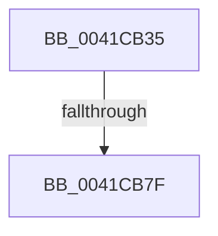

# sub_0041CB35

- RVA: `0x0041CB35`–`0x0041CB87` (길이 `82` bytes)
- VA: `0x000000014041CB35`
- 실행 섹션: `.text`
- PDB 이름 있음: `아니요`; PDB Function 태그: `아니요`
- unwind 정보 RVA: `0x0009ED40`
- 디코드: `18`개 명령, `82/82` bytes 표시
- 미해석 바이트: `0` (있으면 어셈블리에 `.byte`로 보존)

> 이 문서는 커널 이미지의 기계어와 PDB 기호를 분석해 생성했습니다. 4번과 5번은 함수 원형과 자료형을 바이너리 사용 방식에서 추정한 C 해석이며 원본 소스 복구 결과는 아닙니다.

## 1. Dependencies

- 직접 호출 지점: **0**; 고유 호출 대상: **0**
- 직접 호출자로 확인된 함수: **0**
- RIP 상대 이미지 참조: **0**

### Outgoing calls
- 직접 디코드된 call 명령이 없습니다.

### Direct callers
- 이 함수 시작 RVA로 연결되는 직접 call은 확인되지 않았습니다. 간접 호출은 완전히 역산할 수 없습니다.

### Static image references
- 디코드된 RIP-relative 메모리 참조가 없습니다.

## 2. Other-region calls and transfers

- 다른 실행 섹션으로 향하는 call: **0**
- call이 아닌 외부 분기/꼬리 이동: **1**
  - `0x0041CB79` → [sub_0041CCE9](Unknown_function_0041CCE9.md) (`tail-transfer`)

## 3. Assembly (complete function range)

```asm
0041CB35  49 89 6B 18                     mov qword ptr [r11 + 0x18], rbp
0041CB39  49 89 73 20                     mov qword ptr [r11 + 0x20], rsi
0041CB3D  C7 07 00 00 00 00               mov dword ptr [rdi], 0
0041CB43  65 48 8B 04 25 88 01 00 00      mov rax, qword ptr gs:[0x188]
0041CB4C  4D 89 63 F0                     mov qword ptr [r11 - 0x10], r12
0041CB50  4D 8B E0                        mov r12, r8
0041CB53  4D 89 6B E8                     mov qword ptr [r11 - 0x18], r13
0041CB57  4C 8B EA                        mov r13, rdx
0041CB5A  4D 89 7B D8                     mov qword ptr [r11 - 0x28], r15
0041CB5E  4D 8B F9                        mov r15, r9
0041CB61  48 8B B0 B8 00 00 00            mov rsi, qword ptr [rax + 0xb8]
0041CB68  8B 86 B8 04 00 00               mov eax, dword ptr [rsi + 0x4b8]
0041CB6E  48 81 C6 00 04 00 00            add rsi, 0x400
0041CB75  24 0F                           and al, 0xf
0041CB77  3C 06                           cmp al, 6
0041CB79  0F 83 6A 01 00 00               jae 0x14041cce9
0041CB7F  8B 86 B8 00 00 00               mov eax, dword ptr [rsi + 0xb8]
0041CB85  24 0F                           and al, 0xf
```

## 4. C-style interpretation (structured pseudocode)

```c
__int64 __fastcall sub_0041CB35(__int64 a1, __int64 a2, __int64 a3, __int64 a4)
{
    __int64 result;
    __int64 v_rsi;

    *(unsigned __int64 *)(v_r11 + 24) = v_rbp;
    *(unsigned __int64 *)(v_r11 + 32) = v_rsi;
    *(unsigned int *)(v_rdi) = 0;
    *(unsigned __int64 *)(v_r11 - 16) = v_r12;
    *(unsigned __int64 *)(v_r11 - 24) = v_r13;
    *(unsigned __int64 *)(v_r11 - 40) = v_r15;
    v_rsi = (*(unsigned __int64 *)(*(unsigned __int64 *)(gs_base + (0 + 392)) + 184)) + (0x400ULL);
    result = (unsigned __int8)(((unsigned int)(*(unsigned int *)(*(unsigned __int64 *)(*(unsigned __int64 *)(gs_base + (0 + 392)) + 184) + 1208))) & (15));
    result = (unsigned __int8)(((unsigned int)(*(unsigned int *)(v_rsi + 184))) & (15));
    return result;
}
```

## 5. (Beta) C Style

```c
int64_t sub_0041CB35(int64_t Arg1, int64_t Arg2, int64_t Arg3, int64_t Arg4)
{
    int64_t result;
    int64_t local_rsi;

    *(uint64_t *)(local_r11 + 0x18) = local_rbp;
    *(uint64_t *)(local_r11 + 0x20) = local_rsi;
    *(uint32_t *)(local_rdi) = 0;
    *(uint64_t *)(local_r11 - 0x10) = local_r12;
    *(uint64_t *)(local_r11 - 0x18) = local_r13;
    *(uint64_t *)(local_r11 - 0x28) = local_r15;
    local_rsi = (*(uint64_t *)(*(uint64_t *)(gs_base + (0 + 0x188)) + 0xB8)) + (0x400ULL);
    result = (uint8_t)(((uint32_t)(*(uint32_t *)(*(uint64_t *)(*(uint64_t *)(gs_base + (0 + 0x188)) + 0xB8) + 0x4B8))) & (15));
    result = (uint8_t)(((uint32_t)(*(uint32_t *)(local_rsi + 0xB8))) & (15));
    return result;
}
```

## 6. Execution-region graph

[열기: 2D/3D 그래프와 함수 탐색 컨트롤 패널](../../../control-panel.html?section=text&rva=0x0041CB35&view=graph)

- 2D 그래프는 위에서 아래로 흐르고, 3D 그래프는 빈 공간을 드래그해 회전합니다. Shift+드래그는 이동, 휠은 확대·축소, 함수 노드 선택은 대상 보고서 이동입니다.

### Static fallback


