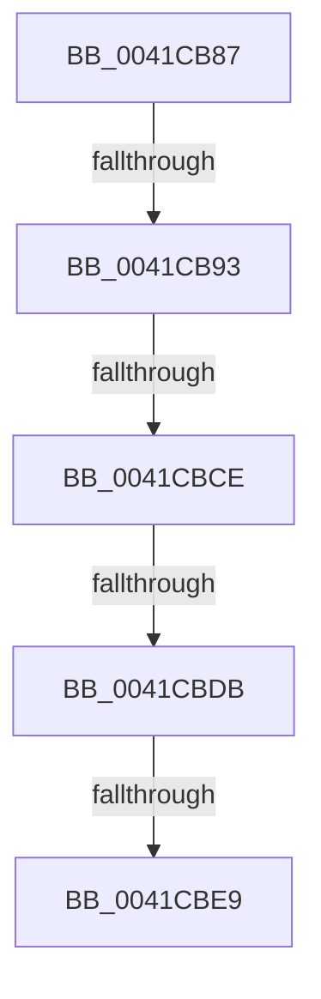

# sub_0041CB87

- RVA: `0x0041CB87`–`0x0041CC0F` (길이 `136` bytes)
- VA: `0x000000014041CB87`
- 실행 섹션: `.text`
- PDB 이름 있음: `아니요`; PDB Function 태그: `아니요`
- unwind 정보 RVA: `0x0009ED64`
- 디코드: `29`개 명령, `136/136` bytes 표시
- 미해석 바이트: `0` (있으면 어셈블리에 `.byte`로 보존)

> 이 문서는 커널 이미지의 기계어와 PDB 기호를 분석해 생성했습니다. 4번과 5번은 함수 원형과 자료형을 바이너리 사용 방식에서 추정한 C 해석이며 원본 소스 복구 결과는 아닙니다.

## 1. Dependencies

- 직접 호출 지점: **1**; 고유 호출 대상: **1**
- 직접 호출자로 확인된 함수: **0**
- RIP 상대 이미지 참조: **4**

### Outgoing calls
- `0x0041CBF0` → [ExpAcquireSpinLockSharedAtDpcLevelInstrumented](../27/ExpAcquireSpinLockSharedAtDpcLevelInstrumented_function_0027CD20.md) (function, `0x0027CD20`)

### Direct callers
- 이 함수 시작 RVA로 연결되는 직접 call은 확인되지 않았습니다. 간접 호출은 완전히 역산할 수 없습니다.

### Static image references
- `0x0041CB93` → RVA `0x00E38840` (`.data`; read)
- `0x0041CBC1` → RVA `0x00FC6D20` (`ALMOSTRO`; read)
- `0x0041CBCE` → RVA `0x00FC6B06` (`ALMOSTRO`; read)
- `0x0041CBDB` → RVA `0x00F0DE58` (`.data`; read)

## 2. Other-region calls and transfers

- 다른 실행 섹션으로 향하는 call: **0**
- call이 아닌 외부 분기/꼬리 이동: **5**
  - `0x0041CB8D` → [sub_0041CD14](Unknown_function_0041CD14.md) (`tail-transfer`)
  - `0x0041CBC8` → [sub_0041CCAA + 0x2E](Unknown_function_0041CCAA.md) (`tail-transfer`)
  - `0x0041CBD5` → [sub_0041CCAA](Unknown_function_0041CCAA.md) (`tail-transfer`)
  - `0x0041CBE3` → [sub_0041CCAA](Unknown_function_0041CCAA.md) (`tail-transfer`)
  - `0x0041CC0D` → [sub_0041CC0F + 0x6](Unknown_function_0041CC0F.md) (`tail-transfer`)

## 3. Assembly (complete function range)

```asm
0041CB87  4D 89 73 E0                     mov qword ptr [r11 - 0x20], r14
0041CB8B  3C 01                           cmp al, 1
0041CB8D  0F 85 81 01 00 00               jne 0x14041cd14
0041CB93  48 8D 05 A6 BC A1 00            lea rax, [rip + 0xa1bca6]
0041CB9A  65 8B 1C 25 A4 01 00 00         mov ebx, dword ptr gs:[0x1a4]
0041CBA2  48 8B 00                        mov rax, qword ptr [rax]
0041CBA5  D1 EB                           shr ebx, 1
0041CBA7  83 E3 03                        and ebx, 3
0041CBAA  44 8B F3                        mov r14d, ebx
0041CBAD  49 C1 E6 06                     shl r14, 6
0041CBB1  4C 03 F0                        add r14, rax
0041CBB4  44 0F 20 C5                     mov rbp, cr8
0041CBB8  B8 02 00 00 00                  mov eax, 2
0041CBBD  44 0F 22 C0                     mov cr8, rax
0041CBC1  83 3D 58 A1 BA 00 00            cmp dword ptr [rip + 0xbaa158], 0
0041CBC8  0F 85 0A 01 00 00               jne 0x14041ccd8
0041CBCE  F6 05 31 9F BA 00 21            test byte ptr [rip + 0xba9f31], 0x21
0041CBD5  0F 84 CF 00 00 00               je 0x14041ccaa
0041CBDB  8B 05 77 12 AF 00               mov eax, dword ptr [rip + 0xaf1277]
0041CBE1  85 C0                           test eax, eax
0041CBE3  0F 85 C1 00 00 00               jne 0x14041ccaa
0041CBE9  40 0F B6 D5                     movzx edx, bpl
0041CBED  49 8B CE                        mov rcx, r14
0041CBF0  E8 2B 01 E6 FF                  call 0x14027cd20
0041CBF5  65 48 8B 04 25 20 00 00 00      mov rax, qword ptr gs:[0x20]
0041CBFE  4C 8B 74 24 28                  mov r14, qword ptr [rsp + 0x28]
0041CC03  48 8B 88 38 88 00 00            mov rcx, qword ptr [rax + 0x8838]
0041CC0A  48 85 C9                        test rcx, rcx
0041CC0D  74 06                           je 0x14041cc15
```

## 4. C-style interpretation (structured pseudocode)

```c
__int64 __fastcall sub_0041CB87(__int64 a1, __int64 a2, __int64 a3, __int64 a4, __int64 a5)
{
    __int64 result;
    __int64 v_r14;
    __int64 v_rbx;

    *(unsigned __int64 *)(v_r11 - 32) = v_r14;
    v_rbx = (unsigned int)(((unsigned int)(*(unsigned int *)(gs_base + (0 + 420)))) >> (1));
    v_rbx = (unsigned int)((v_rbx) & (3));
    v_r14 = ((unsigned int)((unsigned int)(v_rbx))) << (6);
    v_r14 = (v_r14) + (*(unsigned __int64 *)(v_rip + 10599590));
    result = ExpAcquireSpinLockSharedAtDpcLevelInstrumented(v_r14, (unsigned __int8)(v_cr8), a3, a4);
}
```

## 5. (Beta) C Style

```c
int64_t sub_0041CB87(int64_t Arg1, int64_t Arg2, int64_t Arg3, int64_t Arg4, int64_t Arg5)
{
    int64_t result;
    int64_t local_r14;
    int64_t local_rbx;

    *(uint64_t *)(local_r11 - 0x20) = local_r14;
    local_rbx = (uint32_t)(((uint32_t)(*(uint32_t *)(gs_base + (0 + 0x1A4)))) >> (1));
    local_rbx = (uint32_t)((local_rbx) & (3));
    local_r14 = ((uint32_t)((uint32_t)(local_rbx))) << (6);
    local_r14 = (local_r14) + (*(uint64_t *)(v_rip + 0xA1BCA6));
    result = ExpAcquireSpinLockSharedAtDpcLevelInstrumented(local_r14, (uint8_t)(v_cr8), Arg3, Arg4);
}
```

## 6. Execution-region graph

[열기: 2D/3D 그래프와 함수 탐색 컨트롤 패널](../../../control-panel.html?section=text&rva=0x0041CB87&view=graph)

- 2D 그래프는 위에서 아래로 흐르고, 3D 그래프는 빈 공간을 드래그해 회전합니다. Shift+드래그는 이동, 휠은 확대·축소, 함수 노드 선택은 대상 보고서 이동입니다.

### Static fallback


