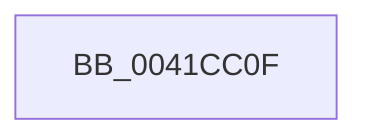

# sub_0041CC0F

- RVA: `0x0041CC0F`–`0x0041CC94` (길이 `133` bytes)
- VA: `0x000000014041CC0F`
- 실행 섹션: `.text`
- PDB 이름 있음: `아니요`; PDB Function 태그: `아니요`
- unwind 정보 RVA: `0x0009ED78`
- 디코드: `29`개 명령, `133/133` bytes 표시
- 미해석 바이트: `0` (있으면 어셈블리에 `.byte`로 보존)

> 이 문서는 커널 이미지의 기계어와 PDB 기호를 분석해 생성했습니다. 4번과 5번은 함수 원형과 자료형을 바이너리 사용 방식에서 추정한 C 해석이며 원본 소스 복구 결과는 아닙니다.

## 1. Dependencies

- 직접 호출 지점: **1**; 고유 호출 대상: **1**
- 직접 호출자로 확인된 함수: **0**
- RIP 상대 이미지 참조: **0**

### Outgoing calls
- `0x0041CC6E` → [MiUnlockWorkingSetShared](../27/MiUnlockWorkingSetShared_function_0027D690.md) (function, `0x0027D690`)

### Direct callers
- 이 함수 시작 RVA로 연결되는 직접 call은 확인되지 않았습니다. 간접 호출은 완전히 역산할 수 없습니다.

### Static image references
- 디코드된 RIP-relative 메모리 참조가 없습니다.

## 2. Other-region calls and transfers

- 다른 실행 섹션으로 향하는 call: **0**
- call이 아닌 외부 분기/꼬리 이동: **1**
  - `0x0041CC8E` → [sub_0041CD20](Unknown_function_0041CD20.md) (`tail-transfer`)

## 3. Assembly (complete function range)

```asm
0041CC0F  89 99 44 01 00 00               mov dword ptr [rcx + 0x144], ebx
0041CC15  8B 9E B8 00 00 00               mov ebx, dword ptr [rsi + 0xb8]
0041CC1B  40 0F B6 D5                     movzx edx, bpl
0041CC1F  48 8B 86 A0 00 00 00            mov rax, qword ptr [rsi + 0xa0]
0041CC26  48 8B 4C 24 50                  mov rcx, qword ptr [rsp + 0x50]
0041CC2B  48 C1 E0 0C                     shl rax, 0xc
0041CC2F  48 89 01                        mov qword ptr [rcx], rax
0041CC32  48 8B CE                        mov rcx, rsi
0041CC35  48 8B 86 80 00 00 00            mov rax, qword ptr [rsi + 0x80]
0041CC3C  48 C1 E0 0C                     shl rax, 0xc
0041CC40  49 89 45 00                     mov qword ptr [r13], rax
0041CC44  48 8B 86 88 00 00 00            mov rax, qword ptr [rsi + 0x88]
0041CC4B  48 C1 E0 0C                     shl rax, 0xc
0041CC4F  49 89 04 24                     mov qword ptr [r12], rax
0041CC53  48 8B 46 70                     mov rax, qword ptr [rsi + 0x70]
0041CC57  48 C1 E0 0C                     shl rax, 0xc
0041CC5B  49 89 07                        mov qword ptr [r15], rax
0041CC5E  4C 8B 46 78                     mov r8, qword ptr [rsi + 0x78]
0041CC62  48 8B 44 24 70                  mov rax, qword ptr [rsp + 0x70]
0041CC67  49 C1 E0 0C                     shl r8, 0xc
0041CC6B  4C 89 00                        mov qword ptr [rax], r8
0041CC6E  E8 1D 0A E6 FF                  call 0x14027d690
0041CC73  4C 8B 7C 24 20                  mov r15, qword ptr [rsp + 0x20]
0041CC78  4C 8B 6C 24 30                  mov r13, qword ptr [rsp + 0x30]
0041CC7D  4C 8B 64 24 38                  mov r12, qword ptr [rsp + 0x38]
0041CC82  48 8B 74 24 68                  mov rsi, qword ptr [rsp + 0x68]
0041CC87  48 8B 6C 24 60                  mov rbp, qword ptr [rsp + 0x60]
0041CC8C  84 DB                           test bl, bl
0041CC8E  0F 88 8C 00 00 00               js 0x14041cd20
```

## 4. C-style interpretation (structured pseudocode)

```c
__int64 __fastcall sub_0041CC0F(__int64 a1, __int64 a2, __int64 a3, __int64 a4, __int64 a5, __int64 a6, __int64 a7, __int64 a8, __int64 a9, __int64 a10, __int64 a11, __int64 a12, __int64 a13, __int64 a14)
{
    __int64 result;
    unsigned __int64 v_stack_p20;

    *(unsigned int *)(a1 + 324) = (unsigned int)(v_rbx);
    result = (*(unsigned __int64 *)(v_rsi + 160)) << (12);
    *(unsigned __int64 *)(a10) = result;
    result = (*(unsigned __int64 *)(v_rsi + 128)) << (12);
    *(unsigned __int64 *)(v_r13) = result;
    result = (*(unsigned __int64 *)(v_rsi + 136)) << (12);
    *(unsigned __int64 *)(v_r12) = result;
    result = (*(unsigned __int64 *)(v_rsi + 112)) << (12);
    *(unsigned __int64 *)(v_r15) = result;
    a3 = (*(unsigned __int64 *)(v_rsi + 120)) << (12);
    *(unsigned __int64 *)(a14) = a3;
    result = MiUnlockWorkingSetShared(v_rsi, (unsigned __int8)(v_rbp), a3, a4);
}
```

## 5. (Beta) C Style

```c
int64_t sub_0041CC0F(void *Arg1, int64_t Arg2, int64_t Arg3, int64_t Arg4, uint64_t Arg5, int64_t Arg6, int64_t Arg7, uint64_t Arg8, uint64_t Arg9, void *Arg10, uint64_t Arg11, int64_t Arg12, int64_t Arg13, void *Arg14)
{
    uint8_t *arg1 = (uint8_t *)Arg1;
    uint8_t *arg10 = (uint8_t *)Arg10;
    uint8_t *arg14 = (uint8_t *)Arg14;

    int64_t result;
    uint64_t v_stack_p20;

    *(uint32_t *)(arg1 + 0x144) = (uint32_t)(local_rbx);
    result = (*(uint64_t *)(local_rsi + 0xA0)) << (12);
    *(uint64_t *)(arg10) = result;
    result = (*(uint64_t *)(local_rsi + 0x80)) << (12);
    *(uint64_t *)(local_r13) = result;
    result = (*(uint64_t *)(local_rsi + 0x88)) << (12);
    *(uint64_t *)(local_r12) = result;
    result = (*(uint64_t *)(local_rsi + 0x70)) << (12);
    *(uint64_t *)(local_r15) = result;
    Arg3 = (*(uint64_t *)(local_rsi + 0x78)) << (12);
    *(uint64_t *)(arg14) = Arg3;
    result = MiUnlockWorkingSetShared(local_rsi, (uint8_t)(local_rbp), Arg3, Arg4);
}
```

### 관측된 메모리 오프셋

구조체 형식이 확인되지 않은 접근은 인자 기준의 오프셋으로만 기록했습니다.

| 기준 인자 | 오프셋 표현 | 폭 (bit) | 접근 |
|---|---:|---:|---|
| `Arg1` | `+ 0x144` | `32` | `W` |
| `Arg10` | `+ 0x0` | `64` | `W` |
| `Arg14` | `+ 0x0` | `64` | `W` |

## 6. Execution-region graph

[열기: 2D/3D 그래프와 함수 탐색 컨트롤 패널](../../../control-panel.html?section=text&rva=0x0041CC0F&view=graph)

- 2D 그래프는 위에서 아래로 흐르고, 3D 그래프는 빈 공간을 드래그해 회전합니다. Shift+드래그는 이동, 휠은 확대·축소, 함수 노드 선택은 대상 보고서 이동입니다.

### Static fallback


