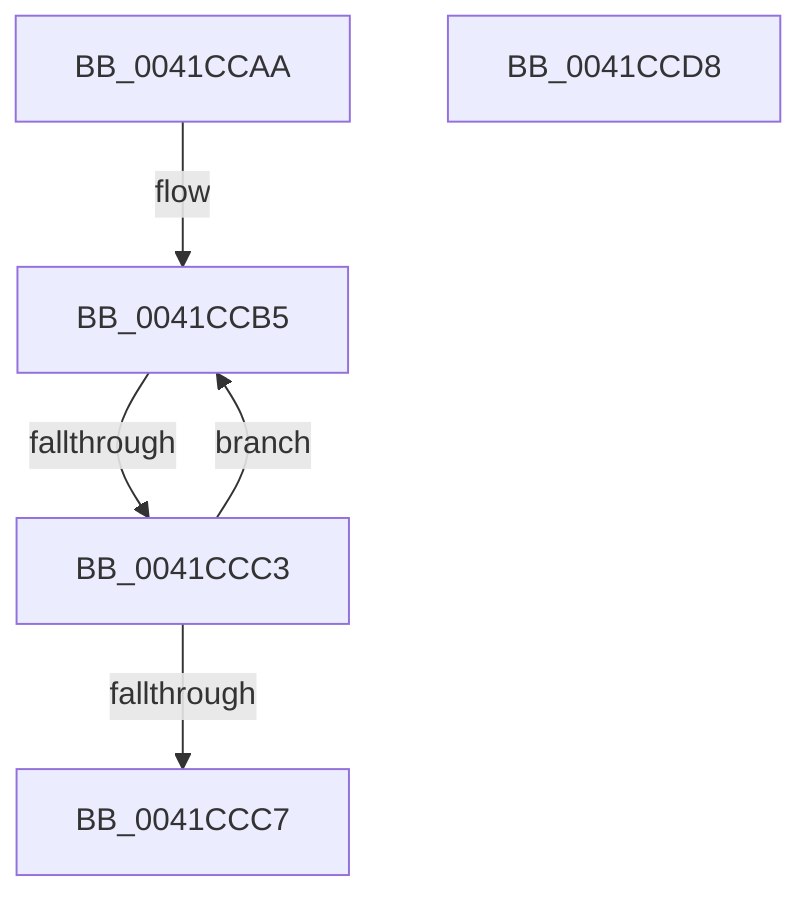

# sub_0041CCAA

- RVA: `0x0041CCAA`–`0x0041CCE9` (길이 `63` bytes)
- VA: `0x000000014041CCAA`
- 실행 섹션: `.text`
- PDB 이름 있음: `아니요`; PDB Function 태그: `아니요`
- unwind 정보 RVA: `0x0009EDAC`
- 디코드: `16`개 명령, `63/63` bytes 표시
- 미해석 바이트: `0` (있으면 어셈블리에 `.byte`로 보존)

> 이 문서는 커널 이미지의 기계어와 PDB 기호를 분석해 생성했습니다. 4번과 5번은 함수 원형과 자료형을 바이너리 사용 방식에서 추정한 C 해석이며 원본 소스 복구 결과는 아닙니다.

## 1. Dependencies

- 직접 호출 지점: **2**; 고유 호출 대상: **2**
- 직접 호출자로 확인된 함수: **0**
- RIP 상대 이미지 참조: **0**

### Outgoing calls
- `0x0041CCCE` → [ExpWaitForSpinLockSharedAndAcquire](../36/ExpWaitForSpinLockSharedAndAcquire_function_00362380.md) (function, `0x00362380`)
- `0x0041CCDF` → [KiRaiseIrqlProcessIrqlFlags](../4F/KiRaiseIrqlProcessIrqlFlags_function_004F56FC.md) (function, `0x004F56FC`)

### Direct callers
- 이 함수 시작 RVA로 연결되는 직접 call은 확인되지 않았습니다. 간접 호출은 완전히 역산할 수 없습니다.

### Static image references
- 디코드된 RIP-relative 메모리 참조가 없습니다.

## 2. Other-region calls and transfers

- 다른 실행 섹션으로 향하는 call: **0**
- call이 아닌 외부 분기/꼬리 이동: **3**
  - `0x0041CCBD` → [sub_0041CB87 + 0x6E](Unknown_function_0041CB87.md) (`tail-transfer`)
  - `0x0041CCD3` → [sub_0041CB87 + 0x6E](Unknown_function_0041CB87.md) (`tail-transfer`)
  - `0x0041CCE4` → [sub_0041CB87 + 0x47](Unknown_function_0041CB87.md) (`tail-transfer`)

## 3. Assembly (complete function range)

```asm
0041CCAA  41 0F 0D 0E                     prefetchw byte ptr [r14]
0041CCAE  41 8B 06                        mov eax, dword ptr [r14]
0041CCB1  0F BA F0 1F                     btr eax, 0x1f
0041CCB5  8D 48 01                        lea ecx, [rax + 1]
0041CCB8  F0 41 0F B1 0E                  lock cmpxchg dword ptr [r14], ecx
0041CCBD  0F 84 32 FF FF FF               je 0x14041cbf5
0041CCC3  85 C0                           test eax, eax
0041CCC5  79 EE                           jns 0x14041ccb5
0041CCC7  40 0F B6 D5                     movzx edx, bpl
0041CCCB  49 8B CE                        mov rcx, r14
0041CCCE  E8 AD 56 F4 FF                  call 0x140362380
0041CCD3  E9 1D FF FF FF                  jmp 0x14041cbf5
0041CCD8  0F B6 D0                        movzx edx, al
0041CCDB  40 0F B6 CD                     movzx ecx, bpl
0041CCDF  E8 18 8A 0D 00                  call 0x1404f56fc
0041CCE4  E9 E5 FE FF FF                  jmp 0x14041cbce
```

## 4. C-style interpretation (structured pseudocode)

```c
__int64 __fastcall sub_0041CCAA(void)
{
    __int64 result;

loc_0041CCB5:
    if (!sign_flag) goto loc_0041CCB5;
    result = ExpWaitForSpinLockSharedAndAcquire(v_r14, (unsigned __int8)(v_rbp), a3, a4);
}
```

## 5. (Beta) C Style

```c
void sub_0041CCAA(void)
{
    int64_t result;

loc_0041CCB5:
    if (!sign_flag) goto loc_0041CCB5;
    result = ExpWaitForSpinLockSharedAndAcquire(local_r14, (uint8_t)(local_rbp), a3, a4);
}
```

## 6. Execution-region graph

[열기: 2D/3D 그래프와 함수 탐색 컨트롤 패널](../../../control-panel.html?section=text&rva=0x0041CCAA&view=graph)

- 2D 그래프는 위에서 아래로 흐르고, 3D 그래프는 빈 공간을 드래그해 회전합니다. Shift+드래그는 이동, 휠은 확대·축소, 함수 노드 선택은 대상 보고서 이동입니다.

### Static fallback


