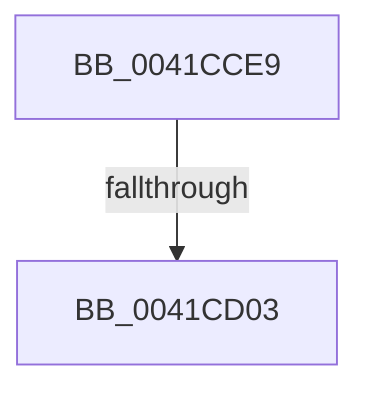

# sub_0041CCE9

- RVA: `0x0041CCE9`–`0x0041CD14` (길이 `43` bytes)
- VA: `0x000000014041CCE9`
- 실행 섹션: `.text`
- PDB 이름 있음: `아니요`; PDB Function 태그: `아니요`
- unwind 정보 RVA: `0x0009EDD8`
- 디코드: `9`개 명령, `43/43` bytes 표시
- 미해석 바이트: `0` (있으면 어셈블리에 `.byte`로 보존)

> 이 문서는 커널 이미지의 기계어와 PDB 기호를 분석해 생성했습니다. 4번과 5번은 함수 원형과 자료형을 바이너리 사용 방식에서 추정한 C 해석이며 원본 소스 복구 결과는 아닙니다.

## 1. Dependencies

- 직접 호출 지점: **1**; 고유 호출 대상: **1**
- 직접 호출자로 확인된 함수: **0**
- RIP 상대 이미지 참조: **1**

### Outgoing calls
- `0x0041CD0A` → [KiRaiseIrqlProcessIrqlFlags](../4F/KiRaiseIrqlProcessIrqlFlags_function_004F56FC.md) (function, `0x004F56FC`)

### Direct callers
- 이 함수 시작 RVA로 연결되는 직접 call은 확인되지 않았습니다. 간접 호출은 완전히 역산할 수 없습니다.

### Static image references
- `0x0041CCF6` → RVA `0x00FC6D20` (`ALMOSTRO`; read)

## 2. Other-region calls and transfers

- 다른 실행 섹션으로 향하는 call: **0**
- call이 아닌 외부 분기/꼬리 이동: **2**
  - `0x0041CCFD` → [sub_0041CC0F + 0x6](Unknown_function_0041CC0F.md) (`tail-transfer`)
  - `0x0041CD0F` → [sub_0041CC0F + 0x6](Unknown_function_0041CC0F.md) (`tail-transfer`)

## 3. Assembly (complete function range)

```asm
0041CCE9  44 0F 20 C5                     mov rbp, cr8
0041CCED  B8 02 00 00 00                  mov eax, 2
0041CCF2  44 0F 22 C0                     mov cr8, rax
0041CCF6  83 3D 23 A0 BA 00 00            cmp dword ptr [rip + 0xbaa023], 0
0041CCFD  0F 84 12 FF FF FF               je 0x14041cc15
0041CD03  0F B6 D0                        movzx edx, al
0041CD06  40 0F B6 CD                     movzx ecx, bpl
0041CD0A  E8 ED 89 0D 00                  call 0x1404f56fc
0041CD0F  E9 01 FF FF FF                  jmp 0x14041cc15
```

## 4. C-style interpretation (structured pseudocode)

```c
__int64 __fastcall sub_0041CCE9(void)
{
    __int64 result;

    result = KiRaiseIrqlProcessIrqlFlags((unsigned __int8)(v_cr8), 2, a3, a4);
}
```

## 5. (Beta) C Style

```c
void sub_0041CCE9(void)
{
    int64_t result;

    result = KiRaiseIrqlProcessIrqlFlags((uint8_t)(v_cr8), 2, a3, a4);
}
```

## 6. Execution-region graph

[열기: 2D/3D 그래프와 함수 탐색 컨트롤 패널](../../../control-panel.html?section=text&rva=0x0041CCE9&view=graph)

- 2D 그래프는 위에서 아래로 흐르고, 3D 그래프는 빈 공간을 드래그해 회전합니다. Shift+드래그는 이동, 휠은 확대·축소, 함수 노드 선택은 대상 보고서 이동입니다.

### Static fallback


