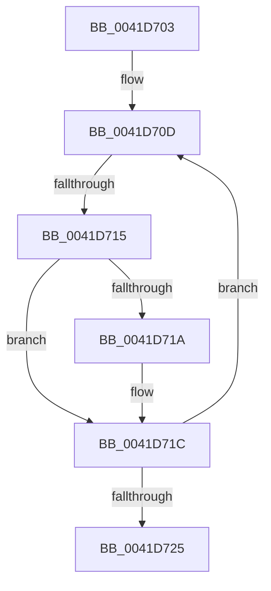

# sub_0041D703

- RVA: `0x0041D703`–`0x0041D72A` (길이 `39` bytes)
- VA: `0x000000014041D703`
- 실행 섹션: `.text`
- PDB 이름 있음: `아니요`; PDB Function 태그: `아니요`
- unwind 정보 RVA: `0x0009EEF4`
- 디코드: `12`개 명령, `39/39` bytes 표시
- 미해석 바이트: `0` (있으면 어셈블리에 `.byte`로 보존)

> 이 문서는 커널 이미지의 기계어와 PDB 기호를 분석해 생성했습니다. 4번과 5번은 함수 원형과 자료형을 바이너리 사용 방식에서 추정한 C 해석이며 원본 소스 복구 결과는 아닙니다.

## 1. Dependencies

- 직접 호출 지점: **0**; 고유 호출 대상: **0**
- 직접 호출자로 확인된 함수: **0**
- RIP 상대 이미지 참조: **0**

### Outgoing calls
- 직접 디코드된 call 명령이 없습니다.

### Direct callers
- 이 함수 시작 RVA로 연결되는 직접 call은 확인되지 않았습니다. 간접 호출은 완전히 역산할 수 없습니다.

### Static image references
- 디코드된 RIP-relative 메모리 참조가 없습니다.

## 2. Other-region calls and transfers

- 다른 실행 섹션으로 향하는 call: **0**
- call이 아닌 외부 분기/꼬리 이동: **1**
  - `0x0041D713` → [sub_0041D762](Unknown_function_0041D762.md) (`tail-transfer`)

## 3. Assembly (complete function range)

```asm
0041D703  48 89 7C 24 10                  mov qword ptr [rsp + 0x10], rdi
0041D708  BF FF 07 00 00                  mov edi, 0x7ff
0041D70D  0F B7 10                        movzx edx, word ptr [rax]
0041D710  66 85 D7                        test di, dx
0041D713  74 4D                           je 0x14041d762
0041D715  66 85 D2                        test dx, dx
0041D718  79 02                           jns 0x14041d71c
0041D71A  FF C1                           inc ecx
0041D71C  48 83 C0 02                     add rax, 2
0041D720  49 3B C2                        cmp rax, r10
0041D723  76 E8                           jbe 0x14041d70d
0041D725  48 8B 7C 24 10                  mov rdi, qword ptr [rsp + 0x10]
```

## 4. C-style interpretation (structured pseudocode)

```c
__int64 __fastcall sub_0041D703(int a1)
{
    __int64 result;
    unsigned __int64 v_stack_p10;

    v_stack_p10 = v_rdi;
loc_0041D70D:
    if (sign_flag) {
        a1 = (unsigned int)((a1) + 1);
    }
    result = (result) + (2);
    if (result <= v_r10) goto loc_0041D70D;
    return result;
}
```

## 5. (Beta) C Style

```c
int64_t sub_0041D703(int32_t Arg1)
{
    int64_t result;
    uint64_t v_stack_p10;

    v_stack_p10 = local_rdi;
loc_0041D70D:
    if (sign_flag) {
        Arg1 = (uint32_t)((Arg1) + 1);
    }
    result = (result) + (2);
    if (result <= local_r10) goto loc_0041D70D;
    return result;
}
```

## 6. Execution-region graph

[열기: 2D/3D 그래프와 함수 탐색 컨트롤 패널](../../../control-panel.html?section=text&rva=0x0041D703&view=graph)

- 2D 그래프는 위에서 아래로 흐르고, 3D 그래프는 빈 공간을 드래그해 회전합니다. Shift+드래그는 이동, 휠은 확대·축소, 함수 노드 선택은 대상 보고서 이동입니다.

### Static fallback


