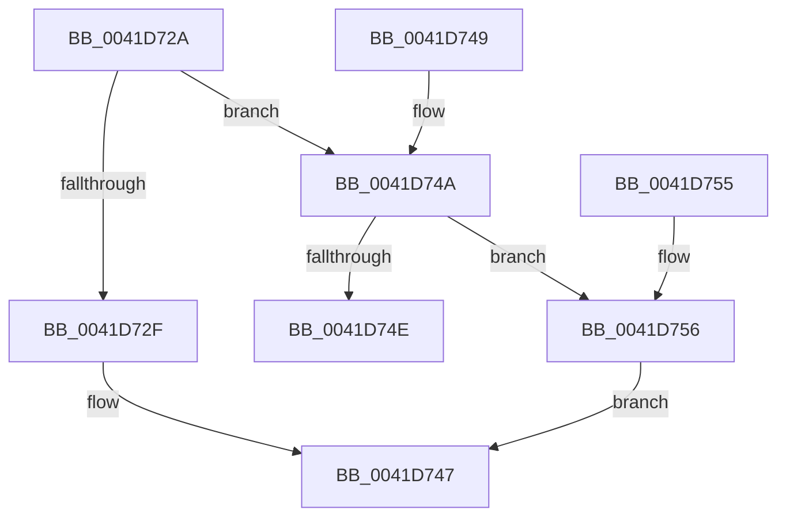

# sub_0041D72A

- RVA: `0x0041D72A`–`0x0041D762` (길이 `56` bytes)
- VA: `0x000000014041D72A`
- 실행 섹션: `.text`
- PDB 이름 있음: `아니요`; PDB Function 태그: `아니요`
- unwind 정보 RVA: `0x0009EF08`
- 디코드: `21`개 명령, `56/56` bytes 표시
- 미해석 바이트: `0` (있으면 어셈블리에 `.byte`로 보존)

> 이 문서는 커널 이미지의 기계어와 PDB 기호를 분석해 생성했습니다. 4번과 5번은 함수 원형과 자료형을 바이너리 사용 방식에서 추정한 C 해석이며 원본 소스 복구 결과는 아닙니다.

## 1. Dependencies

- 직접 호출 지점: **0**; 고유 호출 대상: **0**
- 직접 호출자로 확인된 함수: **0**
- RIP 상대 이미지 참조: **0**

### Outgoing calls
- 직접 디코드된 call 명령이 없습니다.

### Direct callers
- 이 함수 시작 RVA로 연결되는 직접 call은 확인되지 않았습니다. 간접 호출은 완전히 역산할 수 없습니다.

### Static image references
- 디코드된 RIP-relative 메모리 참조가 없습니다.

## 2. Other-region calls and transfers

- 다른 실행 섹션으로 향하는 call: **0**
- 별도 외부 분기/꼬리 이동을 확인하지 못했습니다.

## 3. Assembly (complete function range)

```asm
0041D72A  41 3B C8                        cmp ecx, r8d
0041D72D  75 1B                           jne 0x14041d74a
0041D72F  41 8B C0                        mov eax, r8d
0041D732  49 8D 8B FF FF 1F 00            lea rcx, [r11 + 0x1fffff]
0041D739  48 C1 E9 15                     shr rcx, 0x15
0041D73D  48 3B C1                        cmp rax, rcx
0041D740  41 0F 97 C1                     seta r9b
0041D744  41 8B C1                        mov eax, r9d
0041D747  5B                              pop rbx
0041D748  C3                              ret
0041D749  CC                              int3
0041D74A  85 C9                           test ecx, ecx
0041D74C  74 08                           je 0x14041d756
0041D74E  B8 02 00 00 00                  mov eax, 2
0041D753  5B                              pop rbx
0041D754  C3                              ret
0041D755  CC                              int3
0041D756  85 DB                           test ebx, ebx
0041D758  41 0F 94 C1                     sete r9b
0041D75C  41 8D 41 03                     lea eax, [r9 + 3]
0041D760  EB E5                           jmp 0x14041d747
```

## 4. C-style interpretation (structured pseudocode)

```c
__int64 __fastcall sub_0041D72A(int a1, __int64 a2, int a3)
{
    if (a1 != a3) goto loc_0041D74A;
    a1 = (v_r11 + 2097151) >> (21);
    a4 = (((unsigned int)(a3)) > a1) ? 1 : 0;
loc_0041D747:
    return (unsigned int)((unsigned int)(a4));
loc_0041D74A:
    if (a1 == 0) goto loc_0041D756;
    return 2;
loc_0041D756:
    a4 = ((unsigned int)(v_rbx) == 0) ? 1 : 0;
    goto loc_0041D747;
}
```

## 5. (Beta) C Style

```c
int64_t sub_0041D72A(int32_t Arg1, int64_t Arg2, int32_t Arg3)
{
    if (Arg1 != Arg3) goto loc_0041D74A;
    Arg1 = (local_r11 + 2097151) >> (21);
    a4 = (((uint32_t)(Arg3)) > Arg1) ? 1 : 0;
loc_0041D747:
    return (uint32_t)((uint32_t)(a4));
loc_0041D74A:
    if (Arg1 == 0) goto loc_0041D756;
    return 2;
loc_0041D756:
    a4 = ((uint32_t)(local_rbx) == 0) ? 1 : 0;
    goto loc_0041D747;
}
```

## 6. Execution-region graph

[열기: 2D/3D 그래프와 함수 탐색 컨트롤 패널](../../../control-panel.html?section=text&rva=0x0041D72A&view=graph)

- 2D 그래프는 위에서 아래로 흐르고, 3D 그래프는 빈 공간을 드래그해 회전합니다. Shift+드래그는 이동, 휠은 확대·축소, 함수 노드 선택은 대상 보고서 이동입니다.

### Static fallback


