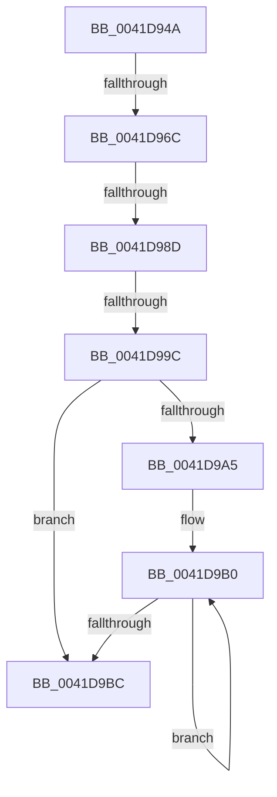

# sub_0041D94A

- RVA: `0x0041D94A`–`0x0041D9E2` (길이 `152` bytes)
- VA: `0x000000014041D94A`
- 실행 섹션: `.text`
- PDB 이름 있음: `아니요`; PDB Function 태그: `아니요`
- unwind 정보 RVA: `0x0009F0A0`
- 디코드: `31`개 명령, `152/152` bytes 표시
- 미해석 바이트: `0` (있으면 어셈블리에 `.byte`로 보존)

> 이 문서는 커널 이미지의 기계어와 PDB 기호를 분석해 생성했습니다. 4번과 5번은 함수 원형과 자료형을 바이너리 사용 방식에서 추정한 C 해석이며 원본 소스 복구 결과는 아닙니다.

## 1. Dependencies

- 직접 호출 지점: **1**; 고유 호출 대상: **1**
- 직접 호출자로 확인된 함수: **0**
- RIP 상대 이미지 참조: **2**

### Outgoing calls
- `0x0041D9C4` → [ObfReferenceObjectWithTag](../21/ObfReferenceObjectWithTag_function_00210710.md) (function, `0x00210710`)

### Direct callers
- 이 함수 시작 RVA로 연결되는 직접 call은 확인되지 않았습니다. 간접 호출은 완전히 역산할 수 없습니다.

### Static image references
- `0x0041D95F` → RVA `0x00FC6D20` (`ALMOSTRO`; read)
- `0x0041D980` → RVA `0x00FC6B06` (`ALMOSTRO`; read)

## 2. Other-region calls and transfers

- 다른 실행 섹션으로 향하는 call: **0**
- call이 아닌 외부 분기/꼬리 이동: **4**
  - `0x0041D966` → [sub_0041DA61 + 0x35](Unknown_function_0041DA61.md) (`tail-transfer`)
  - `0x0041D987` → [sub_0041DA61 + 0x1D](Unknown_function_0041DA61.md) (`tail-transfer`)
  - `0x0041D996` → [sub_0041DA61 + 0x46](Unknown_function_0041DA61.md) (`tail-transfer`)
  - `0x0041D9E0` → [sub_0041DA61](Unknown_function_0041DA61.md) (`tail-transfer`)

## 3. Assembly (complete function range)

```asm
0041D94A  48 89 7C 24 38                  mov qword ptr [rsp + 0x38], rdi
0041D94F  48 8B D9                        mov rbx, rcx
0041D952  44 0F 20 C6                     mov rsi, cr8
0041D956  B8 02 00 00 00                  mov eax, 2
0041D95B  44 0F 22 C0                     mov cr8, rax
0041D95F  83 3D BA 93 BA 00 00            cmp dword ptr [rip + 0xba93ba], 0
0041D966  0F 85 2A 01 00 00               jne 0x14041da96
0041D96C  65 48 8B 0C 25 28 00 00 00      mov rcx, qword ptr gs:[0x28]
0041D975  48 81 C1 A0 00 00 00            add rcx, 0xa0
0041D97C  48 8B 51 08                     mov rdx, qword ptr [rcx + 8]
0041D980  F6 05 7F 91 BA 00 21            test byte ptr [rip + 0xba917f], 0x21
0041D987  0F 85 F1 00 00 00               jne 0x14041da7e
0041D98D  48 8B C1                        mov rax, rcx
0041D990  48 87 02                        xchg qword ptr [rdx], rax
0041D993  48 85 C0                        test rax, rax
0041D996  0F 85 0B 01 00 00               jne 0x14041daa7
0041D99C  48 8B 43 18                     mov rax, qword ptr [rbx + 0x18]
0041D9A0  48 85 C0                        test rax, rax
0041D9A3  74 17                           je 0x14041d9bc
0041D9A5  66 66 66 0F 1F 84 00 00 00 00 00  nop word ptr [rax + rax]
0041D9B0  48 8B D8                        mov rbx, rax
0041D9B3  48 8B 40 18                     mov rax, qword ptr [rax + 0x18]
0041D9B7  48 85 C0                        test rax, rax
0041D9BA  75 F4                           jne 0x14041d9b0
0041D9BC  BA 44 66 6C 74                  mov edx, 0x746c6644
0041D9C1  48 8B CB                        mov rcx, rbx
0041D9C4  E8 47 2D DF FF                  call 0x140210710
0041D9C9  65 48 8B 3C 25 28 00 00 00      mov rdi, qword ptr gs:[0x28]
0041D9D2  48 81 C7 A0 00 00 00            add rdi, 0xa0
0041D9D9  F6 05 26 91 BA 00 01            test byte ptr [rip + 0xba9126], 1
0041D9E0  75 7F                           jne 0x14041da61
```

## 4. C-style interpretation (structured pseudocode)

```c
__int64 __fastcall sub_0041D94A(__int64 a1)
{
    __int64 result;
    __int64 v_rdi;
    unsigned __int64 v_stack_p38;

    v_stack_p38 = v_rdi;
    a1 = (*(unsigned __int64 *)(gs_base + (0 + 40))) + (160);
    if (*(unsigned __int64 *)(a1 + 24) == 0) goto loc_0041D9BC;
loc_0041D9B0:
    if (*(unsigned __int64 *)(*(unsigned __int64 *)(a1 + 24) + 24) != 0) goto loc_0041D9B0;
loc_0041D9BC:
    result = ObfReferenceObjectWithTag(*(unsigned __int64 *)(a1 + 24), (unsigned int)(0x746C6644ULL), a3, a4);
    v_rdi = (*(unsigned __int64 *)(gs_base + (0 + 40))) + (160);
}
```

## 5. (Beta) C Style

```c
int64_t sub_0041D94A(void *Arg1)
{
    uint8_t *arg1 = (uint8_t *)Arg1;

    int64_t result;
    int64_t local_rdi;
    uint64_t v_stack_p38;

    v_stack_p38 = local_rdi;
    Arg1 = (*(uint64_t *)(gs_base + (0 + 0x28))) + (160);
    if (*(uint64_t *)(arg1 + 0x18) == 0) goto loc_0041D9BC;
loc_0041D9B0:
    if (*(uint64_t *)(*(uint64_t *)(arg1 + 0x18) + 0x18) != 0) goto loc_0041D9B0;
loc_0041D9BC:
    result = ObfReferenceObjectWithTag(*(uint64_t *)(arg1 + 0x18), (uint32_t)(0x746C6644ULL), a3, a4);
    local_rdi = (*(uint64_t *)(gs_base + (0 + 0x28))) + (160);
}
```

### 관측된 메모리 오프셋

구조체 형식이 확인되지 않은 접근은 인자 기준의 오프셋으로만 기록했습니다.

| 기준 인자 | 오프셋 표현 | 폭 (bit) | 접근 |
|---|---:|---:|---|
| `Arg1` | `+ 0x18` | `64` | `R` |

## 6. Execution-region graph

[열기: 2D/3D 그래프와 함수 탐색 컨트롤 패널](../../../control-panel.html?section=text&rva=0x0041D94A&view=graph)

- 2D 그래프는 위에서 아래로 흐르고, 3D 그래프는 빈 공간을 드래그해 회전합니다. Shift+드래그는 이동, 휠은 확대·축소, 함수 노드 선택은 대상 보고서 이동입니다.

### Static fallback


