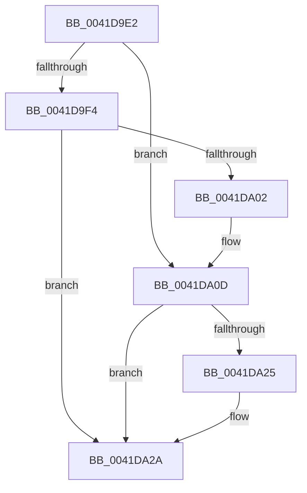

# sub_0041D9E2

- RVA: `0x0041D9E2`–`0x0041DA2F` (길이 `77` bytes)
- VA: `0x000000014041D9E2`
- 실행 섹션: `.text`
- PDB 이름 있음: `아니요`; PDB Function 태그: `아니요`
- unwind 정보 RVA: `0x0009F0B4`
- 디코드: `23`개 명령, `77/77` bytes 표시
- 미해석 바이트: `0` (있으면 어셈블리에 `.byte`로 보존)

> 이 문서는 커널 이미지의 기계어와 PDB 기호를 분석해 생성했습니다. 4번과 5번은 함수 원형과 자료형을 바이너리 사용 방식에서 추정한 C 해석이며 원본 소스 복구 결과는 아닙니다.

## 1. Dependencies

- 직접 호출 지점: **2**; 고유 호출 대상: **2**
- 직접 호출자로 확인된 함수: **0**
- RIP 상대 이미지 참조: **0**

### Outgoing calls
- `0x0041DA05` → [KxWaitForLockChainValid](../21/KxWaitForLockChainValid_function_00217AA0.md) (function, `0x00217AA0`)
- `0x0041DA25` → [KeWakeAddressAll](../21/KeWakeAddressAll_function_00217C20.md) (function, `0x00217C20`)

### Direct callers
- 이 함수 시작 RVA로 연결되는 직접 call은 확인되지 않았습니다. 간접 호출은 완전히 역산할 수 없습니다.

### Static image references
- 디코드된 RIP-relative 메모리 참조가 없습니다.

## 2. Other-region calls and transfers

- 다른 실행 섹션으로 향하는 call: **0**
- 별도 외부 분기/꼬리 이동을 확인하지 못했습니다.

## 3. Assembly (complete function range)

```asm
0041D9E2  48 89 6C 24 30                  mov qword ptr [rsp + 0x30], rbp
0041D9E7  0F 0D 0F                        prefetchw byte ptr [rdi]
0041D9EA  48 8B 0F                        mov rcx, qword ptr [rdi]
0041D9ED  33 ED                           xor ebp, ebp
0041D9EF  48 85 C9                        test rcx, rcx
0041D9F2  75 19                           jne 0x14041da0d
0041D9F4  48 8B 4F 08                     mov rcx, qword ptr [rdi + 8]
0041D9F8  48 8B C7                        mov rax, rdi
0041D9FB  F0 48 0F B1 29                  lock cmpxchg qword ptr [rcx], rbp
0041DA00  74 28                           je 0x14041da2a
0041DA02  48 8B CF                        mov rcx, rdi
0041DA05  E8 96 A0 DF FF                  call 0x140217aa0
0041DA0A  48 8B C8                        mov rcx, rax
0041DA0D  48 89 2F                        mov qword ptr [rdi], rbp
0041DA10  48 83 C1 08                     add rcx, 8
0041DA14  48 8B 47 08                     mov rax, qword ptr [rdi + 8]
0041DA18  48 8B D0                        mov rdx, rax
0041DA1B  48 87 11                        xchg qword ptr [rcx], rdx
0041DA1E  32 D0                           xor dl, al
0041DA20  F6 C2 04                        test dl, 4
0041DA23  74 05                           je 0x14041da2a
0041DA25  E8 F6 A1 DF FF                  call 0x140217c20
0041DA2A  48 8B 6C 24 30                  mov rbp, qword ptr [rsp + 0x30]
```

## 4. C-style interpretation (structured pseudocode)

```c
__int64 __fastcall sub_0041D9E2(__int64 a1, __int64 a2, __int64 a3, __int64 a4, __int64 a5, __int64 a6)
{
    __int64 result;
    __int64 v_rbp;
    unsigned __int64 v_stack_p30;

    v_stack_p30 = v_rbp;
    v_rbp = 0;
    if (*(unsigned __int64 *)(v_rdi) != 0) goto loc_0041DA0D;
    if (*(unsigned __int64 *)(v_rdi) == 0) goto loc_0041DA2A;
    result = KxWaitForLockChainValid(v_rdi, a2, a3, a4);
loc_0041DA0D:
    *(unsigned __int64 *)(v_rdi) = 0;
    a1 = (result) + (8);
    a2 = (unsigned __int8)((*(unsigned __int64 *)(v_rdi + 8)) ^ ((unsigned __int8)(*(unsigned __int64 *)(v_rdi + 8))));
    result = *(unsigned __int64 *)(v_rdi + 8);
    if ((((unsigned __int8)(a2)) & (4)) != 0) {
        result = KeWakeAddressAll(a1, a2, a3, a4);
    }
    return result;
}
```

## 5. (Beta) C Style

```c
int64_t sub_0041D9E2(int64_t Arg1, int64_t Arg2, int64_t Arg3, int64_t Arg4, uint64_t Arg5, int64_t Arg6)
{
    int64_t result;
    int64_t local_rbp;
    uint64_t v_stack_p30;

    v_stack_p30 = local_rbp;
    local_rbp = 0;
    if (*(uint64_t *)(local_rdi) != 0) goto loc_0041DA0D;
    if (*(uint64_t *)(local_rdi) == 0) goto loc_0041DA2A;
    result = KxWaitForLockChainValid(local_rdi, Arg2, Arg3, Arg4);
loc_0041DA0D:
    *(uint64_t *)(local_rdi) = 0;
    Arg1 = (result) + (8);
    Arg2 = (uint8_t)((*(uint64_t *)(local_rdi + 0x8)) ^ ((uint8_t)(*(uint64_t *)(local_rdi + 0x8))));
    result = *(uint64_t *)(local_rdi + 0x8);
    if ((((uint8_t)(Arg2)) & (4)) != 0) {
        result = KeWakeAddressAll(Arg1, Arg2, Arg3, Arg4);
    }
    return result;
}
```

## 6. Execution-region graph

[열기: 2D/3D 그래프와 함수 탐색 컨트롤 패널](../../../control-panel.html?section=text&rva=0x0041D9E2&view=graph)

- 2D 그래프는 위에서 아래로 흐르고, 3D 그래프는 빈 공간을 드래그해 회전합니다. Shift+드래그는 이동, 휠은 확대·축소, 함수 노드 선택은 대상 보고서 이동입니다.

### Static fallback


