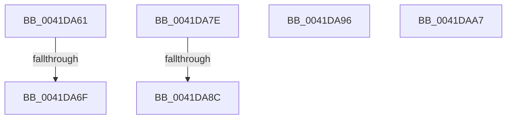

# sub_0041DA61

- RVA: `0x0041DA61`–`0x0041DAB4` (길이 `83` bytes)
- VA: `0x000000014041DA61`
- 실행 섹션: `.text`
- PDB 이름 있음: `아니요`; PDB Function 태그: `아니요`
- unwind 정보 RVA: `0x0009F0EC`
- 디코드: `19`개 명령, `83/83` bytes 표시
- 미해석 바이트: `0` (있으면 어셈블리에 `.byte`로 보존)

> 이 문서는 커널 이미지의 기계어와 PDB 기호를 분석해 생성했습니다. 4번과 5번은 함수 원형과 자료형을 바이너리 사용 방식에서 추정한 C 해석이며 원본 소스 복구 결과는 아닙니다.

## 1. Dependencies

- 직접 호출 지점: **4**; 고유 호출 대상: **4**
- 직접 호출자로 확인된 함수: **0**
- RIP 상대 이미지 참조: **1**

### Outgoing calls
- `0x0041DA77` → [KiReleaseQueuedSpinLockInstrumented](../21/KiReleaseQueuedSpinLockInstrumented_function_002179F0.md) (function, `0x002179F0`)
- `0x0041DA8C` → [KiAcquireQueuedSpinLockInstrumented](../27/KiAcquireQueuedSpinLockInstrumented_function_00275850.md) (function, `0x00275850`)
- `0x0041DA9D` → [KiRaiseIrqlProcessIrqlFlags](../4F/KiRaiseIrqlProcessIrqlFlags_function_004F56FC.md) (function, `0x004F56FC`)
- `0x0041DAAA` → [KxWaitForLockOwnerShip](../25/KxWaitForLockOwnerShip_function_00257EB0.md) (function, `0x00257EB0`)

### Direct callers
- 이 함수 시작 RVA로 연결되는 직접 call은 확인되지 않았습니다. 간접 호출은 완전히 역산할 수 없습니다.

### Static image references
- `0x0041DA61` → RVA `0x00F0DE58` (`.data`; read)

## 2. Other-region calls and transfers

- 다른 실행 섹션으로 향하는 call: **0**
- call이 아닌 외부 분기/꼬리 이동: **6**
  - `0x0041DA69` → [sub_0041D9E2](Unknown_function_0041D9E2.md) (`tail-transfer`)
  - `0x0041DA7C` → [sub_0041DA2F](Unknown_function_0041DA2F.md) (`tail-transfer`)
  - `0x0041DA86` → [sub_0041D94A + 0x43](Unknown_function_0041D94A.md) (`tail-transfer`)
  - `0x0041DA91` → [sub_0041D94A + 0x52](Unknown_function_0041D94A.md) (`tail-transfer`)
  - `0x0041DAA2` → [sub_0041D94A + 0x22](Unknown_function_0041D94A.md) (`tail-transfer`)
  - `0x0041DAAF` → [sub_0041D94A + 0x52](Unknown_function_0041D94A.md) (`tail-transfer`)

## 3. Assembly (complete function range)

```asm
0041DA61  8B 05 F1 03 AF 00               mov eax, dword ptr [rip + 0xaf03f1]
0041DA67  85 C0                           test eax, eax
0041DA69  0F 85 73 FF FF FF               jne 0x14041d9e2
0041DA6F  48 8B 54 24 28                  mov rdx, qword ptr [rsp + 0x28]
0041DA74  48 8B CF                        mov rcx, rdi
0041DA77  E8 74 9F DF FF                  call 0x1402179f0
0041DA7C  EB B1                           jmp 0x14041da2f
0041DA7E  8B 05 D4 03 AF 00               mov eax, dword ptr [rip + 0xaf03d4]
0041DA84  85 C0                           test eax, eax
0041DA86  0F 85 01 FF FF FF               jne 0x14041d98d
0041DA8C  E8 BF 7D E5 FF                  call 0x140275850
0041DA91  E9 06 FF FF FF                  jmp 0x14041d99c
0041DA96  0F B6 D0                        movzx edx, al
0041DA99  40 0F B6 CE                     movzx ecx, sil
0041DA9D  E8 5A 7C 0D 00                  call 0x1404f56fc
0041DAA2  E9 C5 FE FF FF                  jmp 0x14041d96c
0041DAA7  48 8B D0                        mov rdx, rax
0041DAAA  E8 01 A4 E3 FF                  call 0x140257eb0
0041DAAF  E9 E8 FE FF FF                  jmp 0x14041d99c
```

## 4. C-style interpretation (structured pseudocode)

```c
__int64 __fastcall sub_0041DA61(__int64 a1, __int64 a2, __int64 a3, __int64 a4, __int64 a5)
{
    __int64 result;

    result = KiReleaseQueuedSpinLockInstrumented(v_rdi, a5, a3, a4);
}
```

## 5. (Beta) C Style

```c
int64_t sub_0041DA61(int64_t Arg1, int64_t Arg2, int64_t Arg3, int64_t Arg4, int64_t Arg5)
{
    int64_t result;

    result = KiReleaseQueuedSpinLockInstrumented(local_rdi, Arg5, Arg3, Arg4);
}
```

## 6. Execution-region graph

[열기: 2D/3D 그래프와 함수 탐색 컨트롤 패널](../../../control-panel.html?section=text&rva=0x0041DA61&view=graph)

- 2D 그래프는 위에서 아래로 흐르고, 3D 그래프는 빈 공간을 드래그해 회전합니다. Shift+드래그는 이동, 휠은 확대·축소, 함수 노드 선택은 대상 보고서 이동입니다.

### Static fallback


