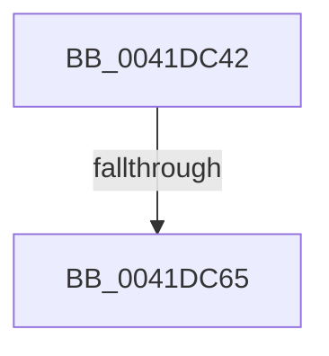

# sub_0041DC42

- RVA: `0x0041DC42`–`0x0041DC89` (길이 `71` bytes)
- VA: `0x000000014041DC42`
- 실행 섹션: `.text`
- PDB 이름 있음: `아니요`; PDB Function 태그: `아니요`
- unwind 정보 RVA: `0x0009F900`
- 디코드: `20`개 명령, `71/71` bytes 표시
- 미해석 바이트: `0` (있으면 어셈블리에 `.byte`로 보존)

> 이 문서는 커널 이미지의 기계어와 PDB 기호를 분석해 생성했습니다. 4번과 5번은 함수 원형과 자료형을 바이너리 사용 방식에서 추정한 C 해석이며 원본 소스 복구 결과는 아닙니다.

## 1. Dependencies

- 직접 호출 지점: **0**; 고유 호출 대상: **0**
- 직접 호출자로 확인된 함수: **0**
- RIP 상대 이미지 참조: **0**

### Outgoing calls
- 직접 디코드된 call 명령이 없습니다.

### Direct callers
- 이 함수 시작 RVA로 연결되는 직접 call은 확인되지 않았습니다. 간접 호출은 완전히 역산할 수 없습니다.

### Static image references
- 디코드된 RIP-relative 메모리 참조가 없습니다.

## 2. Other-region calls and transfers

- 다른 실행 섹션으로 향하는 call: **0**
- call이 아닌 외부 분기/꼬리 이동: **2**
  - `0x0041DC63` → [sub_0041DC89](Unknown_function_0041DC89.md) (`tail-transfer`)
  - `0x0041DC87` → [RtlAreBitsClearEx + 0x35](RtlAreBitsClearEx_function_0041DBF0.md) (`tail-transfer`)

## 3. Assembly (complete function range)

```asm
0041DC42  48 89 1C 24                     mov qword ptr [rsp], rbx
0041DC46  48 8B C2                        mov rax, rdx
0041DC49  48 C1 E8 06                     shr rax, 6
0041DC4D  48 8B 1C C1                     mov rbx, qword ptr [rcx + rax*8]
0041DC51  4C 8D 0C C1                     lea r9, [rcx + rax*8]
0041DC55  49 8B C3                        mov rax, r11
0041DC58  48 C1 E8 06                     shr rax, 6
0041DC5C  4C 8D 14 C1                     lea r10, [rcx + rax*8]
0041DC60  4D 3B CA                        cmp r9, r10
0041DC63  75 24                           jne 0x14041dc89
0041DC65  B9 40 00 00 00                  mov ecx, 0x40
0041DC6A  41 2A C8                        sub cl, r8b
0041DC6D  49 C7 C0 FF FF FF FF            mov r8, 0xffffffffffffffff
0041DC74  49 D3 E8                        shr r8, cl
0041DC77  48 8B CA                        mov rcx, rdx
0041DC7A  49 D3 E0                        shl r8, cl
0041DC7D  49 85 D8                        test r8, rbx
0041DC80  48 8B 1C 24                     mov rbx, qword ptr [rsp]
0041DC84  0F 94 C0                        sete al
0041DC87  EB 9C                           jmp 0x14041dc25
```

## 4. C-style interpretation (structured pseudocode)

```c
__int64 __fastcall sub_0041DC42(__int64 a1, __int64 a2, unsigned __int8 a3)
{
    __int64 result;
    unsigned __int64 v_stack_p0;

    v_stack_p0 = v_rbx;
    result = (a2) >> (6);
    result = (v_r11) >> (6);
    a1 = (unsigned __int8)((64) - (a3));
    a3 = (-1) >> ((unsigned __int8)(a1));
    a3 = (a3) << ((unsigned __int8)(a2));
    result = (((a3) & (*(unsigned __int64 *)(a1 + result * 8))) == 0) ? 1 : 0;
}
```

## 5. (Beta) C Style

```c
int64_t sub_0041DC42(void *Arg1, int64_t Arg2, uint8_t Arg3)
{
    uint8_t *arg1 = (uint8_t *)Arg1;

    int64_t result;
    uint64_t v_stack_p0;

    v_stack_p0 = local_rbx;
    result = (Arg2) >> (6);
    result = (local_r11) >> (6);
    Arg1 = (uint8_t)((64) - (Arg3));
    Arg3 = (-1) >> ((uint8_t)(Arg1));
    Arg3 = (Arg3) << ((uint8_t)(Arg2));
    result = (((Arg3) & (*(uint64_t *)(arg1 + result * 8))) == 0) ? 1 : 0;
}
```

### 관측된 메모리 오프셋

구조체 형식이 확인되지 않은 접근은 인자 기준의 오프셋으로만 기록했습니다.

| 기준 인자 | 오프셋 표현 | 폭 (bit) | 접근 |
|---|---:|---:|---|
| `Arg1` | `+ 0x0 + rax*8` | `64` | `R` |

## 6. Execution-region graph

[열기: 2D/3D 그래프와 함수 탐색 컨트롤 패널](../../../control-panel.html?section=text&rva=0x0041DC42&view=graph)

- 2D 그래프는 위에서 아래로 흐르고, 3D 그래프는 빈 공간을 드래그해 회전합니다. Shift+드래그는 이동, 휠은 확대·축소, 함수 노드 선택은 대상 보고서 이동입니다.

### Static fallback


