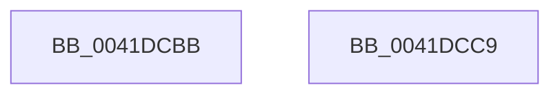

# sub_0041DCBB

- RVA: `0x0041DCBB`–`0x0041DCD4` (길이 `25` bytes)
- VA: `0x000000014041DCBB`
- 실행 섹션: `.text`
- PDB 이름 있음: `아니요`; PDB Function 태그: `아니요`
- unwind 정보 RVA: `0x0009F928`
- 디코드: `8`개 명령, `25/25` bytes 표시
- 미해석 바이트: `0` (있으면 어셈블리에 `.byte`로 보존)

> 이 문서는 커널 이미지의 기계어와 PDB 기호를 분석해 생성했습니다. 4번과 5번은 함수 원형과 자료형을 바이너리 사용 방식에서 추정한 C 해석이며 원본 소스 복구 결과는 아닙니다.

## 1. Dependencies

- 직접 호출 지점: **0**; 고유 호출 대상: **0**
- 직접 호출자로 확인된 함수: **0**
- RIP 상대 이미지 참조: **0**

### Outgoing calls
- 직접 디코드된 call 명령이 없습니다.

### Direct callers
- 이 함수 시작 RVA로 연결되는 직접 call은 확인되지 않았습니다. 간접 호출은 완전히 역산할 수 없습니다.

### Static image references
- 디코드된 RIP-relative 메모리 참조가 없습니다.

## 2. Other-region calls and transfers

- 다른 실행 섹션으로 향하는 call: **0**
- call이 아닌 외부 분기/꼬리 이동: **2**
  - `0x0041DCC7` → [sub_0041DC42 + 0x3E](Unknown_function_0041DC42.md) (`tail-transfer`)
  - `0x0041DCCF` → [RtlAreBitsClearEx + 0x35](RtlAreBitsClearEx_function_0041DBF0.md) (`tail-transfer`)

## 3. Assembly (complete function range)

```asm
0041DCBB  41 0F B6 CB                     movzx ecx, r11b
0041DCBF  F6 D1                           not cl
0041DCC1  49 D3 E8                        shr r8, cl
0041DCC4  49 85 C0                        test r8, rax
0041DCC7  EB B7                           jmp 0x14041dc80
0041DCC9  48 8B 1C 24                     mov rbx, qword ptr [rsp]
0041DCCD  32 C0                           xor al, al
0041DCCF  E9 51 FF FF FF                  jmp 0x14041dc25
```

## 4. C-style interpretation (structured pseudocode)

```c
__int64 __fastcall sub_0041DCBB(__int64 a1, __int64 a2, __int64 a3)
{
    unsigned __int64 v_stack_p0;

    a1 = (unsigned __int8)(~((unsigned __int8)(v_r11)));
    a3 = (a3) >> ((unsigned __int8)(a1));
}
```

## 5. (Beta) C Style

```c
int64_t sub_0041DCBB(int64_t Arg1, int64_t Arg2, int64_t Arg3)
{
    uint64_t v_stack_p0;

    Arg1 = (uint8_t)(~((uint8_t)(local_r11)));
    Arg3 = (Arg3) >> ((uint8_t)(Arg1));
}
```

## 6. Execution-region graph

[열기: 2D/3D 그래프와 함수 탐색 컨트롤 패널](../../../control-panel.html?section=text&rva=0x0041DCBB&view=graph)

- 2D 그래프는 위에서 아래로 흐르고, 3D 그래프는 빈 공간을 드래그해 회전합니다. Shift+드래그는 이동, 휠은 확대·축소, 함수 노드 선택은 대상 보고서 이동입니다.

### Static fallback


