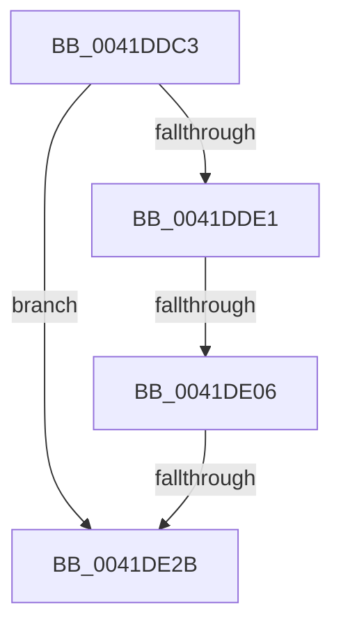

# sub_0041DDC3

- RVA: `0x0041DDC3`–`0x0041DE32` (길이 `111` bytes)
- VA: `0x000000014041DDC3`
- 실행 섹션: `.text`
- PDB 이름 있음: `아니요`; PDB Function 태그: `아니요`
- unwind 정보 RVA: `0x0009F99C`
- 디코드: `27`개 명령, `111/111` bytes 표시
- 미해석 바이트: `0` (있으면 어셈블리에 `.byte`로 보존)

> 이 문서는 커널 이미지의 기계어와 PDB 기호를 분석해 생성했습니다. 4번과 5번은 함수 원형과 자료형을 바이너리 사용 방식에서 추정한 C 해석이며 원본 소스 복구 결과는 아닙니다.

## 1. Dependencies

- 직접 호출 지점: **3**; 고유 호출 대상: **3**
- 직접 호출자로 확인된 함수: **0**
- RIP 상대 이미지 참조: **2**

### Outgoing calls
- `0x0041DDD2` → [FsRtlGetEcpListFromIrp](../../page/99/FsRtlGetEcpListFromIrp_function_0099DC60.md) (function, `0x0099DC60`)
- `0x0041DDFD` → [FsRtlFindExtraCreateParameter](../../page/97/FsRtlFindExtraCreateParameter_function_0097AFE0.md) (function, `0x0097AFE0`)
- `0x0041DE22` → [FsRtlRemoveExtraCreateParameter](../../page/9A/FsRtlRemoveExtraCreateParameter_function_009A8580.md) (function, `0x009A8580`)

### Direct callers
- 이 함수 시작 RVA로 연결되는 직접 call은 확인되지 않았습니다. 간접 호출은 완전히 역산할 수 없습니다.

### Static image references
- `0x0041DDE1` → RVA `0x00013E70` (`.rdata`; read)
- `0x0041DE06` → RVA `0x00013E80` (`.rdata`; read)

## 2. Other-region calls and transfers

- 다른 실행 섹션으로 향하는 call: **3**
  - `0x0041DDD2` → [FsRtlGetEcpListFromIrp](../../page/99/FsRtlGetEcpListFromIrp_function_0099DC60.md) (`.text` → `PAGE`)
  - `0x0041DDFD` → [FsRtlFindExtraCreateParameter](../../page/97/FsRtlFindExtraCreateParameter_function_0097AFE0.md) (`.text` → `PAGE`)
  - `0x0041DE22` → [FsRtlRemoveExtraCreateParameter](../../page/9A/FsRtlRemoveExtraCreateParameter_function_009A8580.md) (`.text` → `PAGE`)
- call이 아닌 외부 분기/꼬리 이동: **2**
  - `0x0041DE04` → [sub_0041DE4F](Unknown_function_0041DE4F.md) (`tail-transfer`)
  - `0x0041DE29` → [sub_0041DE4F + 0x2D](Unknown_function_0041DE4F.md) (`tail-transfer`)

## 3. Assembly (complete function range)

```asm
0041DDC3  48 89 5C 24 58                  mov qword ptr [rsp + 0x58], rbx
0041DDC8  48 89 74 24 20                  mov qword ptr [rsp + 0x20], rsi
0041DDCD  48 89 74 24 28                  mov qword ptr [rsp + 0x28], rsi
0041DDD2  E8 89 FE 57 00                  call 0x14099dc60
0041DDD7  48 8B 5C 24 28                  mov rbx, qword ptr [rsp + 0x28]
0041DDDC  48 85 DB                        test rbx, rbx
0041DDDF  74 4A                           je 0x14041de2b
0041DDE1  0F 10 05 88 60 BF FF            movups xmm0, xmmword ptr [rip - 0x409f78]
0041DDE8  45 33 C9                        xor r9d, r9d
0041DDEB  4C 8D 44 24 20                  lea r8, [rsp + 0x20]
0041DDF0  48 8D 54 24 28                  lea rdx, [rsp + 0x28]
0041DDF5  48 8B CB                        mov rcx, rbx
0041DDF8  0F 11 44 24 28                  movups xmmword ptr [rsp + 0x28], xmm0
0041DDFD  E8 DE D1 55 00                  call 0x14097afe0
0041DE02  85 C0                           test eax, eax
0041DE04  74 49                           je 0x14041de4f
0041DE06  0F 10 05 73 60 BF FF            movups xmm0, xmmword ptr [rip - 0x409f8d]
0041DE0D  45 33 C9                        xor r9d, r9d
0041DE10  4C 8D 44 24 20                  lea r8, [rsp + 0x20]
0041DE15  48 8D 54 24 28                  lea rdx, [rsp + 0x28]
0041DE1A  48 8B CB                        mov rcx, rbx
0041DE1D  0F 11 44 24 28                  movups xmmword ptr [rsp + 0x28], xmm0
0041DE22  E8 59 A7 58 00                  call 0x1409a8580
0041DE27  85 C0                           test eax, eax
0041DE29  74 51                           je 0x14041de7c
0041DE2B  8B C6                           mov eax, esi
0041DE2D  48 8B 5C 24 58                  mov rbx, qword ptr [rsp + 0x58]
```

## 4. C-style interpretation (structured pseudocode)

```c
__int64 __fastcall sub_0041DDC3(__int64 a1, __int64 a2, __int64 a3, int a4, __int64 a5, __int64 a6, __int64 a7, __int64 a8, __int64 a9, __int64 a10, __int64 a11)
{
    __int64 result;
    unsigned __int64 v_stack_p20;
    unsigned __int64 v_stack_p28;
    unsigned __int64 v_stack_p58;

    v_stack_p58 = v_rbx;
    v_stack_p20 = v_rsi;
    v_stack_p28 = v_rsi;
    result = FsRtlGetEcpListFromIrp(a1, a2, a3, a4);
    if (a5 == 0) goto loc_0041DE2B;
    a4 = 0;
    a5 = v_xmm0;
    result = FsRtlFindExtraCreateParameter(a5, a5, v_stack_p20, a4);
    a4 = 0;
    a5 = v_xmm0;
    result = FsRtlRemoveExtraCreateParameter(a5, a5, v_stack_p20, a4);
loc_0041DE2B:
    return (unsigned int)((unsigned int)(v_rsi));
}
```

## 5. (Beta) C Style

```c
int64_t sub_0041DDC3(int64_t Arg1, int64_t Arg2, int64_t Arg3, int32_t Arg4, int64_t Arg5, uint64_t Arg6, uint64_t Arg7, uint64_t Arg8, uint64_t Arg9, uint64_t Arg10, int64_t Arg11)
{
    int64_t result;
    uint64_t v_stack_p20;
    uint64_t v_stack_p28;
    uint64_t v_stack_p58;

    v_stack_p58 = local_rbx;
    v_stack_p20 = local_rsi;
    v_stack_p28 = local_rsi;
    result = FsRtlGetEcpListFromIrp(Arg1, Arg2, Arg3, Arg4);
    if (Arg5 == 0) goto loc_0041DE2B;
    Arg4 = 0;
    Arg5 = v_xmm0;
    result = FsRtlFindExtraCreateParameter(Arg5, Arg5, v_stack_p20, Arg4);
    Arg4 = 0;
    Arg5 = v_xmm0;
    result = FsRtlRemoveExtraCreateParameter(Arg5, Arg5, v_stack_p20, Arg4);
loc_0041DE2B:
    return (uint32_t)((uint32_t)(local_rsi));
}
```

## 6. Execution-region graph

[열기: 2D/3D 그래프와 함수 탐색 컨트롤 패널](../../../control-panel.html?section=text&rva=0x0041DDC3&view=graph)

- 2D 그래프는 위에서 아래로 흐르고, 3D 그래프는 빈 공간을 드래그해 회전합니다. Shift+드래그는 이동, 휠은 확대·축소, 함수 노드 선택은 대상 보고서 이동입니다.

### Static fallback


