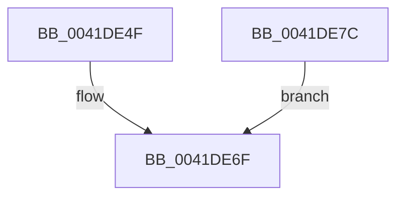

# sub_0041DE4F

- RVA: `0x0041DE4F`–`0x0041DE9E` (길이 `79` bytes)
- VA: `0x000000014041DE4F`
- 실행 섹션: `.text`
- PDB 이름 있음: `아니요`; PDB Function 태그: `아니요`
- unwind 정보 RVA: `0x0009F9C4`
- 디코드: `19`개 명령, `79/79` bytes 표시
- 미해석 바이트: `0` (있으면 어셈블리에 `.byte`로 보존)

> 이 문서는 커널 이미지의 기계어와 PDB 기호를 분석해 생성했습니다. 4번과 5번은 함수 원형과 자료형을 바이너리 사용 방식에서 추정한 C 해석이며 원본 소스 복구 결과는 아닙니다.

## 1. Dependencies

- 직접 호출 지점: **4**; 고유 호출 대상: **3**
- 직접 호출자로 확인된 함수: **0**
- RIP 상대 이미지 참조: **0**

### Outgoing calls
- `0x0041DE5E` → [IoSetOplockKeyContext](../38/IoSetOplockKeyContext_function_0038F7BC.md) (function, `0x0038F7BC`)
- `0x0041DE6A` → [FsRtlAcknowledgeEcp](../../page/A2/FsRtlAcknowledgeEcp_function_00A26010.md) (function, `0x00A26010`)
- `0x0041DE8B` → [IoSetOplockKeyContext](../38/IoSetOplockKeyContext_function_0038F7BC.md) (function, `0x0038F7BC`)
- `0x0041DE97` → [FsRtlFreeExtraCreateParameter](../../page/8A/FsRtlFreeExtraCreateParameter_function_008A1760.md) (function, `0x008A1760`)

### Direct callers
- 이 함수 시작 RVA로 연결되는 직접 call은 확인되지 않았습니다. 간접 호출은 완전히 역산할 수 없습니다.

### Static image references
- 디코드된 RIP-relative 메모리 참조가 없습니다.

## 2. Other-region calls and transfers

- 다른 실행 섹션으로 향하는 call: **2**
  - `0x0041DE6A` → [FsRtlAcknowledgeEcp](../../page/A2/FsRtlAcknowledgeEcp_function_00A26010.md) (`.text` → `PAGE`)
  - `0x0041DE97` → [FsRtlFreeExtraCreateParameter](../../page/8A/FsRtlFreeExtraCreateParameter_function_008A1760.md) (`.text` → `PAGE`)
- call이 아닌 외부 분기/꼬리 이동: **1**
  - `0x0041DE7A` → [sub_0041DDC3 + 0x6A](Unknown_function_0041DDC3.md) (`tail-transfer`)

## 3. Assembly (complete function range)

```asm
0041DE4F  48 8B 54 24 20                  mov rdx, qword ptr [rsp + 0x20]
0041DE54  41 B8 02 00 00 00               mov r8d, 2
0041DE5A  48 8B 4F 30                     mov rcx, qword ptr [rdi + 0x30]
0041DE5E  E8 59 19 F7 FF                  call 0x14038f7bc
0041DE63  48 8B 4C 24 20                  mov rcx, qword ptr [rsp + 0x20]
0041DE68  8B F8                           mov edi, eax
0041DE6A  E8 A1 81 60 00                  call 0x140a26010
0041DE6F  81 FF 01 00 00 C0               cmp edi, 0xc0000001
0041DE75  0F 44 FE                        cmove edi, esi
0041DE78  8B C7                           mov eax, edi
0041DE7A  EB B1                           jmp 0x14041de2d
0041DE7C  48 8B 54 24 20                  mov rdx, qword ptr [rsp + 0x20]
0041DE81  41 B8 01 00 00 00               mov r8d, 1
0041DE87  48 8B 4F 30                     mov rcx, qword ptr [rdi + 0x30]
0041DE8B  E8 2C 19 F7 FF                  call 0x14038f7bc
0041DE90  48 8B 4C 24 20                  mov rcx, qword ptr [rsp + 0x20]
0041DE95  8B F8                           mov edi, eax
0041DE97  E8 C4 38 48 00                  call 0x1408a1760
0041DE9C  EB D1                           jmp 0x14041de6f
```

## 4. C-style interpretation (structured pseudocode)

```c
__int64 __fastcall sub_0041DE4F(void)
{
    __int64 result;
    __int64 v_rdi;
    unsigned __int64 v_stack_p20;

    result = IoSetOplockKeyContext(*(unsigned __int64 *)(v_rdi + 48), v_stack_p20, 2, a4);
    result = FsRtlAcknowledgeEcp(v_stack_p20, v_stack_p20, 2, a4);
loc_0041DE6F:
    v_rdi = (unsigned int)((unsigned int)(result));
    if (((unsigned int)((unsigned int)((unsigned int)(result)))) == 0xC0000001ULL) { v_rdi = (unsigned int)(v_rsi); }
}
```

## 5. (Beta) C Style

```c
void sub_0041DE4F(void)
{
    int64_t result;
    int64_t local_rdi;
    uint64_t v_stack_p20;

    result = IoSetOplockKeyContext(*(uint64_t *)(local_rdi + 0x30), v_stack_p20, 2, a4);
    result = FsRtlAcknowledgeEcp(v_stack_p20, v_stack_p20, 2, a4);
loc_0041DE6F:
    local_rdi = (uint32_t)((uint32_t)(result));
    if (((uint32_t)((uint32_t)((uint32_t)(result)))) == 0xC0000001ULL) { local_rdi = (uint32_t)(local_rsi); }
}
```

## 6. Execution-region graph

[열기: 2D/3D 그래프와 함수 탐색 컨트롤 패널](../../../control-panel.html?section=text&rva=0x0041DE4F&view=graph)

- 2D 그래프는 위에서 아래로 흐르고, 3D 그래프는 빈 공간을 드래그해 회전합니다. Shift+드래그는 이동, 휠은 확대·축소, 함수 노드 선택은 대상 보고서 이동입니다.

### Static fallback


