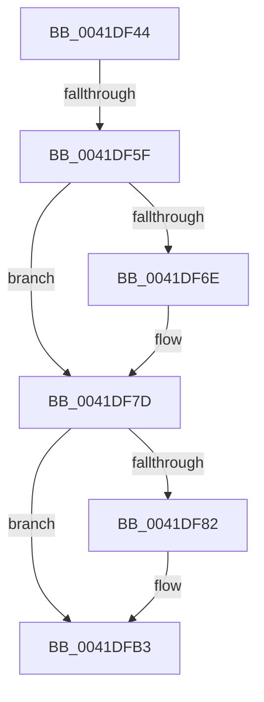

# sub_0041DF44

- RVA: `0x0041DF44`–`0x0041DFBD` (길이 `121` bytes)
- VA: `0x000000014041DF44`
- 실행 섹션: `.text`
- PDB 이름 있음: `아니요`; PDB Function 태그: `아니요`
- unwind 정보 RVA: `0x0009FA1C`
- 디코드: `33`개 명령, `121/121` bytes 표시
- 미해석 바이트: `0` (있으면 어셈블리에 `.byte`로 보존)

> 이 문서는 커널 이미지의 기계어와 PDB 기호를 분석해 생성했습니다. 4번과 5번은 함수 원형과 자료형을 바이너리 사용 방식에서 추정한 C 해석이며 원본 소스 복구 결과는 아닙니다.

## 1. Dependencies

- 직접 호출 지점: **1**; 고유 호출 대상: **1**
- 직접 호출자로 확인된 함수: **0**
- RIP 상대 이미지 참조: **0**

### Outgoing calls
- `0x0041DF78` → [memcpy](../6C/memcpy_function_006C6840.md) (function, `0x006C6840`)

### Direct callers
- 이 함수 시작 RVA로 연결되는 직접 call은 확인되지 않았습니다. 간접 호출은 완전히 역산할 수 없습니다.

### Static image references
- 디코드된 RIP-relative 메모리 참조가 없습니다.

## 2. Other-region calls and transfers

- 다른 실행 섹션으로 향하는 call: **0**
- call이 아닌 외부 분기/꼬리 이동: **1**
  - `0x0041DF59` → [sub_006ED7AC](../6E/Unknown_function_006ED7AC.md) (`tail-transfer`)

## 3. Assembly (complete function range)

```asm
0041DF44  48 89 6C 24 58                  mov qword ptr [rsp + 0x58], rbp
0041DF49  49 8B E8                        mov rbp, r8
0041DF4C  48 C1 ED 03                     shr rbp, 3
0041DF50  4C 89 74 24 28                  mov qword ptr [rsp + 0x28], r14
0041DF55  41 F6 C0 07                     test r8b, 7
0041DF59  0F 85 4D F8 2C 00               jne 0x1406ed7ac
0041DF5F  4C 8B F3                        mov r14, rbx
0041DF62  83 E3 07                        and ebx, 7
0041DF65  49 C1 EE 03                     shr r14, 3
0041DF69  4D 85 F6                        test r14, r14
0041DF6C  74 0F                           je 0x14041df7d
0041DF6E  48 8D 0C 2A                     lea rcx, [rdx + rbp]
0041DF72  4D 8B C6                        mov r8, r14
0041DF75  49 8B D1                        mov rdx, r9
0041DF78  E8 C3 88 2A 00                  call 0x1406c6840
0041DF7D  48 85 DB                        test rbx, rbx
0041DF80  74 31                           je 0x14041dfb3
0041DF82  4C 8B 47 08                     mov r8, qword ptr [rdi + 8]
0041DF86  48 8B CB                        mov rcx, rbx
0041DF89  4C 03 C5                        add r8, rbp
0041DF8C  41 BA 01 00 00 00               mov r10d, 1
0041DF92  41 D2 E2                        shl r10b, cl
0041DF95  4D 03 C6                        add r8, r14
0041DF98  41 FE CA                        dec r10b
0041DF9B  41 0F B6 C2                     movzx eax, r10b
0041DF9F  F6 D0                           not al
0041DFA1  41 20 00                        and byte ptr [r8], al
0041DFA4  48 8B 46 08                     mov rax, qword ptr [rsi + 8]
0041DFA8  41 0F B6 0C 06                  movzx ecx, byte ptr [r14 + rax]
0041DFAD  41 22 CA                        and cl, r10b
0041DFB0  41 08 08                        or byte ptr [r8], cl
0041DFB3  48 8B 6C 24 58                  mov rbp, qword ptr [rsp + 0x58]
0041DFB8  4C 8B 74 24 28                  mov r14, qword ptr [rsp + 0x28]
```

## 4. C-style interpretation (structured pseudocode)

```c
__int64 __fastcall sub_0041DF44(__int64 a1, __int64 a2, __int64 a3, __int64 a4, __int64 a5, __int64 a6, __int64 a7, __int64 a8, __int64 a9, __int64 a10, __int64 a11)
{
    __int64 result;
    __int64 v_r10;
    __int64 v_r14;
    __int64 v_rbp;
    __int64 v_rbx;
    unsigned __int64 v_stack_p28;
    unsigned __int64 v_stack_p58;

    v_stack_p58 = v_rbp;
    v_rbp = (a3) >> (3);
    v_stack_p28 = v_r14;
    v_rbx = (unsigned int)((v_rbx) & (7));
    v_r14 = (v_rbx) >> (3);
    if (v_r14 != 0) {
        a1 = a2 + v_rbp * 1;
        a3 = v_r14;
        a2 = a4;
        result = memcpy(a1, a2, a3, a4);
    }
    if (v_rbx != 0) {
        a3 = *(unsigned __int64 *)(v_rdi + 8);
        a1 = v_rbx;
        a3 = (a3) + (v_rbp);
        v_r10 = 1;
        v_r10 = (unsigned __int8)((v_r10) << ((unsigned __int8)(a1)));
        a3 = (a3) + (v_r14);
        v_r10 = (unsigned __int8)((v_r10) - 1);
        result = (unsigned __int8)(v_r10);
        result = (unsigned __int8)(~(result));
        result = *(unsigned __int64 *)(v_rsi + 8);
        a1 = *(unsigned __int8 *)(v_r14 + result * 1);
        a1 = (unsigned __int8)((a1) & ((unsigned __int8)(v_r10)));
    }
    return result;
}
```

## 5. (Beta) C Style

```c
int64_t sub_0041DF44(int64_t Arg1, void *Arg2, int64_t Arg3, int64_t Arg4, int64_t Arg5, uint64_t Arg6, uint64_t Arg7, uint64_t Arg8, uint64_t Arg9, uint64_t Arg10, int64_t Arg11)
{
    uint8_t *arg2 = (uint8_t *)Arg2;

    int64_t result;
    int64_t local_r10;
    int64_t local_r14;
    int64_t local_rbp;
    int64_t local_rbx;
    uint64_t v_stack_p28;
    uint64_t v_stack_p58;

    v_stack_p58 = local_rbp;
    local_rbp = (Arg3) >> (3);
    v_stack_p28 = local_r14;
    local_rbx = (uint32_t)((local_rbx) & (7));
    local_r14 = (local_rbx) >> (3);
    if (local_r14 != 0) {
        Arg1 = Arg2 + local_rbp * 1;
        Arg3 = local_r14;
        Arg2 = Arg4;
        result = memcpy(Arg1, Arg2, Arg3, Arg4);
    }
    if (local_rbx != 0) {
        Arg3 = *(uint64_t *)(local_rdi + 0x8);
        Arg1 = local_rbx;
        Arg3 = (Arg3) + (local_rbp);
        local_r10 = 1;
        local_r10 = (uint8_t)((local_r10) << ((uint8_t)(Arg1)));
        Arg3 = (Arg3) + (local_r14);
        local_r10 = (uint8_t)((local_r10) - 1);
        result = (uint8_t)(local_r10);
        result = (uint8_t)(~(result));
        result = *(uint64_t *)(local_rsi + 0x8);
        Arg1 = *(uint8_t *)(local_r14 + result * 1);
        Arg1 = (uint8_t)((Arg1) & ((uint8_t)(local_r10)));
    }
    return result;
}
```

### 관측된 메모리 오프셋

구조체 형식이 확인되지 않은 접근은 인자 기준의 오프셋으로만 기록했습니다.

| 기준 인자 | 오프셋 표현 | 폭 (bit) | 접근 |
|---|---:|---:|---|
| `Arg2` | `+ 0x0 + rbp*1` | `64` | `R` |

## 6. Execution-region graph

[열기: 2D/3D 그래프와 함수 탐색 컨트롤 패널](../../../control-panel.html?section=text&rva=0x0041DF44&view=graph)

- 2D 그래프는 위에서 아래로 흐르고, 3D 그래프는 빈 공간을 드래그해 회전합니다. Shift+드래그는 이동, 휠은 확대·축소, 함수 노드 선택은 대상 보고서 이동입니다.

### Static fallback


