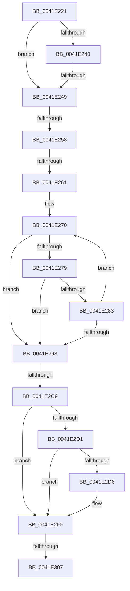

# sub_0041E221

- RVA: `0x0041E221`–`0x0041E313` (길이 `242` bytes)
- VA: `0x000000014041E221`
- 실행 섹션: `.text`
- PDB 이름 있음: `아니요`; PDB Function 태그: `아니요`
- unwind 정보 RVA: `0x0009FAC4`
- 디코드: `63`개 명령, `242/242` bytes 표시
- 미해석 바이트: `0` (있으면 어셈블리에 `.byte`로 보존)

> 이 문서는 커널 이미지의 기계어와 PDB 기호를 분석해 생성했습니다. 4번과 5번은 함수 원형과 자료형을 바이너리 사용 방식에서 추정한 C 해석이며 원본 소스 복구 결과는 아닙니다.

## 1. Dependencies

- 직접 호출 지점: **1**; 고유 호출 대상: **1**
- 직접 호출자로 확인된 함수: **0**
- RIP 상대 이미지 참조: **0**

### Outgoing calls
- `0x0041E2F0` → [RtlStringExHandleOtherFlagsW](RtlStringExHandleOtherFlagsW_function_0041E3F0.md) (function, `0x0041E3F0`)

### Direct callers
- 이 함수 시작 RVA로 연결되는 직접 call은 확인되지 않았습니다. 간접 호출은 완전히 역산할 수 없습니다.

### Static image references
- 디코드된 RIP-relative 메모리 참조가 없습니다.

## 2. Other-region calls and transfers

- 다른 실행 섹션으로 향하는 call: **0**
- call이 아닌 외부 분기/꼬리 이동: **5**
  - `0x0041E243` → [sub_0041E3D2](Unknown_function_0041E3D2.md) (`tail-transfer`)
  - `0x0041E252` → [sub_0041E36C + 0x15](Unknown_function_0041E36C.md) (`tail-transfer`)
  - `0x0041E25B` → [sub_0041E36C](Unknown_function_0041E36C.md) (`tail-transfer`)
  - `0x0041E2C7` → [sub_0041E329](Unknown_function_0041E329.md) (`tail-transfer`)
  - `0x0041E305` → [sub_0041E329 + 0x6](Unknown_function_0041E329.md) (`tail-transfer`)

## 3. Assembly (complete function range)

```asm
0041E221  48 89 74 24 60                  mov qword ptr [rsp + 0x60], rsi
0041E226  49 8B F7                        mov rsi, r15
0041E229  48 89 7C 24 68                  mov qword ptr [rsp + 0x68], rdi
0041E22E  49 8B FE                        mov rdi, r14
0041E231  4C 89 7C 24 30                  mov qword ptr [rsp + 0x30], r15
0041E236  4C 89 74 24 38                  mov qword ptr [rsp + 0x38], r14
0041E23B  45 85 C0                        test r8d, r8d
0041E23E  74 09                           je 0x14041e249
0041E240  4D 85 D2                        test r10, r10
0041E243  0F 84 89 01 00 00               je 0x14041e3d2
0041E249  41 8B D9                        mov ebx, r9d
0041E24C  F7 C5 00 E0 FF FF               test ebp, 0xffffe000
0041E252  0F 85 29 01 00 00               jne 0x14041e381
0041E258  4D 85 F6                        test r14, r14
0041E25B  0F 84 0B 01 00 00               je 0x14041e36c
0041E261  4D 2B DE                        sub r11, r14
0041E264  49 8B C6                        mov rax, r14
0041E267  4D 2B D7                        sub r10, r15
0041E26A  49 8B D7                        mov rdx, r15
0041E26D  4D 8B C1                        mov r8, r9
0041E270  49 8D 0C 03                     lea rcx, [r11 + rax]
0041E274  48 85 C9                        test rcx, rcx
0041E277  74 1A                           je 0x14041e293
0041E279  41 0F B7 0C 12                  movzx ecx, word ptr [r10 + rdx]
0041E27E  66 85 C9                        test cx, cx
0041E281  74 10                           je 0x14041e293
0041E283  66 89 0A                        mov word ptr [rdx], cx
0041E286  49 FF C0                        inc r8
0041E289  48 83 C2 02                     add rdx, 2
0041E28D  48 83 E8 01                     sub rax, 1
0041E291  75 DD                           jne 0x14041e270
0041E293  48 85 C0                        test rax, rax
0041E296  48 8D 4A FE                     lea rcx, [rdx - 2]
0041E29A  BB 05 00 00 80                  mov ebx, 0x80000005
0041E29F  48 0F 45 CA                     cmovne rcx, rdx
0041E2A3  41 0F 45 D9                     cmovne ebx, r9d
0041E2A7  66 44 89 09                     mov word ptr [rcx], r9w
0041E2AB  49 8D 48 FF                     lea rcx, [r8 - 1]
0041E2AF  49 0F 45 C8                     cmovne rcx, r8
0041E2B3  48 2B F9                        sub rdi, rcx
0041E2B6  48 89 7C 24 38                  mov qword ptr [rsp + 0x38], rdi
0041E2BB  49 8D 34 4F                     lea rsi, [r15 + rcx*2]
0041E2BF  48 89 74 24 30                  mov qword ptr [rsp + 0x30], rsi
0041E2C4  48 85 C0                        test rax, rax
0041E2C7  75 60                           jne 0x14041e329
0041E2C9  F7 C5 00 1C 00 00               test ebp, 0x1c00
0041E2CF  74 2E                           je 0x14041e2ff
0041E2D1  4D 85 F6                        test r14, r14
0041E2D4  74 29                           je 0x14041e2ff
0041E2D6  48 8D 44 24 38                  lea rax, [rsp + 0x38]
0041E2DB  89 6C 24 28                     mov dword ptr [rsp + 0x28], ebp
0041E2DF  4B 8D 14 36                     lea rdx, [r14 + r14]
0041E2E3  48 89 44 24 20                  mov qword ptr [rsp + 0x20], rax
0041E2E8  4C 8D 4C 24 30                  lea r9, [rsp + 0x30]
0041E2ED  49 8B CF                        mov rcx, r15
0041E2F0  E8 FB 00 00 00                  call 0x14041e3f0
0041E2F5  48 8B 74 24 30                  mov rsi, qword ptr [rsp + 0x30]
0041E2FA  48 8B 7C 24 38                  mov rdi, qword ptr [rsp + 0x38]
0041E2FF  81 FB 05 00 00 80               cmp ebx, 0x80000005
0041E305  74 28                           je 0x14041e32f
0041E307  48 8B 74 24 60                  mov rsi, qword ptr [rsp + 0x60]
0041E30C  8B C3                           mov eax, ebx
0041E30E  48 8B 7C 24 68                  mov rdi, qword ptr [rsp + 0x68]
```

## 4. C-style interpretation (structured pseudocode)

```c
__int64 __fastcall sub_0041E221(__int64 a1, __int64 a2, int a3, __int64 a4, __int64 a5, __int64 a6, __int64 a7, __int64 a8, __int64 a9, __int64 a10, __int64 a11, __int64 a12, __int64 a13)
{
    __int64 result;
    __int64 v_r10;
    __int64 v_r11;
    __int64 v_rbx;
    __int64 v_rdi;
    __int64 v_rsi;
    unsigned __int64 v_stack_p20;
    unsigned int v_stack_p28;
    unsigned __int64 v_stack_p30;
    unsigned __int64 v_stack_p38;
    unsigned __int64 v_stack_p60;
    unsigned __int64 v_stack_p68;

    v_stack_p60 = v_rsi;
    v_stack_p68 = v_rdi;
    v_stack_p30 = v_r15;
    v_stack_p38 = v_r14;
    if (a3 == 0) goto loc_0041E249;
loc_0041E249:
    v_r11 = (v_r11) - (v_r14);
    v_r10 = (v_r10) - (v_r15);
loc_0041E270:
    if (v_r11 + v_r14 * 1 == 0) goto loc_0041E293;
    if ((unsigned __int16)(*(unsigned __int16 *)(v_r10 + v_r15 * 1)) == 0) goto loc_0041E293;
    *(unsigned __int16 *)(v_r15) = (unsigned __int16)(*(unsigned __int16 *)(v_r10 + v_r15 * 1));
    a3 = (a4) + 1;
    a2 = (v_r15) + (2);
    result = (v_r14) - (1);
    if (condition_is_not_equal) goto loc_0041E270;
loc_0041E293:
    a1 = a2 - 2;
    if (result != 0) { a1 = a2; }
    v_rbx = (unsigned int)(0x80000005ULL);
    if (result != 0) { v_rbx = (unsigned int)(a4); }
    *(unsigned __int16 *)(a1) = (unsigned __int16)(a4);
    a1 = a3 - 1;
    if (result != 0) { a1 = a3; }
    v_rdi = (v_r14) - (a1);
    v_stack_p38 = v_rdi;
    v_stack_p30 = v_r15 + a1 * 2;
    if ((((unsigned int)(v_rbp)) & (0x1C00ULL)) == 0) goto loc_0041E2FF;
    v_rsi = v_r15 + a1 * 2;
    if (v_r14 != 0) {
        result = a7;
        v_stack_p28 = (unsigned int)(v_rbp);
        a2 = v_r14 + v_r14 * 1;
        v_stack_p20 = result;
        a4 = a6;
        a1 = v_r15;
        result = RtlStringExHandleOtherFlagsW(a1, a2, a3, a4);
        v_rsi = a6;
        v_rdi = a7;
    }
    return (unsigned int)((unsigned int)(v_rbx));
}
```

## 5. (Beta) C Style

```c
int64_t sub_0041E221(int64_t Arg1, int64_t Arg2, int32_t Arg3, int64_t Arg4, uint64_t Arg5, int64_t Arg6, int64_t Arg7, uint64_t Arg8, uint64_t Arg9, uint64_t Arg10, uint64_t Arg11, int64_t Arg12, int64_t Arg13)
{
    int64_t result;
    int64_t local_r10;
    int64_t local_r11;
    int64_t local_rbx;
    int64_t local_rdi;
    int64_t local_rsi;
    uint64_t v_stack_p20;
    uint32_t v_stack_p28;
    uint64_t v_stack_p30;
    uint64_t v_stack_p38;
    uint64_t v_stack_p60;
    uint64_t v_stack_p68;

    v_stack_p60 = local_rsi;
    v_stack_p68 = local_rdi;
    v_stack_p30 = local_r15;
    v_stack_p38 = local_r14;
    if (Arg3 == 0) goto loc_0041E249;
loc_0041E249:
    local_r11 = (local_r11) - (local_r14);
    local_r10 = (local_r10) - (local_r15);
loc_0041E270:
    if (local_r11 + local_r14 * 1 == 0) goto loc_0041E293;
    if ((uint16_t)(*(uint16_t *)(local_r10 + local_r15 * 1)) == 0) goto loc_0041E293;
    *(uint16_t *)(local_r15) = (uint16_t)(*(uint16_t *)(local_r10 + local_r15 * 1));
    Arg3 = (Arg4) + 1;
    Arg2 = (local_r15) + (2);
    result = (local_r14) - (1);
    if (condition_is_not_equal) goto loc_0041E270;
loc_0041E293:
    Arg1 = Arg2 - 2;
    if (result != 0) { Arg1 = Arg2; }
    local_rbx = (uint32_t)(0x80000005ULL);
    if (result != 0) { local_rbx = (uint32_t)(Arg4); }
    *(uint16_t *)(Arg1) = (uint16_t)(Arg4);
    Arg1 = Arg3 - 1;
    if (result != 0) { Arg1 = Arg3; }
    local_rdi = (local_r14) - (Arg1);
    v_stack_p38 = local_rdi;
    v_stack_p30 = local_r15 + Arg1 * 2;
    if ((((uint32_t)(local_rbp)) & (0x1C00ULL)) == 0) goto loc_0041E2FF;
    local_rsi = local_r15 + Arg1 * 2;
    if (local_r14 != 0) {
        result = Arg7;
        v_stack_p28 = (uint32_t)(local_rbp);
        Arg2 = local_r14 + local_r14 * 1;
        v_stack_p20 = result;
        Arg4 = Arg6;
        Arg1 = local_r15;
        result = RtlStringExHandleOtherFlagsW(Arg1, Arg2, Arg3, Arg4);
        local_rsi = Arg6;
        local_rdi = Arg7;
    }
    return (uint32_t)((uint32_t)(local_rbx));
}
```

## 6. Execution-region graph

[열기: 2D/3D 그래프와 함수 탐색 컨트롤 패널](../../../control-panel.html?section=text&rva=0x0041E221&view=graph)

- 2D 그래프는 위에서 아래로 흐르고, 3D 그래프는 빈 공간을 드래그해 회전합니다. Shift+드래그는 이동, 휠은 확대·축소, 함수 노드 선택은 대상 보고서 이동입니다.

### Static fallback


