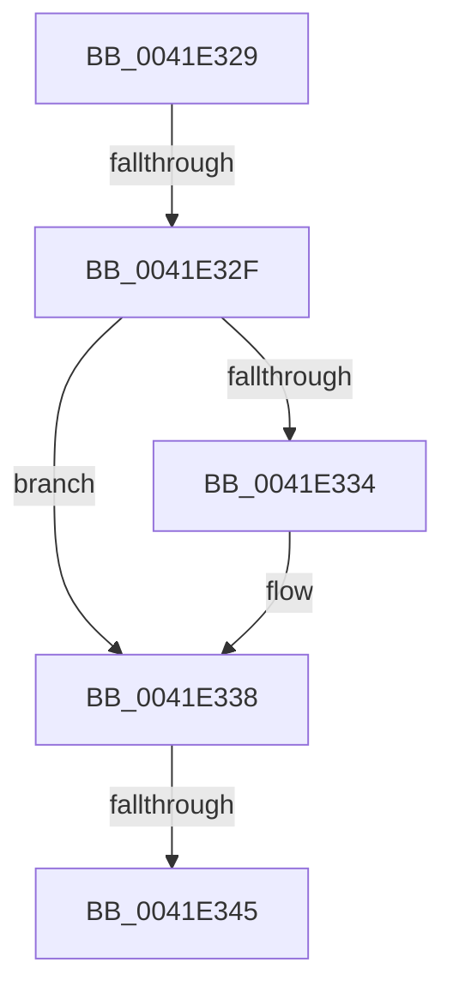

# sub_0041E329

- RVA: `0x0041E329`–`0x0041E34A` (길이 `33` bytes)
- VA: `0x000000014041E329`
- 실행 섹션: `.text`
- PDB 이름 있음: `아니요`; PDB Function 태그: `아니요`
- unwind 정보 RVA: `0x0009FAF0`
- 디코드: `10`개 명령, `33/33` bytes 표시
- 미해석 바이트: `0` (있으면 어셈블리에 `.byte`로 보존)

> 이 문서는 커널 이미지의 기계어와 PDB 기호를 분석해 생성했습니다. 4번과 5번은 함수 원형과 자료형을 바이너리 사용 방식에서 추정한 C 해석이며 원본 소스 복구 결과는 아닙니다.

## 1. Dependencies

- 직접 호출 지점: **0**; 고유 호출 대상: **0**
- 직접 호출자로 확인된 함수: **0**
- RIP 상대 이미지 참조: **0**

### Outgoing calls
- 직접 디코드된 call 명령이 없습니다.

### Direct callers
- 이 함수 시작 RVA로 연결되는 직접 call은 확인되지 않았습니다. 간접 호출은 완전히 역산할 수 없습니다.

### Static image references
- 디코드된 RIP-relative 메모리 참조가 없습니다.

## 2. Other-region calls and transfers

- 다른 실행 섹션으로 향하는 call: **0**
- call이 아닌 외부 분기/꼬리 이동: **3**
  - `0x0041E32D` → [sub_0041E36C + 0x2C](Unknown_function_0041E36C.md) (`tail-transfer`)
  - `0x0041E343` → [sub_0041E221 + 0xE6](Unknown_function_0041E221.md) (`tail-transfer`)
  - `0x0041E348` → [sub_0041E221 + 0xE6](Unknown_function_0041E221.md) (`tail-transfer`)

## 3. Assembly (complete function range)

```asm
0041E329  0F BA E5 09                     bt ebp, 9
0041E32D  72 69                           jb 0x14041e398
0041E32F  4D 85 E4                        test r12, r12
0041E332  74 04                           je 0x14041e338
0041E334  49 89 34 24                     mov qword ptr [r12], rsi
0041E338  48 8B 84 24 80 00 00 00         mov rax, qword ptr [rsp + 0x80]
0041E340  48 85 C0                        test rax, rax
0041E343  74 C2                           je 0x14041e307
0041E345  48 89 38                        mov qword ptr [rax], rdi
0041E348  EB BD                           jmp 0x14041e307
```

## 4. C-style interpretation (structured pseudocode)

```c
__int64 __fastcall sub_0041E329(__int64 a1, __int64 a2, __int64 a3, __int64 a4, __int64 a5, __int64 a6, __int64 a7, __int64 a8, __int64 a9, __int64 a10, __int64 a11, __int64 a12, __int64 a13, __int64 a14, __int64 a15, __int64 a16)
{
    if (v_r12 != 0) {
        *(unsigned __int64 *)(v_r12) = v_rsi;
    }
    *(unsigned __int64 *)(a16) = v_rdi;
}
```

## 5. (Beta) C Style

```c
int64_t sub_0041E329(int64_t Arg1, int64_t Arg2, int64_t Arg3, int64_t Arg4, uint64_t Arg5, uint64_t Arg6, uint64_t Arg7, uint64_t Arg8, uint64_t Arg9, uint64_t Arg10, uint64_t Arg11, uint64_t Arg12, uint64_t Arg13, uint64_t Arg14, uint64_t Arg15, int64_t Arg16)
{
    if (local_r12 != 0) {
        *(uint64_t *)(local_r12) = local_rsi;
    }
    *(uint64_t *)(Arg16) = local_rdi;
}
```

## 6. Execution-region graph

[열기: 2D/3D 그래프와 함수 탐색 컨트롤 패널](../../../control-panel.html?section=text&rva=0x0041E329&view=graph)

- 2D 그래프는 위에서 아래로 흐르고, 3D 그래프는 빈 공간을 드래그해 회전합니다. Shift+드래그는 이동, 휠은 확대·축소, 함수 노드 선택은 대상 보고서 이동입니다.

### Static fallback


