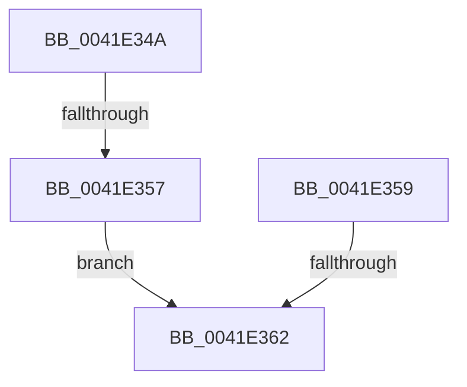

# sub_0041E34A

- RVA: `0x0041E34A`–`0x0041E36C` (길이 `34` bytes)
- VA: `0x000000014041E34A`
- 실행 섹션: `.text`
- PDB 이름 있음: `아니요`; PDB Function 태그: `아니요`
- unwind 정보 RVA: `0x0009FB08`
- 디코드: `8`개 명령, `34/34` bytes 표시
- 미해석 바이트: `0` (있으면 어셈블리에 `.byte`로 보존)

> 이 문서는 커널 이미지의 기계어와 PDB 기호를 분석해 생성했습니다. 4번과 5번은 함수 원형과 자료형을 바이너리 사용 방식에서 추정한 C 해석이며 원본 소스 복구 결과는 아닙니다.

## 1. Dependencies

- 직접 호출 지점: **0**; 고유 호출 대상: **0**
- 직접 호출자로 확인된 함수: **0**
- RIP 상대 이미지 참조: **0**

### Outgoing calls
- 직접 디코드된 call 명령이 없습니다.

### Direct callers
- 이 함수 시작 RVA로 연결되는 직접 call은 확인되지 않았습니다. 간접 호출은 완전히 역산할 수 없습니다.

### Static image references
- 디코드된 RIP-relative 메모리 참조가 없습니다.

## 2. Other-region calls and transfers

- 다른 실행 섹션으로 향하는 call: **0**
- call이 아닌 외부 분기/꼬리 이동: **3**
  - `0x0041E351` → [RtlStringCchCopyExW + 0x59](RtlStringCchCopyExW_function_0041E1C0.md) (`tail-transfer`)
  - `0x0041E35C` → [RtlStringCchCopyExW + 0x4C](RtlStringCchCopyExW_function_0041E1C0.md) (`tail-transfer`)
  - `0x0041E367` → [RtlStringCchCopyExW + 0x59](RtlStringCchCopyExW_function_0041E1C0.md) (`tail-transfer`)

## 3. Assembly (complete function range)

```asm
0041E34A  48 8D 42 FF                     lea rax, [rdx - 1]
0041E34E  49 3B C3                        cmp rax, r11
0041E351  0F 86 C2 FE FF FF               jbe 0x14041e219
0041E357  EB 09                           jmp 0x14041e362
0041E359  4D 85 F6                        test r14, r14
0041E35C  0F 84 AA FE FF FF               je 0x14041e20c
0041E362  BB 0D 00 00 C0                  mov ebx, 0xc000000d
0041E367  E9 AD FE FF FF                  jmp 0x14041e219
```

## 4. C-style interpretation (structured pseudocode)

```c
__int64 __fastcall sub_0041E34A(__int64 a1, __int64 a2)
{
    goto loc_0041E362;
loc_0041E362:
}
```

## 5. (Beta) C Style

```c
int64_t sub_0041E34A(int64_t Arg1, void *Arg2)
{
    uint8_t *arg2 = (uint8_t *)Arg2;

    goto loc_0041E362;
loc_0041E362:
}
```

### 관측된 메모리 오프셋

구조체 형식이 확인되지 않은 접근은 인자 기준의 오프셋으로만 기록했습니다.

| 기준 인자 | 오프셋 표현 | 폭 (bit) | 접근 |
|---|---:|---:|---|
| `Arg2` | `- 0x1` | `64` | `R` |

## 6. Execution-region graph

[열기: 2D/3D 그래프와 함수 탐색 컨트롤 패널](../../../control-panel.html?section=text&rva=0x0041E34A&view=graph)

- 2D 그래프는 위에서 아래로 흐르고, 3D 그래프는 빈 공간을 드래그해 회전합니다. Shift+드래그는 이동, 휠은 확대·축소, 함수 노드 선택은 대상 보고서 이동입니다.

### Static fallback


