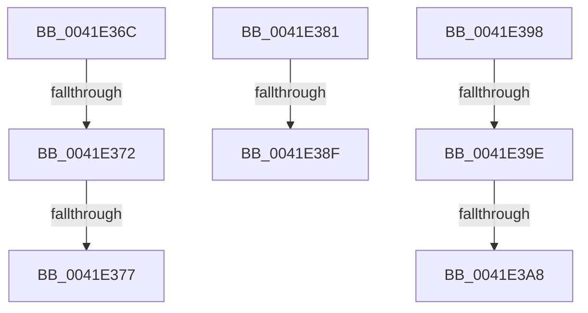

# sub_0041E36C

- RVA: `0x0041E36C`–`0x0041E3BE` (길이 `82` bytes)
- VA: `0x000000014041E36C`
- 실행 섹션: `.text`
- PDB 이름 있음: `아니요`; PDB Function 태그: `아니요`
- unwind 정보 RVA: `0x0009FB18`
- 디코드: `21`개 명령, `82/82` bytes 표시
- 미해석 바이트: `0` (있으면 어셈블리에 `.byte`로 보존)

> 이 문서는 커널 이미지의 기계어와 PDB 기호를 분석해 생성했습니다. 4번과 5번은 함수 원형과 자료형을 바이너리 사용 방식에서 추정한 C 해석이며 원본 소스 복구 결과는 아닙니다.

## 1. Dependencies

- 직접 호출 지점: **1**; 고유 호출 대상: **1**
- 직접 호출자로 확인된 함수: **0**
- RIP 상대 이미지 참조: **0**

### Outgoing calls
- `0x0041E3B4` → [memset](../6C/memset_function_006C6C40.md) (function, `0x006C6C40`)

### Direct callers
- 이 함수 시작 RVA로 연결되는 직접 call은 확인되지 않았습니다. 간접 호출은 완전히 역산할 수 없습니다.

### Static image references
- 디코드된 RIP-relative 메모리 참조가 없습니다.

## 2. Other-region calls and transfers

- 다른 실행 섹션으로 향하는 call: **0**
- call이 아닌 외부 분기/꼬리 이동: **8**
  - `0x0041E370` → [sub_0041E329 + 0x6](Unknown_function_0041E329.md) (`tail-transfer`)
  - `0x0041E375` → [sub_0041E3D2 + 0xC](Unknown_function_0041E3D2.md) (`tail-transfer`)
  - `0x0041E37C` → [sub_0041E221 + 0xA8](Unknown_function_0041E221.md) (`tail-transfer`)
  - `0x0041E389` → [sub_0041E221 + 0xA8](Unknown_function_0041E221.md) (`tail-transfer`)
  - `0x0041E393` → [sub_0041E221 + 0xA8](Unknown_function_0041E221.md) (`tail-transfer`)
  - `0x0041E39C` → [sub_0041E329 + 0x6](Unknown_function_0041E329.md) (`tail-transfer`)
  - `0x0041E3A6` → [sub_0041E329 + 0x6](Unknown_function_0041E329.md) (`tail-transfer`)
  - `0x0041E3B9` → [sub_0041E329 + 0x6](Unknown_function_0041E329.md) (`tail-transfer`)

## 3. Assembly (complete function range)

```asm
0041E36C  66 41 39 1A                     cmp word ptr [r10], bx
0041E370  74 BD                           je 0x14041e32f
0041E372  4D 85 FF                        test r15, r15
0041E375  74 67                           je 0x14041e3de
0041E377  BB 05 00 00 80                  mov ebx, 0x80000005
0041E37C  E9 48 FF FF FF                  jmp 0x14041e2c9
0041E381  BB 0D 00 00 C0                  mov ebx, 0xc000000d
0041E386  4D 85 F6                        test r14, r14
0041E389  0F 84 3A FF FF FF               je 0x14041e2c9
0041E38F  66 44 89 09                     mov word ptr [rcx], r9w
0041E393  E9 31 FF FF FF                  jmp 0x14041e2c9
0041E398  48 83 FF 01                     cmp rdi, 1
0041E39C  76 91                           jbe 0x14041e32f
0041E39E  4C 8D 04 3F                     lea r8, [rdi + rdi]
0041E3A2  49 83 F8 02                     cmp r8, 2
0041E3A6  76 87                           jbe 0x14041e32f
0041E3A8  49 83 C0 FE                     add r8, -2
0041E3AC  40 0F B6 D5                     movzx edx, bpl
0041E3B0  48 8D 4E 02                     lea rcx, [rsi + 2]
0041E3B4  E8 87 88 2A 00                  call 0x1406c6c40
0041E3B9  E9 71 FF FF FF                  jmp 0x14041e32f
```

## 4. C-style interpretation (structured pseudocode)

```c
__int64 __fastcall sub_0041E36C(__int64 a1, __int64 a2, __int64 a3, unsigned __int16 a4)
{
}
```

## 5. (Beta) C Style

```c
int64_t sub_0041E36C(int64_t Arg1, int64_t Arg2, int64_t Arg3, uint16_t Arg4)
{
}
```

## 6. Execution-region graph

[열기: 2D/3D 그래프와 함수 탐색 컨트롤 패널](../../../control-panel.html?section=text&rva=0x0041E36C&view=graph)

- 2D 그래프는 위에서 아래로 흐르고, 3D 그래프는 빈 공간을 드래그해 회전합니다. Shift+드래그는 이동, 휠은 확대·축소, 함수 노드 선택은 대상 보고서 이동입니다.

### Static fallback


