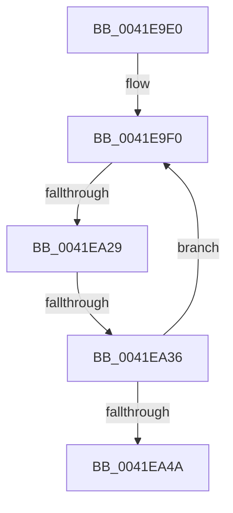

# sub_0041E9E0

- RVA: `0x0041E9E0`–`0x0041EA55` (길이 `117` bytes)
- VA: `0x000000014041E9E0`
- 실행 섹션: `.text`
- PDB 이름 있음: `아니요`; PDB Function 태그: `아니요`
- unwind 정보 RVA: `0x0009FBF8`
- 디코드: `27`개 명령, `117/117` bytes 표시
- 미해석 바이트: `0` (있으면 어셈블리에 `.byte`로 보존)

> 이 문서는 커널 이미지의 기계어와 PDB 기호를 분석해 생성했습니다. 4번과 5번은 함수 원형과 자료형을 바이너리 사용 방식에서 추정한 C 해석이며 원본 소스 복구 결과는 아닙니다.

## 1. Dependencies

- 직접 호출 지점: **1**; 고유 호출 대상: **1**
- 직접 호출자로 확인된 함수: **0**
- RIP 상대 이미지 참조: **0**

### Outgoing calls
- `0x0041EA20` → [ZwQueryVirtualMemory](../6A/ZwQueryVirtualMemory_function_006AD530.md) (function, `0x006AD530`)

### Direct callers
- 이 함수 시작 RVA로 연결되는 직접 call은 확인되지 않았습니다. 간접 호출은 완전히 역산할 수 없습니다.

### Static image references
- 디코드된 RIP-relative 메모리 참조가 없습니다.

## 2. Other-region calls and transfers

- 다른 실행 섹션으로 향하는 call: **0**
- call이 아닌 외부 분기/꼬리 이동: **2**
  - `0x0041EA27` → [sub_0041EA7A](Unknown_function_0041EA7A.md) (`tail-transfer`)
  - `0x0041EA34` → [sub_0041EA7A](Unknown_function_0041EA7A.md) (`tail-transfer`)

## 3. Assembly (complete function range)

```asm
0041E9E0  48 89 BC 24 08 01 00 00         mov qword ptr [rsp + 0x108], rdi
0041E9E8  0F 1F 84 00 00 00 00 00         nop dword ptr [rax + rax]
0041E9F0  0F B7 C3                        movzx eax, bx
0041E9F3  48 8D 7C 24 50                  lea rdi, [rsp + 0x50]
0041E9F8  48 8B 14 C7                     mov rdx, qword ptr [rdi + rax*8]
0041E9FC  48 8D 3C C7                     lea rdi, [rdi + rax*8]
0041EA00  48 89 6C 24 28                  mov qword ptr [rsp + 0x28], rbp
0041EA05  4C 8D 4C 24 38                  lea r9, [rsp + 0x38]
0041EA0A  41 B8 06 00 00 00               mov r8d, 6
0041EA10  48 C7 44 24 20 18 00 00 00      mov qword ptr [rsp + 0x20], 0x18
0041EA19  48 C7 C1 FF FF FF FF            mov rcx, 0xffffffffffffffff
0041EA20  E8 0B EB 28 00                  call 0x1406ad530
0041EA25  85 C0                           test eax, eax
0041EA27  78 51                           js 0x14041ea7a
0041EA29  48 8B 0F                        mov rcx, qword ptr [rdi]
0041EA2C  48 8B 44 24 38                  mov rax, qword ptr [rsp + 0x38]
0041EA31  48 3B C8                        cmp rcx, rax
0041EA34  72 44                           jb 0x14041ea7a
0041EA36  2B C8                           sub ecx, eax
0041EA38  03 4C 24 30                     add ecx, dword ptr [rsp + 0x30]
0041EA3C  66 FF C3                        inc bx
0041EA3F  0F B7 C3                        movzx eax, bx
0041EA42  89 4C 24 30                     mov dword ptr [rsp + 0x30], ecx
0041EA46  3B C6                           cmp eax, esi
0041EA48  72 A6                           jb 0x14041e9f0
0041EA4A  48 8B BC 24 08 01 00 00         mov rdi, qword ptr [rsp + 0x108]
0041EA52  41 89 0E                        mov dword ptr [r14], ecx
```

## 4. C-style interpretation (structured pseudocode)

```c
__int64 __fastcall sub_0041E9E0(__int64 a1, __int64 a2, __int64 a3, __int64 a4, __int64 a5, unsigned int a6, __int64 a7, __int64 a8, __int64 a9, __int64 a10, __int64 a11, __int64 a12, __int64 a13, __int64 a14, __int64 a15, __int64 a16, __int64 a17, __int64 a18, __int64 a19, __int64 a20, __int64 a21, __int64 a22, __int64 a23, __int64 a24, __int64 a25, __int64 a26, __int64 a27, __int64 a28, __int64 a29, __int64 a30, __int64 a31, __int64 a32, __int64 a33)
{
    __int64 result;
    __int64 v_rbx;
    unsigned __int64 v_stack_p108;
    unsigned __int64 v_stack_p20;
    unsigned __int64 v_stack_p28;
    unsigned int v_stack_p30;

    v_stack_p108 = v_rdi;
loc_0041E9F0:
    v_stack_p28 = v_rbp;
    v_stack_p20 = 24;
    result = ZwQueryVirtualMemory(-1, *(unsigned __int64 *)(a10 + (unsigned __int16)(v_rbx) * 8), 6, a7);
    a1 = (unsigned int)((*(unsigned __int64 *)(a10 + (unsigned __int16)(v_rbx) * 8)) - ((unsigned int)(a7)));
    a1 = (unsigned int)((a1) + (a6));
    v_rbx = (unsigned __int16)((v_rbx) + 1);
    v_stack_p30 = (unsigned int)(a1);
    if (((unsigned int)((unsigned __int16)(v_rbx))) < ((unsigned int)(v_rsi))) goto loc_0041E9F0;
    *(unsigned int *)(v_r14) = (unsigned int)(a1);
    return (unsigned __int16)(v_rbx);
}
```

## 5. (Beta) C Style

```c
int64_t sub_0041E9E0(int64_t Arg1, int64_t Arg2, int64_t Arg3, int64_t Arg4, uint64_t Arg5, uint32_t Arg6, int64_t Arg7, uint64_t Arg8, uint64_t Arg9, int64_t Arg10, uint64_t Arg11, uint64_t Arg12, uint64_t Arg13, uint64_t Arg14, uint64_t Arg15, uint64_t Arg16, uint64_t Arg17, uint64_t Arg18, uint64_t Arg19, uint64_t Arg20, uint64_t Arg21, uint64_t Arg22, uint64_t Arg23, uint64_t Arg24, uint64_t Arg25, uint64_t Arg26, uint64_t Arg27, uint64_t Arg28, uint64_t Arg29, uint64_t Arg30, uint64_t Arg31, uint64_t Arg32, int64_t Arg33)
{
    int64_t result;
    int64_t local_rbx;
    uint64_t v_stack_p108;
    uint64_t v_stack_p20;
    uint64_t v_stack_p28;
    uint32_t v_stack_p30;

    v_stack_p108 = local_rdi;
loc_0041E9F0:
    v_stack_p28 = local_rbp;
    v_stack_p20 = 24;
    result = ZwQueryVirtualMemory(-1, *(uint64_t *)(Arg10 + (uint16_t)(local_rbx) * 8), 6, Arg7);
    Arg1 = (uint32_t)((*(uint64_t *)(Arg10 + (uint16_t)(local_rbx) * 8)) - ((uint32_t)(Arg7)));
    Arg1 = (uint32_t)((Arg1) + (Arg6));
    local_rbx = (uint16_t)((local_rbx) + 1);
    v_stack_p30 = (uint32_t)(Arg1);
    if (((uint32_t)((uint16_t)(local_rbx))) < ((uint32_t)(local_rsi))) goto loc_0041E9F0;
    *(uint32_t *)(local_r14) = (uint32_t)(Arg1);
    return (uint16_t)(local_rbx);
}
```

## 6. Execution-region graph

[열기: 2D/3D 그래프와 함수 탐색 컨트롤 패널](../../../control-panel.html?section=text&rva=0x0041E9E0&view=graph)

- 2D 그래프는 위에서 아래로 흐르고, 3D 그래프는 빈 공간을 드래그해 회전합니다. Shift+드래그는 이동, 휠은 확대·축소, 함수 노드 선택은 대상 보고서 이동입니다.

### Static fallback


