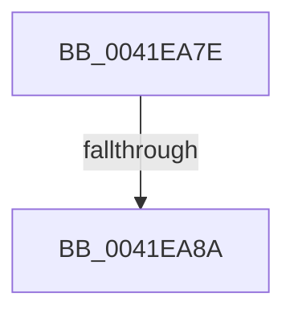

# sub_0041EA7E

- RVA: `0x0041EA7E`–`0x0041EA93` (길이 `21` bytes)
- VA: `0x000000014041EA7E`
- 실행 섹션: `.text`
- PDB 이름 있음: `아니요`; PDB Function 태그: `아니요`
- unwind 정보 RVA: `0x0009FC34`
- 디코드: `7`개 명령, `21/21` bytes 표시
- 미해석 바이트: `0` (있으면 어셈블리에 `.byte`로 보존)

> 이 문서는 커널 이미지의 기계어와 PDB 기호를 분석해 생성했습니다. 4번과 5번은 함수 원형과 자료형을 바이너리 사용 방식에서 추정한 C 해석이며 원본 소스 복구 결과는 아닙니다.

## 1. Dependencies

- 직접 호출 지점: **0**; 고유 호출 대상: **0**
- 직접 호출자로 확인된 함수: **0**
- RIP 상대 이미지 참조: **0**

### Outgoing calls
- 직접 디코드된 call 명령이 없습니다.

### Direct callers
- 이 함수 시작 RVA로 연결되는 직접 call은 확인되지 않았습니다. 간접 호출은 완전히 역산할 수 없습니다.

### Static image references
- 디코드된 RIP-relative 메모리 참조가 없습니다.

## 2. Other-region calls and transfers

- 다른 실행 섹션으로 향하는 call: **0**
- call이 아닌 외부 분기/꼬리 이동: **2**
  - `0x0041EA84` → [sub_0041E9E0](Unknown_function_0041E9E0.md) (`tail-transfer`)
  - `0x0041EA91` → [sub_0041EA55](Unknown_function_0041EA55.md) (`tail-transfer`)

## 3. Assembly (complete function range)

```asm
0041EA7E  8B DD                           mov ebx, ebp
0041EA80  8B F0                           mov esi, eax
0041EA82  85 C0                           test eax, eax
0041EA84  0F 85 56 FF FF FF               jne 0x14041e9e0
0041EA8A  8B 44 24 30                     mov eax, dword ptr [rsp + 0x30]
0041EA8E  41 89 06                        mov dword ptr [r14], eax
0041EA91  EB C2                           jmp 0x14041ea55
```

## 4. C-style interpretation (structured pseudocode)

```c
__int64 __fastcall sub_0041EA7E(__int64 a1, __int64 a2, __int64 a3, __int64 a4, __int64 a5, unsigned int a6)
{
    *(unsigned int *)(v_r14) = (unsigned int)((unsigned int)(a6));
}
```

## 5. (Beta) C Style

```c
int64_t sub_0041EA7E(int64_t Arg1, int64_t Arg2, int64_t Arg3, int64_t Arg4, uint64_t Arg5, uint32_t Arg6)
{
    *(uint32_t *)(local_r14) = (uint32_t)((uint32_t)(Arg6));
}
```

## 6. Execution-region graph

[열기: 2D/3D 그래프와 함수 탐색 컨트롤 패널](../../../control-panel.html?section=text&rva=0x0041EA7E&view=graph)

- 2D 그래프는 위에서 아래로 흐르고, 3D 그래프는 빈 공간을 드래그해 회전합니다. Shift+드래그는 이동, 휠은 확대·축소, 함수 노드 선택은 대상 보고서 이동입니다.

### Static fallback


