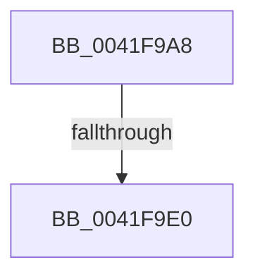

# sub_0041F9A8

- RVA: `0x0041F9A8`–`0x0041FA0C` (길이 `100` bytes)
- VA: `0x000000014041F9A8`
- 실행 섹션: `.text`
- PDB 이름 있음: `아니요`; PDB Function 태그: `아니요`
- unwind 정보 RVA: `0x0009FE8C`
- 디코드: `21`개 명령, `100/100` bytes 표시
- 미해석 바이트: `0` (있으면 어셈블리에 `.byte`로 보존)

> 이 문서는 커널 이미지의 기계어와 PDB 기호를 분석해 생성했습니다. 4번과 5번은 함수 원형과 자료형을 바이너리 사용 방식에서 추정한 C 해석이며 원본 소스 복구 결과는 아닙니다.

## 1. Dependencies

- 직접 호출 지점: **2**; 고유 호출 대상: **2**
- 직접 호출자로 확인된 함수: **0**
- RIP 상대 이미지 참조: **2**

### Outgoing calls
- `0x0041F9B4` → [memset](../6C/memset_function_006C6C40.md) (function, `0x006C6C40`)
- `0x0041F9EE` → [ExpAddResourceToSystemResourceList](ExpAddResourceToSystemResourceList_function_0041FA30.md) (function, `0x0041FA30`)

### Direct callers
- 이 함수 시작 RVA로 연결되는 직접 call은 확인되지 않았습니다. 간접 호출은 완전히 역산할 수 없습니다.

### Static image references
- `0x0041F9D0` → RVA `0x00FC42C0` (`.data`; read)
- `0x0041F9FB` → RVA `0x00FC6B04` (`ALMOSTRO`; read)

## 2. Other-region calls and transfers

- 다른 실행 섹션으로 향하는 call: **0**
- call이 아닌 외부 분기/꼬리 이동: **2**
  - `0x0041F9DA` → [sub_006ED98C](../6E/Unknown_function_006ED98C.md) (`tail-transfer`)
  - `0x0041FA0A` → [sub_0041FA0C + 0x9](Unknown_function_0041FA0C.md) (`tail-transfer`)

## 3. Assembly (complete function range)

```asm
0041F9A8  48 89 7C 24 40                  mov qword ptr [rsp + 0x40], rdi
0041F9AD  48 8B D9                        mov rbx, rcx
0041F9B0  44 8D 42 68                     lea r8d, [rdx + 0x68]
0041F9B4  E8 87 72 2A 00                  call 0x1406c6c40
0041F9B9  48 89 5B 08                     mov qword ptr [rbx + 8], rbx
0041F9BD  33 C0                           xor eax, eax
0041F9BF  48 89 1B                        mov qword ptr [rbx], rbx
0041F9C2  33 FF                           xor edi, edi
0041F9C4  48 89 43 20                     mov qword ptr [rbx + 0x20], rax
0041F9C8  48 89 43 28                     mov qword ptr [rbx + 0x28], rax
0041F9CC  48 89 7B 60                     mov qword ptr [rbx + 0x60], rdi
0041F9D0  F7 05 E6 48 BA 00 00 20 00 00   test dword ptr [rip + 0xba48e6], 0x2000
0041F9DA  0F 85 AC DF 2C 00               jne 0x1406ed98c
0041F9E0  48 89 7B 58                     mov qword ptr [rbx + 0x58], rdi
0041F9E4  48 8B CB                        mov rcx, rbx
0041F9E7  C7 43 54 FF FF FF FF            mov dword ptr [rbx + 0x54], 0xffffffff
0041F9EE  E8 3D 00 00 00                  call 0x14041fa30
0041F9F3  65 FF 04 25 58 90 00 00         inc dword ptr gs:[0x9058]
0041F9FB  F7 05 FF 70 BA 00 00 00 02 00   test dword ptr [rip + 0xba70ff], 0x20000
0041FA05  48 8B 7C 24 40                  mov rdi, qword ptr [rsp + 0x40]
0041FA0A  75 09                           jne 0x14041fa15
```

## 4. C-style interpretation (structured pseudocode)

```c
__int64 __fastcall sub_0041F9A8(__int64 a1, __int64 a2, __int64 a3, __int64 a4, __int64 a5, __int64 a6, __int64 a7, __int64 a8)
{
    __int64 result;
    __int64 v_rdi;
    unsigned __int64 v_stack_p40;

    v_stack_p40 = v_rdi;
    result = memset(a1, a2, a2 + 104, a4);
    *(unsigned __int64 *)(a1 + 8) = a1;
    result = 0;
    *(unsigned __int64 *)(a1) = a1;
    v_rdi = 0;
    *(unsigned __int64 *)(a1 + 32) = 0;
    *(unsigned __int64 *)(a1 + 40) = 0;
    *(unsigned __int64 *)(a1 + 96) = 0;
    *(unsigned __int64 *)(a1 + 88) = 0;
    *(unsigned int *)(a1 + 84) = 0xFFFFFFFFULL;
    result = ExpAddResourceToSystemResourceList(a1, a2, a2 + 104, a4);
}
```

## 5. (Beta) C Style

```c
int64_t sub_0041F9A8(void *Arg1, void *Arg2, int64_t Arg3, int64_t Arg4, uint64_t Arg5, uint64_t Arg6, uint64_t Arg7, int64_t Arg8)
{
    uint8_t *arg1 = (uint8_t *)Arg1;
    uint8_t *arg2 = (uint8_t *)Arg2;

    int64_t result;
    int64_t local_rdi;
    uint64_t v_stack_p40;

    v_stack_p40 = local_rdi;
    result = memset(Arg1, Arg2, Arg2 + 104, Arg4);
    *(void **)(arg1 + 0x8) = Arg1;
    result = 0;
    *(void **)(arg1) = Arg1;
    local_rdi = 0;
    *(uint64_t *)(arg1 + 0x20) = 0;
    *(uint64_t *)(arg1 + 0x28) = 0;
    *(uint64_t *)(arg1 + 0x60) = 0;
    *(uint64_t *)(arg1 + 0x58) = 0;
    *(uint32_t *)(arg1 + 0x54) = 0xFFFFFFFFULL;
    result = ExpAddResourceToSystemResourceList(Arg1, Arg2, Arg2 + 104, Arg4);
}
```

### 관측된 메모리 오프셋

구조체 형식이 확인되지 않은 접근은 인자 기준의 오프셋으로만 기록했습니다.

| 기준 인자 | 오프셋 표현 | 폭 (bit) | 접근 |
|---|---:|---:|---|
| `Arg1` | `+ 0x0` | `64` | `W` |
| `Arg1` | `+ 0x8` | `64` | `W` |
| `Arg1` | `+ 0x20` | `64` | `W` |
| `Arg1` | `+ 0x28` | `64` | `W` |
| `Arg1` | `+ 0x54` | `32` | `W` |
| `Arg1` | `+ 0x58` | `64` | `W` |
| `Arg1` | `+ 0x60` | `64` | `W` |
| `Arg2` | `+ 0x68` | `32` | `R` |

## 6. Execution-region graph

[열기: 2D/3D 그래프와 함수 탐색 컨트롤 패널](../../../control-panel.html?section=text&rva=0x0041F9A8&view=graph)

- 2D 그래프는 위에서 아래로 흐르고, 3D 그래프는 빈 공간을 드래그해 회전합니다. Shift+드래그는 이동, 휠은 확대·축소, 함수 노드 선택은 대상 보고서 이동입니다.

### Static fallback


