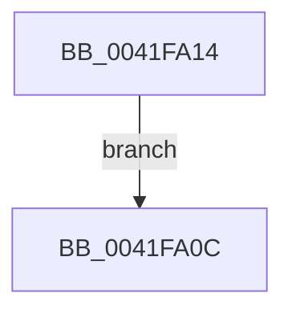

# sub_0041FA0C

- RVA: `0x0041FA0C`–`0x0041FA2A` (길이 `30` bytes)
- VA: `0x000000014041FA0C`
- 실행 섹션: `.text`
- PDB 이름 있음: `아니요`; PDB Function 태그: `아니요`
- unwind 정보 RVA: `0x0009FEA0`
- 디코드: `11`개 명령, `30/30` bytes 표시
- 미해석 바이트: `0` (있으면 어셈블리에 `.byte`로 보존)

> 이 문서는 커널 이미지의 기계어와 PDB 기호를 분석해 생성했습니다. 4번과 5번은 함수 원형과 자료형을 바이너리 사용 방식에서 추정한 C 해석이며 원본 소스 복구 결과는 아닙니다.

## 1. Dependencies

- 직접 호출 지점: **1**; 고유 호출 대상: **1**
- 직접 호출자로 확인된 함수: **0**
- RIP 상대 이미지 참조: **0**

### Outgoing calls
- `0x0041FA23` → [PerfLogExecutiveResourceInitialize](../65/PerfLogExecutiveResourceInitialize_function_006525E8.md) (function, `0x006525E8`)

### Direct callers
- 이 함수 시작 RVA로 연결되는 직접 call은 확인되지 않았습니다. 간접 호출은 완전히 역산할 수 없습니다.

### Static image references
- 디코드된 RIP-relative 메모리 참조가 없습니다.

## 2. Other-region calls and transfers

- 다른 실행 섹션으로 향하는 call: **0**
- 별도 외부 분기/꼬리 이동을 확인하지 못했습니다.

## 3. Assembly (complete function range)

```asm
0041FA0C  33 C0                           xor eax, eax
0041FA0E  48 83 C4 20                     add rsp, 0x20
0041FA12  5B                              pop rbx
0041FA13  C3                              ret
0041FA14  CC                              int3
0041FA15  45 33 C9                        xor r9d, r9d
0041FA18  45 33 C0                        xor r8d, r8d
0041FA1B  48 8B D3                        mov rdx, rbx
0041FA1E  B9 08 00 01 00                  mov ecx, 0x10008
0041FA23  E8 C0 2B 23 00                  call 0x1406525e8
0041FA28  EB E2                           jmp 0x14041fa0c
```

## 4. C-style interpretation (structured pseudocode)

```c
__int64 __fastcall sub_0041FA0C(__int64 a1, __int64 a2, int a3, int a4)
{
    __int64 result;
    __int64 v_rsp;

    result = 0;
    v_rsp = (v_rsp) + (32);
    return result;
}
```

## 5. (Beta) C Style

```c
int64_t sub_0041FA0C(int64_t Arg1, int64_t Arg2, int32_t Arg3, int32_t Arg4)
{
    int64_t result;
    int64_t local_rsp;

    result = 0;
    local_rsp = (local_rsp) + (32);
    return result;
}
```

## 6. Execution-region graph

[열기: 2D/3D 그래프와 함수 탐색 컨트롤 패널](../../../control-panel.html?section=text&rva=0x0041FA0C&view=graph)

- 2D 그래프는 위에서 아래로 흐르고, 3D 그래프는 빈 공간을 드래그해 회전합니다. Shift+드래그는 이동, 휠은 확대·축소, 함수 노드 선택은 대상 보고서 이동입니다.

### Static fallback


