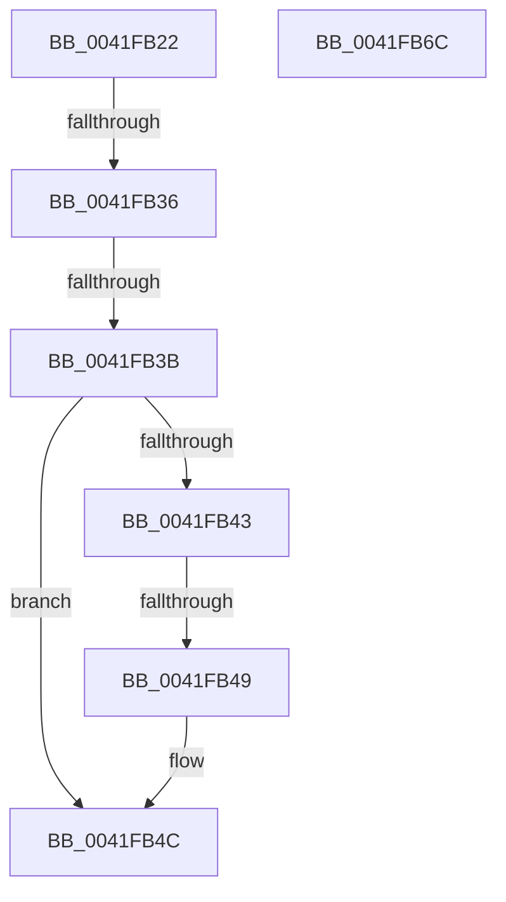

# sub_0041FB22

- RVA: `0x0041FB22`–`0x0041FB6D` (길이 `75` bytes)
- VA: `0x000000014041FB22`
- 실행 섹션: `.text`
- PDB 이름 있음: `아니요`; PDB Function 태그: `아니요`
- unwind 정보 RVA: `0x0009FF04`
- 디코드: `24`개 명령, `75/75` bytes 표시
- 미해석 바이트: `0` (있으면 어셈블리에 `.byte`로 보존)

> 이 문서는 커널 이미지의 기계어와 PDB 기호를 분석해 생성했습니다. 4번과 5번은 함수 원형과 자료형을 바이너리 사용 방식에서 추정한 C 해석이며 원본 소스 복구 결과는 아닙니다.

## 1. Dependencies

- 직접 호출 지점: **2**; 고유 호출 대상: **2**
- 직접 호출자로 확인된 함수: **0**
- RIP 상대 이미지 참조: **0**

### Outgoing calls
- `0x0041FB27` → [FsRtlAcquireAutoExpandPushLockShared](../26/FsRtlAcquireAutoExpandPushLockShared_function_002642D0.md) (function, `0x002642D0`)
- `0x0041FB4F` → [FsRtlReleaseAutoExpandPushLockShared](../26/FsRtlReleaseAutoExpandPushLockShared_function_00265514.md) (function, `0x00265514`)

### Direct callers
- 이 함수 시작 RVA로 연결되는 직접 call은 확인되지 않았습니다. 간접 호출은 완전히 역산할 수 없습니다.

### Static image references
- 디코드된 RIP-relative 메모리 참조가 없습니다.

## 2. Other-region calls and transfers

- 다른 실행 섹션으로 향하는 call: **0**
- call이 아닌 외부 분기/꼬리 이동: **3**
  - `0x0041FB34` → [sub_0041FB80](Unknown_function_0041FB80.md) (`tail-transfer`)
  - `0x0041FB39` → [sub_0041FB80 + 0xD](Unknown_function_0041FB80.md) (`tail-transfer`)
  - `0x0041FB47` → [sub_0041FB80 + 0x8](Unknown_function_0041FB80.md) (`tail-transfer`)

## 3. Assembly (complete function range)

```asm
0041FB22  48 89 6C 24 30                  mov qword ptr [rsp + 0x30], rbp
0041FB27  E8 A4 47 E4 FF                  call 0x1402642d0
0041FB2C  33 ED                           xor ebp, ebp
0041FB2E  48 8B D0                        mov rdx, rax
0041FB31  48 85 DB                        test rbx, rbx
0041FB34  75 4A                           jne 0x14041fb80
0041FB36  48 85 FF                        test rdi, rdi
0041FB39  74 52                           je 0x14041fb8d
0041FB3B  48 8B 06                        mov rax, qword ptr [rsi]
0041FB3E  48 3B C6                        cmp rax, rsi
0041FB41  74 09                           je 0x14041fb4c
0041FB43  48 39 78 10                     cmp qword ptr [rax + 0x10], rdi
0041FB47  75 3F                           jne 0x14041fb88
0041FB49  48 8B E8                        mov rbp, rax
0041FB4C  48 8B CA                        mov rcx, rdx
0041FB4F  E8 C0 59 E4 FF                  call 0x140265514
0041FB54  48 8B 5C 24 38                  mov rbx, qword ptr [rsp + 0x38]
0041FB59  48 8B C5                        mov rax, rbp
0041FB5C  48 8B 6C 24 30                  mov rbp, qword ptr [rsp + 0x30]
0041FB61  48 8B 74 24 40                  mov rsi, qword ptr [rsp + 0x40]
0041FB66  48 83 C4 20                     add rsp, 0x20
0041FB6A  5F                              pop rdi
0041FB6B  C3                              ret
0041FB6C  CC                              int3
```

## 4. C-style interpretation (structured pseudocode)

```c
__int64 __fastcall sub_0041FB22(__int64 a1, __int64 a2, __int64 a3, __int64 a4, __int64 a5, __int64 a6, __int64 a7, __int64 a8)
{
    __int64 result;
    __int64 v_rbp;
    __int64 v_rsp;
    unsigned __int64 v_stack_p30;

    v_stack_p30 = v_rbp;
    result = FsRtlAcquireAutoExpandPushLockShared(a1, a2, a3, a4);
    v_rbp = 0;
    if ((*(unsigned __int64 *)(v_rsi)) == v_rsi) goto loc_0041FB4C;
loc_0041FB4C:
    result = FsRtlReleaseAutoExpandPushLockShared(result, result, a3, a4);
    v_rsp = (v_rsp) + (32);
    return *(unsigned __int64 *)(v_rsi);
}
```

## 5. (Beta) C Style

```c
int64_t sub_0041FB22(int64_t Arg1, int64_t Arg2, int64_t Arg3, int64_t Arg4, uint64_t Arg5, int64_t Arg6, int64_t Arg7, int64_t Arg8)
{
    int64_t result;
    int64_t local_rbp;
    int64_t local_rsp;
    uint64_t v_stack_p30;

    v_stack_p30 = local_rbp;
    result = FsRtlAcquireAutoExpandPushLockShared(Arg1, Arg2, Arg3, Arg4);
    local_rbp = 0;
    if ((*(uint64_t *)(local_rsi)) == local_rsi) goto loc_0041FB4C;
loc_0041FB4C:
    result = FsRtlReleaseAutoExpandPushLockShared(result, result, Arg3, Arg4);
    local_rsp = (local_rsp) + (32);
    return *(uint64_t *)(local_rsi);
}
```

## 6. Execution-region graph

[열기: 2D/3D 그래프와 함수 탐색 컨트롤 패널](../../../control-panel.html?section=text&rva=0x0041FB22&view=graph)

- 2D 그래프는 위에서 아래로 흐르고, 3D 그래프는 빈 공간을 드래그해 회전합니다. Shift+드래그는 이동, 휠은 확대·축소, 함수 노드 선택은 대상 보고서 이동입니다.

### Static fallback


