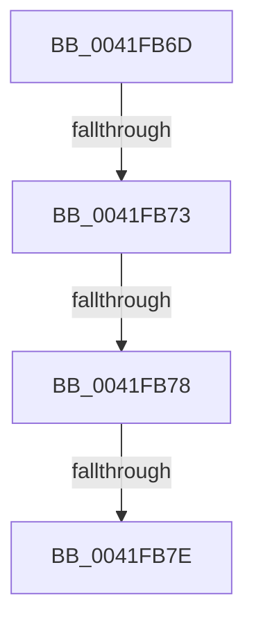

# sub_0041FB6D

- RVA: `0x0041FB6D`–`0x0041FB80` (길이 `19` bytes)
- VA: `0x000000014041FB6D`
- 실행 섹션: `.text`
- PDB 이름 있음: `아니요`; PDB Function 태그: `아니요`
- unwind 정보 RVA: `0x0009FF1C`
- 디코드: `7`개 명령, `19/19` bytes 표시
- 미해석 바이트: `0` (있으면 어셈블리에 `.byte`로 보존)

> 이 문서는 커널 이미지의 기계어와 PDB 기호를 분석해 생성했습니다. 4번과 5번은 함수 원형과 자료형을 바이너리 사용 방식에서 추정한 C 해석이며 원본 소스 복구 결과는 아닙니다.

## 1. Dependencies

- 직접 호출 지점: **0**; 고유 호출 대상: **0**
- 직접 호출자로 확인된 함수: **0**
- RIP 상대 이미지 참조: **0**

### Outgoing calls
- 직접 디코드된 call 명령이 없습니다.

### Direct callers
- 이 함수 시작 RVA로 연결되는 직접 call은 확인되지 않았습니다. 간접 호출은 완전히 역산할 수 없습니다.

### Static image references
- 디코드된 RIP-relative 메모리 참조가 없습니다.

## 2. Other-region calls and transfers

- 다른 실행 섹션으로 향하는 call: **0**
- call이 아닌 외부 분기/꼬리 이동: **4**
  - `0x0041FB71` → [FsRtlLookupPerFileContext + 0x26](FsRtlLookupPerFileContext_function_0041FAE0.md) (`tail-transfer`)
  - `0x0041FB76` → [FsRtlLookupPerFileContext + 0x31](FsRtlLookupPerFileContext_function_0041FAE0.md) (`tail-transfer`)
  - `0x0041FB7C` → [FsRtlLookupPerFileContext + 0x26](FsRtlLookupPerFileContext_function_0041FAE0.md) (`tail-transfer`)
  - `0x0041FB7E` → [FsRtlLookupPerFileContext + 0x31](FsRtlLookupPerFileContext_function_0041FAE0.md) (`tail-transfer`)

## 3. Assembly (complete function range)

```asm
0041FB6D  48 39 78 10                     cmp qword ptr [rax + 0x10], rdi
0041FB71  75 93                           jne 0x14041fb06
0041FB73  48 85 DB                        test rbx, rbx
0041FB76  74 99                           je 0x14041fb11
0041FB78  48 39 58 18                     cmp qword ptr [rax + 0x18], rbx
0041FB7C  75 88                           jne 0x14041fb06
0041FB7E  EB 91                           jmp 0x14041fb11
```

## 4. C-style interpretation (structured pseudocode)

```c
void __fastcall sub_0041FB6D(void)
{
}
```

## 5. (Beta) C Style

```c
void sub_0041FB6D(void)
{
}
```

## 6. Execution-region graph

[열기: 2D/3D 그래프와 함수 탐색 컨트롤 패널](../../../control-panel.html?section=text&rva=0x0041FB6D&view=graph)

- 2D 그래프는 위에서 아래로 흐르고, 3D 그래프는 빈 공간을 드래그해 회전합니다. Shift+드래그는 이동, 휠은 확대·축소, 함수 노드 선택은 대상 보고서 이동입니다.

### Static fallback


