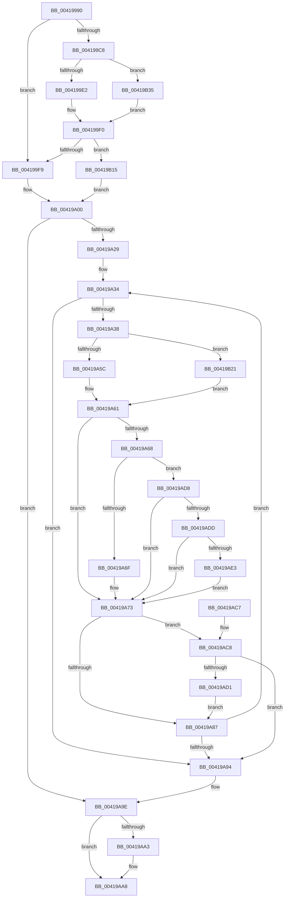

# UpcaseUnicodeToMultiByteNHelper

- RVA: `0x00419990`–`0x00419B3F` (길이 `431` bytes)
- VA: `0x0000000140419990`
- 실행 섹션: `.text`
- PDB 이름 있음: `예`; PDB Function 태그: `아니요`
- unwind 정보 RVA: `0x0009D258`
- 디코드: `117`개 명령, `431/431` bytes 표시
- 미해석 바이트: `0` (있으면 어셈블리에 `.byte`로 보존)

> 이 문서는 커널 이미지의 기계어와 PDB 기호를 분석해 생성했습니다. 4번과 5번은 함수 원형과 자료형을 바이너리 사용 방식에서 추정한 C 해석이며 원본 소스 복구 결과는 아닙니다.

## 1. Dependencies

- 직접 호출 지점: **1**; 고유 호출 대상: **1**
- 직접 호출자로 확인된 함수: **3**
- RIP 상대 이미지 참조: **1**

### Outgoing calls
- `0x00419B35` → [PsGetEffectiveServerSilo](../22/PsGetEffectiveServerSilo_function_002257F0.md) (function, `0x002257F0`)

### Direct callers
- [RtlUpcaseUnicodeToOemN](../../page/90/RtlUpcaseUnicodeToOemN_function_0090CC70.md) at `0x0090CD0D`
- [RtlUpcaseUnicodeToMultiByteN](../../page/90/RtlUpcaseUnicodeToMultiByteN_function_0090D760.md) at `0x0090D7F9`
- [RtlUpcaseUnicodeStringToCountedOemString](../../page/90/RtlUpcaseUnicodeStringToCountedOemString_function_0090E4D0.md) at `0x0090E621`

### Static image references
- `0x004199F9` → RVA `0x00FCF940` (`CACHEALI`; read)

## 2. Other-region calls and transfers

- 다른 실행 섹션으로 향하는 call: **0**
- 별도 외부 분기/꼬리 이동을 확인하지 못했습니다.

## 3. Assembly (complete function range)

```asm
00419990  48 89 5C 24 10                  mov qword ptr [rsp + 0x10], rbx
00419995  4C 89 44 24 18                  mov qword ptr [rsp + 0x18], r8
0041999A  55                              push rbp
0041999B  56                              push rsi
0041999C  57                              push rdi
0041999D  41 54                           push r12
0041999F  41 55                           push r13
004199A1  41 56                           push r14
004199A3  41 57                           push r15
004199A5  48 83 EC 20                     sub rsp, 0x20
004199A9  65 8A 04 25 A0 01 00 00         mov al, byte ptr gs:[0x1a0]
004199B1  49 8B E9                        mov rbp, r9
004199B4  48 89 4C 24 60                  mov qword ptr [rsp + 0x60], rcx
004199B9  49 8B F0                        mov rsi, r8
004199BC  8B FA                           mov edi, edx
004199BE  48 8B D9                        mov rbx, rcx
004199C1  4C 8B F1                        mov r14, rcx
004199C4  84 C0                           test al, al
004199C6  75 31                           jne 0x1404199f9
004199C8  65 48 8B 04 25 88 01 00 00      mov rax, qword ptr gs:[0x188]
004199D1  48 8B 88 98 06 00 00            mov rcx, qword ptr [rax + 0x698]
004199D8  48 83 F9 FD                     cmp rcx, -3
004199DC  0F 85 53 01 00 00               jne 0x140419b35
004199E2  48 8B 80 20 02 00 00            mov rax, qword ptr [rax + 0x220]
004199E9  48 8B 80 F0 05 00 00            mov rax, qword ptr [rax + 0x5f0]
004199F0  48 85 C0                        test rax, rax
004199F3  0F 85 1C 01 00 00               jne 0x140419b15
004199F9  4C 8D 05 40 5F BB 00            lea r8, [rip + 0xbb5f40]
00419A00  44 8B 8C 24 80 00 00 00         mov r9d, dword ptr [rsp + 0x80]
00419A08  4D 8B B8 28 04 00 00            mov r15, qword ptr [r8 + 0x428]
00419A0F  4D 8B 98 30 04 00 00            mov r11, qword ptr [r8 + 0x430]
00419A16  4D 8B A0 98 04 00 00            mov r12, qword ptr [r8 + 0x498]
00419A1D  4D 8B A8 B0 04 00 00            mov r13, qword ptr [r8 + 0x4b0]
00419A24  45 85 C9                        test r9d, r9d
00419A27  74 75                           je 0x140419a9e
00419A29  BE E0 FF 00 00                  mov esi, 0xffe0
00419A2E  41 BE C0 00 00 00               mov r14d, 0xc0
00419A34  85 FF                           test edi, edi
00419A36  74 5C                           je 0x140419a94
00419A38  0F B7 45 00                     movzx eax, word ptr [rbp]
00419A3C  48 83 C5 02                     add rbp, 2
00419A40  41 0F B7 14 43                  movzx edx, word ptr [r11 + rax*2]
00419A45  8B C2                           mov eax, edx
00419A47  48 C1 E8 08                     shr rax, 8
00419A4B  41 0F B7 0C 44                  movzx ecx, word ptr [r12 + rax*2]
00419A50  0F B6 C2                        movzx eax, dl
00419A53  66 85 C9                        test cx, cx
00419A56  0F 85 C5 00 00 00               jne 0x140419b21
00419A5C  45 0F B7 14 47                  movzx r10d, word ptr [r15 + rax*2]
00419A61  66 41 83 FA 61                  cmp r10w, 0x61
00419A66  72 0B                           jb 0x140419a73
00419A68  66 41 83 FA 7A                  cmp r10w, 0x7a
00419A6D  77 69                           ja 0x140419ad8
00419A6F  66 44 03 D6                     add r10w, si
00419A73  41 0F B7 C2                     movzx eax, r10w
00419A77  41 0F B7 14 43                  movzx edx, word ptr [r11 + rax*2]
00419A7C  0F B7 CA                        movzx ecx, dx
00419A7F  66 C1 E9 08                     shr cx, 8
00419A83  84 C9                           test cl, cl
00419A85  75 41                           jne 0x140419ac8
00419A87  88 13                           mov byte ptr [rbx], dl
00419A89  FF CF                           dec edi
00419A8B  48 FF C3                        inc rbx
00419A8E  41 83 C1 FF                     add r9d, -1
00419A92  75 A0                           jne 0x140419a34
00419A94  48 8B 74 24 70                  mov rsi, qword ptr [rsp + 0x70]
00419A99  4C 8B 74 24 60                  mov r14, qword ptr [rsp + 0x60]
00419A9E  48 85 F6                        test rsi, rsi
00419AA1  74 05                           je 0x140419aa8
00419AA3  41 2B DE                        sub ebx, r14d
00419AA6  89 1E                           mov dword ptr [rsi], ebx
00419AA8  48 8B 5C 24 68                  mov rbx, qword ptr [rsp + 0x68]
00419AAD  41 3B F9                        cmp edi, r9d
00419AB0  1B C0                           sbb eax, eax
00419AB2  25 05 00 00 80                  and eax, 0x80000005
00419AB7  48 83 C4 20                     add rsp, 0x20
00419ABB  41 5F                           pop r15
00419ABD  41 5E                           pop r14
00419ABF  41 5D                           pop r13
00419AC1  41 5C                           pop r12
00419AC3  5F                              pop rdi
00419AC4  5E                              pop rsi
00419AC5  5D                              pop rbp
00419AC6  C3                              ret
00419AC7  CC                              int3
00419AC8  8B C7                           mov eax, edi
00419ACA  FF CF                           dec edi
00419ACC  83 F8 02                        cmp eax, 2
00419ACF  72 C3                           jb 0x140419a94
00419AD1  88 0B                           mov byte ptr [rbx], cl
00419AD3  48 FF C3                        inc rbx
00419AD6  EB AF                           jmp 0x140419a87
00419AD8  4D 85 ED                        test r13, r13
00419ADB  74 96                           je 0x140419a73
00419ADD  66 45 3B D6                     cmp r10w, r14w
00419AE1  72 90                           jb 0x140419a73
00419AE3  41 0F B7 D2                     movzx edx, r10w
00419AE7  41 0F B7 C2                     movzx eax, r10w
00419AEB  48 C1 E8 08                     shr rax, 8
00419AEF  41 0F B7 4C 45 00               movzx ecx, word ptr [r13 + rax*2]
00419AF5  8B C2                           mov eax, edx
00419AF7  C1 E8 04                        shr eax, 4
00419AFA  83 E2 0F                        and edx, 0xf
00419AFD  83 E0 0F                        and eax, 0xf
00419B00  03 C8                           add ecx, eax
00419B02  41 0F B7 4C 4D 00               movzx ecx, word ptr [r13 + rcx*2]
00419B08  03 CA                           add ecx, edx
00419B0A  66 45 03 54 4D 00               add r10w, word ptr [r13 + rcx*2]
00419B10  E9 5E FF FF FF                  jmp 0x140419a73
00419B15  4C 8B 80 E0 05 00 00            mov r8, qword ptr [rax + 0x5e0]
00419B1C  E9 DF FE FF FF                  jmp 0x140419a00
00419B21  48 03 C8                        add rcx, rax
00419B24  49 8B 80 40 04 00 00            mov rax, qword ptr [r8 + 0x440]
00419B2B  44 0F B7 14 48                  movzx r10d, word ptr [rax + rcx*2]
00419B30  E9 2C FF FF FF                  jmp 0x140419a61
00419B35  E8 B6 BC E0 FF                  call 0x1402257f0
00419B3A  E9 B1 FE FF FF                  jmp 0x1404199f0
```

## 4. C-style interpretation (structured pseudocode)

```c
__int64 __fastcall UpcaseUnicodeToMultiByteNHelper(__int64 a1, int a2, __int64 a3, __int64 a4, unsigned int a5)
{
    __int64 result;
    __int64 v_r10;
    __int64 v_rbp;
    __int64 v_rbx;
    __int64 v_rdi;
    __int64 v_rsp;
    unsigned __int64 v_stack_p10;
    unsigned __int64 v_stack_p18;
    unsigned __int64 v_stack_p8;

    v_stack_p10 = v_rbx;
    v_stack_p18 = a3;
    v_rsp = (v_rsp) - (32);
    v_stack_p8 = a1;
    if ((unsigned __int8)(*(unsigned __int8 *)(gs_base + (0 + 416))) != 0) goto loc_004199F9;
    if ((*(unsigned __int64 *)(*(unsigned __int64 *)(gs_base + (0 + 392)) + 1688)) != -3) goto loc_00419B35;
loc_004199F0:
    if (*(unsigned __int64 *)(*(unsigned __int64 *)(*(unsigned __int64 *)(gs_base + (0 + 392)) + 544) + 1520) != 0) goto loc_00419B15;
loc_004199F9:
loc_00419A00:
    if ((unsigned int)((unsigned int)(a5)) == 0) goto loc_00419A9E;
loc_00419A34:
    if ((unsigned int)((unsigned int)(a2)) == 0) goto loc_00419A94;
    v_rbp = (a4) + (2);
    result = ((unsigned int)((unsigned int)(*(unsigned __int16 *)(*(unsigned __int64 *)(v_rip + 12279616 + 1072) + *(unsigned __int16 *)(a4) * 2)))) >> (8);
    if ((unsigned __int16)(*(unsigned __int16 *)(*(unsigned __int64 *)(v_rip + 12279616 + 1176) + result * 2)) != 0) goto loc_00419B21;
loc_00419A61:
    if (((unsigned __int16)(*(unsigned __int16 *)(*(unsigned __int64 *)(v_rip + 12279616 + 1064) + (unsigned __int8)(*(unsigned __int16 *)(*(unsigned __int64 *)(v_rip + 12279616 + 1072) + *(unsigned __int16 *)(a4) * 2)) * 2))) < 97) goto loc_00419A73;
    if (((unsigned __int16)(*(unsigned __int16 *)(*(unsigned __int64 *)(v_rip + 12279616 + 1064) + (unsigned __int8)(*(unsigned __int16 *)(*(unsigned __int64 *)(v_rip + 12279616 + 1072) + *(unsigned __int16 *)(a4) * 2)) * 2))) > 122) goto loc_00419AD8;
    v_r10 = (unsigned __int16)((*(unsigned __int16 *)(*(unsigned __int64 *)(v_rip + 12279616 + 1064) + (unsigned __int8)(*(unsigned __int16 *)(*(unsigned __int64 *)(v_rip + 12279616 + 1072) + *(unsigned __int16 *)(a4) * 2)) * 2)) + ((unsigned __int16)((unsigned int)(0xFFE0ULL))));
loc_00419A73:
    a1 = (unsigned __int16)(((unsigned __int16)(*(unsigned __int16 *)(*(unsigned __int64 *)(v_rip + 12279616 + 1072) + (unsigned __int16)(v_r10) * 2))) >> (8));
    if ((unsigned __int8)(a1) != 0) goto loc_00419AC8;
loc_00419A87:
    *(unsigned __int8 *)(a1) = (unsigned __int8)(*(unsigned __int16 *)(*(unsigned __int64 *)(v_rip + 12279616 + 1072) + (unsigned __int16)(v_r10) * 2));
    v_rdi = (unsigned int)(((unsigned int)(a2)) - 1);
    v_rbx = (a1) + 1;
    a4 = (unsigned int)(((unsigned int)(a5)) + (-1));
    if (condition_is_not_equal) goto loc_00419A34;
loc_00419A94:
loc_00419A9E:
    if (v_stack_p18 != 0) {
        v_rbx = (unsigned int)((v_rbx) - ((unsigned int)(v_stack_p8)));
        *(unsigned int *)(v_stack_p18) = (unsigned int)(v_rbx);
    }
    result = (unsigned int)(((unsigned __int16)(v_r10)) & (0x80000005ULL));
    v_rsp = (v_rsp) + (32);
    return result;
loc_00419AC8:
    v_rdi = (unsigned int)((v_rdi) - 1);
    if (((unsigned int)((unsigned int)((unsigned int)(v_rdi)))) < 2) goto loc_00419A94;
    *(unsigned __int8 *)(v_stack_p10) = (unsigned __int8)(a1);
    v_rbx = (v_stack_p10) + 1;
    goto loc_00419A87;
loc_00419AD8:
    if (*(unsigned __int64 *)(v_rip + 12279616 + 1200) == 0) goto loc_00419A73;
    if (((unsigned __int16)(v_r10)) < ((unsigned __int16)(v_stack_p8))) goto loc_00419A73;
    result = ((unsigned __int16)(v_r10)) >> (8);
    result = (unsigned int)(((unsigned int)((unsigned int)((unsigned __int16)(v_r10)))) >> (4));
    a2 = (unsigned int)(((unsigned __int16)(v_r10)) & (15));
    result = (unsigned int)((result) & (15));
    a1 = (unsigned int)((*(unsigned __int16 *)(*(unsigned __int64 *)(v_rip + 12279616 + 1200) + result * 2)) + ((unsigned int)(result)));
    a1 = (unsigned int)((*(unsigned __int16 *)(*(unsigned __int64 *)(v_rip + 12279616 + 1200) + a1 * 2)) + (a2));
    v_r10 = (unsigned __int16)((v_r10) + (*(unsigned __int16 *)(*(unsigned __int64 *)(v_rip + 12279616 + 1200) + a1 * 2)));
    goto loc_00419A73;
loc_00419B15:
    goto loc_00419A00;
loc_00419B21:
    a1 = (a1) + (result);
    goto loc_00419A61;
loc_00419B35:
    result = PsGetEffectiveServerSilo(a1, a2, *(unsigned __int64 *)(result + 1504), a4);
    goto loc_004199F0;
}
```

## 5. (Beta) C Style

```c
int64_t UpcaseUnicodeToMultiByteNHelper(int64_t Arg1, int32_t Arg2, int64_t Arg3, void *Arg4, uint32_t Arg5)
{
    uint8_t *arg4 = (uint8_t *)Arg4;

    int64_t result;
    int64_t local_r10;
    int64_t local_rbp;
    int64_t local_rbx;
    int64_t local_rdi;
    int64_t local_rsp;
    uint64_t v_stack_p10;
    uint64_t v_stack_p18;
    uint64_t v_stack_p8;

    v_stack_p10 = local_rbx;
    v_stack_p18 = Arg3;
    local_rsp = (local_rsp) - (32);
    v_stack_p8 = Arg1;
    if ((uint8_t)(*(uint8_t *)(gs_base + (0 + 0x1A0))) != 0) goto loc_004199F9;
    if ((*(uint64_t *)(*(uint64_t *)(gs_base + (0 + 0x188)) + 0x698)) != -3) goto loc_00419B35;
loc_004199F0:
    if (*(uint64_t *)(*(uint64_t *)(*(uint64_t *)(gs_base + (0 + 0x188)) + 0x220) + 0x5F0) != 0) goto loc_00419B15;
loc_004199F9:
loc_00419A00:
    if ((uint32_t)((uint32_t)(Arg5)) == 0) goto loc_00419A9E;
loc_00419A34:
    if ((uint32_t)((uint32_t)(Arg2)) == 0) goto loc_00419A94;
    local_rbp = (Arg4) + (2);
    result = ((uint32_t)((uint32_t)(*(uint16_t *)(*(uint64_t *)(v_rip + 0xBB5F40 + 0x430) + *(uint16_t *)(arg4) * 2)))) >> (8);
    if ((uint16_t)(*(uint16_t *)(*(uint64_t *)(v_rip + 0xBB5F40 + 0x498) + result * 2)) != 0) goto loc_00419B21;
loc_00419A61:
    if (((uint16_t)(*(uint16_t *)(*(uint64_t *)(v_rip + 0xBB5F40 + 0x428) + (uint8_t)(*(uint16_t *)(*(uint64_t *)(v_rip + 0xBB5F40 + 0x430) + *(uint16_t *)(arg4) * 2)) * 2))) < 97) goto loc_00419A73;
    if (((uint16_t)(*(uint16_t *)(*(uint64_t *)(v_rip + 0xBB5F40 + 0x428) + (uint8_t)(*(uint16_t *)(*(uint64_t *)(v_rip + 0xBB5F40 + 0x430) + *(uint16_t *)(arg4) * 2)) * 2))) > 122) goto loc_00419AD8;
    local_r10 = (uint16_t)((*(uint16_t *)(*(uint64_t *)(v_rip + 0xBB5F40 + 0x428) + (uint8_t)(*(uint16_t *)(*(uint64_t *)(v_rip + 0xBB5F40 + 0x430) + *(uint16_t *)(arg4) * 2)) * 2)) + ((uint16_t)((uint32_t)(0xFFE0ULL))));
loc_00419A73:
    Arg1 = (uint16_t)(((uint16_t)(*(uint16_t *)(*(uint64_t *)(v_rip + 0xBB5F40 + 0x430) + (uint16_t)(local_r10) * 2))) >> (8));
    if ((uint8_t)(Arg1) != 0) goto loc_00419AC8;
loc_00419A87:
    *(uint8_t *)(Arg1) = (uint8_t)(*(uint16_t *)(*(uint64_t *)(v_rip + 0xBB5F40 + 0x430) + (uint16_t)(local_r10) * 2));
    local_rdi = (uint32_t)(((uint32_t)(Arg2)) - 1);
    local_rbx = (Arg1) + 1;
    Arg4 = (uint32_t)(((uint32_t)(Arg5)) + (-1));
    if (condition_is_not_equal) goto loc_00419A34;
loc_00419A94:
loc_00419A9E:
    if (v_stack_p18 != 0) {
        local_rbx = (uint32_t)((local_rbx) - ((uint32_t)(v_stack_p8)));
        *(uint32_t *)(v_stack_p18) = (uint32_t)(local_rbx);
    }
    result = (uint32_t)(((uint16_t)(local_r10)) & (0x80000005ULL));
    local_rsp = (local_rsp) + (32);
    return result;
loc_00419AC8:
    local_rdi = (uint32_t)((local_rdi) - 1);
    if (((uint32_t)((uint32_t)((uint32_t)(local_rdi)))) < 2) goto loc_00419A94;
    *(uint8_t *)(v_stack_p10) = (uint8_t)(Arg1);
    local_rbx = (v_stack_p10) + 1;
    goto loc_00419A87;
loc_00419AD8:
    if (*(uint64_t *)(v_rip + 0xBB5F40 + 0x4B0) == 0) goto loc_00419A73;
    if (((uint16_t)(local_r10)) < ((uint16_t)(v_stack_p8))) goto loc_00419A73;
    result = ((uint16_t)(local_r10)) >> (8);
    result = (uint32_t)(((uint32_t)((uint32_t)((uint16_t)(local_r10)))) >> (4));
    Arg2 = (uint32_t)(((uint16_t)(local_r10)) & (15));
    result = (uint32_t)((result) & (15));
    Arg1 = (uint32_t)((*(uint16_t *)(*(uint64_t *)(v_rip + 0xBB5F40 + 0x4B0) + result * 2)) + ((uint32_t)(result)));
    Arg1 = (uint32_t)((*(uint16_t *)(*(uint64_t *)(v_rip + 0xBB5F40 + 0x4B0) + Arg1 * 2)) + (Arg2));
    local_r10 = (uint16_t)((local_r10) + (*(uint16_t *)(*(uint64_t *)(v_rip + 0xBB5F40 + 0x4B0) + Arg1 * 2)));
    goto loc_00419A73;
loc_00419B15:
    goto loc_00419A00;
loc_00419B21:
    Arg1 = (Arg1) + (result);
    goto loc_00419A61;
loc_00419B35:
    result = PsGetEffectiveServerSilo(Arg1, Arg2, *(uint64_t *)(result + 0x5E0), Arg4);
    goto loc_004199F0;
}
```

### 관측된 메모리 오프셋

구조체 형식이 확인되지 않은 접근은 인자 기준의 오프셋으로만 기록했습니다.

| 기준 인자 | 오프셋 표현 | 폭 (bit) | 접근 |
|---|---:|---:|---|
| `Arg4` | `+ 0x0` | `16` | `R` |

## 6. Execution-region graph

[열기: 2D/3D 그래프와 함수 탐색 컨트롤 패널](../../../control-panel.html?section=text&rva=0x00419990&view=graph)

- 2D 그래프는 위에서 아래로 흐르고, 3D 그래프는 빈 공간을 드래그해 회전합니다. Shift+드래그는 이동, 휠은 확대·축소, 함수 노드 선택은 대상 보고서 이동입니다.

### Static fallback


