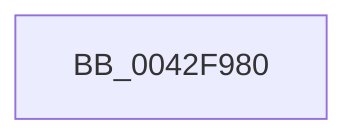

# AuthzBasepSetAccessReasons

- RVA: `0x0042F980`–`0x0042F991` (길이 `17` bytes)
- VA: `0x000000014042F980`
- 실행 섹션: `.text`
- PDB 이름 있음: `예`; PDB Function 태그: `아니요`
- unwind 정보 RVA: `0x000A1F84`
- 디코드: `6`개 명령, `17/17` bytes 표시
- 미해석 바이트: `0` (있으면 어셈블리에 `.byte`로 보존)

> 이 문서는 커널 이미지의 기계어와 PDB 기호를 분석해 생성했습니다. 4번과 5번은 함수 원형과 자료형을 바이너리 사용 방식에서 추정한 C 해석이며 원본 소스 복구 결과는 아닙니다.

## 1. Dependencies

- 직접 호출 지점: **0**; 고유 호출 대상: **0**
- 직접 호출자로 확인된 함수: **5**
- RIP 상대 이미지 참조: **0**

### Outgoing calls
- 직접 디코드된 call 명령이 없습니다.

### Direct callers
- [SepCommonAccessCheckEx](../47/SepCommonAccessCheckEx_function_0047602C.md) at `0x004761D8`
- [SepCommonAccessCheckEx](../47/SepCommonAccessCheckEx_function_0047602C.md) at `0x00476397`
- [SepCommonAccessCheckEx](../47/SepCommonAccessCheckEx_function_0047602C.md) at `0x00476775`
- [SepCommonAccessCheckEx](../47/SepCommonAccessCheckEx_function_0047602C.md) at `0x00476D37`
- [SepCommonAccessCheckEx](../47/SepCommonAccessCheckEx_function_0047602C.md) at `0x00476F0C`
- [SepCommonAccessCheckEx](../47/SepCommonAccessCheckEx_function_0047602C.md) at `0x00476F3B`
- [SepCommonAccessCheckEx](../47/SepCommonAccessCheckEx_function_0047602C.md) at `0x00477170`
- [SepCommonAccessCheckEx](../47/SepCommonAccessCheckEx_function_0047602C.md) at `0x004771C7`
- [SepCommonAccessCheckEx](../47/SepCommonAccessCheckEx_function_0047602C.md) at `0x00477214`
- [SepMaximumAccessCheckEx](../60/SepMaximumAccessCheckEx_function_00606D78.md) at `0x00606DFC`
- [SepMaximumAccessCheckEx](../60/SepMaximumAccessCheckEx_function_00606D78.md) at `0x006071B9`
- [sub_006E8E06](../6E/Unknown_function_006E8E06.md) at `0x006E9015`
- [sub_006E9392](../6E/Unknown_function_006E9392.md) at `0x006E93D4`
- [sub_006E9392](../6E/Unknown_function_006E9392.md) at `0x006E94A7`
- [sub_006FC922](../6F/Unknown_function_006FC922.md) at `0x006FC983`

### Static image references
- 디코드된 RIP-relative 메모리 참조가 없습니다.

## 2. Other-region calls and transfers

- 다른 실행 섹션으로 향하는 call: **0**
- call이 아닌 외부 분기/꼬리 이동: **1**
  - `0x0042F98F` → [sub_0042F9CA](Unknown_function_0042F9CA.md) (`tail-transfer`)

## 3. Assembly (complete function range)

```asm
0042F980  40 57                           push rdi
0042F982  45 33 D2                        xor r10d, r10d
0042F985  8B FA                           mov edi, edx
0042F987  B8 01 00 00 00                  mov eax, 1
0042F98C  4D 85 C9                        test r9, r9
0042F98F  74 39                           je 0x14042f9ca
```

## 4. C-style interpretation (structured pseudocode)

```c
__int64 __fastcall AuthzBasepSetAccessReasons(__int64 a1, int a2, __int64 a3, __int64 a4)
{
    __int64 v_r10;

    v_r10 = 0;
}
```

## 5. (Beta) C Style

```c
int64_t AuthzBasepSetAccessReasons(int64_t Arg1, int32_t Arg2, int64_t Arg3, int64_t Arg4)
{
    int64_t local_r10;

    local_r10 = 0;
}
```

## 6. Execution-region graph

[열기: 2D/3D 그래프와 함수 탐색 컨트롤 패널](../../../control-panel.html?section=text&rva=0x0042F980&view=graph)

- 2D 그래프는 위에서 아래로 흐르고, 3D 그래프는 빈 공간을 드래그해 회전합니다. Shift+드래그는 이동, 휠은 확대·축소, 함수 노드 선택은 대상 보고서 이동입니다.

### Static fallback


