# CcPostVolumeTelemetry

- RVA: `0x00420FF8`–`0x004230C6` (길이 `8,398` bytes)
- VA: `0x0000000140420FF8`
- 실행 섹션: `.text`
- PDB 이름 있음: `예`; PDB Function 태그: `아니요`
- unwind 정보 RVA: `0x000A02A8`
- 디코드: `1,180`개 명령, `8,398/8,398` bytes 표시
- 미해석 바이트: `0` (있으면 어셈블리에 `.byte`로 보존)

> 이 문서는 커널 이미지의 기계어와 PDB 기호를 분석해 생성했습니다. 4번과 5번은 함수 원형과 자료형을 바이너리 사용 방식에서 추정한 C 해석이며 원본 소스 복구 결과는 아닙니다.

## 1. Dependencies

- 직접 호출 지점: **22**; 고유 호출 대상: **19**
- 직접 호출자로 확인된 함수: **1**
- RIP 상대 이미지 참조: **68**

### Outgoing calls
- `0x004210C9` → [ExAllocatePoolWithTag](../../poolcode/B8/ExAllocatePoolWithTag_function_00B82010.md) (function, `0x00B82010`)
- `0x004210E2` → [KeRcuReadLock](../38/KeRcuReadLock_function_0038A1A0.md) (function, `0x0038A1A0`)
- `0x00421133` → [CcHasVolumeTelemetryChanged](../4C/CcHasVolumeTelemetryChanged_function_004C3918.md) (function, `0x004C3918`)
- `0x00421141` → [CcHasVolumeCumulativeTelemetryChanged](../20/CcHasVolumeCumulativeTelemetryChanged_function_002006F8.md) (function, `0x002006F8`)
- `0x00421156` → [CcAggregateCumulativeVolumeTelemetry](../20/CcAggregateCumulativeVolumeTelemetry_function_00200444.md) (function, `0x00200444`)
- `0x00421171` → [memcpy](../6C/memcpy_function_006C6840.md) (function, `0x006C6840`)
- `0x00421189` → [memset](../6C/memset_function_006C6C40.md) (function, `0x006C6C40`)
- `0x004211A8` → [memset](../6C/memset_function_006C6C40.md) (function, `0x006C6C40`)
- `0x004211D1` → [KeRcuReadUnlock](../38/KeRcuReadUnlock_function_0038A070.md) (function, `0x0038A070`)
- `0x004211D6` → [CcAggregateCumulativeGlobalTelemetry](../../page/AC/CcAggregateCumulativeGlobalTelemetry_function_00AC9300.md) (function, `0x00AC9300`)
- `0x004212E3` → [McTemplateK0xxxxxxxxxxxxxxxxxxq_EtwWriteTransfer](../4F/McTemplateK0xxxxxxxxxxxxxxxxxxq_EtwWriteTransfer_function_004F7528.md) (function, `0x004F7528`)
- `0x004212E8` → [CcResetGlobalTelemetry](../../page/AC/CcResetGlobalTelemetry_function_00ACF980.md) (function, `0x00ACF980`)
- `0x0042131B` → [tlgKeywordOn](tlgKeywordOn_function_0042EAA0.md) (function, `0x0042EAA0`)
- `0x00421692` → [tlgWriteTransfer_EtwWriteTransfer](tlgWriteTransfer_EtwWriteTransfer_function_004260E0.md) (function, `0x004260E0`)
- `0x0042196B` → [McTemplateK0jxxxxxxxxxxxxxxxxxxxxxxxxxxxxxxxxxxxx_EtwWriteTransfer](../4C/McTemplateK0jxxxxxxxxxxxxxxxxxxxxxxxxxxxxxxxxxxxx_EtwWriteTransfer_function_004CEF9C.md) (function, `0x004CEF9C`)
- `0x00421DB1` → [McTemplateK0jxxxxxxxxxxxxxxxxxxxxxxxxxxxxxxxxxxxxxxxxxxxxxxxxxxxxxxxxxxxxxxxxxxxxxxxxx_EtwWriteTransfer](McTemplateK0jxxxxxxxxxxxxxxxxxxxxxxxxxxxxxxxxxxxxxxxxxxxxxxxxxxxxxxxxxxxxxxxxxxxxxxxxx_EtwWriteTrans_function_004235B8.md) (function, `0x004235B8`)
- `0x004224B0` → [McTemplateK0jxxxxxxxxxxxxxxxxxxxxxxxxxxxxxxxxxxxxxxxxxxxxxxxxx_EtwWriteTransfer](McTemplateK0jxxxxxxxxxxxxxxxxxxxxxxxxxxxxxxxxxxxxxxxxxxxxxxxxx_EtwWriteTransfer_function_00423CE4.md) (function, `0x00423CE4`)
- `0x004224F6` → [tlgKeywordOn](tlgKeywordOn_function_0042EAA0.md) (function, `0x0042EAA0`)
- `0x00422D32` → [tlgCreate1Sz_wchar_t](tlgCreate1Sz_wchar_t_function_00426198.md) (function, `0x00426198`)
- `0x00423047` → [tlgWriteTransfer_EtwWriteTransfer](tlgWriteTransfer_EtwWriteTransfer_function_004260E0.md) (function, `0x004260E0`)
- `0x0042308E` → [ExFreePoolWithTag](../../poolcode/B8/ExFreePoolWithTag_function_00B82870.md) (function, `0x00B82870`)
- `0x0042309E` → [_security_check_cookie](../6A/_security_check_cookie_function_006AC640.md) (function, `0x006AC640`)

### Direct callers
- [CcTelemetryPeriodicTimerCallback](../../page/A8/CcTelemetryPeriodicTimerCallback_function_00A88370.md) at `0x00A883E1`

### Static image references
- `0x00421018` → RVA `0x00E0A740` (`.data`; read)
- `0x00421055` → RVA `0x00F8F270` (`.data`; read)
- `0x0042105F` → RVA `0x00F8F278` (`.data`; read)
- `0x00421066` → RVA `0x00F8F288` (`.data`; read)
- `0x0042106F` → RVA `0x00F8F298` (`.data`; read)
- `0x0042107F` → RVA `0x00F8F290` (`.data`; read)
- `0x0042109D` → RVA `0x00F8F298` (`.data`; read/write)
- `0x004210A4` → RVA `0x00F8F2A8` (`.data`; read)
- `0x004210E7` → RVA `0x00F8F560` (`.data`; read)
- `0x004211DB` → RVA `0x00F8F600` (`.data`; read)
- `0x00421208` → RVA `0x00F8F2E0` (`.data`; read)
- `0x00421217` → RVA `0x00F8F2D8` (`.data`; read)
- `0x00421226` → RVA `0x00F8F2D0` (`.data`; read)
- `0x00421235` → RVA `0x00F8F2C8` (`.data`; read)
- `0x00421244` → RVA `0x00F8F2C0` (`.data`; read)
- `0x00421253` → RVA `0x00F8F330` (`.data`; read)
- `0x0042125F` → RVA `0x00F8F328` (`.data`; read)
- `0x0042126B` → RVA `0x00F8F320` (`.data`; read)
- `0x00421277` → RVA `0x00F8F318` (`.data`; read)
- `0x00421283` → RVA `0x00F8F310` (`.data`; read)
- `0x0042128F` → RVA `0x00F8F308` (`.data`; read)
- `0x0042129B` → RVA `0x00F8F300` (`.data`; read)
- `0x004212A7` → RVA `0x00F8F2F8` (`.data`; read)
- `0x004212B3` → RVA `0x00F8F2F0` (`.data`; read)
- `0x004212BF` → RVA `0x00F8F2E8` (`.data`; read)
- `0x004212CB` → RVA `0x00F8F2B8` (`.data`; read)
- `0x004212D7` → RVA `0x00F8F2B0` (`.data`; read)
- `0x004212FD` → RVA `0x00E06C18` (`.data`; read)
- `0x004213A9` → RVA `0x00E0A874` (`.data`; read)
- `0x004213D2` → RVA `0x00F8F338` (`.data`; read)
- `0x004213F9` → RVA `0x00F8F340` (`.data`; read)
- `0x00421420` → RVA `0x00F8F370` (`.data`; read)
- `0x00421447` → RVA `0x00F8F378` (`.data`; read)
- `0x0042146E` → RVA `0x00F8F380` (`.data`; read)
- `0x00421495` → RVA `0x00F8F388` (`.data`; read)
- `0x004214BC` → RVA `0x00F8F390` (`.data`; read)
- `0x004214E3` → RVA `0x00F8F398` (`.data`; read)
- `0x0042150A` → RVA `0x00F8F3A0` (`.data`; read)
- `0x00421531` → RVA `0x00F8F3A8` (`.data`; read)
- `0x00421558` → RVA `0x00F8F3B0` (`.data`; read)
- `0x0042157F` → RVA `0x00F8F3B8` (`.data`; read)
- `0x004215A6` → RVA `0x00F8F348` (`.data`; read)
- `0x004215CD` → RVA `0x00F8F350` (`.data`; read)
- `0x004215F4` → RVA `0x00F8F358` (`.data`; read)
- `0x0042161B` → RVA `0x00F8F360` (`.data`; read)
- `0x00421642` → RVA `0x00F8F368` (`.data`; read)
- `0x00421684` → RVA `0x00043EBA` (`.rdata`; read)
- `0x004216A2` → RVA `0x00F8F338` (`.data`; write)
- `0x004216A9` → RVA `0x00F8F340` (`.data`; write)
- `0x004216B0` → RVA `0x00F8F348` (`.data`; write)
- `0x004216B7` → RVA `0x00F8F350` (`.data`; write)
- `0x004216BE` → RVA `0x00F8F358` (`.data`; write)
- `0x004216C5` → RVA `0x00F8F360` (`.data`; write)
- `0x004216CC` → RVA `0x00F8F368` (`.data`; write)
- `0x004216D3` → RVA `0x00F8F370` (`.data`; write)
- `0x004216DA` → RVA `0x00F8F378` (`.data`; write)
- `0x004216E1` → RVA `0x00F8F380` (`.data`; write)
- `0x004216E8` → RVA `0x00F8F388` (`.data`; write)
- `0x004216EF` → RVA `0x00F8F390` (`.data`; write)
- `0x004216F6` → RVA `0x00F8F398` (`.data`; write)
- `0x004216FD` → RVA `0x00F8F3A0` (`.data`; write)
- `0x00421704` → RVA `0x00F8F3A8` (`.data`; write)
- `0x0042170B` → RVA `0x00F8F3B0` (`.data`; write)
- `0x00421712` → RVA `0x00F8F3B8` (`.data`; write)
- `0x00421719` → RVA `0x00F8F278` (`.data`; write)
- `0x00422D23` → RVA `0x006C8E10` (` ?? ::FNODOBFM::`string'`; read)
- `0x00423039` → RVA `0x0004390E` (`.rdata`; read)
- `0x00423082` → RVA `0x00F8F270` (`.data`; write)

## 2. Other-region calls and transfers

- 다른 실행 섹션으로 향하는 call: **4**
  - `0x004210C9` → [ExAllocatePoolWithTag](../../poolcode/B8/ExAllocatePoolWithTag_function_00B82010.md) (`.text` → `POOLCODE`)
  - `0x004211D6` → [CcAggregateCumulativeGlobalTelemetry](../../page/AC/CcAggregateCumulativeGlobalTelemetry_function_00AC9300.md) (`.text` → `PAGE`)
  - `0x004212E8` → [CcResetGlobalTelemetry](../../page/AC/CcResetGlobalTelemetry_function_00ACF980.md) (`.text` → `PAGE`)
  - `0x0042308E` → [ExFreePoolWithTag](../../poolcode/B8/ExFreePoolWithTag_function_00B82870.md) (`.text` → `POOLCODE`)
- 별도 외부 분기/꼬리 이동을 확인하지 못했습니다.

## 3. Assembly (complete function range)

```asm
00420FF8  48 8B C4                        mov rax, rsp
00420FFB  48 89 58 08                     mov qword ptr [rax + 8], rbx
00420FFF  48 89 70 10                     mov qword ptr [rax + 0x10], rsi
00421003  48 89 78 18                     mov qword ptr [rax + 0x18], rdi
00421007  4C 89 60 20                     mov qword ptr [rax + 0x20], r12
0042100B  41 55                           push r13
0042100D  41 56                           push r14
0042100F  41 57                           push r15
00421011  48 81 EC 60 09 00 00            sub rsp, 0x960
00421018  48 8B 05 21 97 9E 00            mov rax, qword ptr [rip + 0x9e9721]
0042101F  48 33 C4                        xor rax, rsp
00421022  48 89 84 24 50 09 00 00         mov qword ptr [rsp + 0x950], rax
0042102A  45 32 F6                        xor r14b, r14b
0042102D  44 88 B4 24 70 02 00 00         mov byte ptr [rsp + 0x270], r14b
00421035  83 A4 24 A4 02 00 00 00         and dword ptr [rsp + 0x2a4], 0
0042103D  83 A4 24 A8 02 00 00 00         and dword ptr [rsp + 0x2a8], 0
00421045  48 BE 14 00 00 00 80 F7 FF FF   movabs rsi, 0xfffff78000000014
0042104F  48 8B 36                        mov rsi, qword ptr [rsi]
00421052  48 8B DE                        mov rbx, rsi
00421055  48 2B 1D 14 E2 B6 00            sub rbx, qword ptr [rip + 0xb6e214]
0042105C  48 8B FE                        mov rdi, rsi
0042105F  48 2B 3D 12 E2 B6 00            sub rdi, qword ptr [rip + 0xb6e212]
00421066  48 3B 1D 1B E2 B6 00            cmp rbx, qword ptr [rip + 0xb6e21b]
0042106D  7D 10                           jge 0x14042107f
0042106F  48 8B 05 22 E2 B6 00            mov rax, qword ptr [rip + 0xb6e222]
00421076  48 85 C0                        test rax, rax
00421079  0F 8F 14 20 00 00               jg 0x140423093
0042107F  48 3B 3D 0A E2 B6 00            cmp rdi, qword ptr [rip + 0xb6e20a]
00421086  7D 0A                           jge 0x140421092
00421088  48 83 3D 08 E2 B6 00 00         cmp qword ptr [rip + 0xb6e208], 0
00421090  75 0B                           jne 0x14042109d
00421092  41 B6 01                        mov r14b, 1
00421095  44 88 B4 24 70 02 00 00         mov byte ptr [rsp + 0x270], r14b
0042109D  48 FF 05 F4 E1 B6 00            inc qword ptr [rip + 0xb6e1f4]
004210A4  48 8B 05 FD E1 B6 00            mov rax, qword ptr [rip + 0xb6e1fd]
004210AB  48 83 C0 0A                     add rax, 0xa
004210AF  48 89 84 24 B8 02 00 00         mov qword ptr [rsp + 0x2b8], rax
004210B7  48 69 D0 B0 09 00 00            imul rdx, rax, 0x9b0
004210BE  B9 00 06 00 00                  mov ecx, 0x600
004210C3  41 B8 43 63 54 65               mov r8d, 0x65546343
004210C9  E8 42 0F 76 00                  call 0x140b82010
004210CE  4C 8B F8                        mov r15, rax
004210D1  48 89 84 24 C0 02 00 00         mov qword ptr [rsp + 0x2c0], rax
004210D9  48 85 C0                        test rax, rax
004210DC  0F 84 B1 1F 00 00               je 0x140423093
004210E2  E8 B9 90 F6 FF                  call 0x14038a1a0
004210E7  4C 8B 25 72 E4 B6 00            mov r12, qword ptr [rip + 0xb6e472]
004210EE  4C 89 A4 24 F8 03 00 00         mov qword ptr [rsp + 0x3f8], r12
004210F6  44 8B AC 24 A4 02 00 00         mov r13d, dword ptr [rsp + 0x2a4]
004210FE  8B 94 24 A8 02 00 00            mov edx, dword ptr [rsp + 0x2a8]
00421105  48 8D 05 54 E4 B6 00            lea rax, [rip + 0xb6e454]
0042110C  4C 3B E0                        cmp r12, rax
0042110F  0F 84 BC 00 00 00               je 0x1404211d1
00421115  8B C2                           mov eax, edx
00421117  48 3B 84 24 B8 02 00 00         cmp rax, qword ptr [rsp + 0x2b8]
0042111F  0F 83 AC 00 00 00               jae 0x1404211d1
00421125  49 8D 4C 24 E8                  lea rcx, [r12 - 0x18]
0042112A  FF C2                           inc edx
0042112C  89 94 24 A8 02 00 00            mov dword ptr [rsp + 0x2a8], edx
00421133  E8 E0 27 0A 00                  call 0x1404c3918
00421138  84 C0                           test al, al
0042113A  75 10                           jne 0x14042114c
0042113C  45 84 F6                        test r14b, r14b
0042113F  74 09                           je 0x14042114a
00421141  E8 B2 F5 DD FF                  call 0x1402006f8
00421146  84 C0                           test al, al
00421148  75 02                           jne 0x14042114c
0042114A  EB B9                           jmp 0x140421105
0042114C  4C 8D B1 E8 00 00 00            lea r14, [rcx + 0xe8]
00421153  49 8B CE                        mov rcx, r14
00421156  E8 E9 F2 DD FF                  call 0x140200444
0042115B  41 8B C5                        mov eax, r13d
0042115E  48 69 C8 B0 09 00 00            imul rcx, rax, 0x9b0
00421165  49 03 CF                        add rcx, r15
00421168  49 8B D6                        mov rdx, r14
0042116B  41 B8 B0 09 00 00               mov r8d, 0x9b0
00421171  E8 CA 56 2A 00                  call 0x1406c6840
00421176  49 8D 8C 24 E0 00 00 00         lea rcx, [r12 + 0xe0]
0042117E  41 BD D0 04 00 00               mov r13d, 0x4d0
00421184  45 8B C5                        mov r8d, r13d
00421187  33 D2                           xor edx, edx
00421189  E8 B2 5A 2A 00                  call 0x1406c6c40
0042118E  44 8A B4 24 70 02 00 00         mov r14b, byte ptr [rsp + 0x270]
00421196  45 84 F6                        test r14b, r14b
00421199  74 12                           je 0x1404211ad
0042119B  49 8D 8C 24 B0 05 00 00         lea rcx, [r12 + 0x5b0]
004211A3  45 8B C5                        mov r8d, r13d
004211A6  33 D2                           xor edx, edx
004211A8  E8 93 5A 2A 00                  call 0x1406c6c40
004211AD  4D 8B 24 24                     mov r12, qword ptr [r12]
004211B1  4C 89 A4 24 F8 03 00 00         mov qword ptr [rsp + 0x3f8], r12
004211B9  44 8B AC 24 A4 02 00 00         mov r13d, dword ptr [rsp + 0x2a4]
004211C1  41 FF C5                        inc r13d
004211C4  44 89 AC 24 A4 02 00 00         mov dword ptr [rsp + 0x2a4], r13d
004211CC  E9 2D FF FF FF                  jmp 0x1404210fe
004211D1  E8 9A 8E F6 FF                  call 0x14038a070
004211D6  E8 25 81 6A 00                  call 0x140ac9300
004211DB  8B 0D 1F E4 B6 00               mov ecx, dword ptr [rip + 0xb6e41f]
004211E1  49 BC 67 66 66 66 66 66 66 66   movabs r12, 0x6666666666666667
004211EB  F6 C1 01                        test cl, 1
004211EE  0F 84 F4 00 00 00               je 0x1404212e8
004211F4  49 8B C4                        mov rax, r12
004211F7  48 F7 EB                        imul rbx
004211FA  48 C1 FA 02                     sar rdx, 2
004211FE  4C 8B CA                        mov r9, rdx
00421201  49 C1 E9 3F                     shr r9, 0x3f
00421205  4C 03 CA                        add r9, rdx
00421208  48 8B 05 D1 E0 B6 00            mov rax, qword ptr [rip + 0xb6e0d1]
0042120F  48 89 84 24 A0 00 00 00         mov qword ptr [rsp + 0xa0], rax
00421217  48 8B 05 BA E0 B6 00            mov rax, qword ptr [rip + 0xb6e0ba]
0042121E  48 89 84 24 98 00 00 00         mov qword ptr [rsp + 0x98], rax
00421226  48 8B 05 A3 E0 B6 00            mov rax, qword ptr [rip + 0xb6e0a3]
0042122D  48 89 84 24 90 00 00 00         mov qword ptr [rsp + 0x90], rax
00421235  48 8B 05 8C E0 B6 00            mov rax, qword ptr [rip + 0xb6e08c]
0042123C  48 89 84 24 88 00 00 00         mov qword ptr [rsp + 0x88], rax
00421244  48 8B 05 75 E0 B6 00            mov rax, qword ptr [rip + 0xb6e075]
0042124B  48 89 84 24 80 00 00 00         mov qword ptr [rsp + 0x80], rax
00421253  48 8B 05 D6 E0 B6 00            mov rax, qword ptr [rip + 0xb6e0d6]
0042125A  48 89 44 24 78                  mov qword ptr [rsp + 0x78], rax
0042125F  48 8B 05 C2 E0 B6 00            mov rax, qword ptr [rip + 0xb6e0c2]
00421266  48 89 44 24 70                  mov qword ptr [rsp + 0x70], rax
0042126B  48 8B 05 AE E0 B6 00            mov rax, qword ptr [rip + 0xb6e0ae]
00421272  48 89 44 24 68                  mov qword ptr [rsp + 0x68], rax
00421277  48 8B 05 9A E0 B6 00            mov rax, qword ptr [rip + 0xb6e09a]
0042127E  48 89 44 24 60                  mov qword ptr [rsp + 0x60], rax
00421283  48 8B 05 86 E0 B6 00            mov rax, qword ptr [rip + 0xb6e086]
0042128A  48 89 44 24 58                  mov qword ptr [rsp + 0x58], rax
0042128F  48 8B 05 72 E0 B6 00            mov rax, qword ptr [rip + 0xb6e072]
00421296  48 89 44 24 50                  mov qword ptr [rsp + 0x50], rax
0042129B  48 8B 05 5E E0 B6 00            mov rax, qword ptr [rip + 0xb6e05e]
004212A2  48 89 44 24 48                  mov qword ptr [rsp + 0x48], rax
004212A7  48 8B 05 4A E0 B6 00            mov rax, qword ptr [rip + 0xb6e04a]
004212AE  48 89 44 24 40                  mov qword ptr [rsp + 0x40], rax
004212B3  48 8B 05 36 E0 B6 00            mov rax, qword ptr [rip + 0xb6e036]
004212BA  48 89 44 24 38                  mov qword ptr [rsp + 0x38], rax
004212BF  48 8B 05 22 E0 B6 00            mov rax, qword ptr [rip + 0xb6e022]
004212C6  48 89 44 24 30                  mov qword ptr [rsp + 0x30], rax
004212CB  48 8B 05 E6 DF B6 00            mov rax, qword ptr [rip + 0xb6dfe6]
004212D2  48 89 44 24 28                  mov qword ptr [rsp + 0x28], rax
004212D7  48 8B 05 D2 DF B6 00            mov rax, qword ptr [rip + 0xb6dfd2]
004212DE  48 89 44 24 20                  mov qword ptr [rsp + 0x20], rax
004212E3  E8 40 62 0D 00                  call 0x1404f7528
004212E8  E8 93 E6 6A 00                  call 0x140acf980
004212ED  45 33 DB                        xor r11d, r11d
004212F0  45 84 F6                        test r14b, r14b
004212F3  0F 84 29 04 00 00               je 0x140421722
004212F9  45 8D 43 05                     lea r8d, [r11 + 5]
004212FD  44 39 05 14 59 9E 00            cmp dword ptr [rip + 0x9e5914], r8d
00421304  0F 86 92 03 00 00               jbe 0x14042169c
0042130A  48 BA 00 00 00 00 00 40 00 00   movabs rdx, 0x400000000000
00421314  48 8D 0D FD 58 9E 00            lea rcx, [rip + 0x9e58fd]
0042131B  E8 80 D7 00 00                  call 0x14042eaa0
00421320  84 C0                           test al, al
00421322  0F 84 74 03 00 00               je 0x14042169c
00421328  48 C7 84 24 B8 02 00 00 00 00 00 01  mov qword ptr [rsp + 0x2b8], 0x1000000
00421334  48 8D 84 24 B8 02 00 00         lea rax, [rsp + 0x2b8]
0042133C  48 89 84 24 60 05 00 00         mov qword ptr [rsp + 0x560], rax
00421344  45 8D 7B 08                     lea r15d, [r11 + 8]
00421348  4C 89 BC 24 68 05 00 00         mov qword ptr [rsp + 0x568], r15
00421350  66 44 89 84 24 74 02 00 00      mov word ptr [rsp + 0x274], r8w
00421359  48 8D 84 24 74 02 00 00         lea rax, [rsp + 0x274]
00421361  48 89 84 24 70 05 00 00         mov qword ptr [rsp + 0x570], rax
00421369  48 C7 84 24 78 05 00 00 02 00 00 00  mov qword ptr [rsp + 0x578], 2
00421375  49 8B C4                        mov rax, r12
00421378  48 F7 EF                        imul rdi
0042137B  48 C1 FA 02                     sar rdx, 2
0042137F  48 8B C2                        mov rax, rdx
00421382  48 C1 E8 3F                     shr rax, 0x3f
00421386  48 03 D0                        add rdx, rax
00421389  48 89 94 24 B0 02 00 00         mov qword ptr [rsp + 0x2b0], rdx
00421391  48 8D 84 24 B0 02 00 00         lea rax, [rsp + 0x2b0]
00421399  48 89 84 24 80 05 00 00         mov qword ptr [rsp + 0x580], rax
004213A1  4C 89 BC 24 88 05 00 00         mov qword ptr [rsp + 0x588], r15
004213A9  8B 05 C5 94 9E 00               mov eax, dword ptr [rip + 0x9e94c5]
004213AF  89 84 24 78 02 00 00            mov dword ptr [rsp + 0x278], eax
004213B6  48 8D 84 24 78 02 00 00         lea rax, [rsp + 0x278]
004213BE  48 89 84 24 90 05 00 00         mov qword ptr [rsp + 0x590], rax
004213C6  48 C7 84 24 98 05 00 00 04 00 00 00  mov qword ptr [rsp + 0x598], 4
004213D2  48 8B 05 5F DF B6 00            mov rax, qword ptr [rip + 0xb6df5f]
004213D9  48 89 84 24 D0 02 00 00         mov qword ptr [rsp + 0x2d0], rax
004213E1  48 8D 84 24 D0 02 00 00         lea rax, [rsp + 0x2d0]
004213E9  48 89 84 24 A0 05 00 00         mov qword ptr [rsp + 0x5a0], rax
004213F1  4C 89 BC 24 A8 05 00 00         mov qword ptr [rsp + 0x5a8], r15
004213F9  48 8B 05 40 DF B6 00            mov rax, qword ptr [rip + 0xb6df40]
00421400  48 89 84 24 D8 02 00 00         mov qword ptr [rsp + 0x2d8], rax
00421408  48 8D 84 24 D8 02 00 00         lea rax, [rsp + 0x2d8]
00421410  48 89 84 24 B0 05 00 00         mov qword ptr [rsp + 0x5b0], rax
00421418  4C 89 BC 24 B8 05 00 00         mov qword ptr [rsp + 0x5b8], r15
00421420  48 8B 05 49 DF B6 00            mov rax, qword ptr [rip + 0xb6df49]
00421427  48 89 84 24 E0 02 00 00         mov qword ptr [rsp + 0x2e0], rax
0042142F  48 8D 84 24 E0 02 00 00         lea rax, [rsp + 0x2e0]
00421437  48 89 84 24 C0 05 00 00         mov qword ptr [rsp + 0x5c0], rax
0042143F  4C 89 BC 24 C8 05 00 00         mov qword ptr [rsp + 0x5c8], r15
00421447  48 8B 05 2A DF B6 00            mov rax, qword ptr [rip + 0xb6df2a]
0042144E  48 89 84 24 E8 02 00 00         mov qword ptr [rsp + 0x2e8], rax
00421456  48 8D 84 24 E8 02 00 00         lea rax, [rsp + 0x2e8]
0042145E  48 89 84 24 D0 05 00 00         mov qword ptr [rsp + 0x5d0], rax
00421466  4C 89 BC 24 D8 05 00 00         mov qword ptr [rsp + 0x5d8], r15
0042146E  48 8B 05 0B DF B6 00            mov rax, qword ptr [rip + 0xb6df0b]
00421475  48 89 84 24 F0 02 00 00         mov qword ptr [rsp + 0x2f0], rax
0042147D  48 8D 84 24 F0 02 00 00         lea rax, [rsp + 0x2f0]
00421485  48 89 84 24 E0 05 00 00         mov qword ptr [rsp + 0x5e0], rax
0042148D  4C 89 BC 24 E8 05 00 00         mov qword ptr [rsp + 0x5e8], r15
00421495  48 8B 05 EC DE B6 00            mov rax, qword ptr [rip + 0xb6deec]
0042149C  48 89 84 24 F8 02 00 00         mov qword ptr [rsp + 0x2f8], rax
004214A4  48 8D 84 24 F8 02 00 00         lea rax, [rsp + 0x2f8]
004214AC  48 89 84 24 F0 05 00 00         mov qword ptr [rsp + 0x5f0], rax
004214B4  4C 89 BC 24 F8 05 00 00         mov qword ptr [rsp + 0x5f8], r15
004214BC  48 8B 05 CD DE B6 00            mov rax, qword ptr [rip + 0xb6decd]
004214C3  48 89 84 24 00 03 00 00         mov qword ptr [rsp + 0x300], rax
004214CB  48 8D 84 24 00 03 00 00         lea rax, [rsp + 0x300]
004214D3  48 89 84 24 00 06 00 00         mov qword ptr [rsp + 0x600], rax
004214DB  4C 89 BC 24 08 06 00 00         mov qword ptr [rsp + 0x608], r15
004214E3  48 8B 05 AE DE B6 00            mov rax, qword ptr [rip + 0xb6deae]
004214EA  48 89 84 24 08 03 00 00         mov qword ptr [rsp + 0x308], rax
004214F2  48 8D 84 24 08 03 00 00         lea rax, [rsp + 0x308]
004214FA  48 89 84 24 10 06 00 00         mov qword ptr [rsp + 0x610], rax
00421502  4C 89 BC 24 18 06 00 00         mov qword ptr [rsp + 0x618], r15
0042150A  48 8B 05 8F DE B6 00            mov rax, qword ptr [rip + 0xb6de8f]
00421511  48 89 84 24 10 03 00 00         mov qword ptr [rsp + 0x310], rax
00421519  48 8D 84 24 10 03 00 00         lea rax, [rsp + 0x310]
00421521  48 89 84 24 20 06 00 00         mov qword ptr [rsp + 0x620], rax
00421529  4C 89 BC 24 28 06 00 00         mov qword ptr [rsp + 0x628], r15
00421531  48 8B 05 70 DE B6 00            mov rax, qword ptr [rip + 0xb6de70]
00421538  48 89 84 24 18 03 00 00         mov qword ptr [rsp + 0x318], rax
00421540  48 8D 84 24 18 03 00 00         lea rax, [rsp + 0x318]
00421548  48 89 84 24 30 06 00 00         mov qword ptr [rsp + 0x630], rax
00421550  4C 89 BC 24 38 06 00 00         mov qword ptr [rsp + 0x638], r15
00421558  48 8B 05 51 DE B6 00            mov rax, qword ptr [rip + 0xb6de51]
0042155F  48 89 84 24 20 03 00 00         mov qword ptr [rsp + 0x320], rax
00421567  48 8D 84 24 20 03 00 00         lea rax, [rsp + 0x320]
0042156F  48 89 84 24 40 06 00 00         mov qword ptr [rsp + 0x640], rax
00421577  4C 89 BC 24 48 06 00 00         mov qword ptr [rsp + 0x648], r15
0042157F  48 8B 05 32 DE B6 00            mov rax, qword ptr [rip + 0xb6de32]
00421586  48 89 84 24 28 03 00 00         mov qword ptr [rsp + 0x328], rax
0042158E  48 8D 84 24 28 03 00 00         lea rax, [rsp + 0x328]
00421596  48 89 84 24 50 06 00 00         mov qword ptr [rsp + 0x650], rax
0042159E  4C 89 BC 24 58 06 00 00         mov qword ptr [rsp + 0x658], r15
004215A6  48 8B 05 9B DD B6 00            mov rax, qword ptr [rip + 0xb6dd9b]
004215AD  48 89 84 24 30 03 00 00         mov qword ptr [rsp + 0x330], rax
004215B5  48 8D 84 24 30 03 00 00         lea rax, [rsp + 0x330]
004215BD  48 89 84 24 60 06 00 00         mov qword ptr [rsp + 0x660], rax
004215C5  4C 89 BC 24 68 06 00 00         mov qword ptr [rsp + 0x668], r15
004215CD  48 8B 05 7C DD B6 00            mov rax, qword ptr [rip + 0xb6dd7c]
004215D4  48 89 84 24 38 03 00 00         mov qword ptr [rsp + 0x338], rax
004215DC  48 8D 84 24 38 03 00 00         lea rax, [rsp + 0x338]
004215E4  48 89 84 24 70 06 00 00         mov qword ptr [rsp + 0x670], rax
004215EC  4C 89 BC 24 78 06 00 00         mov qword ptr [rsp + 0x678], r15
004215F4  48 8B 05 5D DD B6 00            mov rax, qword ptr [rip + 0xb6dd5d]
004215FB  48 89 84 24 40 03 00 00         mov qword ptr [rsp + 0x340], rax
00421603  48 8D 84 24 40 03 00 00         lea rax, [rsp + 0x340]
0042160B  48 89 84 24 80 06 00 00         mov qword ptr [rsp + 0x680], rax
00421613  4C 89 BC 24 88 06 00 00         mov qword ptr [rsp + 0x688], r15
0042161B  48 8B 05 3E DD B6 00            mov rax, qword ptr [rip + 0xb6dd3e]
00421622  48 89 84 24 48 03 00 00         mov qword ptr [rsp + 0x348], rax
0042162A  48 8D 84 24 48 03 00 00         lea rax, [rsp + 0x348]
00421632  48 89 84 24 90 06 00 00         mov qword ptr [rsp + 0x690], rax
0042163A  4C 89 BC 24 98 06 00 00         mov qword ptr [rsp + 0x698], r15
00421642  48 8B 05 1F DD B6 00            mov rax, qword ptr [rip + 0xb6dd1f]
00421649  48 89 84 24 C8 02 00 00         mov qword ptr [rsp + 0x2c8], rax
00421651  48 8D 84 24 C8 02 00 00         lea rax, [rsp + 0x2c8]
00421659  48 89 84 24 A0 06 00 00         mov qword ptr [rsp + 0x6a0], rax
00421661  4C 89 BC 24 A8 06 00 00         mov qword ptr [rsp + 0x6a8], r15
00421669  48 8D 84 24 40 05 00 00         lea rax, [rsp + 0x540]
00421671  48 89 44 24 28                  mov qword ptr [rsp + 0x28], rax
00421676  C7 44 24 20 17 00 00 00         mov dword ptr [rsp + 0x20], 0x17
0042167E  45 33 C9                        xor r9d, r9d
00421681  45 33 C0                        xor r8d, r8d
00421684  48 8D 15 2F 28 C2 FF            lea rdx, [rip - 0x3dd7d1]
0042168B  48 8D 0D 86 55 9E 00            lea rcx, [rip + 0x9e5586]
00421692  E8 49 4A 00 00                  call 0x1404260e0
00421697  45 33 DB                        xor r11d, r11d
0042169A  EB 06                           jmp 0x1404216a2
0042169C  41 BF 08 00 00 00               mov r15d, 8
004216A2  4C 89 1D 8F DC B6 00            mov qword ptr [rip + 0xb6dc8f], r11
004216A9  4C 89 1D 90 DC B6 00            mov qword ptr [rip + 0xb6dc90], r11
004216B0  4C 89 1D 91 DC B6 00            mov qword ptr [rip + 0xb6dc91], r11
004216B7  4C 89 1D 92 DC B6 00            mov qword ptr [rip + 0xb6dc92], r11
004216BE  4C 89 1D 93 DC B6 00            mov qword ptr [rip + 0xb6dc93], r11
004216C5  4C 89 1D 94 DC B6 00            mov qword ptr [rip + 0xb6dc94], r11
004216CC  4C 89 1D 95 DC B6 00            mov qword ptr [rip + 0xb6dc95], r11
004216D3  4C 89 1D 96 DC B6 00            mov qword ptr [rip + 0xb6dc96], r11
004216DA  4C 89 1D 97 DC B6 00            mov qword ptr [rip + 0xb6dc97], r11
004216E1  4C 89 1D 98 DC B6 00            mov qword ptr [rip + 0xb6dc98], r11
004216E8  4C 89 1D 99 DC B6 00            mov qword ptr [rip + 0xb6dc99], r11
004216EF  4C 89 1D 9A DC B6 00            mov qword ptr [rip + 0xb6dc9a], r11
004216F6  4C 89 1D 9B DC B6 00            mov qword ptr [rip + 0xb6dc9b], r11
004216FD  4C 89 1D 9C DC B6 00            mov qword ptr [rip + 0xb6dc9c], r11
00421704  4C 89 1D 9D DC B6 00            mov qword ptr [rip + 0xb6dc9d], r11
0042170B  4C 89 1D 9E DC B6 00            mov qword ptr [rip + 0xb6dc9e], r11
00421712  4C 89 1D 9F DC B6 00            mov qword ptr [rip + 0xb6dc9f], r11
00421719  48 89 35 58 DB B6 00            mov qword ptr [rip + 0xb6db58], rsi
00421720  EB 06                           jmp 0x140421728
00421722  41 BF 08 00 00 00               mov r15d, 8
00421728  41 8B C5                        mov eax, r13d
0042172B  48 89 84 24 38 05 00 00         mov qword ptr [rsp + 0x538], rax
00421733  44 89 9C 24 78 02 00 00         mov dword ptr [rsp + 0x278], r11d
0042173B  4C 8B B4 24 C0 02 00 00         mov r14, qword ptr [rsp + 0x2c0]
00421743  45 85 ED                        test r13d, r13d
00421746  0F 84 36 19 00 00               je 0x140423082
0042174C  4D 8B EB                        mov r13, r11
0042174F  4C 89 9C 24 B0 02 00 00         mov qword ptr [rsp + 0x2b0], r11
00421757  49 69 FD B0 09 00 00            imul rdi, r13, 0x9b0
0042175E  49 03 FE                        add rdi, r14
00421761  4C 8B 47 70                     mov r8, qword ptr [rdi + 0x70]
00421765  4D 85 C0                        test r8, r8
00421768  74 15                           je 0x14042177f
0042176A  49 8B C0                        mov rax, r8
0042176D  48 2B 47 78                     sub rax, qword ptr [rdi + 0x78]
00421771  48 6B C0 64                     imul rax, rax, 0x64
00421775  33 D2                           xor edx, edx
00421777  49 F7 F0                        div r8
0042177A  4C 8B C8                        mov r9, rax
0042177D  EB 03                           jmp 0x140421782
0042177F  4D 8B CB                        mov r9, r11
00421782  4C 89 8C 24 B8 02 00 00         mov qword ptr [rsp + 0x2b8], r9
0042178A  8B 05 70 DE B6 00               mov eax, dword ptr [rip + 0xb6de70]
00421790  A8 01                           test al, 1
00421792  0F 84 D8 01 00 00               je 0x140421970
00421798  49 8B C4                        mov rax, r12
0042179B  48 F7 EB                        imul rbx
0042179E  48 C1 FA 02                     sar rdx, 2
004217A2  48 8B C2                        mov rax, rdx
004217A5  48 C1 E8 3F                     shr rax, 0x3f
004217A9  48 03 D0                        add rdx, rax
004217AC  48 8B 87 18 04 00 00            mov rax, qword ptr [rdi + 0x418]
004217B3  48 89 84 24 38 01 00 00         mov qword ptr [rsp + 0x138], rax
004217BB  48 8B 87 10 04 00 00            mov rax, qword ptr [rdi + 0x410]
004217C2  48 89 84 24 30 01 00 00         mov qword ptr [rsp + 0x130], rax
004217CA  48 8B 87 88 02 00 00            mov rax, qword ptr [rdi + 0x288]
004217D1  48 89 84 24 28 01 00 00         mov qword ptr [rsp + 0x128], rax
004217D9  48 8B 87 80 02 00 00            mov rax, qword ptr [rdi + 0x280]
004217E0  48 89 84 24 20 01 00 00         mov qword ptr [rsp + 0x120], rax
004217E8  48 8B 87 78 02 00 00            mov rax, qword ptr [rdi + 0x278]
004217EF  48 89 84 24 18 01 00 00         mov qword ptr [rsp + 0x118], rax
004217F7  48 8B 87 70 02 00 00            mov rax, qword ptr [rdi + 0x270]
004217FE  48 89 84 24 10 01 00 00         mov qword ptr [rsp + 0x110], rax
00421806  48 8B 87 68 02 00 00            mov rax, qword ptr [rdi + 0x268]
0042180D  48 89 84 24 08 01 00 00         mov qword ptr [rsp + 0x108], rax
00421815  48 8B 87 E0 00 00 00            mov rax, qword ptr [rdi + 0xe0]
0042181C  48 89 84 24 00 01 00 00         mov qword ptr [rsp + 0x100], rax
00421824  48 8B 87 D8 00 00 00            mov rax, qword ptr [rdi + 0xd8]
0042182B  48 89 84 24 F8 00 00 00         mov qword ptr [rsp + 0xf8], rax
00421833  48 8B 87 98 00 00 00            mov rax, qword ptr [rdi + 0x98]
0042183A  48 89 84 24 F0 00 00 00         mov qword ptr [rsp + 0xf0], rax
00421842  48 8B 87 90 00 00 00            mov rax, qword ptr [rdi + 0x90]
00421849  48 89 84 24 E8 00 00 00         mov qword ptr [rsp + 0xe8], rax
00421851  48 8B 87 88 00 00 00            mov rax, qword ptr [rdi + 0x88]
00421858  48 89 84 24 E0 00 00 00         mov qword ptr [rsp + 0xe0], rax
00421860  48 8B 87 B0 00 00 00            mov rax, qword ptr [rdi + 0xb0]
00421867  48 89 84 24 D8 00 00 00         mov qword ptr [rsp + 0xd8], rax
0042186F  48 8B 87 A8 00 00 00            mov rax, qword ptr [rdi + 0xa8]
00421876  48 89 84 24 D0 00 00 00         mov qword ptr [rsp + 0xd0], rax
0042187E  48 8B 87 A0 00 00 00            mov rax, qword ptr [rdi + 0xa0]
00421885  48 89 84 24 C8 00 00 00         mov qword ptr [rsp + 0xc8], rax
0042188D  4C 89 8C 24 C0 00 00 00         mov qword ptr [rsp + 0xc0], r9
00421895  48 8B 87 80 00 00 00            mov rax, qword ptr [rdi + 0x80]
0042189C  48 89 84 24 B8 00 00 00         mov qword ptr [rsp + 0xb8], rax
004218A4  48 8B 47 78                     mov rax, qword ptr [rdi + 0x78]
004218A8  48 89 84 24 B0 00 00 00         mov qword ptr [rsp + 0xb0], rax
004218B0  4C 89 84 24 A8 00 00 00         mov qword ptr [rsp + 0xa8], r8
004218B8  48 8B 47 68                     mov rax, qword ptr [rdi + 0x68]
004218BC  48 89 84 24 A0 00 00 00         mov qword ptr [rsp + 0xa0], rax
004218C4  48 8B 47 60                     mov rax, qword ptr [rdi + 0x60]
004218C8  48 89 84 24 98 00 00 00         mov qword ptr [rsp + 0x98], rax
004218D0  48 8B 47 58                     mov rax, qword ptr [rdi + 0x58]
004218D4  48 89 84 24 90 00 00 00         mov qword ptr [rsp + 0x90], rax
004218DC  48 8B 47 50                     mov rax, qword ptr [rdi + 0x50]
004218E0  48 89 84 24 88 00 00 00         mov qword ptr [rsp + 0x88], rax
004218E8  48 8B 47 48                     mov rax, qword ptr [rdi + 0x48]
004218EC  48 89 84 24 80 00 00 00         mov qword ptr [rsp + 0x80], rax
004218F4  48 8B 47 40                     mov rax, qword ptr [rdi + 0x40]
004218F8  48 89 44 24 78                  mov qword ptr [rsp + 0x78], rax
004218FD  48 8B 87 D0 00 00 00            mov rax, qword ptr [rdi + 0xd0]
00421904  48 89 44 24 70                  mov qword ptr [rsp + 0x70], rax
00421909  48 8B 87 C8 00 00 00            mov rax, qword ptr [rdi + 0xc8]
00421910  48 89 44 24 68                  mov qword ptr [rsp + 0x68], rax
00421915  48 8B 87 C0 00 00 00            mov rax, qword ptr [rdi + 0xc0]
0042191C  48 89 44 24 60                  mov qword ptr [rsp + 0x60], rax
00421921  48 8B 87 B8 00 00 00            mov rax, qword ptr [rdi + 0xb8]
00421928  48 89 44 24 58                  mov qword ptr [rsp + 0x58], rax
0042192D  48 8B 47 38                     mov rax, qword ptr [rdi + 0x38]
00421931  48 89 44 24 50                  mov qword ptr [rsp + 0x50], rax
00421936  48 8B 47 30                     mov rax, qword ptr [rdi + 0x30]
0042193A  48 89 44 24 48                  mov qword ptr [rsp + 0x48], rax
0042193F  48 8B 47 28                     mov rax, qword ptr [rdi + 0x28]
00421943  48 89 44 24 40                  mov qword ptr [rsp + 0x40], rax
00421948  48 8B 47 20                     mov rax, qword ptr [rdi + 0x20]
0042194C  48 89 44 24 38                  mov qword ptr [rsp + 0x38], rax
00421951  48 8B 47 18                     mov rax, qword ptr [rdi + 0x18]
00421955  48 89 44 24 30                  mov qword ptr [rsp + 0x30], rax
0042195A  48 8B 47 10                     mov rax, qword ptr [rdi + 0x10]
0042195E  48 89 44 24 28                  mov qword ptr [rsp + 0x28], rax
00421963  48 89 54 24 20                  mov qword ptr [rsp + 0x20], rdx
00421968  4C 8B CF                        mov r9, rdi
0042196B  E8 2C D6 0A 00                  call 0x1404cef9c
00421970  8B 05 8A DC B6 00               mov eax, dword ptr [rip + 0xb6dc8a]
00421976  A8 01                           test al, 1
00421978  0F 84 38 04 00 00               je 0x140421db6
0042197E  49 8B C4                        mov rax, r12
00421981  48 F7 EB                        imul rbx
00421984  48 C1 FA 02                     sar rdx, 2
00421988  48 8B C2                        mov rax, rdx
0042198B  48 C1 E8 3F                     shr rax, 0x3f
0042198F  48 03 D0                        add rdx, rax
00421992  48 8B 87 D8 04 00 00            mov rax, qword ptr [rdi + 0x4d8]
00421999  48 89 84 24 60 02 00 00         mov qword ptr [rsp + 0x260], rax
004219A1  48 8B 87 D0 04 00 00            mov rax, qword ptr [rdi + 0x4d0]
004219A8  48 89 84 24 58 02 00 00         mov qword ptr [rsp + 0x258], rax
004219B0  48 8B 87 C8 04 00 00            mov rax, qword ptr [rdi + 0x4c8]
004219B7  48 89 84 24 50 02 00 00         mov qword ptr [rsp + 0x250], rax
004219BF  48 8B 87 C0 04 00 00            mov rax, qword ptr [rdi + 0x4c0]
004219C6  48 89 84 24 48 02 00 00         mov qword ptr [rsp + 0x248], rax
004219CE  48 8B 87 B8 04 00 00            mov rax, qword ptr [rdi + 0x4b8]
004219D5  48 89 84 24 40 02 00 00         mov qword ptr [rsp + 0x240], rax
004219DD  48 8B 87 B0 04 00 00            mov rax, qword ptr [rdi + 0x4b0]
004219E4  48 89 84 24 38 02 00 00         mov qword ptr [rsp + 0x238], rax
004219EC  48 8B 87 A8 04 00 00            mov rax, qword ptr [rdi + 0x4a8]
004219F3  48 89 84 24 30 02 00 00         mov qword ptr [rsp + 0x230], rax
004219FB  48 8B 87 A0 04 00 00            mov rax, qword ptr [rdi + 0x4a0]
00421A02  48 89 84 24 28 02 00 00         mov qword ptr [rsp + 0x228], rax
00421A0A  48 8B 87 98 04 00 00            mov rax, qword ptr [rdi + 0x498]
00421A11  48 89 84 24 20 02 00 00         mov qword ptr [rsp + 0x220], rax
00421A19  48 8B 87 90 04 00 00            mov rax, qword ptr [rdi + 0x490]
00421A20  48 89 84 24 18 02 00 00         mov qword ptr [rsp + 0x218], rax
00421A28  48 8B 87 88 04 00 00            mov rax, qword ptr [rdi + 0x488]
00421A2F  48 89 84 24 10 02 00 00         mov qword ptr [rsp + 0x210], rax
00421A37  48 8B 87 80 04 00 00            mov rax, qword ptr [rdi + 0x480]
00421A3E  48 89 84 24 08 02 00 00         mov qword ptr [rsp + 0x208], rax
00421A46  48 8B 87 78 04 00 00            mov rax, qword ptr [rdi + 0x478]
00421A4D  48 89 84 24 00 02 00 00         mov qword ptr [rsp + 0x200], rax
00421A55  48 8B 87 70 04 00 00            mov rax, qword ptr [rdi + 0x470]
00421A5C  48 89 84 24 F8 01 00 00         mov qword ptr [rsp + 0x1f8], rax
00421A64  48 8B 87 68 04 00 00            mov rax, qword ptr [rdi + 0x468]
00421A6B  48 89 84 24 F0 01 00 00         mov qword ptr [rsp + 0x1f0], rax
00421A73  48 8B 87 60 04 00 00            mov rax, qword ptr [rdi + 0x460]
00421A7A  48 89 84 24 E8 01 00 00         mov qword ptr [rsp + 0x1e8], rax
00421A82  48 8B 87 58 04 00 00            mov rax, qword ptr [rdi + 0x458]
00421A89  48 89 84 24 E0 01 00 00         mov qword ptr [rsp + 0x1e0], rax
00421A91  48 8B 87 50 04 00 00            mov rax, qword ptr [rdi + 0x450]
00421A98  48 89 84 24 D8 01 00 00         mov qword ptr [rsp + 0x1d8], rax
00421AA0  48 8B 87 48 04 00 00            mov rax, qword ptr [rdi + 0x448]
00421AA7  48 89 84 24 D0 01 00 00         mov qword ptr [rsp + 0x1d0], rax
00421AAF  48 8B 87 40 04 00 00            mov rax, qword ptr [rdi + 0x440]
00421AB6  48 89 84 24 C8 01 00 00         mov qword ptr [rsp + 0x1c8], rax
00421ABE  48 8B 87 38 04 00 00            mov rax, qword ptr [rdi + 0x438]
00421AC5  48 89 84 24 C0 01 00 00         mov qword ptr [rsp + 0x1c0], rax
00421ACD  48 8B 87 30 04 00 00            mov rax, qword ptr [rdi + 0x430]
00421AD4  48 89 84 24 B8 01 00 00         mov qword ptr [rsp + 0x1b8], rax
00421ADC  48 8B 87 28 04 00 00            mov rax, qword ptr [rdi + 0x428]
00421AE3  48 89 84 24 B0 01 00 00         mov qword ptr [rsp + 0x1b0], rax
00421AEB  48 8B 87 20 04 00 00            mov rax, qword ptr [rdi + 0x420]
00421AF2  48 89 84 24 A8 01 00 00         mov qword ptr [rsp + 0x1a8], rax
00421AFA  48 8B 87 60 02 00 00            mov rax, qword ptr [rdi + 0x260]
00421B01  48 89 84 24 A0 01 00 00         mov qword ptr [rsp + 0x1a0], rax
00421B09  48 8B 87 58 02 00 00            mov rax, qword ptr [rdi + 0x258]
00421B10  48 89 84 24 98 01 00 00         mov qword ptr [rsp + 0x198], rax
00421B18  48 8B 87 50 02 00 00            mov rax, qword ptr [rdi + 0x250]
00421B1F  48 89 84 24 90 01 00 00         mov qword ptr [rsp + 0x190], rax
00421B27  48 8B 87 48 02 00 00            mov rax, qword ptr [rdi + 0x248]
00421B2E  48 89 84 24 88 01 00 00         mov qword ptr [rsp + 0x188], rax
00421B36  48 8B 87 40 02 00 00            mov rax, qword ptr [rdi + 0x240]
00421B3D  48 89 84 24 80 01 00 00         mov qword ptr [rsp + 0x180], rax
00421B45  48 8B 87 38 02 00 00            mov rax, qword ptr [rdi + 0x238]
00421B4C  48 89 84 24 78 01 00 00         mov qword ptr [rsp + 0x178], rax
00421B54  48 8B 87 30 02 00 00            mov rax, qword ptr [rdi + 0x230]
00421B5B  48 89 84 24 70 01 00 00         mov qword ptr [rsp + 0x170], rax
00421B63  48 8B 87 28 02 00 00            mov rax, qword ptr [rdi + 0x228]
00421B6A  48 89 84 24 68 01 00 00         mov qword ptr [rsp + 0x168], rax
00421B72  48 8B 87 20 02 00 00            mov rax, qword ptr [rdi + 0x220]
00421B79  48 89 84 24 60 01 00 00         mov qword ptr [rsp + 0x160], rax
00421B81  48 8B 87 18 02 00 00            mov rax, qword ptr [rdi + 0x218]
00421B88  48 89 84 24 58 01 00 00         mov qword ptr [rsp + 0x158], rax
00421B90  48 8B 87 10 02 00 00            mov rax, qword ptr [rdi + 0x210]
00421B97  48 89 84 24 50 01 00 00         mov qword ptr [rsp + 0x150], rax
00421B9F  48 8B 87 08 02 00 00            mov rax, qword ptr [rdi + 0x208]
00421BA6  48 89 84 24 48 01 00 00         mov qword ptr [rsp + 0x148], rax
00421BAE  48 8B 87 00 02 00 00            mov rax, qword ptr [rdi + 0x200]
00421BB5  48 89 84 24 40 01 00 00         mov qword ptr [rsp + 0x140], rax
00421BBD  48 8B 87 F8 01 00 00            mov rax, qword ptr [rdi + 0x1f8]
00421BC4  48 89 84 24 38 01 00 00         mov qword ptr [rsp + 0x138], rax
00421BCC  48 8B 87 F0 01 00 00            mov rax, qword ptr [rdi + 0x1f0]
00421BD3  48 89 84 24 30 01 00 00         mov qword ptr [rsp + 0x130], rax
00421BDB  48 8B 87 E8 01 00 00            mov rax, qword ptr [rdi + 0x1e8]
00421BE2  48 89 84 24 28 01 00 00         mov qword ptr [rsp + 0x128], rax
00421BEA  48 8B 87 E0 01 00 00            mov rax, qword ptr [rdi + 0x1e0]
00421BF1  48 89 84 24 20 01 00 00         mov qword ptr [rsp + 0x120], rax
00421BF9  48 8B 87 D8 01 00 00            mov rax, qword ptr [rdi + 0x1d8]
00421C00  48 89 84 24 18 01 00 00         mov qword ptr [rsp + 0x118], rax
00421C08  48 8B 87 D0 01 00 00            mov rax, qword ptr [rdi + 0x1d0]
00421C0F  48 89 84 24 10 01 00 00         mov qword ptr [rsp + 0x110], rax
00421C17  48 8B 87 C8 01 00 00            mov rax, qword ptr [rdi + 0x1c8]
00421C1E  48 89 84 24 08 01 00 00         mov qword ptr [rsp + 0x108], rax
00421C26  48 8B 87 C0 01 00 00            mov rax, qword ptr [rdi + 0x1c0]
00421C2D  48 89 84 24 00 01 00 00         mov qword ptr [rsp + 0x100], rax
00421C35  48 8B 87 B8 01 00 00            mov rax, qword ptr [rdi + 0x1b8]
00421C3C  48 89 84 24 F8 00 00 00         mov qword ptr [rsp + 0xf8], rax
00421C44  48 8B 87 B0 01 00 00            mov rax, qword ptr [rdi + 0x1b0]
00421C4B  48 89 84 24 F0 00 00 00         mov qword ptr [rsp + 0xf0], rax
00421C53  48 8B 87 A8 01 00 00            mov rax, qword ptr [rdi + 0x1a8]
00421C5A  48 89 84 24 E8 00 00 00         mov qword ptr [rsp + 0xe8], rax
00421C62  48 8B 87 A0 01 00 00            mov rax, qword ptr [rdi + 0x1a0]
00421C69  48 89 84 24 E0 00 00 00         mov qword ptr [rsp + 0xe0], rax
00421C71  48 8B 87 98 01 00 00            mov rax, qword ptr [rdi + 0x198]
00421C78  48 89 84 24 D8 00 00 00         mov qword ptr [rsp + 0xd8], rax
00421C80  48 8B 87 90 01 00 00            mov rax, qword ptr [rdi + 0x190]
00421C87  48 89 84 24 D0 00 00 00         mov qword ptr [rsp + 0xd0], rax
00421C8F  48 8B 87 88 01 00 00            mov rax, qword ptr [rdi + 0x188]
00421C96  48 89 84 24 C8 00 00 00         mov qword ptr [rsp + 0xc8], rax
00421C9E  48 8B 87 80 01 00 00            mov rax, qword ptr [rdi + 0x180]
00421CA5  48 89 84 24 C0 00 00 00         mov qword ptr [rsp + 0xc0], rax
00421CAD  48 8B 87 78 01 00 00            mov rax, qword ptr [rdi + 0x178]
00421CB4  48 89 84 24 B8 00 00 00         mov qword ptr [rsp + 0xb8], rax
00421CBC  48 8B 87 70 01 00 00            mov rax, qword ptr [rdi + 0x170]
00421CC3  48 89 84 24 B0 00 00 00         mov qword ptr [rsp + 0xb0], rax
00421CCB  48 8B 87 68 01 00 00            mov rax, qword ptr [rdi + 0x168]
00421CD2  48 89 84 24 A8 00 00 00         mov qword ptr [rsp + 0xa8], rax
00421CDA  48 8B 87 60 01 00 00            mov rax, qword ptr [rdi + 0x160]
00421CE1  48 89 84 24 A0 00 00 00         mov qword ptr [rsp + 0xa0], rax
00421CE9  48 8B 87 58 01 00 00            mov rax, qword ptr [rdi + 0x158]
00421CF0  48 89 84 24 98 00 00 00         mov qword ptr [rsp + 0x98], rax
00421CF8  48 8B 87 50 01 00 00            mov rax, qword ptr [rdi + 0x150]
00421CFF  48 89 84 24 90 00 00 00         mov qword ptr [rsp + 0x90], rax
00421D07  48 8B 87 48 01 00 00            mov rax, qword ptr [rdi + 0x148]
00421D0E  48 89 84 24 88 00 00 00         mov qword ptr [rsp + 0x88], rax
00421D16  48 8B 87 40 01 00 00            mov rax, qword ptr [rdi + 0x140]
00421D1D  48 89 84 24 80 00 00 00         mov qword ptr [rsp + 0x80], rax
00421D25  48 8B 87 38 01 00 00            mov rax, qword ptr [rdi + 0x138]
00421D2C  48 89 44 24 78                  mov qword ptr [rsp + 0x78], rax
00421D31  48 8B 87 30 01 00 00            mov rax, qword ptr [rdi + 0x130]
00421D38  48 89 44 24 70                  mov qword ptr [rsp + 0x70], rax
00421D3D  48 8B 87 28 01 00 00            mov rax, qword ptr [rdi + 0x128]
00421D44  48 89 44 24 68                  mov qword ptr [rsp + 0x68], rax
00421D49  48 8B 87 20 01 00 00            mov rax, qword ptr [rdi + 0x120]
00421D50  48 89 44 24 60                  mov qword ptr [rsp + 0x60], rax
00421D55  48 8B 87 18 01 00 00            mov rax, qword ptr [rdi + 0x118]
00421D5C  48 89 44 24 58                  mov qword ptr [rsp + 0x58], rax
00421D61  48 8B 87 10 01 00 00            mov rax, qword ptr [rdi + 0x110]
00421D68  48 89 44 24 50                  mov qword ptr [rsp + 0x50], rax
00421D6D  48 8B 87 08 01 00 00            mov rax, qword ptr [rdi + 0x108]
00421D74  48 89 44 24 48                  mov qword ptr [rsp + 0x48], rax
00421D79  48 8B 87 00 01 00 00            mov rax, qword ptr [rdi + 0x100]
00421D80  48 89 44 24 40                  mov qword ptr [rsp + 0x40], rax
00421D85  48 8B 87 F8 00 00 00            mov rax, qword ptr [rdi + 0xf8]
00421D8C  48 89 44 24 38                  mov qword ptr [rsp + 0x38], rax
00421D91  48 8B 87 F0 00 00 00            mov rax, qword ptr [rdi + 0xf0]
00421D98  48 89 44 24 30                  mov qword ptr [rsp + 0x30], rax
00421D9D  48 8B 87 E8 00 00 00            mov rax, qword ptr [rdi + 0xe8]
00421DA4  48 89 44 24 28                  mov qword ptr [rsp + 0x28], rax
00421DA9  48 89 54 24 20                  mov qword ptr [rsp + 0x20], rdx
00421DAE  4C 8B CF                        mov r9, rdi
00421DB1  E8 02 18 00 00                  call 0x1404235b8
00421DB6  8B 05 44 D8 B6 00               mov eax, dword ptr [rip + 0xb6d844]
00421DBC  A8 01                           test al, 1
00421DBE  0F 84 FF 06 00 00               je 0x1404224c3
00421DC4  49 69 CD B0 09 00 00            imul rcx, r13, 0x9b0
00421DCB  4D 69 C5 B0 09 00 00            imul r8, r13, 0x9b0
00421DD2  4D 69 CD B0 09 00 00            imul r9, r13, 0x9b0
00421DD9  4D 69 D5 B0 09 00 00            imul r10, r13, 0x9b0
00421DE0  4D 69 DD B0 09 00 00            imul r11, r13, 0x9b0
00421DE7  49 69 FD B0 09 00 00            imul rdi, r13, 0x9b0
00421DEE  4D 69 F5 B0 09 00 00            imul r14, r13, 0x9b0
00421DF5  4D 69 FD B0 09 00 00            imul r15, r13, 0x9b0
00421DFC  4D 69 E5 B0 09 00 00            imul r12, r13, 0x9b0
00421E03  4D 69 ED B0 09 00 00            imul r13, r13, 0x9b0
00421E0A  48 8B 94 24 B0 02 00 00         mov rdx, qword ptr [rsp + 0x2b0]
00421E12  48 69 C2 B0 09 00 00            imul rax, rdx, 0x9b0
00421E19  48 89 84 24 C8 02 00 00         mov qword ptr [rsp + 0x2c8], rax
00421E21  48 69 C2 B0 09 00 00            imul rax, rdx, 0x9b0
00421E28  48 89 84 24 48 03 00 00         mov qword ptr [rsp + 0x348], rax
00421E30  48 69 C2 B0 09 00 00            imul rax, rdx, 0x9b0
00421E37  48 89 84 24 40 03 00 00         mov qword ptr [rsp + 0x340], rax
00421E3F  48 69 C2 B0 09 00 00            imul rax, rdx, 0x9b0
00421E46  48 89 84 24 38 03 00 00         mov qword ptr [rsp + 0x338], rax
00421E4E  48 69 C2 B0 09 00 00            imul rax, rdx, 0x9b0
00421E55  48 89 84 24 30 03 00 00         mov qword ptr [rsp + 0x330], rax
00421E5D  48 69 C2 B0 09 00 00            imul rax, rdx, 0x9b0
00421E64  48 89 84 24 28 03 00 00         mov qword ptr [rsp + 0x328], rax
00421E6C  48 69 C2 B0 09 00 00            imul rax, rdx, 0x9b0
00421E73  48 89 84 24 20 03 00 00         mov qword ptr [rsp + 0x320], rax
00421E7B  48 69 C2 B0 09 00 00            imul rax, rdx, 0x9b0
00421E82  48 89 84 24 18 03 00 00         mov qword ptr [rsp + 0x318], rax
00421E8A  48 69 C2 B0 09 00 00            imul rax, rdx, 0x9b0
00421E91  48 89 84 24 10 03 00 00         mov qword ptr [rsp + 0x310], rax
00421E99  48 69 C2 B0 09 00 00            imul rax, rdx, 0x9b0
00421EA0  48 89 84 24 08 03 00 00         mov qword ptr [rsp + 0x308], rax
00421EA8  48 69 C2 B0 09 00 00            imul rax, rdx, 0x9b0
00421EAF  48 89 84 24 00 03 00 00         mov qword ptr [rsp + 0x300], rax
00421EB7  48 69 C2 B0 09 00 00            imul rax, rdx, 0x9b0
00421EBE  48 89 84 24 F8 02 00 00         mov qword ptr [rsp + 0x2f8], rax
00421EC6  48 69 C2 B0 09 00 00            imul rax, rdx, 0x9b0
00421ECD  48 89 84 24 F0 02 00 00         mov qword ptr [rsp + 0x2f0], rax
00421ED5  48 69 C2 B0 09 00 00            imul rax, rdx, 0x9b0
00421EDC  48 89 84 24 E8 02 00 00         mov qword ptr [rsp + 0x2e8], rax
00421EE4  48 69 C2 B0 09 00 00            imul rax, rdx, 0x9b0
00421EEB  48 89 84 24 E0 02 00 00         mov qword ptr [rsp + 0x2e0], rax
00421EF3  48 69 C2 B0 09 00 00            imul rax, rdx, 0x9b0
00421EFA  48 89 84 24 D8 02 00 00         mov qword ptr [rsp + 0x2d8], rax
00421F02  48 69 C2 B0 09 00 00            imul rax, rdx, 0x9b0
00421F09  48 89 84 24 D0 02 00 00         mov qword ptr [rsp + 0x2d0], rax
00421F11  48 69 C2 B0 09 00 00            imul rax, rdx, 0x9b0
00421F18  48 89 84 24 00 04 00 00         mov qword ptr [rsp + 0x400], rax
00421F20  48 69 C2 B0 09 00 00            imul rax, rdx, 0x9b0
00421F27  48 89 84 24 60 03 00 00         mov qword ptr [rsp + 0x360], rax
00421F2F  48 69 C2 B0 09 00 00            imul rax, rdx, 0x9b0
00421F36  48 89 84 24 68 03 00 00         mov qword ptr [rsp + 0x368], rax
00421F3E  48 69 C2 B0 09 00 00            imul rax, rdx, 0x9b0
00421F45  48 89 84 24 70 03 00 00         mov qword ptr [rsp + 0x370], rax
00421F4D  48 69 C2 B0 09 00 00            imul rax, rdx, 0x9b0
00421F54  48 89 84 24 78 03 00 00         mov qword ptr [rsp + 0x378], rax
00421F5C  48 69 C2 B0 09 00 00            imul rax, rdx, 0x9b0
00421F63  48 89 84 24 80 03 00 00         mov qword ptr [rsp + 0x380], rax
00421F6B  48 69 C2 B0 09 00 00            imul rax, rdx, 0x9b0
00421F72  48 89 84 24 88 03 00 00         mov qword ptr [rsp + 0x388], rax
00421F7A  48 69 C2 B0 09 00 00            imul rax, rdx, 0x9b0
00421F81  48 89 84 24 90 03 00 00         mov qword ptr [rsp + 0x390], rax
00421F89  48 69 C2 B0 09 00 00            imul rax, rdx, 0x9b0
00421F90  48 89 84 24 98 03 00 00         mov qword ptr [rsp + 0x398], rax
00421F98  48 69 C2 B0 09 00 00            imul rax, rdx, 0x9b0
00421F9F  48 89 84 24 A0 03 00 00         mov qword ptr [rsp + 0x3a0], rax
00421FA7  48 69 C2 B0 09 00 00            imul rax, rdx, 0x9b0
00421FAE  48 89 84 24 A8 03 00 00         mov qword ptr [rsp + 0x3a8], rax
00421FB6  48 69 C2 B0 09 00 00            imul rax, rdx, 0x9b0
00421FBD  48 89 84 24 B0 03 00 00         mov qword ptr [rsp + 0x3b0], rax
00421FC5  48 69 C2 B0 09 00 00            imul rax, rdx, 0x9b0
00421FCC  48 89 84 24 B8 03 00 00         mov qword ptr [rsp + 0x3b8], rax
00421FD4  48 69 C2 B0 09 00 00            imul rax, rdx, 0x9b0
00421FDB  48 89 84 24 C0 03 00 00         mov qword ptr [rsp + 0x3c0], rax
00421FE3  48 69 C2 B0 09 00 00            imul rax, rdx, 0x9b0
00421FEA  48 89 84 24 C8 03 00 00         mov qword ptr [rsp + 0x3c8], rax
00421FF2  48 69 C2 B0 09 00 00            imul rax, rdx, 0x9b0
00421FF9  48 89 84 24 D0 03 00 00         mov qword ptr [rsp + 0x3d0], rax
00422001  48 69 C2 B0 09 00 00            imul rax, rdx, 0x9b0
00422008  48 89 84 24 D8 03 00 00         mov qword ptr [rsp + 0x3d8], rax
00422010  48 69 C2 B0 09 00 00            imul rax, rdx, 0x9b0
00422017  48 89 84 24 E0 03 00 00         mov qword ptr [rsp + 0x3e0], rax
0042201F  48 69 C2 B0 09 00 00            imul rax, rdx, 0x9b0
00422026  48 89 84 24 E8 03 00 00         mov qword ptr [rsp + 0x3e8], rax
0042202E  48 69 C2 B0 09 00 00            imul rax, rdx, 0x9b0
00422035  48 89 84 24 F0 03 00 00         mov qword ptr [rsp + 0x3f0], rax
0042203D  48 69 C2 B0 09 00 00            imul rax, rdx, 0x9b0
00422044  48 89 84 24 50 03 00 00         mov qword ptr [rsp + 0x350], rax
0042204C  48 B8 67 66 66 66 66 66 66 66   movabs rax, 0x6666666666666667
00422056  48 F7 EB                        imul rbx
00422059  48 C1 FA 02                     sar rdx, 2
0042205D  48 8B C2                        mov rax, rdx
00422060  48 C1 E8 3F                     shr rax, 0x3f
00422064  48 03 D0                        add rdx, rax
00422067  48 89 94 24 58 03 00 00         mov qword ptr [rsp + 0x358], rdx
0042206F  48 69 94 24 B0 02 00 00 B0 09 00 00  imul rdx, qword ptr [rsp + 0x2b0], 0x9b0
0042207B  48 8B 84 24 C0 02 00 00         mov rax, qword ptr [rsp + 0x2c0]
00422083  48 03 D0                        add rdx, rax
00422086  48 8B 84 01 08 04 00 00         mov rax, qword ptr [rcx + rax + 0x408]
0042208E  48 89 84 24 A0 01 00 00         mov qword ptr [rsp + 0x1a0], rax
00422096  48 8B 8C 24 C0 02 00 00         mov rcx, qword ptr [rsp + 0x2c0]
0042209E  49 8B 84 08 00 04 00 00         mov rax, qword ptr [r8 + rcx + 0x400]
004220A6  48 89 84 24 98 01 00 00         mov qword ptr [rsp + 0x198], rax
004220AE  49 8B 84 09 F8 03 00 00         mov rax, qword ptr [r9 + rcx + 0x3f8]
004220B6  48 89 84 24 90 01 00 00         mov qword ptr [rsp + 0x190], rax
004220BE  49 8B 84 0A F0 03 00 00         mov rax, qword ptr [r10 + rcx + 0x3f0]
004220C6  48 89 84 24 88 01 00 00         mov qword ptr [rsp + 0x188], rax
004220CE  49 8B 84 0B E8 03 00 00         mov rax, qword ptr [r11 + rcx + 0x3e8]
004220D6  48 89 84 24 80 01 00 00         mov qword ptr [rsp + 0x180], rax
004220DE  48 8B 84 0F E0 03 00 00         mov rax, qword ptr [rdi + rcx + 0x3e0]
004220E6  48 89 84 24 78 01 00 00         mov qword ptr [rsp + 0x178], rax
004220EE  49 8B 84 0E D8 03 00 00         mov rax, qword ptr [r14 + rcx + 0x3d8]
004220F6  48 89 84 24 70 01 00 00         mov qword ptr [rsp + 0x170], rax
004220FE  4C 8B F1                        mov r14, rcx
00422101  49 8B 84 0F D0 03 00 00         mov rax, qword ptr [r15 + rcx + 0x3d0]
00422109  48 89 84 24 68 01 00 00         mov qword ptr [rsp + 0x168], rax
00422111  49 8B 84 0C C8 03 00 00         mov rax, qword ptr [r12 + rcx + 0x3c8]
00422119  48 89 84 24 60 01 00 00         mov qword ptr [rsp + 0x160], rax
00422121  4A 8B 84 29 C0 03 00 00         mov rax, qword ptr [rcx + r13 + 0x3c0]
00422129  48 89 84 24 58 01 00 00         mov qword ptr [rsp + 0x158], rax
00422131  48 8B 84 24 C8 02 00 00         mov rax, qword ptr [rsp + 0x2c8]
00422139  48 8B 84 08 B8 03 00 00         mov rax, qword ptr [rax + rcx + 0x3b8]
00422141  48 89 84 24 50 01 00 00         mov qword ptr [rsp + 0x150], rax
00422149  48 8B 84 24 48 03 00 00         mov rax, qword ptr [rsp + 0x348]
00422151  48 8B 84 08 B0 03 00 00         mov rax, qword ptr [rax + rcx + 0x3b0]
00422159  48 89 84 24 48 01 00 00         mov qword ptr [rsp + 0x148], rax
00422161  48 8B 84 24 40 03 00 00         mov rax, qword ptr [rsp + 0x340]
00422169  48 8B 84 08 A8 03 00 00         mov rax, qword ptr [rax + rcx + 0x3a8]
00422171  48 89 84 24 40 01 00 00         mov qword ptr [rsp + 0x140], rax
00422179  48 8B 84 24 38 03 00 00         mov rax, qword ptr [rsp + 0x338]
00422181  48 8B 84 08 A0 03 00 00         mov rax, qword ptr [rax + rcx + 0x3a0]
00422189  48 89 84 24 38 01 00 00         mov qword ptr [rsp + 0x138], rax
00422191  48 8B 84 24 30 03 00 00         mov rax, qword ptr [rsp + 0x330]
00422199  48 8B 84 08 98 03 00 00         mov rax, qword ptr [rax + rcx + 0x398]
004221A1  48 89 84 24 30 01 00 00         mov qword ptr [rsp + 0x130], rax
004221A9  48 8B 84 24 28 03 00 00         mov rax, qword ptr [rsp + 0x328]
004221B1  48 8B 84 08 90 03 00 00         mov rax, qword ptr [rax + rcx + 0x390]
004221B9  48 89 84 24 28 01 00 00         mov qword ptr [rsp + 0x128], rax
004221C1  48 8B 84 24 20 03 00 00         mov rax, qword ptr [rsp + 0x320]
004221C9  48 8B 84 08 88 03 00 00         mov rax, qword ptr [rax + rcx + 0x388]
004221D1  48 89 84 24 20 01 00 00         mov qword ptr [rsp + 0x120], rax
004221D9  48 8B 84 24 18 03 00 00         mov rax, qword ptr [rsp + 0x318]
004221E1  48 8B 84 08 80 03 00 00         mov rax, qword ptr [rax + rcx + 0x380]
004221E9  48 89 84 24 18 01 00 00         mov qword ptr [rsp + 0x118], rax
004221F1  48 8B 84 24 10 03 00 00         mov rax, qword ptr [rsp + 0x310]
004221F9  48 8B 84 08 78 03 00 00         mov rax, qword ptr [rax + rcx + 0x378]
00422201  48 89 84 24 10 01 00 00         mov qword ptr [rsp + 0x110], rax
00422209  48 8B 84 24 08 03 00 00         mov rax, qword ptr [rsp + 0x308]
00422211  48 8B 84 08 70 03 00 00         mov rax, qword ptr [rax + rcx + 0x370]
00422219  48 89 84 24 08 01 00 00         mov qword ptr [rsp + 0x108], rax
00422221  48 8B 84 24 00 03 00 00         mov rax, qword ptr [rsp + 0x300]
00422229  48 8B 84 08 68 03 00 00         mov rax, qword ptr [rax + rcx + 0x368]
00422231  48 89 84 24 00 01 00 00         mov qword ptr [rsp + 0x100], rax
00422239  48 8B 84 24 F8 02 00 00         mov rax, qword ptr [rsp + 0x2f8]
00422241  48 8B 84 08 60 03 00 00         mov rax, qword ptr [rax + rcx + 0x360]
00422249  48 89 84 24 F8 00 00 00         mov qword ptr [rsp + 0xf8], rax
00422251  48 8B 84 24 F0 02 00 00         mov rax, qword ptr [rsp + 0x2f0]
00422259  48 8B 84 08 58 03 00 00         mov rax, qword ptr [rax + rcx + 0x358]
00422261  48 89 84 24 F0 00 00 00         mov qword ptr [rsp + 0xf0], rax
00422269  48 8B 84 24 E8 02 00 00         mov rax, qword ptr [rsp + 0x2e8]
00422271  48 8B 84 08 50 03 00 00         mov rax, qword ptr [rax + rcx + 0x350]
00422279  48 89 84 24 E8 00 00 00         mov qword ptr [rsp + 0xe8], rax
00422281  48 8B 84 24 E0 02 00 00         mov rax, qword ptr [rsp + 0x2e0]
00422289  48 8B 84 08 48 03 00 00         mov rax, qword ptr [rax + rcx + 0x348]
00422291  48 89 84 24 E0 00 00 00         mov qword ptr [rsp + 0xe0], rax
00422299  48 8B 84 24 D8 02 00 00         mov rax, qword ptr [rsp + 0x2d8]
004222A1  48 8B 84 08 40 03 00 00         mov rax, qword ptr [rax + rcx + 0x340]
004222A9  48 89 84 24 D8 00 00 00         mov qword ptr [rsp + 0xd8], rax
004222B1  48 8B 84 24 D0 02 00 00         mov rax, qword ptr [rsp + 0x2d0]
004222B9  48 8B 84 08 38 03 00 00         mov rax, qword ptr [rax + rcx + 0x338]
004222C1  48 89 84 24 D0 00 00 00         mov qword ptr [rsp + 0xd0], rax
004222C9  48 8B 84 24 00 04 00 00         mov rax, qword ptr [rsp + 0x400]
004222D1  48 8B 84 08 30 03 00 00         mov rax, qword ptr [rax + rcx + 0x330]
004222D9  48 89 84 24 C8 00 00 00         mov qword ptr [rsp + 0xc8], rax
004222E1  48 8B 84 24 60 03 00 00         mov rax, qword ptr [rsp + 0x360]
004222E9  48 8B 84 08 28 03 00 00         mov rax, qword ptr [rax + rcx + 0x328]
004222F1  48 89 84 24 C0 00 00 00         mov qword ptr [rsp + 0xc0], rax
004222F9  48 8B 84 24 68 03 00 00         mov rax, qword ptr [rsp + 0x368]
00422301  48 8B 84 08 20 03 00 00         mov rax, qword ptr [rax + rcx + 0x320]
00422309  48 89 84 24 B8 00 00 00         mov qword ptr [rsp + 0xb8], rax
00422311  48 8B 84 24 70 03 00 00         mov rax, qword ptr [rsp + 0x370]
00422319  48 8B 84 08 18 03 00 00         mov rax, qword ptr [rax + rcx + 0x318]
00422321  48 89 84 24 B0 00 00 00         mov qword ptr [rsp + 0xb0], rax
00422329  48 8B 84 24 78 03 00 00         mov rax, qword ptr [rsp + 0x378]
00422331  48 8B 84 08 10 03 00 00         mov rax, qword ptr [rax + rcx + 0x310]
00422339  48 89 84 24 A8 00 00 00         mov qword ptr [rsp + 0xa8], rax
00422341  48 8B 84 24 80 03 00 00         mov rax, qword ptr [rsp + 0x380]
00422349  48 8B 84 08 08 03 00 00         mov rax, qword ptr [rax + rcx + 0x308]
00422351  48 89 84 24 A0 00 00 00         mov qword ptr [rsp + 0xa0], rax
00422359  48 8B 84 24 88 03 00 00         mov rax, qword ptr [rsp + 0x388]
00422361  48 8B 84 08 00 03 00 00         mov rax, qword ptr [rax + rcx + 0x300]
00422369  48 89 84 24 98 00 00 00         mov qword ptr [rsp + 0x98], rax
00422371  48 8B 84 24 90 03 00 00         mov rax, qword ptr [rsp + 0x390]
00422379  48 8B 84 08 F8 02 00 00         mov rax, qword ptr [rax + rcx + 0x2f8]
00422381  48 89 84 24 90 00 00 00         mov qword ptr [rsp + 0x90], rax
00422389  48 8B 84 24 98 03 00 00         mov rax, qword ptr [rsp + 0x398]
00422391  48 8B 84 08 F0 02 00 00         mov rax, qword ptr [rax + rcx + 0x2f0]
00422399  48 89 84 24 88 00 00 00         mov qword ptr [rsp + 0x88], rax
004223A1  48 8B 84 24 A0 03 00 00         mov rax, qword ptr [rsp + 0x3a0]
004223A9  48 8B 84 08 E8 02 00 00         mov rax, qword ptr [rax + rcx + 0x2e8]
004223B1  48 89 84 24 80 00 00 00         mov qword ptr [rsp + 0x80], rax
004223B9  48 8B 84 24 A8 03 00 00         mov rax, qword ptr [rsp + 0x3a8]
004223C1  48 8B 84 08 E0 02 00 00         mov rax, qword ptr [rax + rcx + 0x2e0]
004223C9  48 89 44 24 78                  mov qword ptr [rsp + 0x78], rax
004223CE  48 8B 84 24 B0 03 00 00         mov rax, qword ptr [rsp + 0x3b0]
004223D6  48 8B 84 08 D8 02 00 00         mov rax, qword ptr [rax + rcx + 0x2d8]
004223DE  48 89 44 24 70                  mov qword ptr [rsp + 0x70], rax
004223E3  48 8B 84 24 B8 03 00 00         mov rax, qword ptr [rsp + 0x3b8]
004223EB  48 8B 84 08 D0 02 00 00         mov rax, qword ptr [rax + rcx + 0x2d0]
004223F3  48 89 44 24 68                  mov qword ptr [rsp + 0x68], rax
004223F8  48 8B 84 24 C0 03 00 00         mov rax, qword ptr [rsp + 0x3c0]
00422400  48 8B 84 08 C8 02 00 00         mov rax, qword ptr [rax + rcx + 0x2c8]
00422408  48 89 44 24 60                  mov qword ptr [rsp + 0x60], rax
0042240D  48 8B 84 24 C8 03 00 00         mov rax, qword ptr [rsp + 0x3c8]
00422415  48 8B 84 08 C0 02 00 00         mov rax, qword ptr [rax + rcx + 0x2c0]
0042241D  48 89 44 24 58                  mov qword ptr [rsp + 0x58], rax
00422422  48 8B 84 24 D0 03 00 00         mov rax, qword ptr [rsp + 0x3d0]
0042242A  48 8B 84 08 B8 02 00 00         mov rax, qword ptr [rax + rcx + 0x2b8]
00422432  48 89 44 24 50                  mov qword ptr [rsp + 0x50], rax
00422437  48 8B 84 24 D8 03 00 00         mov rax, qword ptr [rsp + 0x3d8]
0042243F  48 8B 84 08 B0 02 00 00         mov rax, qword ptr [rax + rcx + 0x2b0]
00422447  48 89 44 24 48                  mov qword ptr [rsp + 0x48], rax
0042244C  48 8B 84 24 E0 03 00 00         mov rax, qword ptr [rsp + 0x3e0]
00422454  48 8B 84 08 A8 02 00 00         mov rax, qword ptr [rax + rcx + 0x2a8]
0042245C  48 89 44 24 40                  mov qword ptr [rsp + 0x40], rax
00422461  48 8B 84 24 E8 03 00 00         mov rax, qword ptr [rsp + 0x3e8]
00422469  48 8B 84 08 A0 02 00 00         mov rax, qword ptr [rax + rcx + 0x2a0]
00422471  48 89 44 24 38                  mov qword ptr [rsp + 0x38], rax
00422476  48 8B 84 24 F0 03 00 00         mov rax, qword ptr [rsp + 0x3f0]
0042247E  48 8B 84 08 98 02 00 00         mov rax, qword ptr [rax + rcx + 0x298]
00422486  48 89 44 24 30                  mov qword ptr [rsp + 0x30], rax
0042248B  48 8B 84 24 50 03 00 00         mov rax, qword ptr [rsp + 0x350]
00422493  48 8B 84 08 90 02 00 00         mov rax, qword ptr [rax + rcx + 0x290]
0042249B  48 89 44 24 28                  mov qword ptr [rsp + 0x28], rax
004224A0  48 8B 84 24 58 03 00 00         mov rax, qword ptr [rsp + 0x358]
004224A8  48 89 44 24 20                  mov qword ptr [rsp + 0x20], rax
004224AD  4C 8B CA                        mov r9, rdx
004224B0  E8 2F 18 00 00                  call 0x140423ce4
004224B5  4C 8B AC 24 B0 02 00 00         mov r13, qword ptr [rsp + 0x2b0]
004224BD  41 BF 08 00 00 00               mov r15d, 8
004224C3  45 33 DB                        xor r11d, r11d
004224C6  44 38 9C 24 70 02 00 00         cmp byte ptr [rsp + 0x270], r11b
004224CE  0F 84 7B 0B 00 00               je 0x14042304f
004224D4  45 8D 43 05                     lea r8d, [r11 + 5]
004224D8  44 39 05 39 47 9E 00            cmp dword ptr [rip + 0x9e4739], r8d
004224DF  0F 86 6A 0B 00 00               jbe 0x14042304f
004224E5  48 BA 00 00 00 00 00 40 00 00   movabs rdx, 0x400000000000
004224EF  48 8D 0D 22 47 9E 00            lea rcx, [rip + 0x9e4722]
004224F6  E8 A5 C5 00 00                  call 0x14042eaa0
004224FB  84 C0                           test al, al
004224FD  0F 84 4C 0B 00 00               je 0x14042304f
00422503  48 C7 84 24 58 03 00 00 00 00 00 01  mov qword ptr [rsp + 0x358], 0x1000000
0042250F  48 8D 84 24 58 03 00 00         lea rax, [rsp + 0x358]
00422517  48 89 84 24 60 05 00 00         mov qword ptr [rsp + 0x560], rax
0042251F  48 C7 84 24 68 05 00 00 08 00 00 00  mov qword ptr [rsp + 0x568], 8
0042252B  66 44 89 84 24 74 02 00 00      mov word ptr [rsp + 0x274], r8w
00422534  48 8D 84 24 74 02 00 00         lea rax, [rsp + 0x274]
0042253C  48 89 84 24 70 05 00 00         mov qword ptr [rsp + 0x570], rax
00422544  48 C7 84 24 78 05 00 00 02 00 00 00  mov qword ptr [rsp + 0x578], 2
00422550  49 69 C5 B0 09 00 00            imul rax, r13, 0x9b0
00422557  49 03 C6                        add rax, r14
0042255A  48 89 84 24 80 05 00 00         mov qword ptr [rsp + 0x580], rax
00422562  48 C7 84 24 88 05 00 00 10 00 00 00  mov qword ptr [rsp + 0x588], 0x10
0042256E  48 B8 67 66 66 66 66 66 66 66   movabs rax, 0x6666666666666667
00422578  48 F7 EB                        imul rbx
0042257B  48 C1 FA 02                     sar rdx, 2
0042257F  48 8B C2                        mov rax, rdx
00422582  48 C1 E8 3F                     shr rax, 0x3f
00422586  48 03 D0                        add rdx, rax
00422589  48 89 94 24 50 03 00 00         mov qword ptr [rsp + 0x350], rdx
00422591  48 8D 84 24 50 03 00 00         lea rax, [rsp + 0x350]
00422599  48 89 84 24 90 05 00 00         mov qword ptr [rsp + 0x590], rax
004225A1  48 C7 84 24 98 05 00 00 08 00 00 00  mov qword ptr [rsp + 0x598], 8
004225AD  49 69 C5 B0 09 00 00            imul rax, r13, 0x9b0
004225B4  4A 8B 8C 30 E0 04 00 00         mov rcx, qword ptr [rax + r14 + 0x4e0]
004225BC  48 89 8C 24 08 04 00 00         mov qword ptr [rsp + 0x408], rcx
004225C4  48 8D 84 24 08 04 00 00         lea rax, [rsp + 0x408]
004225CC  48 89 84 24 A0 05 00 00         mov qword ptr [rsp + 0x5a0], rax
004225D4  48 C7 84 24 A8 05 00 00 08 00 00 00  mov qword ptr [rsp + 0x5a8], 8
004225E0  49 69 C5 B0 09 00 00            imul rax, r13, 0x9b0
004225E7  4A 8B 8C 30 E8 04 00 00         mov rcx, qword ptr [rax + r14 + 0x4e8]
004225EF  48 89 8C 24 10 04 00 00         mov qword ptr [rsp + 0x410], rcx
004225F7  48 8D 84 24 10 04 00 00         lea rax, [rsp + 0x410]
004225FF  48 89 84 24 B0 05 00 00         mov qword ptr [rsp + 0x5b0], rax
00422607  48 C7 84 24 B8 05 00 00 08 00 00 00  mov qword ptr [rsp + 0x5b8], 8
00422613  49 69 C5 B0 09 00 00            imul rax, r13, 0x9b0
0042261A  4A 8B 8C 30 F0 04 00 00         mov rcx, qword ptr [rax + r14 + 0x4f0]
00422622  48 89 8C 24 18 04 00 00         mov qword ptr [rsp + 0x418], rcx
0042262A  48 8D 84 24 18 04 00 00         lea rax, [rsp + 0x418]
00422632  48 89 84 24 C0 05 00 00         mov qword ptr [rsp + 0x5c0], rax
0042263A  48 C7 84 24 C8 05 00 00 08 00 00 00  mov qword ptr [rsp + 0x5c8], 8
00422646  49 69 C5 B0 09 00 00            imul rax, r13, 0x9b0
0042264D  4A 8B 8C 30 F8 04 00 00         mov rcx, qword ptr [rax + r14 + 0x4f8]
00422655  48 89 8C 24 20 04 00 00         mov qword ptr [rsp + 0x420], rcx
0042265D  48 8D 84 24 20 04 00 00         lea rax, [rsp + 0x420]
00422665  48 89 84 24 D0 05 00 00         mov qword ptr [rsp + 0x5d0], rax
0042266D  48 C7 84 24 D8 05 00 00 08 00 00 00  mov qword ptr [rsp + 0x5d8], 8
00422679  49 69 C5 B0 09 00 00            imul rax, r13, 0x9b0
00422680  4A 8B 8C 30 00 05 00 00         mov rcx, qword ptr [rax + r14 + 0x500]
00422688  48 89 8C 24 28 04 00 00         mov qword ptr [rsp + 0x428], rcx
00422690  48 8D 84 24 28 04 00 00         lea rax, [rsp + 0x428]
00422698  48 89 84 24 E0 05 00 00         mov qword ptr [rsp + 0x5e0], rax
004226A0  48 C7 84 24 E8 05 00 00 08 00 00 00  mov qword ptr [rsp + 0x5e8], 8
004226AC  49 69 C5 B0 09 00 00            imul rax, r13, 0x9b0
004226B3  4A 8B 8C 30 08 05 00 00         mov rcx, qword ptr [rax + r14 + 0x508]
004226BB  48 89 8C 24 30 04 00 00         mov qword ptr [rsp + 0x430], rcx
004226C3  48 8D 84 24 30 04 00 00         lea rax, [rsp + 0x430]
004226CB  48 89 84 24 F0 05 00 00         mov qword ptr [rsp + 0x5f0], rax
004226D3  48 C7 84 24 F8 05 00 00 08 00 00 00  mov qword ptr [rsp + 0x5f8], 8
004226DF  4D 69 CD B0 09 00 00            imul r9, r13, 0x9b0
004226E6  4B 8B 84 31 88 05 00 00         mov rax, qword ptr [r9 + r14 + 0x588]
004226EE  48 89 84 24 38 04 00 00         mov qword ptr [rsp + 0x438], rax
004226F6  48 8D 84 24 38 04 00 00         lea rax, [rsp + 0x438]
004226FE  48 89 84 24 00 06 00 00         mov qword ptr [rsp + 0x600], rax
00422706  48 C7 84 24 08 06 00 00 08 00 00 00  mov qword ptr [rsp + 0x608], 8
00422712  4D 69 C5 B0 09 00 00            imul r8, r13, 0x9b0
00422719  4B 8B 84 30 90 05 00 00         mov rax, qword ptr [r8 + r14 + 0x590]
00422721  48 89 84 24 40 04 00 00         mov qword ptr [rsp + 0x440], rax
00422729  48 8D 84 24 40 04 00 00         lea rax, [rsp + 0x440]
00422731  48 89 84 24 10 06 00 00         mov qword ptr [rsp + 0x610], rax
00422739  48 C7 84 24 18 06 00 00 08 00 00 00  mov qword ptr [rsp + 0x618], 8
00422745  49 69 D5 B0 09 00 00            imul rdx, r13, 0x9b0
0042274C  4A 8B 84 32 98 05 00 00         mov rax, qword ptr [rdx + r14 + 0x598]
00422754  48 89 84 24 48 04 00 00         mov qword ptr [rsp + 0x448], rax
0042275C  48 8D 84 24 48 04 00 00         lea rax, [rsp + 0x448]
00422764  48 89 84 24 20 06 00 00         mov qword ptr [rsp + 0x620], rax
0042276C  48 C7 84 24 28 06 00 00 08 00 00 00  mov qword ptr [rsp + 0x628], 8
00422778  49 69 C5 B0 09 00 00            imul rax, r13, 0x9b0
0042277F  4A 8B 8C 30 A0 05 00 00         mov rcx, qword ptr [rax + r14 + 0x5a0]
00422787  48 89 8C 24 50 04 00 00         mov qword ptr [rsp + 0x450], rcx
0042278F  48 8D 84 24 50 04 00 00         lea rax, [rsp + 0x450]
00422797  48 89 84 24 30 06 00 00         mov qword ptr [rsp + 0x630], rax
0042279F  48 C7 84 24 38 06 00 00 08 00 00 00  mov qword ptr [rsp + 0x638], 8
004227AB  49 69 C5 B0 09 00 00            imul rax, r13, 0x9b0
004227B2  4A 8B 8C 30 10 05 00 00         mov rcx, qword ptr [rax + r14 + 0x510]
004227BA  48 89 8C 24 58 04 00 00         mov qword ptr [rsp + 0x458], rcx
004227C2  48 8D 84 24 58 04 00 00         lea rax, [rsp + 0x458]
004227CA  48 89 84 24 40 06 00 00         mov qword ptr [rsp + 0x640], rax
004227D2  48 C7 84 24 48 06 00 00 08 00 00 00  mov qword ptr [rsp + 0x648], 8
004227DE  49 69 C5 B0 09 00 00            imul rax, r13, 0x9b0
004227E5  4A 8B 8C 30 18 05 00 00         mov rcx, qword ptr [rax + r14 + 0x518]
004227ED  48 89 8C 24 60 04 00 00         mov qword ptr [rsp + 0x460], rcx
004227F5  48 8D 84 24 60 04 00 00         lea rax, [rsp + 0x460]
004227FD  48 89 84 24 50 06 00 00         mov qword ptr [rsp + 0x650], rax
00422805  48 C7 84 24 58 06 00 00 08 00 00 00  mov qword ptr [rsp + 0x658], 8
00422811  49 69 C5 B0 09 00 00            imul rax, r13, 0x9b0
00422818  4A 8B 8C 30 20 05 00 00         mov rcx, qword ptr [rax + r14 + 0x520]
00422820  48 89 8C 24 68 04 00 00         mov qword ptr [rsp + 0x468], rcx
00422828  48 8D 84 24 68 04 00 00         lea rax, [rsp + 0x468]
00422830  48 89 84 24 60 06 00 00         mov qword ptr [rsp + 0x660], rax
00422838  48 C7 84 24 68 06 00 00 08 00 00 00  mov qword ptr [rsp + 0x668], 8
00422844  49 69 C5 B0 09 00 00            imul rax, r13, 0x9b0
0042284B  4A 8B 8C 30 28 05 00 00         mov rcx, qword ptr [rax + r14 + 0x528]
00422853  48 89 8C 24 70 04 00 00         mov qword ptr [rsp + 0x470], rcx
0042285B  48 8D 84 24 70 04 00 00         lea rax, [rsp + 0x470]
00422863  48 89 84 24 70 06 00 00         mov qword ptr [rsp + 0x670], rax
0042286B  48 C7 84 24 78 06 00 00 08 00 00 00  mov qword ptr [rsp + 0x678], 8
00422877  49 69 C5 B0 09 00 00            imul rax, r13, 0x9b0
0042287E  4A 8B 8C 30 30 05 00 00         mov rcx, qword ptr [rax + r14 + 0x530]
00422886  48 89 8C 24 78 04 00 00         mov qword ptr [rsp + 0x478], rcx
0042288E  48 8D 84 24 78 04 00 00         lea rax, [rsp + 0x478]
00422896  48 89 84 24 80 06 00 00         mov qword ptr [rsp + 0x680], rax
0042289E  48 C7 84 24 88 06 00 00 08 00 00 00  mov qword ptr [rsp + 0x688], 8
004228AA  49 69 C5 B0 09 00 00            imul rax, r13, 0x9b0
004228B1  4A 8B 8C 30 38 05 00 00         mov rcx, qword ptr [rax + r14 + 0x538]
004228B9  48 89 8C 24 80 04 00 00         mov qword ptr [rsp + 0x480], rcx
004228C1  48 8D 84 24 80 04 00 00         lea rax, [rsp + 0x480]
004228C9  48 89 84 24 90 06 00 00         mov qword ptr [rsp + 0x690], rax
004228D1  48 C7 84 24 98 06 00 00 08 00 00 00  mov qword ptr [rsp + 0x698], 8
004228DD  49 69 C5 B0 09 00 00            imul rax, r13, 0x9b0
004228E4  4A 8B 8C 30 40 05 00 00         mov rcx, qword ptr [rax + r14 + 0x540]
004228EC  48 89 8C 24 88 04 00 00         mov qword ptr [rsp + 0x488], rcx
004228F4  48 8D 84 24 88 04 00 00         lea rax, [rsp + 0x488]
004228FC  48 89 84 24 A0 06 00 00         mov qword ptr [rsp + 0x6a0], rax
00422904  48 C7 84 24 A8 06 00 00 08 00 00 00  mov qword ptr [rsp + 0x6a8], 8
00422910  49 69 C5 B0 09 00 00            imul rax, r13, 0x9b0
00422917  4A 8B 8C 30 48 05 00 00         mov rcx, qword ptr [rax + r14 + 0x548]
0042291F  48 89 8C 24 90 04 00 00         mov qword ptr [rsp + 0x490], rcx
00422927  48 8D 84 24 90 04 00 00         lea rax, [rsp + 0x490]
0042292F  48 89 84 24 B0 06 00 00         mov qword ptr [rsp + 0x6b0], rax
00422937  48 C7 84 24 B8 06 00 00 08 00 00 00  mov qword ptr [rsp + 0x6b8], 8
00422943  48 8B 84 24 B8 02 00 00         mov rax, qword ptr [rsp + 0x2b8]
0042294B  48 89 84 24 98 04 00 00         mov qword ptr [rsp + 0x498], rax
00422953  48 8D 84 24 98 04 00 00         lea rax, [rsp + 0x498]
0042295B  48 89 84 24 C0 06 00 00         mov qword ptr [rsp + 0x6c0], rax
00422963  48 C7 84 24 C8 06 00 00 08 00 00 00  mov qword ptr [rsp + 0x6c8], 8
0042296F  49 69 C5 B0 09 00 00            imul rax, r13, 0x9b0
00422976  4A 8B 8C 30 50 05 00 00         mov rcx, qword ptr [rax + r14 + 0x550]
0042297E  48 89 8C 24 A0 04 00 00         mov qword ptr [rsp + 0x4a0], rcx
00422986  48 8D 84 24 A0 04 00 00         lea rax, [rsp + 0x4a0]
0042298E  48 89 84 24 D0 06 00 00         mov qword ptr [rsp + 0x6d0], rax
00422996  48 C7 84 24 D8 06 00 00 08 00 00 00  mov qword ptr [rsp + 0x6d8], 8
004229A2  49 69 C5 B0 09 00 00            imul rax, r13, 0x9b0
004229A9  4A 8B 8C 30 70 05 00 00         mov rcx, qword ptr [rax + r14 + 0x570]
004229B1  48 89 8C 24 A8 04 00 00         mov qword ptr [rsp + 0x4a8], rcx
004229B9  48 8D 84 24 A8 04 00 00         lea rax, [rsp + 0x4a8]
004229C1  48 89 84 24 E0 06 00 00         mov qword ptr [rsp + 0x6e0], rax
004229C9  48 C7 84 24 E8 06 00 00 08 00 00 00  mov qword ptr [rsp + 0x6e8], 8
004229D5  49 69 C5 B0 09 00 00            imul rax, r13, 0x9b0
004229DC  4A 8B 8C 30 78 05 00 00         mov rcx, qword ptr [rax + r14 + 0x578]
004229E4  48 89 8C 24 B0 04 00 00         mov qword ptr [rsp + 0x4b0], rcx
004229EC  48 8D 84 24 B0 04 00 00         lea rax, [rsp + 0x4b0]
004229F4  48 89 84 24 F0 06 00 00         mov qword ptr [rsp + 0x6f0], rax
004229FC  48 C7 84 24 F8 06 00 00 08 00 00 00  mov qword ptr [rsp + 0x6f8], 8
00422A08  49 69 C5 B0 09 00 00            imul rax, r13, 0x9b0
00422A0F  4A 8B 8C 30 80 05 00 00         mov rcx, qword ptr [rax + r14 + 0x580]
00422A17  48 89 8C 24 B8 04 00 00         mov qword ptr [rsp + 0x4b8], rcx
00422A1F  48 8D 84 24 B8 04 00 00         lea rax, [rsp + 0x4b8]
00422A27  48 89 84 24 00 07 00 00         mov qword ptr [rsp + 0x700], rax
00422A2F  48 C7 84 24 08 07 00 00 08 00 00 00  mov qword ptr [rsp + 0x708], 8
00422A3B  49 69 C5 B0 09 00 00            imul rax, r13, 0x9b0
00422A42  4A 8B 8C 30 58 05 00 00         mov rcx, qword ptr [rax + r14 + 0x558]
00422A4A  48 89 8C 24 C0 04 00 00         mov qword ptr [rsp + 0x4c0], rcx
00422A52  48 8D 84 24 C0 04 00 00         lea rax, [rsp + 0x4c0]
00422A5A  48 89 84 24 10 07 00 00         mov qword ptr [rsp + 0x710], rax
00422A62  48 C7 84 24 18 07 00 00 08 00 00 00  mov qword ptr [rsp + 0x718], 8
00422A6E  49 69 C5 B0 09 00 00            imul rax, r13, 0x9b0
00422A75  4A 8B 8C 30 60 05 00 00         mov rcx, qword ptr [rax + r14 + 0x560]
00422A7D  48 89 8C 24 C8 04 00 00         mov qword ptr [rsp + 0x4c8], rcx
00422A85  48 8D 84 24 C8 04 00 00         lea rax, [rsp + 0x4c8]
00422A8D  48 89 84 24 20 07 00 00         mov qword ptr [rsp + 0x720], rax
00422A95  48 C7 84 24 28 07 00 00 08 00 00 00  mov qword ptr [rsp + 0x728], 8
00422AA1  49 69 C5 B0 09 00 00            imul rax, r13, 0x9b0
00422AA8  4A 8B 8C 30 68 05 00 00         mov rcx, qword ptr [rax + r14 + 0x568]
00422AB0  48 89 8C 24 D0 04 00 00         mov qword ptr [rsp + 0x4d0], rcx
00422AB8  48 8D 84 24 D0 04 00 00         lea rax, [rsp + 0x4d0]
00422AC0  48 89 84 24 30 07 00 00         mov qword ptr [rsp + 0x730], rax
00422AC8  48 C7 84 24 38 07 00 00 08 00 00 00  mov qword ptr [rsp + 0x738], 8
00422AD4  49 69 C5 B0 09 00 00            imul rax, r13, 0x9b0
00422ADB  4A 8B 8C 30 A8 05 00 00         mov rcx, qword ptr [rax + r14 + 0x5a8]
00422AE3  48 89 8C 24 D8 04 00 00         mov qword ptr [rsp + 0x4d8], rcx
00422AEB  48 8D 84 24 D8 04 00 00         lea rax, [rsp + 0x4d8]
00422AF3  48 89 84 24 40 07 00 00         mov qword ptr [rsp + 0x740], rax
00422AFB  48 C7 84 24 48 07 00 00 08 00 00 00  mov qword ptr [rsp + 0x748], 8
00422B07  49 69 C5 B0 09 00 00            imul rax, r13, 0x9b0
00422B0E  4A 8B 8C 30 B0 05 00 00         mov rcx, qword ptr [rax + r14 + 0x5b0]
00422B16  48 89 8C 24 E0 04 00 00         mov qword ptr [rsp + 0x4e0], rcx
00422B1E  48 8D 84 24 E0 04 00 00         lea rax, [rsp + 0x4e0]
00422B26  48 89 84 24 50 07 00 00         mov qword ptr [rsp + 0x750], rax
00422B2E  48 C7 84 24 58 07 00 00 08 00 00 00  mov qword ptr [rsp + 0x758], 8
00422B3A  49 69 C5 B0 09 00 00            imul rax, r13, 0x9b0
00422B41  4A 8B 8C 30 38 07 00 00         mov rcx, qword ptr [rax + r14 + 0x738]
00422B49  48 89 8C 24 E8 04 00 00         mov qword ptr [rsp + 0x4e8], rcx
00422B51  48 8D 84 24 E8 04 00 00         lea rax, [rsp + 0x4e8]
00422B59  48 89 84 24 60 07 00 00         mov qword ptr [rsp + 0x760], rax
00422B61  48 C7 84 24 68 07 00 00 08 00 00 00  mov qword ptr [rsp + 0x768], 8
00422B6D  49 69 C5 B0 09 00 00            imul rax, r13, 0x9b0
00422B74  4A 8B 8C 30 40 07 00 00         mov rcx, qword ptr [rax + r14 + 0x740]
00422B7C  48 89 8C 24 F0 04 00 00         mov qword ptr [rsp + 0x4f0], rcx
00422B84  48 8D 84 24 F0 04 00 00         lea rax, [rsp + 0x4f0]
00422B8C  48 89 84 24 70 07 00 00         mov qword ptr [rsp + 0x770], rax
00422B94  48 C7 84 24 78 07 00 00 08 00 00 00  mov qword ptr [rsp + 0x778], 8
00422BA0  49 69 C5 B0 09 00 00            imul rax, r13, 0x9b0
00422BA7  4A 8B 8C 30 48 07 00 00         mov rcx, qword ptr [rax + r14 + 0x748]
00422BAF  48 89 8C 24 F8 04 00 00         mov qword ptr [rsp + 0x4f8], rcx
00422BB7  48 8D 84 24 F8 04 00 00         lea rax, [rsp + 0x4f8]
00422BBF  48 89 84 24 80 07 00 00         mov qword ptr [rsp + 0x780], rax
00422BC7  48 C7 84 24 88 07 00 00 08 00 00 00  mov qword ptr [rsp + 0x788], 8
00422BD3  49 69 C5 B0 09 00 00            imul rax, r13, 0x9b0
00422BDA  4A 8B 8C 30 50 07 00 00         mov rcx, qword ptr [rax + r14 + 0x750]
00422BE2  48 89 8C 24 00 05 00 00         mov qword ptr [rsp + 0x500], rcx
00422BEA  48 8D 84 24 00 05 00 00         lea rax, [rsp + 0x500]
00422BF2  48 89 84 24 90 07 00 00         mov qword ptr [rsp + 0x790], rax
00422BFA  48 C7 84 24 98 07 00 00 08 00 00 00  mov qword ptr [rsp + 0x798], 8
00422C06  49 69 C5 B0 09 00 00            imul rax, r13, 0x9b0
00422C0D  4A 8B 8C 30 58 07 00 00         mov rcx, qword ptr [rax + r14 + 0x758]
00422C15  48 89 8C 24 08 05 00 00         mov qword ptr [rsp + 0x508], rcx
00422C1D  48 8D 84 24 08 05 00 00         lea rax, [rsp + 0x508]
00422C25  48 89 84 24 A0 07 00 00         mov qword ptr [rsp + 0x7a0], rax
00422C2D  48 C7 84 24 A8 07 00 00 08 00 00 00  mov qword ptr [rsp + 0x7a8], 8
00422C39  49 69 C5 B0 09 00 00            imul rax, r13, 0x9b0
00422C40  4A 8B 8C 30 E0 08 00 00         mov rcx, qword ptr [rax + r14 + 0x8e0]
00422C48  48 89 8C 24 10 05 00 00         mov qword ptr [rsp + 0x510], rcx
00422C50  48 8D 84 24 10 05 00 00         lea rax, [rsp + 0x510]
00422C58  48 89 84 24 B0 07 00 00         mov qword ptr [rsp + 0x7b0], rax
00422C60  48 C7 84 24 B8 07 00 00 08 00 00 00  mov qword ptr [rsp + 0x7b8], 8
00422C6C  49 69 C5 B0 09 00 00            imul rax, r13, 0x9b0
00422C73  4A 8B 8C 30 E8 08 00 00         mov rcx, qword ptr [rax + r14 + 0x8e8]
00422C7B  48 89 8C 24 18 05 00 00         mov qword ptr [rsp + 0x518], rcx
00422C83  48 8D 84 24 18 05 00 00         lea rax, [rsp + 0x518]
00422C8B  48 89 84 24 C0 07 00 00         mov qword ptr [rsp + 0x7c0], rax
00422C93  48 C7 84 24 C8 07 00 00 08 00 00 00  mov qword ptr [rsp + 0x7c8], 8
00422C9F  4B 8B 84 31 88 05 00 00         mov rax, qword ptr [r9 + r14 + 0x588]
00422CA7  48 89 84 24 20 05 00 00         mov qword ptr [rsp + 0x520], rax
00422CAF  48 8D 84 24 20 05 00 00         lea rax, [rsp + 0x520]
00422CB7  48 89 84 24 D0 07 00 00         mov qword ptr [rsp + 0x7d0], rax
00422CBF  48 C7 84 24 D8 07 00 00 08 00 00 00  mov qword ptr [rsp + 0x7d8], 8
00422CCB  4B 8B 84 30 90 05 00 00         mov rax, qword ptr [r8 + r14 + 0x590]
00422CD3  48 89 84 24 28 05 00 00         mov qword ptr [rsp + 0x528], rax
00422CDB  48 8D 84 24 28 05 00 00         lea rax, [rsp + 0x528]
00422CE3  48 89 84 24 E0 07 00 00         mov qword ptr [rsp + 0x7e0], rax
00422CEB  48 C7 84 24 E8 07 00 00 08 00 00 00  mov qword ptr [rsp + 0x7e8], 8
00422CF7  4A 8B 84 32 98 05 00 00         mov rax, qword ptr [rdx + r14 + 0x598]
00422CFF  48 89 84 24 30 05 00 00         mov qword ptr [rsp + 0x530], rax
00422D07  48 8D 84 24 30 05 00 00         lea rax, [rsp + 0x530]
00422D0F  48 89 84 24 F0 07 00 00         mov qword ptr [rsp + 0x7f0], rax
00422D17  48 C7 84 24 F8 07 00 00 08 00 00 00  mov qword ptr [rsp + 0x7f8], 8
00422D23  48 8D 15 E6 60 2A 00            lea rdx, [rip + 0x2a60e6]
00422D2A  48 8D 8C 24 00 08 00 00         lea rcx, [rsp + 0x800]
00422D32  E8 61 34 00 00                  call 0x140426198
00422D37  49 69 C5 B0 09 00 00            imul rax, r13, 0x9b0
00422D3E  48 05 B8 05 00 00               add rax, 0x5b8
00422D44  49 03 C6                        add rax, r14
00422D47  45 8D 43 0C                     lea r8d, [r11 + 0xc]
00422D4B  66 44 89 84 24 7C 02 00 00      mov word ptr [rsp + 0x27c], r8w
00422D54  48 8D 8C 24 7C 02 00 00         lea rcx, [rsp + 0x27c]
00422D5C  48 89 8C 24 10 08 00 00         mov qword ptr [rsp + 0x810], rcx
00422D64  48 C7 84 24 18 08 00 00 02 00 00 00  mov qword ptr [rsp + 0x818], 2
00422D70  48 89 84 24 20 08 00 00         mov qword ptr [rsp + 0x820], rax
00422D78  48 C7 84 24 28 08 00 00 60 00 00 00  mov qword ptr [rsp + 0x828], 0x60
00422D84  49 69 CD B0 09 00 00            imul rcx, r13, 0x9b0
00422D8B  48 81 C1 18 06 00 00            add rcx, 0x618
00422D92  49 03 CE                        add rcx, r14
00422D95  66 44 89 84 24 80 02 00 00      mov word ptr [rsp + 0x280], r8w
00422D9E  48 8D 84 24 80 02 00 00         lea rax, [rsp + 0x280]
00422DA6  48 89 84 24 30 08 00 00         mov qword ptr [rsp + 0x830], rax
00422DAE  48 C7 84 24 38 08 00 00 02 00 00 00  mov qword ptr [rsp + 0x838], 2
00422DBA  48 89 8C 24 40 08 00 00         mov qword ptr [rsp + 0x840], rcx
00422DC2  48 C7 84 24 48 08 00 00 60 00 00 00  mov qword ptr [rsp + 0x848], 0x60
00422DCE  49 69 CD B0 09 00 00            imul rcx, r13, 0x9b0
00422DD5  48 81 C1 78 06 00 00            add rcx, 0x678
00422DDC  49 03 CE                        add rcx, r14
00422DDF  66 44 89 84 24 84 02 00 00      mov word ptr [rsp + 0x284], r8w
00422DE8  48 8D 84 24 84 02 00 00         lea rax, [rsp + 0x284]
00422DF0  48 89 84 24 50 08 00 00         mov qword ptr [rsp + 0x850], rax
00422DF8  48 C7 84 24 58 08 00 00 02 00 00 00  mov qword ptr [rsp + 0x858], 2
00422E04  48 89 8C 24 60 08 00 00         mov qword ptr [rsp + 0x860], rcx
00422E0C  48 C7 84 24 68 08 00 00 60 00 00 00  mov qword ptr [rsp + 0x868], 0x60
00422E18  49 69 CD B0 09 00 00            imul rcx, r13, 0x9b0
00422E1F  48 81 C1 D8 06 00 00            add rcx, 0x6d8
00422E26  49 03 CE                        add rcx, r14
00422E29  66 44 89 84 24 88 02 00 00      mov word ptr [rsp + 0x288], r8w
00422E32  48 8D 84 24 88 02 00 00         lea rax, [rsp + 0x288]
00422E3A  48 89 84 24 70 08 00 00         mov qword ptr [rsp + 0x870], rax
00422E42  48 C7 84 24 78 08 00 00 02 00 00 00  mov qword ptr [rsp + 0x878], 2
00422E4E  48 89 8C 24 80 08 00 00         mov qword ptr [rsp + 0x880], rcx
00422E56  48 C7 84 24 88 08 00 00 60 00 00 00  mov qword ptr [rsp + 0x888], 0x60
00422E62  49 69 CD B0 09 00 00            imul rcx, r13, 0x9b0
00422E69  48 81 C1 60 07 00 00            add rcx, 0x760
00422E70  49 03 CE                        add rcx, r14
00422E73  66 44 89 84 24 8C 02 00 00      mov word ptr [rsp + 0x28c], r8w
00422E7C  48 8D 84 24 8C 02 00 00         lea rax, [rsp + 0x28c]
00422E84  48 89 84 24 90 08 00 00         mov qword ptr [rsp + 0x890], rax
00422E8C  48 C7 84 24 98 08 00 00 02 00 00 00  mov qword ptr [rsp + 0x898], 2
00422E98  48 89 8C 24 A0 08 00 00         mov qword ptr [rsp + 0x8a0], rcx
00422EA0  48 C7 84 24 A8 08 00 00 60 00 00 00  mov qword ptr [rsp + 0x8a8], 0x60
00422EAC  49 69 CD B0 09 00 00            imul rcx, r13, 0x9b0
00422EB3  48 81 C1 C0 07 00 00            add rcx, 0x7c0
00422EBA  49 03 CE                        add rcx, r14
00422EBD  66 44 89 84 24 90 02 00 00      mov word ptr [rsp + 0x290], r8w
00422EC6  48 8D 84 24 90 02 00 00         lea rax, [rsp + 0x290]
00422ECE  48 89 84 24 B0 08 00 00         mov qword ptr [rsp + 0x8b0], rax
00422ED6  48 C7 84 24 B8 08 00 00 02 00 00 00  mov qword ptr [rsp + 0x8b8], 2
00422EE2  48 89 8C 24 C0 08 00 00         mov qword ptr [rsp + 0x8c0], rcx
00422EEA  48 C7 84 24 C8 08 00 00 60 00 00 00  mov qword ptr [rsp + 0x8c8], 0x60
00422EF6  49 69 CD B0 09 00 00            imul rcx, r13, 0x9b0
00422EFD  48 81 C1 20 08 00 00            add rcx, 0x820
00422F04  49 03 CE                        add rcx, r14
00422F07  66 44 89 84 24 94 02 00 00      mov word ptr [rsp + 0x294], r8w
00422F10  48 8D 84 24 94 02 00 00         lea rax, [rsp + 0x294]
00422F18  48 89 84 24 D0 08 00 00         mov qword ptr [rsp + 0x8d0], rax
00422F20  48 C7 84 24 D8 08 00 00 02 00 00 00  mov qword ptr [rsp + 0x8d8], 2
00422F2C  48 89 8C 24 E0 08 00 00         mov qword ptr [rsp + 0x8e0], rcx
00422F34  48 C7 84 24 E8 08 00 00 60 00 00 00  mov qword ptr [rsp + 0x8e8], 0x60
00422F40  49 69 CD B0 09 00 00            imul rcx, r13, 0x9b0
00422F47  48 81 C1 80 08 00 00            add rcx, 0x880
00422F4E  49 03 CE                        add rcx, r14
00422F51  66 44 89 84 24 98 02 00 00      mov word ptr [rsp + 0x298], r8w
00422F5A  48 8D 84 24 98 02 00 00         lea rax, [rsp + 0x298]
00422F62  48 89 84 24 F0 08 00 00         mov qword ptr [rsp + 0x8f0], rax
00422F6A  48 C7 84 24 F8 08 00 00 02 00 00 00  mov qword ptr [rsp + 0x8f8], 2
00422F76  48 89 8C 24 00 09 00 00         mov qword ptr [rsp + 0x900], rcx
00422F7E  48 C7 84 24 08 09 00 00 60 00 00 00  mov qword ptr [rsp + 0x908], 0x60
00422F8A  49 69 CD B0 09 00 00            imul rcx, r13, 0x9b0
00422F91  48 81 C1 F0 08 00 00            add rcx, 0x8f0
00422F98  49 03 CE                        add rcx, r14
00422F9B  66 44 89 84 24 9C 02 00 00      mov word ptr [rsp + 0x29c], r8w
00422FA4  48 8D 84 24 9C 02 00 00         lea rax, [rsp + 0x29c]
00422FAC  48 89 84 24 10 09 00 00         mov qword ptr [rsp + 0x910], rax
00422FB4  48 C7 84 24 18 09 00 00 02 00 00 00  mov qword ptr [rsp + 0x918], 2
00422FC0  48 89 8C 24 20 09 00 00         mov qword ptr [rsp + 0x920], rcx
00422FC8  48 C7 84 24 28 09 00 00 60 00 00 00  mov qword ptr [rsp + 0x928], 0x60
00422FD4  49 69 CD B0 09 00 00            imul rcx, r13, 0x9b0
00422FDB  48 81 C1 50 09 00 00            add rcx, 0x950
00422FE2  49 03 CE                        add rcx, r14
00422FE5  66 44 89 84 24 A0 02 00 00      mov word ptr [rsp + 0x2a0], r8w
00422FEE  48 8D 84 24 A0 02 00 00         lea rax, [rsp + 0x2a0]
00422FF6  48 89 84 24 30 09 00 00         mov qword ptr [rsp + 0x930], rax
00422FFE  48 C7 84 24 38 09 00 00 02 00 00 00  mov qword ptr [rsp + 0x938], 2
0042300A  48 89 8C 24 40 09 00 00         mov qword ptr [rsp + 0x940], rcx
00423012  48 C7 84 24 48 09 00 00 60 00 00 00  mov qword ptr [rsp + 0x948], 0x60
0042301E  48 8D 84 24 40 05 00 00         lea rax, [rsp + 0x540]
00423026  48 89 44 24 28                  mov qword ptr [rsp + 0x28], rax
0042302B  C7 44 24 20 41 00 00 00         mov dword ptr [rsp + 0x20], 0x41
00423033  45 33 C9                        xor r9d, r9d
00423036  45 33 C0                        xor r8d, r8d
00423039  48 8D 15 CE 08 C2 FF            lea rdx, [rip - 0x3df732]
00423040  48 8D 0D D1 3B 9E 00            lea rcx, [rip + 0x9e3bd1]
00423047  E8 94 30 00 00                  call 0x1404260e0
0042304C  45 33 DB                        xor r11d, r11d
0042304F  8B 94 24 78 02 00 00            mov edx, dword ptr [rsp + 0x278]
00423056  FF C2                           inc edx
00423058  89 94 24 78 02 00 00            mov dword ptr [rsp + 0x278], edx
0042305F  44 8B EA                        mov r13d, edx
00423062  4C 89 AC 24 B0 02 00 00         mov qword ptr [rsp + 0x2b0], r13
0042306A  4C 3B AC 24 38 05 00 00         cmp r13, qword ptr [rsp + 0x538]
00423072  49 BC 67 66 66 66 66 66 66 66   movabs r12, 0x6666666666666667
0042307C  0F 82 D5 E6 FF FF               jb 0x140421757
00423082  48 89 35 E7 C1 B6 00            mov qword ptr [rip + 0xb6c1e7], rsi
00423089  33 D2                           xor edx, edx
0042308B  49 8B CE                        mov rcx, r14
0042308E  E8 DD F7 75 00                  call 0x140b82870
00423093  48 8B 8C 24 50 09 00 00         mov rcx, qword ptr [rsp + 0x950]
0042309B  48 33 CC                        xor rcx, rsp
0042309E  E8 9D 95 28 00                  call 0x1406ac640
004230A3  4C 8D 9C 24 60 09 00 00         lea r11, [rsp + 0x960]
004230AB  49 8B 5B 20                     mov rbx, qword ptr [r11 + 0x20]
004230AF  49 8B 73 28                     mov rsi, qword ptr [r11 + 0x28]
004230B3  49 8B 7B 30                     mov rdi, qword ptr [r11 + 0x30]
004230B7  4D 8B 63 38                     mov r12, qword ptr [r11 + 0x38]
004230BB  49 8B E3                        mov rsp, r11
004230BE  41 5F                           pop r15
004230C0  41 5E                           pop r14
004230C2  41 5D                           pop r13
004230C4  C3                              ret
004230C5  CC                              int3
```

## 4. C-style interpretation (structured pseudocode)

```c
__int64 __fastcall CcPostVolumeTelemetry(void)
{
    __int64 result;
    __int64 v_r10;
    __int64 v_r11;
    __int64 v_r12;
    __int64 v_r13;
    __int64 v_r14;
    __int64 v_r15;
    __int64 v_rbx;
    __int64 v_rdi;
    __int64 v_rsp;
    unsigned __int64 v_stack_m100;
    unsigned __int64 v_stack_m108;
    unsigned __int64 v_stack_m110;
    unsigned __int64 v_stack_m118;
    unsigned __int64 v_stack_m120;
    unsigned __int64 v_stack_m128;
    unsigned __int64 v_stack_m130;
    unsigned __int64 v_stack_m138;
    unsigned __int64 v_stack_m140;
    unsigned __int64 v_stack_m148;
    unsigned __int64 v_stack_m150;
    unsigned __int64 v_stack_m158;
    unsigned __int64 v_stack_m160;
    unsigned __int64 v_stack_m168;
    unsigned __int64 v_stack_m178;
    unsigned __int64 v_stack_m18;
    unsigned __int64 v_stack_m180;
    unsigned __int64 v_stack_m188;
    unsigned __int64 v_stack_m190;
    unsigned __int64 v_stack_m198;
    unsigned __int64 v_stack_m1A0;
    unsigned __int64 v_stack_m1A8;
    unsigned __int64 v_stack_m1B0;
    unsigned __int64 v_stack_m1B8;
    unsigned __int64 v_stack_m1C0;
    unsigned __int64 v_stack_m1C8;
    unsigned __int64 v_stack_m1D0;
    unsigned __int64 v_stack_m1D8;
    unsigned __int64 v_stack_m1E0;
    unsigned __int64 v_stack_m1E8;
    unsigned __int64 v_stack_m1F0;
    unsigned __int64 v_stack_m1F8;
    unsigned __int64 v_stack_m200;
    unsigned __int64 v_stack_m208;
    unsigned __int64 v_stack_m210;
    unsigned __int64 v_stack_m218;
    unsigned __int64 v_stack_m220;
    unsigned __int64 v_stack_m228;
    unsigned __int64 v_stack_m230;
    unsigned __int64 v_stack_m238;
    unsigned __int64 v_stack_m240;
    unsigned __int64 v_stack_m248;
    unsigned __int64 v_stack_m250;
    unsigned __int64 v_stack_m258;
    unsigned __int64 v_stack_m260;
    unsigned __int64 v_stack_m268;
    unsigned __int64 v_stack_m270;
    unsigned __int64 v_stack_m278;
    unsigned __int64 v_stack_m28;
    unsigned __int64 v_stack_m280;
    unsigned __int64 v_stack_m288;
    unsigned __int64 v_stack_m290;
    unsigned __int64 v_stack_m298;
    unsigned __int64 v_stack_m2A0;
    unsigned __int64 v_stack_m2A8;
    unsigned __int64 v_stack_m2B0;
    unsigned __int64 v_stack_m2B8;
    unsigned __int64 v_stack_m2C0;
    unsigned __int64 v_stack_m2C8;
    unsigned __int64 v_stack_m2D0;
    unsigned __int64 v_stack_m2D8;
    unsigned __int64 v_stack_m2E0;
    unsigned __int64 v_stack_m2E8;
    unsigned __int64 v_stack_m2F0;
    unsigned __int64 v_stack_m2F8;
    unsigned __int64 v_stack_m30;
    unsigned __int64 v_stack_m300;
    unsigned __int64 v_stack_m308;
    unsigned __int64 v_stack_m310;
    unsigned __int64 v_stack_m318;
    unsigned __int64 v_stack_m320;
    unsigned __int64 v_stack_m328;
    unsigned __int64 v_stack_m330;
    unsigned __int64 v_stack_m338;
    unsigned __int64 v_stack_m340;
    unsigned __int64 v_stack_m348;
    unsigned __int64 v_stack_m350;
    unsigned __int64 v_stack_m358;
    unsigned __int64 v_stack_m360;
    unsigned __int64 v_stack_m368;
    unsigned __int64 v_stack_m370;
    unsigned __int64 v_stack_m378;
    unsigned __int64 v_stack_m38;
    unsigned __int64 v_stack_m380;
    unsigned __int64 v_stack_m388;
    unsigned __int64 v_stack_m390;
    unsigned __int64 v_stack_m398;
    unsigned __int64 v_stack_m3A0;
    unsigned __int64 v_stack_m3A8;
    unsigned __int64 v_stack_m3B0;
    unsigned __int64 v_stack_m3B8;
    unsigned __int64 v_stack_m3C0;
    unsigned __int64 v_stack_m3C8;
    unsigned __int64 v_stack_m3D0;
    unsigned __int64 v_stack_m3D8;
    unsigned __int64 v_stack_m3E0;
    unsigned __int64 v_stack_m3E8;
    unsigned __int64 v_stack_m3F0;
    unsigned __int64 v_stack_m3F8;
    unsigned __int64 v_stack_m40;
    unsigned __int64 v_stack_m400;
    unsigned __int64 v_stack_m408;
    unsigned __int64 v_stack_m410;
    unsigned __int64 v_stack_m418;
    unsigned __int64 v_stack_m438;
    unsigned __int64 v_stack_m440;
    unsigned __int64 v_stack_m448;
    unsigned __int64 v_stack_m450;
    unsigned __int64 v_stack_m458;
    unsigned __int64 v_stack_m460;
    unsigned __int64 v_stack_m468;
    unsigned __int64 v_stack_m470;
    unsigned __int64 v_stack_m478;
    unsigned __int64 v_stack_m48;
    unsigned __int64 v_stack_m480;
    unsigned __int64 v_stack_m488;
    unsigned __int64 v_stack_m490;
    unsigned __int64 v_stack_m498;
    unsigned __int64 v_stack_m4A0;
    unsigned __int64 v_stack_m4A8;
    unsigned __int64 v_stack_m4B0;
    unsigned __int64 v_stack_m4B8;
    unsigned __int64 v_stack_m4C0;
    unsigned __int64 v_stack_m4C8;
    unsigned __int64 v_stack_m4D0;
    unsigned __int64 v_stack_m4D8;
    unsigned __int64 v_stack_m4E0;
    unsigned __int64 v_stack_m4E8;
    unsigned __int64 v_stack_m4F0;
    unsigned __int64 v_stack_m4F8;
    unsigned __int64 v_stack_m50;
    unsigned __int64 v_stack_m500;
    unsigned __int64 v_stack_m508;
    unsigned __int64 v_stack_m510;
    unsigned __int64 v_stack_m518;
    unsigned __int64 v_stack_m520;
    unsigned __int64 v_stack_m528;
    unsigned __int64 v_stack_m530;
    unsigned __int64 v_stack_m538;
    unsigned __int64 v_stack_m540;
    unsigned __int64 v_stack_m548;
    unsigned __int64 v_stack_m550;
    unsigned __int64 v_stack_m558;
    unsigned __int64 v_stack_m560;
    unsigned __int64 v_stack_m568;
    unsigned __int64 v_stack_m570;
    unsigned __int64 v_stack_m578;
    unsigned __int64 v_stack_m58;
    unsigned __int64 v_stack_m580;
    unsigned __int64 v_stack_m588;
    unsigned __int64 v_stack_m590;
    unsigned __int64 v_stack_m598;
    unsigned __int64 v_stack_m5A0;
    unsigned __int64 v_stack_m5A8;
    unsigned __int64 v_stack_m5B0;
    unsigned __int64 v_stack_m5B8;
    unsigned __int64 v_stack_m5C0;
    unsigned __int64 v_stack_m5C8;
    unsigned __int64 v_stack_m5D0;
    unsigned __int64 v_stack_m5D8;
    unsigned __int64 v_stack_m5E0;
    unsigned __int64 v_stack_m5E8;
    unsigned __int64 v_stack_m5F0;
    unsigned __int64 v_stack_m5F8;
    unsigned __int64 v_stack_m60;
    unsigned __int64 v_stack_m600;
    unsigned __int64 v_stack_m608;
    unsigned __int64 v_stack_m610;
    unsigned __int64 v_stack_m618;
    unsigned __int64 v_stack_m620;
    unsigned __int64 v_stack_m628;
    unsigned __int64 v_stack_m630;
    unsigned __int64 v_stack_m638;
    unsigned __int64 v_stack_m640;
    unsigned __int64 v_stack_m648;
    unsigned __int64 v_stack_m650;
    unsigned __int64 v_stack_m658;
    unsigned __int64 v_stack_m660;
    unsigned __int64 v_stack_m668;
    unsigned __int64 v_stack_m670;
    unsigned __int64 v_stack_m678;
    unsigned __int64 v_stack_m68;
    unsigned __int64 v_stack_m680;
    unsigned __int64 v_stack_m688;
    unsigned __int64 v_stack_m690;
    unsigned __int64 v_stack_m698;
    unsigned __int64 v_stack_m6A0;
    unsigned __int64 v_stack_m6A8;
    unsigned __int64 v_stack_m6B0;
    unsigned __int64 v_stack_m6B8;
    unsigned __int64 v_stack_m6C0;
    unsigned __int64 v_stack_m6C8;
    unsigned int v_stack_m6D0;
    unsigned int v_stack_m6D4;
    unsigned __int16 v_stack_m6D8;
    unsigned __int16 v_stack_m6DC;
    unsigned __int16 v_stack_m6E0;
    unsigned __int16 v_stack_m6E4;
    unsigned __int16 v_stack_m6E8;
    unsigned __int16 v_stack_m6EC;
    unsigned __int16 v_stack_m6F0;
    unsigned __int16 v_stack_m6F4;
    unsigned __int16 v_stack_m6F8;
    unsigned __int16 v_stack_m6FC;
    unsigned __int64 v_stack_m70;
    unsigned int v_stack_m700;
    unsigned __int16 v_stack_m704;
    unsigned __int8 v_stack_m708;
    unsigned __int64 v_stack_m718;
    unsigned __int64 v_stack_m720;
    unsigned __int64 v_stack_m728;
    unsigned __int64 v_stack_m730;
    unsigned __int64 v_stack_m738;
    unsigned __int64 v_stack_m740;
    unsigned __int64 v_stack_m748;
    unsigned __int64 v_stack_m750;
    unsigned __int64 v_stack_m758;
    unsigned __int64 v_stack_m760;
    unsigned __int64 v_stack_m768;
    unsigned __int64 v_stack_m770;
    unsigned __int64 v_stack_m778;
    unsigned __int64 v_stack_m78;
    unsigned __int64 v_stack_m780;
    unsigned __int64 v_stack_m788;
    unsigned __int64 v_stack_m790;
    unsigned __int64 v_stack_m798;
    unsigned __int64 v_stack_m7A0;
    unsigned __int64 v_stack_m7A8;
    unsigned __int64 v_stack_m7B0;
    unsigned __int64 v_stack_m7B8;
    unsigned __int64 v_stack_m7C0;
    unsigned __int64 v_stack_m7C8;
    unsigned __int64 v_stack_m7D0;
    unsigned __int64 v_stack_m7D8;
    unsigned __int64 v_stack_m7E0;
    unsigned __int64 v_stack_m7E8;
    unsigned __int64 v_stack_m7F0;
    unsigned __int64 v_stack_m7F8;
    unsigned __int64 v_stack_m80;
    unsigned __int64 v_stack_m800;
    unsigned __int64 v_stack_m808;
    unsigned __int64 v_stack_m810;
    unsigned __int64 v_stack_m818;
    unsigned __int64 v_stack_m820;
    unsigned __int64 v_stack_m828;
    unsigned __int64 v_stack_m830;
    unsigned __int64 v_stack_m838;
    unsigned __int64 v_stack_m840;
    unsigned __int64 v_stack_m848;
    unsigned __int64 v_stack_m850;
    unsigned __int64 v_stack_m858;
    unsigned __int64 v_stack_m860;
    unsigned __int64 v_stack_m868;
    unsigned __int64 v_stack_m870;
    unsigned __int64 v_stack_m878;
    unsigned __int64 v_stack_m88;
    unsigned __int64 v_stack_m880;
    unsigned __int64 v_stack_m888;
    unsigned __int64 v_stack_m890;
    unsigned __int64 v_stack_m898;
    unsigned __int64 v_stack_m8A0;
    unsigned __int64 v_stack_m8A8;
    unsigned __int64 v_stack_m8B0;
    unsigned __int64 v_stack_m8B8;
    unsigned __int64 v_stack_m8C0;
    unsigned __int64 v_stack_m8C8;
    unsigned __int64 v_stack_m8D0;
    unsigned __int64 v_stack_m8D8;
    unsigned __int64 v_stack_m8E0;
    unsigned __int64 v_stack_m8E8;
    unsigned __int64 v_stack_m8F0;
    unsigned __int64 v_stack_m8F8;
    unsigned __int64 v_stack_m90;
    unsigned __int64 v_stack_m900;
    unsigned __int64 v_stack_m908;
    unsigned __int64 v_stack_m910;
    unsigned __int64 v_stack_m918;
    unsigned __int64 v_stack_m920;
    unsigned __int64 v_stack_m928;
    unsigned __int64 v_stack_m930;
    unsigned __int64 v_stack_m938;
    unsigned __int64 v_stack_m940;
    unsigned __int64 v_stack_m948;
    unsigned __int64 v_stack_m950;
    unsigned __int64 v_stack_m958;
    unsigned __int64 v_stack_m98;
    unsigned __int64 v_stack_mA0;
    unsigned __int64 v_stack_mA8;
    unsigned __int64 v_stack_mB0;
    unsigned __int64 v_stack_mB8;
    unsigned __int64 v_stack_mC0;
    unsigned __int64 v_stack_mC8;
    unsigned __int64 v_stack_mD0;
    unsigned __int64 v_stack_mD8;
    unsigned __int64 v_stack_mE0;
    unsigned __int64 v_stack_mE8;
    unsigned __int64 v_stack_mF0;
    unsigned __int64 v_stack_mF8;

    *(unsigned __int64 *)(v_rsp + 8) = v_rbx;
    *(unsigned __int64 *)(v_rsp + 16) = v_rsi;
    *(unsigned __int64 *)(v_rsp + 24) = v_rdi;
    *(unsigned __int64 *)(v_rsp + 32) = v_r12;
    v_rsp = (v_rsp) - (0x960ULL);
    result = (*(unsigned __int64 *)(v_rip + 10393377)) ^ (v_rsp);
    v_stack_m28 = result;
    v_r14 = 0;
    v_stack_m708 = 0;
    v_rbx = (*(unsigned __int64 *)(v_rsi)) - (*(unsigned __int64 *)(v_rip + 11985428));
    v_rdi = (*(unsigned __int64 *)(v_rsi)) - (*(unsigned __int64 *)(v_rip + 11985426));
    if (v_rbx >= (*(unsigned __int64 *)(v_rip + 11985435))) goto loc_0042107F;
    if (condition_is_greater) goto loc_00423093;
loc_0042107F:
    if (v_rdi >= (*(unsigned __int64 *)(v_rip + 11985418))) goto loc_00421092;
    if ((*(unsigned __int64 *)(v_rip + 11985416)) == 0) {
        v_r14 = 1;
        v_stack_m708 = (unsigned __int8)(v_r14);
    }
    result = (*(unsigned __int64 *)(v_rip + 11985405)) + (10);
    v_stack_m6C0 = result;
    a2 = (a2) * (result);
    result = ExAllocatePoolWithTag((unsigned int)(0x600ULL), a2, (unsigned int)(0x65546343ULL), a4);
    v_stack_m6B8 = result;
    if (result == 0) goto loc_00423093;
    result = KeRcuReadLock((unsigned int)(0x600ULL), a2, (unsigned int)(0x65546343ULL), a4);
    v_stack_m580 = *(unsigned __int64 *)(v_rip + 11986034);
loc_004210FE:
loc_00421105:
    if ((*(unsigned __int64 *)(v_rip + 11986034)) == (v_rip + 11986004)) goto loc_004211D1;
    if (((unsigned int)((unsigned int)((unsigned int)(v_stack_m6D0)))) >= v_stack_m6C0) goto loc_004211D1;
    a2 = (unsigned int)(((unsigned int)(v_stack_m6D0)) + 1);
    v_stack_m6D0 = (unsigned int)(a2);
    result = CcHasVolumeTelemetryChanged(*(unsigned __int64 *)(v_rip + 11986034) - 24, a2, (unsigned int)(0x65546343ULL), a4);
    if ((unsigned __int8)(result) != 0) goto loc_0042114C;
    if ((unsigned __int8)(v_r14) == 0) goto loc_0042114A;
    result = CcHasVolumeCumulativeTelemetryChanged(*(unsigned __int64 *)(v_rip + 11986034) - 24, a2, (unsigned int)(0x65546343ULL), a4);
    if ((unsigned __int8)(result) != 0) goto loc_0042114C;
loc_0042114A:
    goto loc_00421105;
loc_0042114C:
    result = CcAggregateCumulativeVolumeTelemetry(*(unsigned __int64 *)(v_rip + 11986034) - 24 + 232, a2, (unsigned int)(0x65546343ULL), a4);
    a1 = (*(unsigned __int64 *)(v_rip + 11986034) - 24 + 232) * ((unsigned int)((unsigned int)((unsigned int)(v_stack_m6D4))));
    a1 = (a1) + (result);
    result = memcpy(a1, *(unsigned __int64 *)(v_rip + 11986034) - 24 + 232, (unsigned int)(0x9B0ULL), a4);
    a2 = 0;
    result = memset(*(unsigned __int64 *)(v_rip + 11986034) + 224, a2, (unsigned int)((unsigned int)((unsigned int)(0x4D0ULL))), a4);
    if ((unsigned __int8)(v_stack_m708) != 0) {
        a1 = *(unsigned __int64 *)(v_rip + 11986034) + 1456;
        a3 = (unsigned int)((unsigned int)(0x4D0ULL));
        a2 = 0;
        result = memset(a1, a2, a3, a4);
    }
    v_stack_m580 = *(unsigned __int64 *)(*(unsigned __int64 *)(v_rip + 11986034));
    v_r13 = (unsigned int)(((unsigned int)(v_stack_m6D4)) + 1);
    v_stack_m6D4 = (unsigned int)(v_r13);
    goto loc_004210FE;
loc_004211D1:
    result = KeRcuReadUnlock(a1, a2, a3, a4);
    result = CcAggregateCumulativeGlobalTelemetry(a1, a2, a3, a4);
    if ((((unsigned __int8)((unsigned int)(*(unsigned int *)(v_rip + 11985951)))) & (1)) != 0) {
        result = *(unsigned __int64 *)(*(unsigned __int64 *)(v_rip + 11986034));
        a2 = (a2) >> (2);
        a4 = a2;
        a4 = (a4) >> (63);
        a4 = (a4) + (a2);
        result = *(unsigned __int64 *)(v_rip + 11985105);
        v_stack_m8D8 = result;
        result = *(unsigned __int64 *)(v_rip + 11985082);
        v_stack_m8E0 = result;
        result = *(unsigned __int64 *)(v_rip + 11985059);
        v_stack_m8E8 = result;
        result = *(unsigned __int64 *)(v_rip + 11985036);
        v_stack_m8F0 = result;
        result = *(unsigned __int64 *)(v_rip + 11985013);
        v_stack_m8F8 = result;
        result = *(unsigned __int64 *)(v_rip + 11985110);
        v_stack_m900 = result;
        result = *(unsigned __int64 *)(v_rip + 11985090);
        v_stack_m908 = result;
        result = *(unsigned __int64 *)(v_rip + 11985070);
        v_stack_m910 = result;
        result = *(unsigned __int64 *)(v_rip + 11985050);
        v_stack_m918 = result;
        result = *(unsigned __int64 *)(v_rip + 11985030);
        v_stack_m920 = result;
        result = *(unsigned __int64 *)(v_rip + 11985010);
        v_stack_m928 = result;
        result = *(unsigned __int64 *)(v_rip + 11984990);
        v_stack_m930 = result;
        result = *(unsigned __int64 *)(v_rip + 11984970);
        v_stack_m938 = result;
        result = *(unsigned __int64 *)(v_rip + 11984950);
        v_stack_m940 = result;
        result = *(unsigned __int64 *)(v_rip + 11984930);
        v_stack_m948 = result;
        result = *(unsigned __int64 *)(v_rip + 11984870);
        v_stack_m950 = result;
        result = *(unsigned __int64 *)(v_rip + 11984850);
        v_stack_m958 = result;
        result = McTemplateK0xxxxxxxxxxxxxxxxxxq_EtwWriteTransfer((unsigned int)(*(unsigned int *)(v_rip + 11985951)), a2, a3, a4);
    }
    result = CcResetGlobalTelemetry((unsigned int)(*(unsigned int *)(v_rip + 11985951)), a2, a3, a4);
    v_r11 = 0;
    if ((unsigned __int8)(v_stack_m708) == 0) goto loc_00421722;
    if ((*(unsigned int *)(v_rip + 10377492)) <= ((unsigned int)(v_r11 + 5))) goto loc_0042169C;
    result = tlgKeywordOn(v_rip + 10377469, a2, v_r11 + 5, a4);
    if ((unsigned __int8)(result) == 0) goto loc_0042169C;
    v_stack_m6C0 = 0x1000000ULL;
    v_stack_m418 = v_stack_m6C0;
    v_stack_m410 = v_r11 + 8;
    v_stack_m704 = (unsigned __int16)(v_r11 + 5);
    v_stack_m408 = v_stack_m704;
    v_stack_m400 = 2;
    a2 = (a2) >> (2);
    result = (a2) >> (63);
    a2 = (a2) + (result);
    v_stack_m6C8 = a2;
    v_stack_m3F8 = v_stack_m6C8;
    v_stack_m3F0 = v_r11 + 8;
    v_stack_m700 = (unsigned int)((unsigned int)(*(unsigned int *)(v_rip + 10392773)));
    v_stack_m3E8 = v_stack_m700;
    v_stack_m3E0 = 4;
    v_stack_m6A8 = *(unsigned __int64 *)(v_rip + 11984735);
    v_stack_m3D8 = v_stack_m6A8;
    v_stack_m3D0 = v_r11 + 8;
    v_stack_m6A0 = *(unsigned __int64 *)(v_rip + 11984704);
    v_stack_m3C8 = v_stack_m6A0;
    v_stack_m3C0 = v_r11 + 8;
    v_stack_m698 = *(unsigned __int64 *)(v_rip + 11984713);
    v_stack_m3B8 = v_stack_m698;
    v_stack_m3B0 = v_r11 + 8;
    v_stack_m690 = *(unsigned __int64 *)(v_rip + 11984682);
    v_stack_m3A8 = v_stack_m690;
    v_stack_m3A0 = v_r11 + 8;
    v_stack_m688 = *(unsigned __int64 *)(v_rip + 11984651);
    v_stack_m398 = v_stack_m688;
    v_stack_m390 = v_r11 + 8;
    v_stack_m680 = *(unsigned __int64 *)(v_rip + 11984620);
    v_stack_m388 = v_stack_m680;
    v_stack_m380 = v_r11 + 8;
    v_stack_m678 = *(unsigned __int64 *)(v_rip + 11984589);
    v_stack_m378 = v_stack_m678;
    v_stack_m370 = v_r11 + 8;
    v_stack_m670 = *(unsigned __int64 *)(v_rip + 11984558);
    v_stack_m368 = v_stack_m670;
    v_stack_m360 = v_r11 + 8;
    v_stack_m668 = *(unsigned __int64 *)(v_rip + 11984527);
    v_stack_m358 = v_stack_m668;
    v_stack_m350 = v_r11 + 8;
    v_stack_m660 = *(unsigned __int64 *)(v_rip + 11984496);
    v_stack_m348 = v_stack_m660;
    v_stack_m340 = v_r11 + 8;
    v_stack_m658 = *(unsigned __int64 *)(v_rip + 11984465);
    v_stack_m338 = v_stack_m658;
    v_stack_m330 = v_r11 + 8;
    v_stack_m650 = *(unsigned __int64 *)(v_rip + 11984434);
    v_stack_m328 = v_stack_m650;
    v_stack_m320 = v_r11 + 8;
    v_stack_m648 = *(unsigned __int64 *)(v_rip + 11984283);
    v_stack_m318 = v_stack_m648;
    v_stack_m310 = v_r11 + 8;
    v_stack_m640 = *(unsigned __int64 *)(v_rip + 11984252);
    v_stack_m308 = v_stack_m640;
    v_stack_m300 = v_r11 + 8;
    v_stack_m638 = *(unsigned __int64 *)(v_rip + 11984221);
    v_stack_m2F8 = v_stack_m638;
    v_stack_m2F0 = v_r11 + 8;
    v_stack_m630 = *(unsigned __int64 *)(v_rip + 11984190);
    v_stack_m2E8 = v_stack_m630;
    v_stack_m2E0 = v_r11 + 8;
    v_stack_m6B0 = *(unsigned __int64 *)(v_rip + 11984159);
    v_stack_m2D8 = v_stack_m6B0;
    v_stack_m2D0 = v_r11 + 8;
    v_stack_m950 = v_stack_m438;
    v_stack_m958 = 23;
    a4 = 0;
    a3 = 0;
    result = tlgWriteTransfer_EtwWriteTransfer(v_rip + 10376582, v_rip - 4052945, a3, a4);
    v_r11 = 0;
    goto loc_004216A2;
loc_0042169C:
loc_004216A2:
    *(unsigned __int64 *)(v_rip + 11984015) = 0;
    *(unsigned __int64 *)(v_rip + 11984016) = 0;
    *(unsigned __int64 *)(v_rip + 11984017) = 0;
    *(unsigned __int64 *)(v_rip + 11984018) = 0;
    *(unsigned __int64 *)(v_rip + 11984019) = 0;
    *(unsigned __int64 *)(v_rip + 11984020) = 0;
    *(unsigned __int64 *)(v_rip + 11984021) = 0;
    *(unsigned __int64 *)(v_rip + 11984022) = 0;
    *(unsigned __int64 *)(v_rip + 11984023) = 0;
    *(unsigned __int64 *)(v_rip + 11984024) = 0;
    *(unsigned __int64 *)(v_rip + 11984025) = 0;
    *(unsigned __int64 *)(v_rip + 11984026) = 0;
    *(unsigned __int64 *)(v_rip + 11984027) = 0;
    *(unsigned __int64 *)(v_rip + 11984028) = 0;
    *(unsigned __int64 *)(v_rip + 11984029) = 0;
    *(unsigned __int64 *)(v_rip + 11984030) = 0;
    *(unsigned __int64 *)(v_rip + 11984031) = 0;
    *(unsigned __int64 *)(v_rip + 11983704) = *(unsigned __int64 *)(v_rsi);
    goto loc_00421728;
loc_00421722:
loc_00421728:
    v_stack_m440 = (unsigned int)((unsigned int)(v_r13));
    v_stack_m700 = 0;
    if ((unsigned int)(v_r13) == 0) goto loc_00423082;
    v_stack_m6C8 = 0;
loc_00421757:
    v_rdi = (v_rdi) * (0);
    v_rdi = (v_rdi) + (v_stack_m6B8);
    if (*(unsigned __int64 *)(v_rdi + 112) == 0) goto loc_0042177F;
    result = (*(unsigned __int64 *)(v_rdi + 112)) - (*(unsigned __int64 *)(v_rdi + 120));
    result = (result) * (result);
    a2 = 0;
    goto loc_00421782;
loc_0042177F:
loc_00421782:
    v_stack_m6C0 = 0;
    result = (unsigned int)(*(unsigned int *)(v_rip + 11984496));
    if ((((unsigned __int8)((unsigned int)(*(unsigned int *)(v_rip + 11984496)))) & (1)) != 0) {
        result = *(unsigned __int64 *)(*(unsigned __int64 *)(v_rip + 11986034));
        a2 = (a2) >> (2);
        result = a2;
        result = (result) >> (63);
        a2 = (a2) + (result);
        result = *(unsigned __int64 *)(v_rdi + 1048);
        v_stack_m840 = result;
        result = *(unsigned __int64 *)(v_rdi + 1040);
        v_stack_m848 = result;
        result = *(unsigned __int64 *)(v_rdi + 648);
        v_stack_m850 = result;
        result = *(unsigned __int64 *)(v_rdi + 640);
        v_stack_m858 = result;
        result = *(unsigned __int64 *)(v_rdi + 632);
        v_stack_m860 = result;
        result = *(unsigned __int64 *)(v_rdi + 624);
        v_stack_m868 = result;
        result = *(unsigned __int64 *)(v_rdi + 616);
        v_stack_m870 = result;
        result = *(unsigned __int64 *)(v_rdi + 224);
        v_stack_m878 = result;
        result = *(unsigned __int64 *)(v_rdi + 216);
        v_stack_m880 = result;
        result = *(unsigned __int64 *)(v_rdi + 152);
        v_stack_m888 = result;
        result = *(unsigned __int64 *)(v_rdi + 144);
        v_stack_m890 = result;
        result = *(unsigned __int64 *)(v_rdi + 136);
        v_stack_m898 = result;
        result = *(unsigned __int64 *)(v_rdi + 176);
        v_stack_m8A0 = result;
        result = *(unsigned __int64 *)(v_rdi + 168);
        v_stack_m8A8 = result;
        result = *(unsigned __int64 *)(v_rdi + 160);
        v_stack_m8B0 = result;
        v_stack_m8B8 = 0;
        result = *(unsigned __int64 *)(v_rdi + 128);
        v_stack_m8C0 = result;
        result = *(unsigned __int64 *)(v_rdi + 120);
        v_stack_m8C8 = result;
        v_stack_m8D0 = *(unsigned __int64 *)(v_rdi + 112);
        result = *(unsigned __int64 *)(v_rdi + 104);
        v_stack_m8D8 = result;
        result = *(unsigned __int64 *)(v_rdi + 96);
        v_stack_m8E0 = result;
        result = *(unsigned __int64 *)(v_rdi + 88);
        v_stack_m8E8 = result;
        result = *(unsigned __int64 *)(v_rdi + 80);
        v_stack_m8F0 = result;
        result = *(unsigned __int64 *)(v_rdi + 72);
        v_stack_m8F8 = result;
        result = *(unsigned __int64 *)(v_rdi + 64);
        v_stack_m900 = result;
        result = *(unsigned __int64 *)(v_rdi + 208);
        v_stack_m908 = result;
        result = *(unsigned __int64 *)(v_rdi + 200);
        v_stack_m910 = result;
        result = *(unsigned __int64 *)(v_rdi + 192);
        v_stack_m918 = result;
        result = *(unsigned __int64 *)(v_rdi + 184);
        v_stack_m920 = result;
        result = *(unsigned __int64 *)(v_rdi + 56);
        v_stack_m928 = result;
        result = *(unsigned __int64 *)(v_rdi + 48);
        v_stack_m930 = result;
        result = *(unsigned __int64 *)(v_rdi + 40);
        v_stack_m938 = result;
        result = *(unsigned __int64 *)(v_rdi + 32);
        v_stack_m940 = result;
        result = *(unsigned __int64 *)(v_rdi + 24);
        v_stack_m948 = result;
        result = *(unsigned __int64 *)(v_rdi + 16);
        v_stack_m950 = result;
        v_stack_m958 = a2;
        a4 = v_rdi;
        result = McTemplateK0jxxxxxxxxxxxxxxxxxxxxxxxxxxxxxxxxxxxx_EtwWriteTransfer(v_rip + 10376582, a2, *(unsigned __int64 *)(v_rdi + 112), a4);
    }
    result = (unsigned int)(*(unsigned int *)(v_rip + 11984010));
    if ((((unsigned __int8)((unsigned int)(*(unsigned int *)(v_rip + 11984010)))) & (1)) != 0) {
        result = *(unsigned __int64 *)(*(unsigned __int64 *)(v_rip + 11986034));
        a2 = (a2) >> (2);
        result = a2;
        result = (result) >> (63);
        a2 = (a2) + (result);
        result = *(unsigned __int64 *)(v_rdi + 1240);
        v_stack_m718 = result;
        result = *(unsigned __int64 *)(v_rdi + 1232);
        v_stack_m720 = result;
        result = *(unsigned __int64 *)(v_rdi + 1224);
        v_stack_m728 = result;
        result = *(unsigned __int64 *)(v_rdi + 1216);
        v_stack_m730 = result;
        result = *(unsigned __int64 *)(v_rdi + 1208);
        v_stack_m738 = result;
        result = *(unsigned __int64 *)(v_rdi + 1200);
        v_stack_m740 = result;
        result = *(unsigned __int64 *)(v_rdi + 1192);
        v_stack_m748 = result;
        result = *(unsigned __int64 *)(v_rdi + 1184);
        v_stack_m750 = result;
        result = *(unsigned __int64 *)(v_rdi + 1176);
        v_stack_m758 = result;
        result = *(unsigned __int64 *)(v_rdi + 1168);
        v_stack_m760 = result;
        result = *(unsigned __int64 *)(v_rdi + 1160);
        v_stack_m768 = result;
        result = *(unsigned __int64 *)(v_rdi + 1152);
        v_stack_m770 = result;
        result = *(unsigned __int64 *)(v_rdi + 1144);
        v_stack_m778 = result;
        result = *(unsigned __int64 *)(v_rdi + 1136);
        v_stack_m780 = result;
        result = *(unsigned __int64 *)(v_rdi + 1128);
        v_stack_m788 = result;
        result = *(unsigned __int64 *)(v_rdi + 1120);
        v_stack_m790 = result;
        result = *(unsigned __int64 *)(v_rdi + 1112);
        v_stack_m798 = result;
        result = *(unsigned __int64 *)(v_rdi + 1104);
        v_stack_m7A0 = result;
        result = *(unsigned __int64 *)(v_rdi + 1096);
        v_stack_m7A8 = result;
        result = *(unsigned __int64 *)(v_rdi + 1088);
        v_stack_m7B0 = result;
        result = *(unsigned __int64 *)(v_rdi + 1080);
        v_stack_m7B8 = result;
        result = *(unsigned __int64 *)(v_rdi + 1072);
        v_stack_m7C0 = result;
        result = *(unsigned __int64 *)(v_rdi + 1064);
        v_stack_m7C8 = result;
        result = *(unsigned __int64 *)(v_rdi + 1056);
        v_stack_m7D0 = result;
        result = *(unsigned __int64 *)(v_rdi + 608);
        v_stack_m7D8 = result;
        result = *(unsigned __int64 *)(v_rdi + 600);
        v_stack_m7E0 = result;
        result = *(unsigned __int64 *)(v_rdi + 592);
        v_stack_m7E8 = result;
        result = *(unsigned __int64 *)(v_rdi + 584);
        v_stack_m7F0 = result;
        result = *(unsigned __int64 *)(v_rdi + 576);
        v_stack_m7F8 = result;
        result = *(unsigned __int64 *)(v_rdi + 568);
        v_stack_m800 = result;
        result = *(unsigned __int64 *)(v_rdi + 560);
        v_stack_m808 = result;
        result = *(unsigned __int64 *)(v_rdi + 552);
        v_stack_m810 = result;
        result = *(unsigned __int64 *)(v_rdi + 544);
        v_stack_m818 = result;
        result = *(unsigned __int64 *)(v_rdi + 536);
        v_stack_m820 = result;
        result = *(unsigned __int64 *)(v_rdi + 528);
        v_stack_m828 = result;
        result = *(unsigned __int64 *)(v_rdi + 520);
        v_stack_m830 = result;
        result = *(unsigned __int64 *)(v_rdi + 512);
        v_stack_m838 = result;
        result = *(unsigned __int64 *)(v_rdi + 504);
        v_stack_m840 = result;
        result = *(unsigned __int64 *)(v_rdi + 496);
        v_stack_m848 = result;
        result = *(unsigned __int64 *)(v_rdi + 488);
        v_stack_m850 = result;
        result = *(unsigned __int64 *)(v_rdi + 480);
        v_stack_m858 = result;
        result = *(unsigned __int64 *)(v_rdi + 472);
        v_stack_m860 = result;
        result = *(unsigned __int64 *)(v_rdi + 464);
        v_stack_m868 = result;
        result = *(unsigned __int64 *)(v_rdi + 456);
        v_stack_m870 = result;
        result = *(unsigned __int64 *)(v_rdi + 448);
        v_stack_m878 = result;
        result = *(unsigned __int64 *)(v_rdi + 440);
        v_stack_m880 = result;
        result = *(unsigned __int64 *)(v_rdi + 432);
        v_stack_m888 = result;
        result = *(unsigned __int64 *)(v_rdi + 424);
        v_stack_m890 = result;
        result = *(unsigned __int64 *)(v_rdi + 416);
        v_stack_m898 = result;
        result = *(unsigned __int64 *)(v_rdi + 408);
        v_stack_m8A0 = result;
        result = *(unsigned __int64 *)(v_rdi + 400);
        v_stack_m8A8 = result;
        result = *(unsigned __int64 *)(v_rdi + 392);
        v_stack_m8B0 = result;
        result = *(unsigned __int64 *)(v_rdi + 384);
        v_stack_m8B8 = result;
        result = *(unsigned __int64 *)(v_rdi + 376);
        v_stack_m8C0 = result;
        result = *(unsigned __int64 *)(v_rdi + 368);
        v_stack_m8C8 = result;
        result = *(unsigned __int64 *)(v_rdi + 360);
        v_stack_m8D0 = result;
        result = *(unsigned __int64 *)(v_rdi + 352);
        v_stack_m8D8 = result;
        result = *(unsigned __int64 *)(v_rdi + 344);
        v_stack_m8E0 = result;
        result = *(unsigned __int64 *)(v_rdi + 336);
        v_stack_m8E8 = result;
        result = *(unsigned __int64 *)(v_rdi + 328);
        v_stack_m8F0 = result;
        result = *(unsigned __int64 *)(v_rdi + 320);
        v_stack_m8F8 = result;
        result = *(unsigned __int64 *)(v_rdi + 312);
        v_stack_m900 = result;
        result = *(unsigned __int64 *)(v_rdi + 304);
        v_stack_m908 = result;
        result = *(unsigned __int64 *)(v_rdi + 296);
        v_stack_m910 = result;
        result = *(unsigned __int64 *)(v_rdi + 288);
        v_stack_m918 = result;
        result = *(unsigned __int64 *)(v_rdi + 280);
        v_stack_m920 = result;
        result = *(unsigned __int64 *)(v_rdi + 272);
        v_stack_m928 = result;
        result = *(unsigned __int64 *)(v_rdi + 264);
        v_stack_m930 = result;
        result = *(unsigned __int64 *)(v_rdi + 256);
        v_stack_m938 = result;
        result = *(unsigned __int64 *)(v_rdi + 248);
        v_stack_m940 = result;
        result = *(unsigned __int64 *)(v_rdi + 240);
        v_stack_m948 = result;
        result = *(unsigned __int64 *)(v_rdi + 232);
        v_stack_m950 = result;
        v_stack_m958 = a2;
        a4 = v_rdi;
        result = McTemplateK0jxxxxxxxxxxxxxxxxxxxxxxxxxxxxxxxxxxxxxxxxxxxxxxxxxxxxxxxxxxxxxxxxxxxxxxxxx_EtwWriteTrans(v_rip + 10376582, a2, *(unsigned __int64 *)(v_rdi + 112), a4);
    }
    result = (unsigned int)(*(unsigned int *)(v_rip + 11982916));
    v_r12 = *(unsigned __int64 *)(*(unsigned __int64 *)(v_rip + 11986034));
    v_r13 = 0;
    v_r14 = v_stack_m6B8;
    v_r15 = 8;
    if ((((unsigned __int8)((unsigned int)(*(unsigned int *)(v_rip + 11982916)))) & (1)) != 0) {
        a1 = (v_rip + 10376582) * (0);
        a3 = (*(unsigned __int64 *)(v_rdi + 112)) * (0);
        a4 = (a4) * (0);
        v_r10 = (v_r10) * (0);
        v_r11 = (v_r11) * (0);
        v_rdi = (v_rdi) * (0);
        v_r14 = (v_stack_m6B8) * (0);
        v_r15 = (8) * (0);
        v_r12 = (*(unsigned __int64 *)(*(unsigned __int64 *)(v_rip + 11986034))) * (0);
        v_r13 = (0) * (0);
        a2 = v_stack_m6C8;
        result = ((unsigned int)(*(unsigned int *)(v_rip + 11982916))) * (a2);
        v_stack_m6B0 = result;
        result = (result) * (a2);
        v_stack_m630 = result;
        result = (result) * (a2);
        v_stack_m638 = result;
        result = (result) * (a2);
        v_stack_m640 = result;
        result = (result) * (a2);
        v_stack_m648 = result;
        result = (result) * (a2);
        v_stack_m650 = result;
        result = (result) * (a2);
        v_stack_m658 = result;
        result = (result) * (a2);
        v_stack_m660 = result;
        result = (result) * (a2);
        v_stack_m668 = result;
        result = (result) * (a2);
        v_stack_m670 = result;
        result = (result) * (a2);
        v_stack_m678 = result;
        result = (result) * (a2);
        v_stack_m680 = result;
        result = (result) * (a2);
        v_stack_m688 = result;
        result = (result) * (a2);
        v_stack_m690 = result;
        result = (result) * (a2);
        v_stack_m698 = result;
        result = (result) * (a2);
        v_stack_m6A0 = result;
        result = (result) * (a2);
        v_stack_m6A8 = result;
        result = (result) * (a2);
        v_stack_m578 = result;
        result = (result) * (a2);
        v_stack_m618 = result;
        result = (result) * (a2);
        v_stack_m610 = result;
        result = (result) * (a2);
        v_stack_m608 = result;
        result = (result) * (a2);
        v_stack_m600 = result;
        result = (result) * (a2);
        v_stack_m5F8 = result;
        result = (result) * (a2);
        v_stack_m5F0 = result;
        result = (result) * (a2);
        v_stack_m5E8 = result;
        result = (result) * (a2);
        v_stack_m5E0 = result;
        result = (result) * (a2);
        v_stack_m5D8 = result;
        result = (result) * (a2);
        v_stack_m5D0 = result;
        result = (result) * (a2);
        v_stack_m5C8 = result;
        result = (result) * (a2);
        v_stack_m5C0 = result;
        result = (result) * (a2);
        v_stack_m5B8 = result;
        result = (result) * (a2);
        v_stack_m5B0 = result;
        result = (result) * (a2);
        v_stack_m5A8 = result;
        result = (result) * (a2);
        v_stack_m5A0 = result;
        result = (result) * (a2);
        v_stack_m598 = result;
        result = (result) * (a2);
        v_stack_m590 = result;
        result = (result) * (a2);
        v_stack_m588 = result;
        result = (result) * (a2);
        v_stack_m628 = result;
        a2 = (a2) >> (2);
        result = a2;
        result = (result) >> (63);
        a2 = (a2) + (result);
        v_stack_m620 = a2;
        a2 = (a2) * (v_stack_m6C8);
        result = v_stack_m6B8;
        a2 = (a2) + (result);
        result = *(unsigned __int64 *)(a1 + result * 1 + 1032);
        v_stack_m7D8 = result;
        a1 = v_stack_m6B8;
        result = *(unsigned __int64 *)(a3 + a1 * 1 + 1024);
        v_stack_m7E0 = result;
        result = *(unsigned __int64 *)(a4 + a1 * 1 + 1016);
        v_stack_m7E8 = result;
        result = *(unsigned __int64 *)(v_r10 + a1 * 1 + 1008);
        v_stack_m7F0 = result;
        result = *(unsigned __int64 *)(v_r11 + a1 * 1 + 1000);
        v_stack_m7F8 = result;
        result = *(unsigned __int64 *)(v_rdi + a1 * 1 + 992);
        v_stack_m800 = result;
        result = *(unsigned __int64 *)(v_r14 + a1 * 1 + 984);
        v_stack_m808 = result;
        v_r14 = a1;
        result = *(unsigned __int64 *)(v_r15 + a1 * 1 + 976);
        v_stack_m810 = result;
        result = *(unsigned __int64 *)(v_r12 + a1 * 1 + 968);
        v_stack_m818 = result;
        result = *(unsigned __int64 *)(a1 + v_r13 * 1 + 960);
        v_stack_m820 = result;
        result = v_stack_m6B0;
        result = *(unsigned __int64 *)(result + a1 * 1 + 952);
        v_stack_m828 = result;
        result = v_stack_m630;
        result = *(unsigned __int64 *)(result + a1 * 1 + 944);
        v_stack_m830 = result;
        result = v_stack_m638;
        result = *(unsigned __int64 *)(result + a1 * 1 + 936);
        v_stack_m838 = result;
        result = v_stack_m640;
        result = *(unsigned __int64 *)(result + a1 * 1 + 928);
        v_stack_m840 = result;
        result = v_stack_m648;
        result = *(unsigned __int64 *)(result + a1 * 1 + 920);
        v_stack_m848 = result;
        result = v_stack_m650;
        result = *(unsigned __int64 *)(result + a1 * 1 + 912);
        v_stack_m850 = result;
        result = v_stack_m658;
        result = *(unsigned __int64 *)(result + a1 * 1 + 904);
        v_stack_m858 = result;
        result = v_stack_m660;
        result = *(unsigned __int64 *)(result + a1 * 1 + 896);
        v_stack_m860 = result;
        result = v_stack_m668;
        result = *(unsigned __int64 *)(result + a1 * 1 + 888);
        v_stack_m868 = result;
        result = v_stack_m670;
        result = *(unsigned __int64 *)(result + a1 * 1 + 880);
        v_stack_m870 = result;
        result = v_stack_m678;
        result = *(unsigned __int64 *)(result + a1 * 1 + 872);
        v_stack_m878 = result;
        result = v_stack_m680;
        result = *(unsigned __int64 *)(result + a1 * 1 + 864);
        v_stack_m880 = result;
        result = v_stack_m688;
        result = *(unsigned __int64 *)(result + a1 * 1 + 856);
        v_stack_m888 = result;
        result = v_stack_m690;
        result = *(unsigned __int64 *)(result + a1 * 1 + 848);
        v_stack_m890 = result;
        result = v_stack_m698;
        result = *(unsigned __int64 *)(result + a1 * 1 + 840);
        v_stack_m898 = result;
        result = v_stack_m6A0;
        result = *(unsigned __int64 *)(result + a1 * 1 + 832);
        v_stack_m8A0 = result;
        result = v_stack_m6A8;
        result = *(unsigned __int64 *)(result + a1 * 1 + 824);
        v_stack_m8A8 = result;
        result = v_stack_m578;
        result = *(unsigned __int64 *)(result + a1 * 1 + 816);
        v_stack_m8B0 = result;
        result = v_stack_m618;
        result = *(unsigned __int64 *)(result + a1 * 1 + 808);
        v_stack_m8B8 = result;
        result = v_stack_m610;
        result = *(unsigned __int64 *)(result + a1 * 1 + 800);
        v_stack_m8C0 = result;
        result = v_stack_m608;
        result = *(unsigned __int64 *)(result + a1 * 1 + 792);
        v_stack_m8C8 = result;
        result = v_stack_m600;
        result = *(unsigned __int64 *)(result + a1 * 1 + 784);
        v_stack_m8D0 = result;
        result = v_stack_m5F8;
        result = *(unsigned __int64 *)(result + a1 * 1 + 776);
        v_stack_m8D8 = result;
        result = v_stack_m5F0;
        result = *(unsigned __int64 *)(result + a1 * 1 + 768);
        v_stack_m8E0 = result;
        result = v_stack_m5E8;
        result = *(unsigned __int64 *)(result + a1 * 1 + 760);
        v_stack_m8E8 = result;
        result = v_stack_m5E0;
        result = *(unsigned __int64 *)(result + a1 * 1 + 752);
        v_stack_m8F0 = result;
        result = v_stack_m5D8;
        result = *(unsigned __int64 *)(result + a1 * 1 + 744);
        v_stack_m8F8 = result;
        result = v_stack_m5D0;
        result = *(unsigned __int64 *)(result + a1 * 1 + 736);
        v_stack_m900 = result;
        result = v_stack_m5C8;
        result = *(unsigned __int64 *)(result + a1 * 1 + 728);
        v_stack_m908 = result;
        result = v_stack_m5C0;
        result = *(unsigned __int64 *)(result + a1 * 1 + 720);
        v_stack_m910 = result;
        result = v_stack_m5B8;
        result = *(unsigned __int64 *)(result + a1 * 1 + 712);
        v_stack_m918 = result;
        result = v_stack_m5B0;
        result = *(unsigned __int64 *)(result + a1 * 1 + 704);
        v_stack_m920 = result;
        result = v_stack_m5A8;
        result = *(unsigned __int64 *)(result + a1 * 1 + 696);
        v_stack_m928 = result;
        result = v_stack_m5A0;
        result = *(unsigned __int64 *)(result + a1 * 1 + 688);
        v_stack_m930 = result;
        result = v_stack_m598;
        result = *(unsigned __int64 *)(result + a1 * 1 + 680);
        v_stack_m938 = result;
        result = v_stack_m590;
        result = *(unsigned __int64 *)(result + a1 * 1 + 672);
        v_stack_m940 = result;
        result = v_stack_m588;
        result = *(unsigned __int64 *)(result + a1 * 1 + 664);
        v_stack_m948 = result;
        result = v_stack_m628;
        result = *(unsigned __int64 *)(result + a1 * 1 + 656);
        v_stack_m950 = result;
        result = v_stack_m620;
        v_stack_m958 = result;
        a4 = a2;
        result = McTemplateK0jxxxxxxxxxxxxxxxxxxxxxxxxxxxxxxxxxxxxxxxxxxxxxxxxx_EtwWriteTransfer(a1, a2, a3, a4);
        v_r13 = v_stack_m6C8;
        v_r15 = 8;
    }
    v_r11 = 0;
    if (v_stack_m708 == 0) goto loc_0042304F;
    if ((*(unsigned int *)(v_rip + 10372921)) <= ((unsigned int)(v_r11 + 5))) goto loc_0042304F;
    result = tlgKeywordOn(v_rip + 10372898, a2, v_r11 + 5, a4);
    if ((unsigned __int8)(result) != 0) {
        v_stack_m620 = 0x1000000ULL;
        result = v_stack_m620;
        v_stack_m418 = result;
        v_stack_m410 = 8;
        v_stack_m704 = (unsigned __int16)(v_r11 + 5);
        result = v_stack_m704;
        v_stack_m408 = result;
        v_stack_m400 = 2;
        result = (result) * (v_r13);
        result = (result) + (v_r14);
        v_stack_m3F8 = result;
        v_stack_m3F0 = 16;
        a2 = (a2) >> (2);
        result = a2;
        result = (result) >> (63);
        a2 = (a2) + (result);
        v_stack_m628 = a2;
        result = v_stack_m628;
        v_stack_m3E8 = result;
        v_stack_m3E0 = 8;
        result = (result) * (v_r13);
        a1 = *(unsigned __int64 *)(result + v_r14 * 1 + 1248);
        v_stack_m570 = a1;
        result = v_stack_m570;
        v_stack_m3D8 = result;
        v_stack_m3D0 = 8;
        result = (result) * (v_r13);
        a1 = *(unsigned __int64 *)(result + v_r14 * 1 + 1256);
        v_stack_m568 = a1;
        result = v_stack_m568;
        v_stack_m3C8 = result;
        v_stack_m3C0 = 8;
        result = (result) * (v_r13);
        a1 = *(unsigned __int64 *)(result + v_r14 * 1 + 1264);
        v_stack_m560 = a1;
        result = v_stack_m560;
        v_stack_m3B8 = result;
        v_stack_m3B0 = 8;
        result = (result) * (v_r13);
        a1 = *(unsigned __int64 *)(result + v_r14 * 1 + 1272);
        v_stack_m558 = a1;
        result = v_stack_m558;
        v_stack_m3A8 = result;
        v_stack_m3A0 = 8;
        result = (result) * (v_r13);
        a1 = *(unsigned __int64 *)(result + v_r14 * 1 + 1280);
        v_stack_m550 = a1;
        result = v_stack_m550;
        v_stack_m398 = result;
        v_stack_m390 = 8;
        result = (result) * (v_r13);
        a1 = *(unsigned __int64 *)(result + v_r14 * 1 + 1288);
        v_stack_m548 = a1;
        result = v_stack_m548;
        v_stack_m388 = result;
        v_stack_m380 = 8;
        a4 = (a4) * (v_r13);
        result = *(unsigned __int64 *)(a4 + v_r14 * 1 + 1416);
        v_stack_m540 = result;
        result = v_stack_m540;
        v_stack_m378 = result;
        v_stack_m370 = 8;
        a3 = (v_r11 + 5) * (v_r13);
        result = *(unsigned __int64 *)(a3 + v_r14 * 1 + 1424);
        v_stack_m538 = result;
        result = v_stack_m538;
        v_stack_m368 = result;
        v_stack_m360 = 8;
        a2 = (a2) * (v_r13);
        result = *(unsigned __int64 *)(a2 + v_r14 * 1 + 1432);
        v_stack_m530 = result;
        result = v_stack_m530;
        v_stack_m358 = result;
        v_stack_m350 = 8;
        result = (result) * (v_r13);
        a1 = *(unsigned __int64 *)(result + v_r14 * 1 + 1440);
        v_stack_m528 = a1;
        result = v_stack_m528;
        v_stack_m348 = result;
        v_stack_m340 = 8;
        result = (result) * (v_r13);
        a1 = *(unsigned __int64 *)(result + v_r14 * 1 + 1296);
        v_stack_m520 = a1;
        result = v_stack_m520;
        v_stack_m338 = result;
        v_stack_m330 = 8;
        result = (result) * (v_r13);
        a1 = *(unsigned __int64 *)(result + v_r14 * 1 + 1304);
        v_stack_m518 = a1;
        result = v_stack_m518;
        v_stack_m328 = result;
        v_stack_m320 = 8;
        result = (result) * (v_r13);
        a1 = *(unsigned __int64 *)(result + v_r14 * 1 + 1312);
        v_stack_m510 = a1;
        result = v_stack_m510;
        v_stack_m318 = result;
        v_stack_m310 = 8;
        result = (result) * (v_r13);
        a1 = *(unsigned __int64 *)(result + v_r14 * 1 + 1320);
        v_stack_m508 = a1;
        result = v_stack_m508;
        v_stack_m308 = result;
        v_stack_m300 = 8;
        result = (result) * (v_r13);
        a1 = *(unsigned __int64 *)(result + v_r14 * 1 + 1328);
        v_stack_m500 = a1;
        result = v_stack_m500;
        v_stack_m2F8 = result;
        v_stack_m2F0 = 8;
        result = (result) * (v_r13);
        a1 = *(unsigned __int64 *)(result + v_r14 * 1 + 1336);
        v_stack_m4F8 = a1;
        result = v_stack_m4F8;
        v_stack_m2E8 = result;
        v_stack_m2E0 = 8;
        result = (result) * (v_r13);
        a1 = *(unsigned __int64 *)(result + v_r14 * 1 + 1344);
        v_stack_m4F0 = a1;
        result = v_stack_m4F0;
        v_stack_m2D8 = result;
        v_stack_m2D0 = 8;
        result = (result) * (v_r13);
        a1 = *(unsigned __int64 *)(result + v_r14 * 1 + 1352);
        v_stack_m4E8 = a1;
        result = v_stack_m4E8;
        v_stack_m2C8 = result;
        v_stack_m2C0 = 8;
        result = v_stack_m6C0;
        v_stack_m4E0 = result;
        result = v_stack_m4E0;
        v_stack_m2B8 = result;
        v_stack_m2B0 = 8;
        result = (result) * (v_r13);
        a1 = *(unsigned __int64 *)(result + v_r14 * 1 + 1360);
        v_stack_m4D8 = a1;
        result = v_stack_m4D8;
        v_stack_m2A8 = result;
        v_stack_m2A0 = 8;
        result = (result) * (v_r13);
        a1 = *(unsigned __int64 *)(result + v_r14 * 1 + 1392);
        v_stack_m4D0 = a1;
        result = v_stack_m4D0;
        v_stack_m298 = result;
        v_stack_m290 = 8;
        result = (result) * (v_r13);
        a1 = *(unsigned __int64 *)(result + v_r14 * 1 + 1400);
        v_stack_m4C8 = a1;
        result = v_stack_m4C8;
        v_stack_m288 = result;
        v_stack_m280 = 8;
        result = (result) * (v_r13);
        a1 = *(unsigned __int64 *)(result + v_r14 * 1 + 1408);
        v_stack_m4C0 = a1;
        result = v_stack_m4C0;
        v_stack_m278 = result;
        v_stack_m270 = 8;
        result = (result) * (v_r13);
        a1 = *(unsigned __int64 *)(result + v_r14 * 1 + 1368);
        v_stack_m4B8 = a1;
        result = v_stack_m4B8;
        v_stack_m268 = result;
        v_stack_m260 = 8;
        result = (result) * (v_r13);
        a1 = *(unsigned __int64 *)(result + v_r14 * 1 + 1376);
        v_stack_m4B0 = a1;
        result = v_stack_m4B0;
        v_stack_m258 = result;
        v_stack_m250 = 8;
        result = (result) * (v_r13);
        a1 = *(unsigned __int64 *)(result + v_r14 * 1 + 1384);
        v_stack_m4A8 = a1;
        result = v_stack_m4A8;
        v_stack_m248 = result;
        v_stack_m240 = 8;
        result = (result) * (v_r13);
        a1 = *(unsigned __int64 *)(result + v_r14 * 1 + 1448);
        v_stack_m4A0 = a1;
        result = v_stack_m4A0;
        v_stack_m238 = result;
        v_stack_m230 = 8;
        result = (result) * (v_r13);
        a1 = *(unsigned __int64 *)(result + v_r14 * 1 + 1456);
        v_stack_m498 = a1;
        result = v_stack_m498;
        v_stack_m228 = result;
        v_stack_m220 = 8;
        result = (result) * (v_r13);
        a1 = *(unsigned __int64 *)(result + v_r14 * 1 + 1848);
        v_stack_m490 = a1;
        result = v_stack_m490;
        v_stack_m218 = result;
        v_stack_m210 = 8;
        result = (result) * (v_r13);
        a1 = *(unsigned __int64 *)(result + v_r14 * 1 + 1856);
        v_stack_m488 = a1;
        result = v_stack_m488;
        v_stack_m208 = result;
        v_stack_m200 = 8;
        result = (result) * (v_r13);
        a1 = *(unsigned __int64 *)(result + v_r14 * 1 + 1864);
        v_stack_m480 = a1;
        result = v_stack_m480;
        v_stack_m1F8 = result;
        v_stack_m1F0 = 8;
        result = (result) * (v_r13);
        a1 = *(unsigned __int64 *)(result + v_r14 * 1 + 1872);
        v_stack_m478 = a1;
        result = v_stack_m478;
        v_stack_m1E8 = result;
        v_stack_m1E0 = 8;
        result = (result) * (v_r13);
        a1 = *(unsigned __int64 *)(result + v_r14 * 1 + 1880);
        v_stack_m470 = a1;
        result = v_stack_m470;
        v_stack_m1D8 = result;
        v_stack_m1D0 = 8;
        result = (result) * (v_r13);
        a1 = *(unsigned __int64 *)(result + v_r14 * 1 + 2272);
        v_stack_m468 = a1;
        result = v_stack_m468;
        v_stack_m1C8 = result;
        v_stack_m1C0 = 8;
        result = (result) * (v_r13);
        a1 = *(unsigned __int64 *)(result + v_r14 * 1 + 2280);
        v_stack_m460 = a1;
        result = v_stack_m460;
        v_stack_m1B8 = result;
        v_stack_m1B0 = 8;
        result = *(unsigned __int64 *)(a4 + v_r14 * 1 + 1416);
        v_stack_m458 = result;
        result = v_stack_m458;
        v_stack_m1A8 = result;
        v_stack_m1A0 = 8;
        result = *(unsigned __int64 *)(a3 + v_r14 * 1 + 1424);
        v_stack_m450 = result;
        result = v_stack_m450;
        v_stack_m198 = result;
        v_stack_m190 = 8;
        result = *(unsigned __int64 *)(a2 + v_r14 * 1 + 1432);
        v_stack_m448 = result;
        result = v_stack_m448;
        v_stack_m188 = result;
        v_stack_m180 = 8;
        a2 = v_rip + 2777318;
        a1 = v_stack_m178;
        result = tlgCreate1Sz_wchar_t(a1, a2, a3, a4);
        result = (result) * (v_r13);
        result = (result) + (0x5B8ULL);
        result = (result) + (v_r14);
        a3 = v_r11 + 12;
        v_stack_m6FC = (unsigned __int16)(a3);
        a1 = v_stack_m6FC;
        v_stack_m168 = a1;
        v_stack_m160 = 2;
        v_stack_m158 = result;
        v_stack_m150 = 96;
        a1 = (a1) * (v_r13);
        a1 = (a1) + (0x618ULL);
        a1 = (a1) + (v_r14);
        v_stack_m6F8 = (unsigned __int16)(a3);
        result = v_stack_m6F8;
        v_stack_m148 = result;
        v_stack_m140 = 2;
        v_stack_m138 = a1;
        v_stack_m130 = 96;
        a1 = (a1) * (v_r13);
        a1 = (a1) + (0x678ULL);
        a1 = (a1) + (v_r14);
        v_stack_m6F4 = (unsigned __int16)(a3);
        result = v_stack_m6F4;
        v_stack_m128 = result;
        v_stack_m120 = 2;
        v_stack_m118 = a1;
        v_stack_m110 = 96;
        a1 = (a1) * (v_r13);
        a1 = (a1) + (0x6D8ULL);
        a1 = (a1) + (v_r14);
        v_stack_m6F0 = (unsigned __int16)(a3);
        result = v_stack_m6F0;
        v_stack_m108 = result;
        v_stack_m100 = 2;
        v_stack_mF8 = a1;
        v_stack_mF0 = 96;
        a1 = (a1) * (v_r13);
        a1 = (a1) + (0x760ULL);
        a1 = (a1) + (v_r14);
        v_stack_m6EC = (unsigned __int16)(a3);
        result = v_stack_m6EC;
        v_stack_mE8 = result;
        v_stack_mE0 = 2;
        v_stack_mD8 = a1;
        v_stack_mD0 = 96;
        a1 = (a1) * (v_r13);
        a1 = (a1) + (0x7C0ULL);
        a1 = (a1) + (v_r14);
        v_stack_m6E8 = (unsigned __int16)(a3);
        result = v_stack_m6E8;
        v_stack_mC8 = result;
        v_stack_mC0 = 2;
        v_stack_mB8 = a1;
        v_stack_mB0 = 96;
        a1 = (a1) * (v_r13);
        a1 = (a1) + (0x820ULL);
        a1 = (a1) + (v_r14);
        v_stack_m6E4 = (unsigned __int16)(a3);
        result = v_stack_m6E4;
        v_stack_mA8 = result;
        v_stack_mA0 = 2;
        v_stack_m98 = a1;
        v_stack_m90 = 96;
        a1 = (a1) * (v_r13);
        a1 = (a1) + (0x880ULL);
        a1 = (a1) + (v_r14);
        v_stack_m6E0 = (unsigned __int16)(a3);
        result = v_stack_m6E0;
        v_stack_m88 = result;
        v_stack_m80 = 2;
        v_stack_m78 = a1;
        v_stack_m70 = 96;
        a1 = (a1) * (v_r13);
        a1 = (a1) + (0x8F0ULL);
        a1 = (a1) + (v_r14);
        v_stack_m6DC = (unsigned __int16)(a3);
        result = v_stack_m6DC;
        v_stack_m68 = result;
        v_stack_m60 = 2;
        v_stack_m58 = a1;
        v_stack_m50 = 96;
        a1 = (a1) * (v_r13);
        a1 = (a1) + (0x950ULL);
        a1 = (a1) + (v_r14);
        v_stack_m6D8 = (unsigned __int16)(a3);
        result = v_stack_m6D8;
        v_stack_m48 = result;
        v_stack_m40 = 2;
        v_stack_m38 = a1;
        v_stack_m30 = 96;
        result = v_stack_m438;
        v_stack_m950 = result;
        v_stack_m958 = 65;
        a4 = 0;
        a3 = 0;
        a2 = v_rip - 4060978;
        a1 = v_rip + 10370001;
        result = tlgWriteTransfer_EtwWriteTransfer(a1, a2, a3, a4);
        v_r11 = 0;
    }
    a2 = (unsigned int)(((unsigned int)(v_stack_m700)) + 1);
    v_stack_m700 = (unsigned int)(a2);
    v_stack_m6C8 = (unsigned int)((unsigned int)(a2));
    if (((unsigned int)((unsigned int)(a2))) < v_stack_m440) goto loc_00421757;
loc_00423082:
    *(unsigned __int64 *)(v_rip + 11977191) = *(unsigned __int64 *)(v_rsi);
    a2 = 0;
    result = ExFreePoolWithTag(v_r14, a2, a3, a4);
loc_00423093:
    a1 = (v_stack_m28) ^ (v_rsp);
    result = _security_check_cookie(a1, a2, a3, a4);
    return result;
}
```

## 5. (Beta) C Style

```c
void CcPostVolumeTelemetry(void)
{
    int64_t result;
    int64_t local_r10;
    int64_t local_r11;
    int64_t local_r12;
    int64_t local_r13;
    int64_t local_r14;
    int64_t local_r15;
    int64_t local_rbx;
    int64_t local_rdi;
    int64_t local_rsp;
    uint64_t v_stack_m100;
    uint64_t v_stack_m108;
    uint64_t v_stack_m110;
    uint64_t v_stack_m118;
    uint64_t v_stack_m120;
    uint64_t v_stack_m128;
    uint64_t v_stack_m130;
    uint64_t v_stack_m138;
    uint64_t v_stack_m140;
    uint64_t v_stack_m148;
    uint64_t v_stack_m150;
    uint64_t v_stack_m158;
    uint64_t v_stack_m160;
    uint64_t v_stack_m168;
    uint64_t v_stack_m178;
    uint64_t v_stack_m18;
    uint64_t v_stack_m180;
    uint64_t v_stack_m188;
    uint64_t v_stack_m190;
    uint64_t v_stack_m198;
    uint64_t v_stack_m1A0;
    uint64_t v_stack_m1A8;
    uint64_t v_stack_m1B0;
    uint64_t v_stack_m1B8;
    uint64_t v_stack_m1C0;
    uint64_t v_stack_m1C8;
    uint64_t v_stack_m1D0;
    uint64_t v_stack_m1D8;
    uint64_t v_stack_m1E0;
    uint64_t v_stack_m1E8;
    uint64_t v_stack_m1F0;
    uint64_t v_stack_m1F8;
    uint64_t v_stack_m200;
    uint64_t v_stack_m208;
    uint64_t v_stack_m210;
    uint64_t v_stack_m218;
    uint64_t v_stack_m220;
    uint64_t v_stack_m228;
    uint64_t v_stack_m230;
    uint64_t v_stack_m238;
    uint64_t v_stack_m240;
    uint64_t v_stack_m248;
    uint64_t v_stack_m250;
    uint64_t v_stack_m258;
    uint64_t v_stack_m260;
    uint64_t v_stack_m268;
    uint64_t v_stack_m270;
    uint64_t v_stack_m278;
    uint64_t v_stack_m28;
    uint64_t v_stack_m280;
    uint64_t v_stack_m288;
    uint64_t v_stack_m290;
    uint64_t v_stack_m298;
    uint64_t v_stack_m2A0;
    uint64_t v_stack_m2A8;
    uint64_t v_stack_m2B0;
    uint64_t v_stack_m2B8;
    uint64_t v_stack_m2C0;
    uint64_t v_stack_m2C8;
    uint64_t v_stack_m2D0;
    uint64_t v_stack_m2D8;
    uint64_t v_stack_m2E0;
    uint64_t v_stack_m2E8;
    uint64_t v_stack_m2F0;
    uint64_t v_stack_m2F8;
    uint64_t v_stack_m30;
    uint64_t v_stack_m300;
    uint64_t v_stack_m308;
    uint64_t v_stack_m310;
    uint64_t v_stack_m318;
    uint64_t v_stack_m320;
    uint64_t v_stack_m328;
    uint64_t v_stack_m330;
    uint64_t v_stack_m338;
    uint64_t v_stack_m340;
    uint64_t v_stack_m348;
    uint64_t v_stack_m350;
    uint64_t v_stack_m358;
    uint64_t v_stack_m360;
    uint64_t v_stack_m368;
    uint64_t v_stack_m370;
    uint64_t v_stack_m378;
    uint64_t v_stack_m38;
    uint64_t v_stack_m380;
    uint64_t v_stack_m388;
    uint64_t v_stack_m390;
    uint64_t v_stack_m398;
    uint64_t v_stack_m3A0;
    uint64_t v_stack_m3A8;
    uint64_t v_stack_m3B0;
    uint64_t v_stack_m3B8;
    uint64_t v_stack_m3C0;
    uint64_t v_stack_m3C8;
    uint64_t v_stack_m3D0;
    uint64_t v_stack_m3D8;
    uint64_t v_stack_m3E0;
    uint64_t v_stack_m3E8;
    uint64_t v_stack_m3F0;
    uint64_t v_stack_m3F8;
    uint64_t v_stack_m40;
    uint64_t v_stack_m400;
    uint64_t v_stack_m408;
    uint64_t v_stack_m410;
    uint64_t v_stack_m418;
    uint64_t v_stack_m438;
    uint64_t v_stack_m440;
    uint64_t v_stack_m448;
    uint64_t v_stack_m450;
    uint64_t v_stack_m458;
    uint64_t v_stack_m460;
    uint64_t v_stack_m468;
    uint64_t v_stack_m470;
    uint64_t v_stack_m478;
    uint64_t v_stack_m48;
    uint64_t v_stack_m480;
    uint64_t v_stack_m488;
    uint64_t v_stack_m490;
    uint64_t v_stack_m498;
    uint64_t v_stack_m4A0;
    uint64_t v_stack_m4A8;
    uint64_t v_stack_m4B0;
    uint64_t v_stack_m4B8;
    uint64_t v_stack_m4C0;
    uint64_t v_stack_m4C8;
    uint64_t v_stack_m4D0;
    uint64_t v_stack_m4D8;
    uint64_t v_stack_m4E0;
    uint64_t v_stack_m4E8;
    uint64_t v_stack_m4F0;
    uint64_t v_stack_m4F8;
    uint64_t v_stack_m50;
    uint64_t v_stack_m500;
    uint64_t v_stack_m508;
    uint64_t v_stack_m510;
    uint64_t v_stack_m518;
    uint64_t v_stack_m520;
    uint64_t v_stack_m528;
    uint64_t v_stack_m530;
    uint64_t v_stack_m538;
    uint64_t v_stack_m540;
    uint64_t v_stack_m548;
    uint64_t v_stack_m550;
    uint64_t v_stack_m558;
    uint64_t v_stack_m560;
    uint64_t v_stack_m568;
    uint64_t v_stack_m570;
    uint64_t v_stack_m578;
    uint64_t v_stack_m58;
    uint64_t v_stack_m580;
    uint64_t v_stack_m588;
    uint64_t v_stack_m590;
    uint64_t v_stack_m598;
    uint64_t v_stack_m5A0;
    uint64_t v_stack_m5A8;
    uint64_t v_stack_m5B0;
    uint64_t v_stack_m5B8;
    uint64_t v_stack_m5C0;
    uint64_t v_stack_m5C8;
    uint64_t v_stack_m5D0;
    uint64_t v_stack_m5D8;
    uint64_t v_stack_m5E0;
    uint64_t v_stack_m5E8;
    uint64_t v_stack_m5F0;
    uint64_t v_stack_m5F8;
    uint64_t v_stack_m60;
    uint64_t v_stack_m600;
    uint64_t v_stack_m608;
    uint64_t v_stack_m610;
    uint64_t v_stack_m618;
    uint64_t v_stack_m620;
    uint64_t v_stack_m628;
    uint64_t v_stack_m630;
    uint64_t v_stack_m638;
    uint64_t v_stack_m640;
    uint64_t v_stack_m648;
    uint64_t v_stack_m650;
    uint64_t v_stack_m658;
    uint64_t v_stack_m660;
    uint64_t v_stack_m668;
    uint64_t v_stack_m670;
    uint64_t v_stack_m678;
    uint64_t v_stack_m68;
    uint64_t v_stack_m680;
    uint64_t v_stack_m688;
    uint64_t v_stack_m690;
    uint64_t v_stack_m698;
    uint64_t v_stack_m6A0;
    uint64_t v_stack_m6A8;
    uint64_t v_stack_m6B0;
    uint64_t v_stack_m6B8;
    uint64_t v_stack_m6C0;
    uint64_t v_stack_m6C8;
    uint32_t v_stack_m6D0;
    uint32_t v_stack_m6D4;
    uint16_t v_stack_m6D8;
    uint16_t v_stack_m6DC;
    uint16_t v_stack_m6E0;
    uint16_t v_stack_m6E4;
    uint16_t v_stack_m6E8;
    uint16_t v_stack_m6EC;
    uint16_t v_stack_m6F0;
    uint16_t v_stack_m6F4;
    uint16_t v_stack_m6F8;
    uint16_t v_stack_m6FC;
    uint64_t v_stack_m70;
    uint32_t v_stack_m700;
    uint16_t v_stack_m704;
    uint8_t v_stack_m708;
    uint64_t v_stack_m718;
    uint64_t v_stack_m720;
    uint64_t v_stack_m728;
    uint64_t v_stack_m730;
    uint64_t v_stack_m738;
    uint64_t v_stack_m740;
    uint64_t v_stack_m748;
    uint64_t v_stack_m750;
    uint64_t v_stack_m758;
    uint64_t v_stack_m760;
    uint64_t v_stack_m768;
    uint64_t v_stack_m770;
    uint64_t v_stack_m778;
    uint64_t v_stack_m78;
    uint64_t v_stack_m780;
    uint64_t v_stack_m788;
    uint64_t v_stack_m790;
    uint64_t v_stack_m798;
    uint64_t v_stack_m7A0;
    uint64_t v_stack_m7A8;
    uint64_t v_stack_m7B0;
    uint64_t v_stack_m7B8;
    uint64_t v_stack_m7C0;
    uint64_t v_stack_m7C8;
    uint64_t v_stack_m7D0;
    uint64_t v_stack_m7D8;
    uint64_t v_stack_m7E0;
    uint64_t v_stack_m7E8;
    uint64_t v_stack_m7F0;
    uint64_t v_stack_m7F8;
    uint64_t v_stack_m80;
    uint64_t v_stack_m800;
    uint64_t v_stack_m808;
    uint64_t v_stack_m810;
    uint64_t v_stack_m818;
    uint64_t v_stack_m820;
    uint64_t v_stack_m828;
    uint64_t v_stack_m830;
    uint64_t v_stack_m838;
    uint64_t v_stack_m840;
    uint64_t v_stack_m848;
    uint64_t v_stack_m850;
    uint64_t v_stack_m858;
    uint64_t v_stack_m860;
    uint64_t v_stack_m868;
    uint64_t v_stack_m870;
    uint64_t v_stack_m878;
    uint64_t v_stack_m88;
    uint64_t v_stack_m880;
    uint64_t v_stack_m888;
    uint64_t v_stack_m890;
    uint64_t v_stack_m898;
    uint64_t v_stack_m8A0;
    uint64_t v_stack_m8A8;
    uint64_t v_stack_m8B0;
    uint64_t v_stack_m8B8;
    uint64_t v_stack_m8C0;
    uint64_t v_stack_m8C8;
    uint64_t v_stack_m8D0;
    uint64_t v_stack_m8D8;
    uint64_t v_stack_m8E0;
    uint64_t v_stack_m8E8;
    uint64_t v_stack_m8F0;
    uint64_t v_stack_m8F8;
    uint64_t v_stack_m90;
    uint64_t v_stack_m900;
    uint64_t v_stack_m908;
    uint64_t v_stack_m910;
    uint64_t v_stack_m918;
    uint64_t v_stack_m920;
    uint64_t v_stack_m928;
    uint64_t v_stack_m930;
    uint64_t v_stack_m938;
    uint64_t v_stack_m940;
    uint64_t v_stack_m948;
    uint64_t v_stack_m950;
    uint64_t v_stack_m958;
    uint64_t v_stack_m98;
    uint64_t v_stack_mA0;
    uint64_t v_stack_mA8;
    uint64_t v_stack_mB0;
    uint64_t v_stack_mB8;
    uint64_t v_stack_mC0;
    uint64_t v_stack_mC8;
    uint64_t v_stack_mD0;
    uint64_t v_stack_mD8;
    uint64_t v_stack_mE0;
    uint64_t v_stack_mE8;
    uint64_t v_stack_mF0;
    uint64_t v_stack_mF8;

    *(uint64_t *)(local_rsp + 0x8) = local_rbx;
    *(uint64_t *)(local_rsp + 0x10) = local_rsi;
    *(uint64_t *)(local_rsp + 0x18) = local_rdi;
    *(uint64_t *)(local_rsp + 0x20) = local_r12;
    local_rsp = (local_rsp) - (0x960ULL);
    result = (*(uint64_t *)(v_rip + 0x9E9721)) ^ (local_rsp);
    v_stack_m28 = result;
    local_r14 = 0;
    v_stack_m708 = 0;
    local_rbx = (*(uint64_t *)(local_rsi)) - (*(uint64_t *)(v_rip + 0xB6E214));
    local_rdi = (*(uint64_t *)(local_rsi)) - (*(uint64_t *)(v_rip + 0xB6E212));
    if (local_rbx >= (*(uint64_t *)(v_rip + 0xB6E21B))) goto loc_0042107F;
    if (condition_is_greater) goto loc_00423093;
loc_0042107F:
    if (local_rdi >= (*(uint64_t *)(v_rip + 0xB6E20A))) goto loc_00421092;
    if ((*(uint64_t *)(v_rip + 0xB6E208)) == 0) {
        local_r14 = 1;
        v_stack_m708 = (uint8_t)(local_r14);
    }
    result = (*(uint64_t *)(v_rip + 0xB6E1FD)) + (10);
    v_stack_m6C0 = result;
    a2 = (a2) * (result);
    result = ExAllocatePoolWithTag((uint32_t)(0x600ULL), a2, (uint32_t)(0x65546343ULL), a4);
    v_stack_m6B8 = result;
    if (result == 0) goto loc_00423093;
    result = KeRcuReadLock((uint32_t)(0x600ULL), a2, (uint32_t)(0x65546343ULL), a4);
    v_stack_m580 = *(uint64_t *)(v_rip + 0xB6E472);
loc_004210FE:
loc_00421105:
    if ((*(uint64_t *)(v_rip + 0xB6E472)) == (v_rip + 11986004)) goto loc_004211D1;
    if (((uint32_t)((uint32_t)((uint32_t)(v_stack_m6D0)))) >= v_stack_m6C0) goto loc_004211D1;
    a2 = (uint32_t)(((uint32_t)(v_stack_m6D0)) + 1);
    v_stack_m6D0 = (uint32_t)(a2);
    result = CcHasVolumeTelemetryChanged(*(uint64_t *)(v_rip + 0xB6E472) - 24, a2, (uint32_t)(0x65546343ULL), a4);
    if ((uint8_t)(result) != 0) goto loc_0042114C;
    if ((uint8_t)(local_r14) == 0) goto loc_0042114A;
    result = CcHasVolumeCumulativeTelemetryChanged(*(uint64_t *)(v_rip + 0xB6E472) - 24, a2, (uint32_t)(0x65546343ULL), a4);
    if ((uint8_t)(result) != 0) goto loc_0042114C;
loc_0042114A:
    goto loc_00421105;
loc_0042114C:
    result = CcAggregateCumulativeVolumeTelemetry(*(uint64_t *)(v_rip + 0xB6E472) - 24 + 232, a2, (uint32_t)(0x65546343ULL), a4);
    a1 = (*(uint64_t *)(v_rip + 0xB6E472) - 24 + 232) * ((uint32_t)((uint32_t)((uint32_t)(v_stack_m6D4))));
    a1 = (a1) + (result);
    result = memcpy(a1, *(uint64_t *)(v_rip + 0xB6E472) - 24 + 232, (uint32_t)(0x9B0ULL), a4);
    a2 = 0;
    result = memset(*(uint64_t *)(v_rip + 0xB6E472) + 224, a2, (uint32_t)((uint32_t)((uint32_t)(0x4D0ULL))), a4);
    if ((uint8_t)(v_stack_m708) != 0) {
        a1 = *(uint64_t *)(v_rip + 0xB6E472) + 1456;
        a3 = (uint32_t)((uint32_t)(0x4D0ULL));
        a2 = 0;
        result = memset(a1, a2, a3, a4);
    }
    v_stack_m580 = *(uint64_t *)(*(uint64_t *)(v_rip + 0xB6E472));
    local_r13 = (uint32_t)(((uint32_t)(v_stack_m6D4)) + 1);
    v_stack_m6D4 = (uint32_t)(local_r13);
    goto loc_004210FE;
loc_004211D1:
    result = KeRcuReadUnlock(a1, a2, a3, a4);
    result = CcAggregateCumulativeGlobalTelemetry(a1, a2, a3, a4);
    if ((((uint8_t)((uint32_t)(*(uint32_t *)(v_rip + 0xB6E41F)))) & (1)) != 0) {
        result = *(uint64_t *)(*(uint64_t *)(v_rip + 0xB6E472));
        a2 = (a2) >> (2);
        a4 = a2;
        a4 = (a4) >> (63);
        a4 = (a4) + (a2);
        result = *(uint64_t *)(v_rip + 0xB6E0D1);
        v_stack_m8D8 = result;
        result = *(uint64_t *)(v_rip + 0xB6E0BA);
        v_stack_m8E0 = result;
        result = *(uint64_t *)(v_rip + 0xB6E0A3);
        v_stack_m8E8 = result;
        result = *(uint64_t *)(v_rip + 0xB6E08C);
        v_stack_m8F0 = result;
        result = *(uint64_t *)(v_rip + 0xB6E075);
        v_stack_m8F8 = result;
        result = *(uint64_t *)(v_rip + 0xB6E0D6);
        v_stack_m900 = result;
        result = *(uint64_t *)(v_rip + 0xB6E0C2);
        v_stack_m908 = result;
        result = *(uint64_t *)(v_rip + 0xB6E0AE);
        v_stack_m910 = result;
        result = *(uint64_t *)(v_rip + 0xB6E09A);
        v_stack_m918 = result;
        result = *(uint64_t *)(v_rip + 0xB6E086);
        v_stack_m920 = result;
        result = *(uint64_t *)(v_rip + 0xB6E072);
        v_stack_m928 = result;
        result = *(uint64_t *)(v_rip + 0xB6E05E);
        v_stack_m930 = result;
        result = *(uint64_t *)(v_rip + 0xB6E04A);
        v_stack_m938 = result;
        result = *(uint64_t *)(v_rip + 0xB6E036);
        v_stack_m940 = result;
        result = *(uint64_t *)(v_rip + 0xB6E022);
        v_stack_m948 = result;
        result = *(uint64_t *)(v_rip + 0xB6DFE6);
        v_stack_m950 = result;
        result = *(uint64_t *)(v_rip + 0xB6DFD2);
        v_stack_m958 = result;
        result = McTemplateK0xxxxxxxxxxxxxxxxxxq_EtwWriteTransfer((uint32_t)(*(uint32_t *)(v_rip + 0xB6E41F)), a2, a3, a4);
    }
    result = CcResetGlobalTelemetry((uint32_t)(*(uint32_t *)(v_rip + 0xB6E41F)), a2, a3, a4);
    local_r11 = 0;
    if ((uint8_t)(v_stack_m708) == 0) goto loc_00421722;
    if ((*(uint32_t *)(v_rip + 0x9E5914)) <= ((uint32_t)(local_r11 + 5))) goto loc_0042169C;
    result = tlgKeywordOn(v_rip + 10377469, a2, local_r11 + 5, a4);
    if ((uint8_t)(result) == 0) goto loc_0042169C;
    v_stack_m6C0 = 0x1000000ULL;
    v_stack_m418 = v_stack_m6C0;
    v_stack_m410 = local_r11 + 8;
    v_stack_m704 = (uint16_t)(local_r11 + 5);
    v_stack_m408 = v_stack_m704;
    v_stack_m400 = 2;
    a2 = (a2) >> (2);
    result = (a2) >> (63);
    a2 = (a2) + (result);
    v_stack_m6C8 = a2;
    v_stack_m3F8 = v_stack_m6C8;
    v_stack_m3F0 = local_r11 + 8;
    v_stack_m700 = (uint32_t)((uint32_t)(*(uint32_t *)(v_rip + 0x9E94C5)));
    v_stack_m3E8 = v_stack_m700;
    v_stack_m3E0 = 4;
    v_stack_m6A8 = *(uint64_t *)(v_rip + 0xB6DF5F);
    v_stack_m3D8 = v_stack_m6A8;
    v_stack_m3D0 = local_r11 + 8;
    v_stack_m6A0 = *(uint64_t *)(v_rip + 0xB6DF40);
    v_stack_m3C8 = v_stack_m6A0;
    v_stack_m3C0 = local_r11 + 8;
    v_stack_m698 = *(uint64_t *)(v_rip + 0xB6DF49);
    v_stack_m3B8 = v_stack_m698;
    v_stack_m3B0 = local_r11 + 8;
    v_stack_m690 = *(uint64_t *)(v_rip + 0xB6DF2A);
    v_stack_m3A8 = v_stack_m690;
    v_stack_m3A0 = local_r11 + 8;
    v_stack_m688 = *(uint64_t *)(v_rip + 0xB6DF0B);
    v_stack_m398 = v_stack_m688;
    v_stack_m390 = local_r11 + 8;
    v_stack_m680 = *(uint64_t *)(v_rip + 0xB6DEEC);
    v_stack_m388 = v_stack_m680;
    v_stack_m380 = local_r11 + 8;
    v_stack_m678 = *(uint64_t *)(v_rip + 0xB6DECD);
    v_stack_m378 = v_stack_m678;
    v_stack_m370 = local_r11 + 8;
    v_stack_m670 = *(uint64_t *)(v_rip + 0xB6DEAE);
    v_stack_m368 = v_stack_m670;
    v_stack_m360 = local_r11 + 8;
    v_stack_m668 = *(uint64_t *)(v_rip + 0xB6DE8F);
    v_stack_m358 = v_stack_m668;
    v_stack_m350 = local_r11 + 8;
    v_stack_m660 = *(uint64_t *)(v_rip + 0xB6DE70);
    v_stack_m348 = v_stack_m660;
    v_stack_m340 = local_r11 + 8;
    v_stack_m658 = *(uint64_t *)(v_rip + 0xB6DE51);
    v_stack_m338 = v_stack_m658;
    v_stack_m330 = local_r11 + 8;
    v_stack_m650 = *(uint64_t *)(v_rip + 0xB6DE32);
    v_stack_m328 = v_stack_m650;
    v_stack_m320 = local_r11 + 8;
    v_stack_m648 = *(uint64_t *)(v_rip + 0xB6DD9B);
    v_stack_m318 = v_stack_m648;
    v_stack_m310 = local_r11 + 8;
    v_stack_m640 = *(uint64_t *)(v_rip + 0xB6DD7C);
    v_stack_m308 = v_stack_m640;
    v_stack_m300 = local_r11 + 8;
    v_stack_m638 = *(uint64_t *)(v_rip + 0xB6DD5D);
    v_stack_m2F8 = v_stack_m638;
    v_stack_m2F0 = local_r11 + 8;
    v_stack_m630 = *(uint64_t *)(v_rip + 0xB6DD3E);
    v_stack_m2E8 = v_stack_m630;
    v_stack_m2E0 = local_r11 + 8;
    v_stack_m6B0 = *(uint64_t *)(v_rip + 0xB6DD1F);
    v_stack_m2D8 = v_stack_m6B0;
    v_stack_m2D0 = local_r11 + 8;
    v_stack_m950 = v_stack_m438;
    v_stack_m958 = 23;
    a4 = 0;
    a3 = 0;
    result = tlgWriteTransfer_EtwWriteTransfer(v_rip + 10376582, v_rip - 4052945, a3, a4);
    local_r11 = 0;
    goto loc_004216A2;
loc_0042169C:
loc_004216A2:
    *(uint64_t *)(v_rip + 0xB6DC8F) = 0;
    *(uint64_t *)(v_rip + 0xB6DC90) = 0;
    *(uint64_t *)(v_rip + 0xB6DC91) = 0;
    *(uint64_t *)(v_rip + 0xB6DC92) = 0;
    *(uint64_t *)(v_rip + 0xB6DC93) = 0;
    *(uint64_t *)(v_rip + 0xB6DC94) = 0;
    *(uint64_t *)(v_rip + 0xB6DC95) = 0;
    *(uint64_t *)(v_rip + 0xB6DC96) = 0;
    *(uint64_t *)(v_rip + 0xB6DC97) = 0;
    *(uint64_t *)(v_rip + 0xB6DC98) = 0;
    *(uint64_t *)(v_rip + 0xB6DC99) = 0;
    *(uint64_t *)(v_rip + 0xB6DC9A) = 0;
    *(uint64_t *)(v_rip + 0xB6DC9B) = 0;
    *(uint64_t *)(v_rip + 0xB6DC9C) = 0;
    *(uint64_t *)(v_rip + 0xB6DC9D) = 0;
    *(uint64_t *)(v_rip + 0xB6DC9E) = 0;
    *(uint64_t *)(v_rip + 0xB6DC9F) = 0;
    *(uint64_t *)(v_rip + 0xB6DB58) = *(uint64_t *)(local_rsi);
    goto loc_00421728;
loc_00421722:
loc_00421728:
    v_stack_m440 = (uint32_t)((uint32_t)(local_r13));
    v_stack_m700 = 0;
    if ((uint32_t)(local_r13) == 0) goto loc_00423082;
    v_stack_m6C8 = 0;
loc_00421757:
    local_rdi = (local_rdi) * (0);
    local_rdi = (local_rdi) + (v_stack_m6B8);
    if (*(uint64_t *)(local_rdi + 0x70) == 0) goto loc_0042177F;
    result = (*(uint64_t *)(local_rdi + 0x70)) - (*(uint64_t *)(local_rdi + 0x78));
    result = (result) * (result);
    a2 = 0;
    goto loc_00421782;
loc_0042177F:
loc_00421782:
    v_stack_m6C0 = 0;
    result = (uint32_t)(*(uint32_t *)(v_rip + 0xB6DE70));
    if ((((uint8_t)((uint32_t)(*(uint32_t *)(v_rip + 0xB6DE70)))) & (1)) != 0) {
        result = *(uint64_t *)(*(uint64_t *)(v_rip + 0xB6E472));
        a2 = (a2) >> (2);
        result = a2;
        result = (result) >> (63);
        a2 = (a2) + (result);
        result = *(uint64_t *)(local_rdi + 0x418);
        v_stack_m840 = result;
        result = *(uint64_t *)(local_rdi + 0x410);
        v_stack_m848 = result;
        result = *(uint64_t *)(local_rdi + 0x288);
        v_stack_m850 = result;
        result = *(uint64_t *)(local_rdi + 0x280);
        v_stack_m858 = result;
        result = *(uint64_t *)(local_rdi + 0x278);
        v_stack_m860 = result;
        result = *(uint64_t *)(local_rdi + 0x270);
        v_stack_m868 = result;
        result = *(uint64_t *)(local_rdi + 0x268);
        v_stack_m870 = result;
        result = *(uint64_t *)(local_rdi + 0xE0);
        v_stack_m878 = result;
        result = *(uint64_t *)(local_rdi + 0xD8);
        v_stack_m880 = result;
        result = *(uint64_t *)(local_rdi + 0x98);
        v_stack_m888 = result;
        result = *(uint64_t *)(local_rdi + 0x90);
        v_stack_m890 = result;
        result = *(uint64_t *)(local_rdi + 0x88);
        v_stack_m898 = result;
        result = *(uint64_t *)(local_rdi + 0xB0);
        v_stack_m8A0 = result;
        result = *(uint64_t *)(local_rdi + 0xA8);
        v_stack_m8A8 = result;
        result = *(uint64_t *)(local_rdi + 0xA0);
        v_stack_m8B0 = result;
        v_stack_m8B8 = 0;
        result = *(uint64_t *)(local_rdi + 0x80);
        v_stack_m8C0 = result;
        result = *(uint64_t *)(local_rdi + 0x78);
        v_stack_m8C8 = result;
        v_stack_m8D0 = *(uint64_t *)(local_rdi + 0x70);
        result = *(uint64_t *)(local_rdi + 0x68);
        v_stack_m8D8 = result;
        result = *(uint64_t *)(local_rdi + 0x60);
        v_stack_m8E0 = result;
        result = *(uint64_t *)(local_rdi + 0x58);
        v_stack_m8E8 = result;
        result = *(uint64_t *)(local_rdi + 0x50);
        v_stack_m8F0 = result;
        result = *(uint64_t *)(local_rdi + 0x48);
        v_stack_m8F8 = result;
        result = *(uint64_t *)(local_rdi + 0x40);
        v_stack_m900 = result;
        result = *(uint64_t *)(local_rdi + 0xD0);
        v_stack_m908 = result;
        result = *(uint64_t *)(local_rdi + 0xC8);
        v_stack_m910 = result;
        result = *(uint64_t *)(local_rdi + 0xC0);
        v_stack_m918 = result;
        result = *(uint64_t *)(local_rdi + 0xB8);
        v_stack_m920 = result;
        result = *(uint64_t *)(local_rdi + 0x38);
        v_stack_m928 = result;
        result = *(uint64_t *)(local_rdi + 0x30);
        v_stack_m930 = result;
        result = *(uint64_t *)(local_rdi + 0x28);
        v_stack_m938 = result;
        result = *(uint64_t *)(local_rdi + 0x20);
        v_stack_m940 = result;
        result = *(uint64_t *)(local_rdi + 0x18);
        v_stack_m948 = result;
        result = *(uint64_t *)(local_rdi + 0x10);
        v_stack_m950 = result;
        v_stack_m958 = a2;
        a4 = local_rdi;
        result = McTemplateK0jxxxxxxxxxxxxxxxxxxxxxxxxxxxxxxxxxxxx_EtwWriteTransfer(v_rip + 10376582, a2, *(uint64_t *)(local_rdi + 0x70), a4);
    }
    result = (uint32_t)(*(uint32_t *)(v_rip + 0xB6DC8A));
    if ((((uint8_t)((uint32_t)(*(uint32_t *)(v_rip + 0xB6DC8A)))) & (1)) != 0) {
        result = *(uint64_t *)(*(uint64_t *)(v_rip + 0xB6E472));
        a2 = (a2) >> (2);
        result = a2;
        result = (result) >> (63);
        a2 = (a2) + (result);
        result = *(uint64_t *)(local_rdi + 0x4D8);
        v_stack_m718 = result;
        result = *(uint64_t *)(local_rdi + 0x4D0);
        v_stack_m720 = result;
        result = *(uint64_t *)(local_rdi + 0x4C8);
        v_stack_m728 = result;
        result = *(uint64_t *)(local_rdi + 0x4C0);
        v_stack_m730 = result;
        result = *(uint64_t *)(local_rdi + 0x4B8);
        v_stack_m738 = result;
        result = *(uint64_t *)(local_rdi + 0x4B0);
        v_stack_m740 = result;
        result = *(uint64_t *)(local_rdi + 0x4A8);
        v_stack_m748 = result;
        result = *(uint64_t *)(local_rdi + 0x4A0);
        v_stack_m750 = result;
        result = *(uint64_t *)(local_rdi + 0x498);
        v_stack_m758 = result;
        result = *(uint64_t *)(local_rdi + 0x490);
        v_stack_m760 = result;
        result = *(uint64_t *)(local_rdi + 0x488);
        v_stack_m768 = result;
        result = *(uint64_t *)(local_rdi + 0x480);
        v_stack_m770 = result;
        result = *(uint64_t *)(local_rdi + 0x478);
        v_stack_m778 = result;
        result = *(uint64_t *)(local_rdi + 0x470);
        v_stack_m780 = result;
        result = *(uint64_t *)(local_rdi + 0x468);
        v_stack_m788 = result;
        result = *(uint64_t *)(local_rdi + 0x460);
        v_stack_m790 = result;
        result = *(uint64_t *)(local_rdi + 0x458);
        v_stack_m798 = result;
        result = *(uint64_t *)(local_rdi + 0x450);
        v_stack_m7A0 = result;
        result = *(uint64_t *)(local_rdi + 0x448);
        v_stack_m7A8 = result;
        result = *(uint64_t *)(local_rdi + 0x440);
        v_stack_m7B0 = result;
        result = *(uint64_t *)(local_rdi + 0x438);
        v_stack_m7B8 = result;
        result = *(uint64_t *)(local_rdi + 0x430);
        v_stack_m7C0 = result;
        result = *(uint64_t *)(local_rdi + 0x428);
        v_stack_m7C8 = result;
        result = *(uint64_t *)(local_rdi + 0x420);
        v_stack_m7D0 = result;
        result = *(uint64_t *)(local_rdi + 0x260);
        v_stack_m7D8 = result;
        result = *(uint64_t *)(local_rdi + 0x258);
        v_stack_m7E0 = result;
        result = *(uint64_t *)(local_rdi + 0x250);
        v_stack_m7E8 = result;
        result = *(uint64_t *)(local_rdi + 0x248);
        v_stack_m7F0 = result;
        result = *(uint64_t *)(local_rdi + 0x240);
        v_stack_m7F8 = result;
        result = *(uint64_t *)(local_rdi + 0x238);
        v_stack_m800 = result;
        result = *(uint64_t *)(local_rdi + 0x230);
        v_stack_m808 = result;
        result = *(uint64_t *)(local_rdi + 0x228);
        v_stack_m810 = result;
        result = *(uint64_t *)(local_rdi + 0x220);
        v_stack_m818 = result;
        result = *(uint64_t *)(local_rdi + 0x218);
        v_stack_m820 = result;
        result = *(uint64_t *)(local_rdi + 0x210);
        v_stack_m828 = result;
        result = *(uint64_t *)(local_rdi + 0x208);
        v_stack_m830 = result;
        result = *(uint64_t *)(local_rdi + 0x200);
        v_stack_m838 = result;
        result = *(uint64_t *)(local_rdi + 0x1F8);
        v_stack_m840 = result;
        result = *(uint64_t *)(local_rdi + 0x1F0);
        v_stack_m848 = result;
        result = *(uint64_t *)(local_rdi + 0x1E8);
        v_stack_m850 = result;
        result = *(uint64_t *)(local_rdi + 0x1E0);
        v_stack_m858 = result;
        result = *(uint64_t *)(local_rdi + 0x1D8);
        v_stack_m860 = result;
        result = *(uint64_t *)(local_rdi + 0x1D0);
        v_stack_m868 = result;
        result = *(uint64_t *)(local_rdi + 0x1C8);
        v_stack_m870 = result;
        result = *(uint64_t *)(local_rdi + 0x1C0);
        v_stack_m878 = result;
        result = *(uint64_t *)(local_rdi + 0x1B8);
        v_stack_m880 = result;
        result = *(uint64_t *)(local_rdi + 0x1B0);
        v_stack_m888 = result;
        result = *(uint64_t *)(local_rdi + 0x1A8);
        v_stack_m890 = result;
        result = *(uint64_t *)(local_rdi + 0x1A0);
        v_stack_m898 = result;
        result = *(uint64_t *)(local_rdi + 0x198);
        v_stack_m8A0 = result;
        result = *(uint64_t *)(local_rdi + 0x190);
        v_stack_m8A8 = result;
        result = *(uint64_t *)(local_rdi + 0x188);
        v_stack_m8B0 = result;
        result = *(uint64_t *)(local_rdi + 0x180);
        v_stack_m8B8 = result;
        result = *(uint64_t *)(local_rdi + 0x178);
        v_stack_m8C0 = result;
        result = *(uint64_t *)(local_rdi + 0x170);
        v_stack_m8C8 = result;
        result = *(uint64_t *)(local_rdi + 0x168);
        v_stack_m8D0 = result;
        result = *(uint64_t *)(local_rdi + 0x160);
        v_stack_m8D8 = result;
        result = *(uint64_t *)(local_rdi + 0x158);
        v_stack_m8E0 = result;
        result = *(uint64_t *)(local_rdi + 0x150);
        v_stack_m8E8 = result;
        result = *(uint64_t *)(local_rdi + 0x148);
        v_stack_m8F0 = result;
        result = *(uint64_t *)(local_rdi + 0x140);
        v_stack_m8F8 = result;
        result = *(uint64_t *)(local_rdi + 0x138);
        v_stack_m900 = result;
        result = *(uint64_t *)(local_rdi + 0x130);
        v_stack_m908 = result;
        result = *(uint64_t *)(local_rdi + 0x128);
        v_stack_m910 = result;
        result = *(uint64_t *)(local_rdi + 0x120);
        v_stack_m918 = result;
        result = *(uint64_t *)(local_rdi + 0x118);
        v_stack_m920 = result;
        result = *(uint64_t *)(local_rdi + 0x110);
        v_stack_m928 = result;
        result = *(uint64_t *)(local_rdi + 0x108);
        v_stack_m930 = result;
        result = *(uint64_t *)(local_rdi + 0x100);
        v_stack_m938 = result;
        result = *(uint64_t *)(local_rdi + 0xF8);
        v_stack_m940 = result;
        result = *(uint64_t *)(local_rdi + 0xF0);
        v_stack_m948 = result;
        result = *(uint64_t *)(local_rdi + 0xE8);
        v_stack_m950 = result;
        v_stack_m958 = a2;
        a4 = local_rdi;
        result = McTemplateK0jxxxxxxxxxxxxxxxxxxxxxxxxxxxxxxxxxxxxxxxxxxxxxxxxxxxxxxxxxxxxxxxxxxxxxxxxx_EtwWriteTrans(v_rip + 10376582, a2, *(uint64_t *)(local_rdi + 0x70), a4);
    }
    result = (uint32_t)(*(uint32_t *)(v_rip + 0xB6D844));
    local_r12 = *(uint64_t *)(*(uint64_t *)(v_rip + 0xB6E472));
    local_r13 = 0;
    local_r14 = v_stack_m6B8;
    local_r15 = 8;
    if ((((uint8_t)((uint32_t)(*(uint32_t *)(v_rip + 0xB6D844)))) & (1)) != 0) {
        a1 = (v_rip + 10376582) * (0);
        a3 = (*(uint64_t *)(local_rdi + 0x70)) * (0);
        a4 = (a4) * (0);
        local_r10 = (local_r10) * (0);
        local_r11 = (local_r11) * (0);
        local_rdi = (local_rdi) * (0);
        local_r14 = (v_stack_m6B8) * (0);
        local_r15 = (8) * (0);
        local_r12 = (*(uint64_t *)(*(uint64_t *)(v_rip + 0xB6E472))) * (0);
        local_r13 = (0) * (0);
        a2 = v_stack_m6C8;
        result = ((uint32_t)(*(uint32_t *)(v_rip + 0xB6D844))) * (a2);
        v_stack_m6B0 = result;
        result = (result) * (a2);
        v_stack_m630 = result;
        result = (result) * (a2);
        v_stack_m638 = result;
        result = (result) * (a2);
        v_stack_m640 = result;
        result = (result) * (a2);
        v_stack_m648 = result;
        result = (result) * (a2);
        v_stack_m650 = result;
        result = (result) * (a2);
        v_stack_m658 = result;
        result = (result) * (a2);
        v_stack_m660 = result;
        result = (result) * (a2);
        v_stack_m668 = result;
        result = (result) * (a2);
        v_stack_m670 = result;
        result = (result) * (a2);
        v_stack_m678 = result;
        result = (result) * (a2);
        v_stack_m680 = result;
        result = (result) * (a2);
        v_stack_m688 = result;
        result = (result) * (a2);
        v_stack_m690 = result;
        result = (result) * (a2);
        v_stack_m698 = result;
        result = (result) * (a2);
        v_stack_m6A0 = result;
        result = (result) * (a2);
        v_stack_m6A8 = result;
        result = (result) * (a2);
        v_stack_m578 = result;
        result = (result) * (a2);
        v_stack_m618 = result;
        result = (result) * (a2);
        v_stack_m610 = result;
        result = (result) * (a2);
        v_stack_m608 = result;
        result = (result) * (a2);
        v_stack_m600 = result;
        result = (result) * (a2);
        v_stack_m5F8 = result;
        result = (result) * (a2);
        v_stack_m5F0 = result;
        result = (result) * (a2);
        v_stack_m5E8 = result;
        result = (result) * (a2);
        v_stack_m5E0 = result;
        result = (result) * (a2);
        v_stack_m5D8 = result;
        result = (result) * (a2);
        v_stack_m5D0 = result;
        result = (result) * (a2);
        v_stack_m5C8 = result;
        result = (result) * (a2);
        v_stack_m5C0 = result;
        result = (result) * (a2);
        v_stack_m5B8 = result;
        result = (result) * (a2);
        v_stack_m5B0 = result;
        result = (result) * (a2);
        v_stack_m5A8 = result;
        result = (result) * (a2);
        v_stack_m5A0 = result;
        result = (result) * (a2);
        v_stack_m598 = result;
        result = (result) * (a2);
        v_stack_m590 = result;
        result = (result) * (a2);
        v_stack_m588 = result;
        result = (result) * (a2);
        v_stack_m628 = result;
        a2 = (a2) >> (2);
        result = a2;
        result = (result) >> (63);
        a2 = (a2) + (result);
        v_stack_m620 = a2;
        a2 = (a2) * (v_stack_m6C8);
        result = v_stack_m6B8;
        a2 = (a2) + (result);
        result = *(uint64_t *)(a1 + result * 1 + 0x408);
        v_stack_m7D8 = result;
        a1 = v_stack_m6B8;
        result = *(uint64_t *)(a3 + a1 * 1 + 0x400);
        v_stack_m7E0 = result;
        result = *(uint64_t *)(a4 + a1 * 1 + 0x3F8);
        v_stack_m7E8 = result;
        result = *(uint64_t *)(local_r10 + a1 * 1 + 0x3F0);
        v_stack_m7F0 = result;
        result = *(uint64_t *)(local_r11 + a1 * 1 + 0x3E8);
        v_stack_m7F8 = result;
        result = *(uint64_t *)(local_rdi + a1 * 1 + 0x3E0);
        v_stack_m800 = result;
        result = *(uint64_t *)(local_r14 + a1 * 1 + 0x3D8);
        v_stack_m808 = result;
        local_r14 = a1;
        result = *(uint64_t *)(local_r15 + a1 * 1 + 0x3D0);
        v_stack_m810 = result;
        result = *(uint64_t *)(local_r12 + a1 * 1 + 0x3C8);
        v_stack_m818 = result;
        result = *(uint64_t *)(a1 + local_r13 * 1 + 0x3C0);
        v_stack_m820 = result;
        result = v_stack_m6B0;
        result = *(uint64_t *)(result + a1 * 1 + 0x3B8);
        v_stack_m828 = result;
        result = v_stack_m630;
        result = *(uint64_t *)(result + a1 * 1 + 0x3B0);
        v_stack_m830 = result;
        result = v_stack_m638;
        result = *(uint64_t *)(result + a1 * 1 + 0x3A8);
        v_stack_m838 = result;
        result = v_stack_m640;
        result = *(uint64_t *)(result + a1 * 1 + 0x3A0);
        v_stack_m840 = result;
        result = v_stack_m648;
        result = *(uint64_t *)(result + a1 * 1 + 0x398);
        v_stack_m848 = result;
        result = v_stack_m650;
        result = *(uint64_t *)(result + a1 * 1 + 0x390);
        v_stack_m850 = result;
        result = v_stack_m658;
        result = *(uint64_t *)(result + a1 * 1 + 0x388);
        v_stack_m858 = result;
        result = v_stack_m660;
        result = *(uint64_t *)(result + a1 * 1 + 0x380);
        v_stack_m860 = result;
        result = v_stack_m668;
        result = *(uint64_t *)(result + a1 * 1 + 0x378);
        v_stack_m868 = result;
        result = v_stack_m670;
        result = *(uint64_t *)(result + a1 * 1 + 0x370);
        v_stack_m870 = result;
        result = v_stack_m678;
        result = *(uint64_t *)(result + a1 * 1 + 0x368);
        v_stack_m878 = result;
        result = v_stack_m680;
        result = *(uint64_t *)(result + a1 * 1 + 0x360);
        v_stack_m880 = result;
        result = v_stack_m688;
        result = *(uint64_t *)(result + a1 * 1 + 0x358);
        v_stack_m888 = result;
        result = v_stack_m690;
        result = *(uint64_t *)(result + a1 * 1 + 0x350);
        v_stack_m890 = result;
        result = v_stack_m698;
        result = *(uint64_t *)(result + a1 * 1 + 0x348);
        v_stack_m898 = result;
        result = v_stack_m6A0;
        result = *(uint64_t *)(result + a1 * 1 + 0x340);
        v_stack_m8A0 = result;
        result = v_stack_m6A8;
        result = *(uint64_t *)(result + a1 * 1 + 0x338);
        v_stack_m8A8 = result;
        result = v_stack_m578;
        result = *(uint64_t *)(result + a1 * 1 + 0x330);
        v_stack_m8B0 = result;
        result = v_stack_m618;
        result = *(uint64_t *)(result + a1 * 1 + 0x328);
        v_stack_m8B8 = result;
        result = v_stack_m610;
        result = *(uint64_t *)(result + a1 * 1 + 0x320);
        v_stack_m8C0 = result;
        result = v_stack_m608;
        result = *(uint64_t *)(result + a1 * 1 + 0x318);
        v_stack_m8C8 = result;
        result = v_stack_m600;
        result = *(uint64_t *)(result + a1 * 1 + 0x310);
        v_stack_m8D0 = result;
        result = v_stack_m5F8;
        result = *(uint64_t *)(result + a1 * 1 + 0x308);
        v_stack_m8D8 = result;
        result = v_stack_m5F0;
        result = *(uint64_t *)(result + a1 * 1 + 0x300);
        v_stack_m8E0 = result;
        result = v_stack_m5E8;
        result = *(uint64_t *)(result + a1 * 1 + 0x2F8);
        v_stack_m8E8 = result;
        result = v_stack_m5E0;
        result = *(uint64_t *)(result + a1 * 1 + 0x2F0);
        v_stack_m8F0 = result;
        result = v_stack_m5D8;
        result = *(uint64_t *)(result + a1 * 1 + 0x2E8);
        v_stack_m8F8 = result;
        result = v_stack_m5D0;
        result = *(uint64_t *)(result + a1 * 1 + 0x2E0);
        v_stack_m900 = result;
        result = v_stack_m5C8;
        result = *(uint64_t *)(result + a1 * 1 + 0x2D8);
        v_stack_m908 = result;
        result = v_stack_m5C0;
        result = *(uint64_t *)(result + a1 * 1 + 0x2D0);
        v_stack_m910 = result;
        result = v_stack_m5B8;
        result = *(uint64_t *)(result + a1 * 1 + 0x2C8);
        v_stack_m918 = result;
        result = v_stack_m5B0;
        result = *(uint64_t *)(result + a1 * 1 + 0x2C0);
        v_stack_m920 = result;
        result = v_stack_m5A8;
        result = *(uint64_t *)(result + a1 * 1 + 0x2B8);
        v_stack_m928 = result;
        result = v_stack_m5A0;
        result = *(uint64_t *)(result + a1 * 1 + 0x2B0);
        v_stack_m930 = result;
        result = v_stack_m598;
        result = *(uint64_t *)(result + a1 * 1 + 0x2A8);
        v_stack_m938 = result;
        result = v_stack_m590;
        result = *(uint64_t *)(result + a1 * 1 + 0x2A0);
        v_stack_m940 = result;
        result = v_stack_m588;
        result = *(uint64_t *)(result + a1 * 1 + 0x298);
        v_stack_m948 = result;
        result = v_stack_m628;
        result = *(uint64_t *)(result + a1 * 1 + 0x290);
        v_stack_m950 = result;
        result = v_stack_m620;
        v_stack_m958 = result;
        a4 = a2;
        result = McTemplateK0jxxxxxxxxxxxxxxxxxxxxxxxxxxxxxxxxxxxxxxxxxxxxxxxxx_EtwWriteTransfer(a1, a2, a3, a4);
        local_r13 = v_stack_m6C8;
        local_r15 = 8;
    }
    local_r11 = 0;
    if (v_stack_m708 == 0) goto loc_0042304F;
    if ((*(uint32_t *)(v_rip + 0x9E4739)) <= ((uint32_t)(local_r11 + 5))) goto loc_0042304F;
    result = tlgKeywordOn(v_rip + 10372898, a2, local_r11 + 5, a4);
    if ((uint8_t)(result) != 0) {
        v_stack_m620 = 0x1000000ULL;
        result = v_stack_m620;
        v_stack_m418 = result;
        v_stack_m410 = 8;
        v_stack_m704 = (uint16_t)(local_r11 + 5);
        result = v_stack_m704;
        v_stack_m408 = result;
        v_stack_m400 = 2;
        result = (result) * (local_r13);
        result = (result) + (local_r14);
        v_stack_m3F8 = result;
        v_stack_m3F0 = 16;
        a2 = (a2) >> (2);
        result = a2;
        result = (result) >> (63);
        a2 = (a2) + (result);
        v_stack_m628 = a2;
        result = v_stack_m628;
        v_stack_m3E8 = result;
        v_stack_m3E0 = 8;
        result = (result) * (local_r13);
        a1 = *(uint64_t *)(result + local_r14 * 1 + 0x4E0);
        v_stack_m570 = a1;
        result = v_stack_m570;
        v_stack_m3D8 = result;
        v_stack_m3D0 = 8;
        result = (result) * (local_r13);
        a1 = *(uint64_t *)(result + local_r14 * 1 + 0x4E8);
        v_stack_m568 = a1;
        result = v_stack_m568;
        v_stack_m3C8 = result;
        v_stack_m3C0 = 8;
        result = (result) * (local_r13);
        a1 = *(uint64_t *)(result + local_r14 * 1 + 0x4F0);
        v_stack_m560 = a1;
        result = v_stack_m560;
        v_stack_m3B8 = result;
        v_stack_m3B0 = 8;
        result = (result) * (local_r13);
        a1 = *(uint64_t *)(result + local_r14 * 1 + 0x4F8);
        v_stack_m558 = a1;
        result = v_stack_m558;
        v_stack_m3A8 = result;
        v_stack_m3A0 = 8;
        result = (result) * (local_r13);
        a1 = *(uint64_t *)(result + local_r14 * 1 + 0x500);
        v_stack_m550 = a1;
        result = v_stack_m550;
        v_stack_m398 = result;
        v_stack_m390 = 8;
        result = (result) * (local_r13);
        a1 = *(uint64_t *)(result + local_r14 * 1 + 0x508);
        v_stack_m548 = a1;
        result = v_stack_m548;
        v_stack_m388 = result;
        v_stack_m380 = 8;
        a4 = (a4) * (local_r13);
        result = *(uint64_t *)(a4 + local_r14 * 1 + 0x588);
        v_stack_m540 = result;
        result = v_stack_m540;
        v_stack_m378 = result;
        v_stack_m370 = 8;
        a3 = (local_r11 + 5) * (local_r13);
        result = *(uint64_t *)(a3 + local_r14 * 1 + 0x590);
        v_stack_m538 = result;
        result = v_stack_m538;
        v_stack_m368 = result;
        v_stack_m360 = 8;
        a2 = (a2) * (local_r13);
        result = *(uint64_t *)(a2 + local_r14 * 1 + 0x598);
        v_stack_m530 = result;
        result = v_stack_m530;
        v_stack_m358 = result;
        v_stack_m350 = 8;
        result = (result) * (local_r13);
        a1 = *(uint64_t *)(result + local_r14 * 1 + 0x5A0);
        v_stack_m528 = a1;
        result = v_stack_m528;
        v_stack_m348 = result;
        v_stack_m340 = 8;
        result = (result) * (local_r13);
        a1 = *(uint64_t *)(result + local_r14 * 1 + 0x510);
        v_stack_m520 = a1;
        result = v_stack_m520;
        v_stack_m338 = result;
        v_stack_m330 = 8;
        result = (result) * (local_r13);
        a1 = *(uint64_t *)(result + local_r14 * 1 + 0x518);
        v_stack_m518 = a1;
        result = v_stack_m518;
        v_stack_m328 = result;
        v_stack_m320 = 8;
        result = (result) * (local_r13);
        a1 = *(uint64_t *)(result + local_r14 * 1 + 0x520);
        v_stack_m510 = a1;
        result = v_stack_m510;
        v_stack_m318 = result;
        v_stack_m310 = 8;
        result = (result) * (local_r13);
        a1 = *(uint64_t *)(result + local_r14 * 1 + 0x528);
        v_stack_m508 = a1;
        result = v_stack_m508;
        v_stack_m308 = result;
        v_stack_m300 = 8;
        result = (result) * (local_r13);
        a1 = *(uint64_t *)(result + local_r14 * 1 + 0x530);
        v_stack_m500 = a1;
        result = v_stack_m500;
        v_stack_m2F8 = result;
        v_stack_m2F0 = 8;
        result = (result) * (local_r13);
        a1 = *(uint64_t *)(result + local_r14 * 1 + 0x538);
        v_stack_m4F8 = a1;
        result = v_stack_m4F8;
        v_stack_m2E8 = result;
        v_stack_m2E0 = 8;
        result = (result) * (local_r13);
        a1 = *(uint64_t *)(result + local_r14 * 1 + 0x540);
        v_stack_m4F0 = a1;
        result = v_stack_m4F0;
        v_stack_m2D8 = result;
        v_stack_m2D0 = 8;
        result = (result) * (local_r13);
        a1 = *(uint64_t *)(result + local_r14 * 1 + 0x548);
        v_stack_m4E8 = a1;
        result = v_stack_m4E8;
        v_stack_m2C8 = result;
        v_stack_m2C0 = 8;
        result = v_stack_m6C0;
        v_stack_m4E0 = result;
        result = v_stack_m4E0;
        v_stack_m2B8 = result;
        v_stack_m2B0 = 8;
        result = (result) * (local_r13);
        a1 = *(uint64_t *)(result + local_r14 * 1 + 0x550);
        v_stack_m4D8 = a1;
        result = v_stack_m4D8;
        v_stack_m2A8 = result;
        v_stack_m2A0 = 8;
        result = (result) * (local_r13);
        a1 = *(uint64_t *)(result + local_r14 * 1 + 0x570);
        v_stack_m4D0 = a1;
        result = v_stack_m4D0;
        v_stack_m298 = result;
        v_stack_m290 = 8;
        result = (result) * (local_r13);
        a1 = *(uint64_t *)(result + local_r14 * 1 + 0x578);
        v_stack_m4C8 = a1;
        result = v_stack_m4C8;
        v_stack_m288 = result;
        v_stack_m280 = 8;
        result = (result) * (local_r13);
        a1 = *(uint64_t *)(result + local_r14 * 1 + 0x580);
        v_stack_m4C0 = a1;
        result = v_stack_m4C0;
        v_stack_m278 = result;
        v_stack_m270 = 8;
        result = (result) * (local_r13);
        a1 = *(uint64_t *)(result + local_r14 * 1 + 0x558);
        v_stack_m4B8 = a1;
        result = v_stack_m4B8;
        v_stack_m268 = result;
        v_stack_m260 = 8;
        result = (result) * (local_r13);
        a1 = *(uint64_t *)(result + local_r14 * 1 + 0x560);
        v_stack_m4B0 = a1;
        result = v_stack_m4B0;
        v_stack_m258 = result;
        v_stack_m250 = 8;
        result = (result) * (local_r13);
        a1 = *(uint64_t *)(result + local_r14 * 1 + 0x568);
        v_stack_m4A8 = a1;
        result = v_stack_m4A8;
        v_stack_m248 = result;
        v_stack_m240 = 8;
        result = (result) * (local_r13);
        a1 = *(uint64_t *)(result + local_r14 * 1 + 0x5A8);
        v_stack_m4A0 = a1;
        result = v_stack_m4A0;
        v_stack_m238 = result;
        v_stack_m230 = 8;
        result = (result) * (local_r13);
        a1 = *(uint64_t *)(result + local_r14 * 1 + 0x5B0);
        v_stack_m498 = a1;
        result = v_stack_m498;
        v_stack_m228 = result;
        v_stack_m220 = 8;
        result = (result) * (local_r13);
        a1 = *(uint64_t *)(result + local_r14 * 1 + 0x738);
        v_stack_m490 = a1;
        result = v_stack_m490;
        v_stack_m218 = result;
        v_stack_m210 = 8;
        result = (result) * (local_r13);
        a1 = *(uint64_t *)(result + local_r14 * 1 + 0x740);
        v_stack_m488 = a1;
        result = v_stack_m488;
        v_stack_m208 = result;
        v_stack_m200 = 8;
        result = (result) * (local_r13);
        a1 = *(uint64_t *)(result + local_r14 * 1 + 0x748);
        v_stack_m480 = a1;
        result = v_stack_m480;
        v_stack_m1F8 = result;
        v_stack_m1F0 = 8;
        result = (result) * (local_r13);
        a1 = *(uint64_t *)(result + local_r14 * 1 + 0x750);
        v_stack_m478 = a1;
        result = v_stack_m478;
        v_stack_m1E8 = result;
        v_stack_m1E0 = 8;
        result = (result) * (local_r13);
        a1 = *(uint64_t *)(result + local_r14 * 1 + 0x758);
        v_stack_m470 = a1;
        result = v_stack_m470;
        v_stack_m1D8 = result;
        v_stack_m1D0 = 8;
        result = (result) * (local_r13);
        a1 = *(uint64_t *)(result + local_r14 * 1 + 0x8E0);
        v_stack_m468 = a1;
        result = v_stack_m468;
        v_stack_m1C8 = result;
        v_stack_m1C0 = 8;
        result = (result) * (local_r13);
        a1 = *(uint64_t *)(result + local_r14 * 1 + 0x8E8);
        v_stack_m460 = a1;
        result = v_stack_m460;
        v_stack_m1B8 = result;
        v_stack_m1B0 = 8;
        result = *(uint64_t *)(a4 + local_r14 * 1 + 0x588);
        v_stack_m458 = result;
        result = v_stack_m458;
        v_stack_m1A8 = result;
        v_stack_m1A0 = 8;
        result = *(uint64_t *)(a3 + local_r14 * 1 + 0x590);
        v_stack_m450 = result;
        result = v_stack_m450;
        v_stack_m198 = result;
        v_stack_m190 = 8;
        result = *(uint64_t *)(a2 + local_r14 * 1 + 0x598);
        v_stack_m448 = result;
        result = v_stack_m448;
        v_stack_m188 = result;
        v_stack_m180 = 8;
        a2 = v_rip + 2777318;
        a1 = v_stack_m178;
        result = tlgCreate1Sz_wchar_t(a1, a2, a3, a4);
        result = (result) * (local_r13);
        result = (result) + (0x5B8ULL);
        result = (result) + (local_r14);
        a3 = local_r11 + 12;
        v_stack_m6FC = (uint16_t)(a3);
        a1 = v_stack_m6FC;
        v_stack_m168 = a1;
        v_stack_m160 = 2;
        v_stack_m158 = result;
        v_stack_m150 = 96;
        a1 = (a1) * (local_r13);
        a1 = (a1) + (0x618ULL);
        a1 = (a1) + (local_r14);
        v_stack_m6F8 = (uint16_t)(a3);
        result = v_stack_m6F8;
        v_stack_m148 = result;
        v_stack_m140 = 2;
        v_stack_m138 = a1;
        v_stack_m130 = 96;
        a1 = (a1) * (local_r13);
        a1 = (a1) + (0x678ULL);
        a1 = (a1) + (local_r14);
        v_stack_m6F4 = (uint16_t)(a3);
        result = v_stack_m6F4;
        v_stack_m128 = result;
        v_stack_m120 = 2;
        v_stack_m118 = a1;
        v_stack_m110 = 96;
        a1 = (a1) * (local_r13);
        a1 = (a1) + (0x6D8ULL);
        a1 = (a1) + (local_r14);
        v_stack_m6F0 = (uint16_t)(a3);
        result = v_stack_m6F0;
        v_stack_m108 = result;
        v_stack_m100 = 2;
        v_stack_mF8 = a1;
        v_stack_mF0 = 96;
        a1 = (a1) * (local_r13);
        a1 = (a1) + (0x760ULL);
        a1 = (a1) + (local_r14);
        v_stack_m6EC = (uint16_t)(a3);
        result = v_stack_m6EC;
        v_stack_mE8 = result;
        v_stack_mE0 = 2;
        v_stack_mD8 = a1;
        v_stack_mD0 = 96;
        a1 = (a1) * (local_r13);
        a1 = (a1) + (0x7C0ULL);
        a1 = (a1) + (local_r14);
        v_stack_m6E8 = (uint16_t)(a3);
        result = v_stack_m6E8;
        v_stack_mC8 = result;
        v_stack_mC0 = 2;
        v_stack_mB8 = a1;
        v_stack_mB0 = 96;
        a1 = (a1) * (local_r13);
        a1 = (a1) + (0x820ULL);
        a1 = (a1) + (local_r14);
        v_stack_m6E4 = (uint16_t)(a3);
        result = v_stack_m6E4;
        v_stack_mA8 = result;
        v_stack_mA0 = 2;
        v_stack_m98 = a1;
        v_stack_m90 = 96;
        a1 = (a1) * (local_r13);
        a1 = (a1) + (0x880ULL);
        a1 = (a1) + (local_r14);
        v_stack_m6E0 = (uint16_t)(a3);
        result = v_stack_m6E0;
        v_stack_m88 = result;
        v_stack_m80 = 2;
        v_stack_m78 = a1;
        v_stack_m70 = 96;
        a1 = (a1) * (local_r13);
        a1 = (a1) + (0x8F0ULL);
        a1 = (a1) + (local_r14);
        v_stack_m6DC = (uint16_t)(a3);
        result = v_stack_m6DC;
        v_stack_m68 = result;
        v_stack_m60 = 2;
        v_stack_m58 = a1;
        v_stack_m50 = 96;
        a1 = (a1) * (local_r13);
        a1 = (a1) + (0x950ULL);
        a1 = (a1) + (local_r14);
        v_stack_m6D8 = (uint16_t)(a3);
        result = v_stack_m6D8;
        v_stack_m48 = result;
        v_stack_m40 = 2;
        v_stack_m38 = a1;
        v_stack_m30 = 96;
        result = v_stack_m438;
        v_stack_m950 = result;
        v_stack_m958 = 65;
        a4 = 0;
        a3 = 0;
        a2 = v_rip - 4060978;
        a1 = v_rip + 10370001;
        result = tlgWriteTransfer_EtwWriteTransfer(a1, a2, a3, a4);
        local_r11 = 0;
    }
    a2 = (uint32_t)(((uint32_t)(v_stack_m700)) + 1);
    v_stack_m700 = (uint32_t)(a2);
    v_stack_m6C8 = (uint32_t)((uint32_t)(a2));
    if (((uint32_t)((uint32_t)(a2))) < v_stack_m440) goto loc_00421757;
loc_00423082:
    *(uint64_t *)(v_rip + 0xB6C1E7) = *(uint64_t *)(local_rsi);
    a2 = 0;
    result = ExFreePoolWithTag(local_r14, a2, a3, a4);
loc_00423093:
    a1 = (v_stack_m28) ^ (local_rsp);
    result = _security_check_cookie(a1, a2, a3, a4);
    return result;
}
```

## 6. Execution-region graph

[열기: 2D/3D 그래프와 함수 탐색 컨트롤 패널](../../../control-panel.html?section=text&rva=0x00420FF8&view=graph)

- 2D 그래프는 위에서 아래로 흐르고, 3D 그래프는 빈 공간을 드래그해 회전합니다. Shift+드래그는 이동, 휠은 확대·축소, 함수 노드 선택은 대상 보고서 이동입니다.

### Static fallback

```mermaid
flowchart TD
  bb_00420FF8[BB_00420FF8]
  bb_0042106F[BB_0042106F]
  bb_0042107F[BB_0042107F]
  bb_00421088[BB_00421088]
  bb_00421092[BB_00421092]
  bb_0042109D[BB_0042109D]
  bb_004210E2[BB_004210E2]
  bb_004210FE[BB_004210FE]
  bb_00421105[BB_00421105]
  bb_00421115[BB_00421115]
  bb_00421125[BB_00421125]
  bb_0042113C[BB_0042113C]
  bb_00421141[BB_00421141]
  bb_0042114A[BB_0042114A]
  bb_0042114C[BB_0042114C]
  bb_0042119B[BB_0042119B]
  bb_004211AD[BB_004211AD]
  bb_004211D1[BB_004211D1]
  bb_004211F4[BB_004211F4]
  bb_004212E8[BB_004212E8]
  bb_004212F9[BB_004212F9]
  bb_0042130A[BB_0042130A]
  bb_00421328[BB_00421328]
  bb_0042169C[BB_0042169C]
  bb_004216A2[BB_004216A2]
  bb_00421722[BB_00421722]
  bb_00421728[BB_00421728]
  bb_0042174C[BB_0042174C]
  bb_00421757[BB_00421757]
  bb_0042176A[BB_0042176A]
  bb_0042177F[BB_0042177F]
  bb_00421782[BB_00421782]
  bb_00421798[BB_00421798]
  bb_00421970[BB_00421970]
  bb_0042197E[BB_0042197E]
  bb_00421DB6[BB_00421DB6]
  bb_00421DC4[BB_00421DC4]
  bb_004224C3[BB_004224C3]
  bb_004224D4[BB_004224D4]
  bb_004224E5[BB_004224E5]
  bb_00422503[BB_00422503]
  bb_0042304F[BB_0042304F]
  bb_00423082[BB_00423082]
  bb_00423093[BB_00423093]
  bb_004230C5[BB_004230C5]
  bb_00420FF8 -->|branch| bb_0042107F
  bb_00420FF8 -->|fallthrough| bb_0042106F
  bb_0042106F -->|branch| bb_00423093
  bb_0042106F -->|fallthrough| bb_0042107F
  bb_0042107F -->|branch| bb_00421092
  bb_0042107F -->|fallthrough| bb_00421088
  bb_00421088 -->|branch| bb_0042109D
  bb_00421088 -->|fallthrough| bb_00421092
  bb_00421092 -->|flow| bb_0042109D
  bb_0042109D -->|branch| bb_00423093
  bb_0042109D -->|fallthrough| bb_004210E2
  bb_004210E2 -->|flow| bb_004210FE
  bb_004210FE -->|flow| bb_00421105
  bb_00421105 -->|branch| bb_004211D1
  bb_00421105 -->|fallthrough| bb_00421115
  bb_00421115 -->|branch| bb_004211D1
  bb_00421115 -->|fallthrough| bb_00421125
  bb_00421125 -->|branch| bb_0042114C
  bb_00421125 -->|fallthrough| bb_0042113C
  bb_0042113C -->|branch| bb_0042114A
  bb_0042113C -->|fallthrough| bb_00421141
  bb_00421141 -->|branch| bb_0042114C
  bb_00421141 -->|fallthrough| bb_0042114A
  bb_0042114A -->|branch| bb_00421105
  bb_0042114C -->|branch| bb_004211AD
  bb_0042114C -->|fallthrough| bb_0042119B
  bb_0042119B -->|flow| bb_004211AD
  bb_004211AD -->|branch| bb_004210FE
  bb_004211D1 -->|branch| bb_004212E8
  bb_004211D1 -->|fallthrough| bb_004211F4
  bb_004211F4 -->|flow| bb_004212E8
  bb_004212E8 -->|branch| bb_00421722
  bb_004212E8 -->|fallthrough| bb_004212F9
  bb_004212F9 -->|branch| bb_0042169C
  bb_004212F9 -->|fallthrough| bb_0042130A
  bb_0042130A -->|branch| bb_0042169C
  bb_0042130A -->|fallthrough| bb_00421328
  bb_00421328 -->|branch| bb_004216A2
  bb_0042169C -->|flow| bb_004216A2
  bb_004216A2 -->|branch| bb_00421728
  bb_00421722 -->|flow| bb_00421728
  bb_00421728 -->|branch| bb_00423082
  bb_00421728 -->|fallthrough| bb_0042174C
  bb_0042174C -->|flow| bb_00421757
  bb_00421757 -->|branch| bb_0042177F
  bb_00421757 -->|fallthrough| bb_0042176A
  bb_0042176A -->|branch| bb_00421782
  bb_0042177F -->|flow| bb_00421782
  bb_00421782 -->|branch| bb_00421970
  bb_00421782 -->|fallthrough| bb_00421798
  bb_00421798 -->|flow| bb_00421970
  bb_00421970 -->|branch| bb_00421DB6
  bb_00421970 -->|fallthrough| bb_0042197E
  bb_0042197E -->|flow| bb_00421DB6
  bb_00421DB6 -->|branch| bb_004224C3
  bb_00421DB6 -->|fallthrough| bb_00421DC4
  bb_00421DC4 -->|flow| bb_004224C3
  bb_004224C3 -->|branch| bb_0042304F
  bb_004224C3 -->|fallthrough| bb_004224D4
  bb_004224D4 -->|branch| bb_0042304F
  bb_004224D4 -->|fallthrough| bb_004224E5
  bb_004224E5 -->|branch| bb_0042304F
  bb_004224E5 -->|fallthrough| bb_00422503
  bb_00422503 -->|flow| bb_0042304F
  bb_0042304F -->|branch| bb_00421757
  bb_0042304F -->|fallthrough| bb_00423082
  bb_00423082 -->|flow| bb_00423093
```


