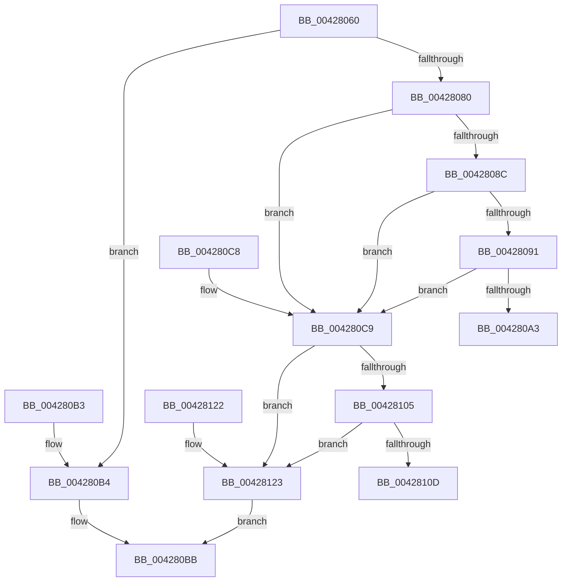

# CmpFindSecurityCellCacheIndex

- RVA: `0x00428060`–`0x00428127` (길이 `199` bytes)
- VA: `0x0000000140428060`
- 실행 섹션: `.text`
- PDB 이름 있음: `예`; PDB Function 태그: `아니요`
- unwind 정보 RVA: `0x000A0CB8`
- 디코드: `58`개 명령, `199/199` bytes 표시
- 미해석 바이트: `0` (있으면 어셈블리에 `.byte`로 보존)

> 이 문서는 커널 이미지의 기계어와 PDB 기호를 분석해 생성했습니다. 4번과 5번은 함수 원형과 자료형을 바이너리 사용 방식에서 추정한 C 해석이며 원본 소스 복구 결과는 아닙니다.

## 1. Dependencies

- 직접 호출 지점: **1**; 고유 호출 대상: **1**
- 직접 호출자로 확인된 함수: **14**
- RIP 상대 이미지 참조: **1**

### Outgoing calls
- `0x004280EA` → [RtlFindLowerBoundInSortedArray](../../page/9B/RtlFindLowerBoundInSortedArray_function_009BCB00.md) (function, `0x009BCB00`)

### Direct callers
- [CmpSyncKeyValues](../../page/7F/CmpSyncKeyValues_function_007F2DF4.md) at `0x007F2EBB`
- [CmpRebuildKcbCacheFromNode](../../page/84/CmpRebuildKcbCacheFromNode_function_0084C5A8.md) at `0x0084C68A`
- [CmpCreateKeyControlBlock](../../page/85/CmpCreateKeyControlBlock_function_00851DB0.md) at `0x00852252`
- [CmpCopyKeyPartial](../../page/85/CmpCopyKeyPartial_function_0085AFF4.md) at `0x0085B195`
- [CmpCreateChild](../../page/94/CmpCreateChild_function_0094817C.md) at `0x0094869F`
- [CmpSetSecurityDescriptorInfo](../../page/94/CmpSetSecurityDescriptorInfo_function_00949688.md) at `0x00949AF3`
- [CmpSetSecurityDescriptorInfo](../../page/94/CmpSetSecurityDescriptorInfo_function_00949688.md) at `0x00949D9B`
- [CmpUndoDeleteKeyForTrans](../../page/94/CmpUndoDeleteKeyForTrans_function_0094A728.md) at `0x0094AA03`
- [CmpLightWeightCommitSetSecDescUoW](../../page/94/CmpLightWeightCommitSetSecDescUoW_function_0094B4AC.md) at `0x0094B56A`
- [CmpValidateHiveSecurityDescriptors](../../page/96/CmpValidateHiveSecurityDescriptors_function_0096DAFC.md) at `0x0096DE6A`
- [CmpAddSecurityCellToCache](../../page/96/CmpAddSecurityCellToCache_function_0096E228.md) at `0x0096E262`
- [CmpIncrementCachedSecurityRefcount](../../page/97/CmpIncrementCachedSecurityRefcount_function_00970F08.md) at `0x00970F20`
- [sub_009DA74E](../../page/9D/Unknown_function_009DA74E.md) at `0x009DA76F`
- [CmpLightWeightCommitAddKeyUoW](../../page/A5/CmpLightWeightCommitAddKeyUoW_function_00A54CA8.md) at `0x00A54D3D`
- [CmpRemoveFromSecurityCache](../../page/A8/CmpRemoveFromSecurityCache_function_00A80794.md) at `0x00A807AF`

### Static image references
- `0x004280D0` → RVA `0x0043D6F0` (`CmpSearchSecurityCellCache`; read)

## 2. Other-region calls and transfers

- 다른 실행 섹션으로 향하는 call: **1**
  - `0x004280EA` → [RtlFindLowerBoundInSortedArray](../../page/9B/RtlFindLowerBoundInSortedArray_function_009BCB00.md) (`.text` → `PAGE`)
- 별도 외부 분기/꼬리 이동을 확인하지 못했습니다.

## 3. Assembly (complete function range)

```asm
00428060  48 89 5C 24 08                  mov qword ptr [rsp + 8], rbx
00428065  89 54 24 10                     mov dword ptr [rsp + 0x10], edx
00428069  57                              push rdi
0042806A  48 83 EC 30                     sub rsp, 0x30
0042806E  44 8B 89 50 07 00 00            mov r9d, dword ptr [rcx + 0x750]
00428075  49 8B F8                        mov rdi, r8
00428078  48 8B D9                        mov rbx, rcx
0042807B  45 85 C9                        test r9d, r9d
0042807E  74 34                           je 0x1404280b4
00428080  4C 63 81 58 07 00 00            movsxd r8, dword ptr [rcx + 0x758]
00428087  45 85 C0                        test r8d, r8d
0042808A  78 3D                           js 0x1404280c9
0042808C  45 3B C1                        cmp r8d, r9d
0042808F  73 38                           jae 0x1404280c9
00428091  48 8B 83 60 07 00 00            mov rax, qword ptr [rbx + 0x760]
00428098  49 8B C8                        mov rcx, r8
0042809B  48 03 C9                        add rcx, rcx
0042809E  39 14 C8                        cmp dword ptr [rax + rcx*8], edx
004280A1  75 26                           jne 0x1404280c9
004280A3  44 89 07                        mov dword ptr [rdi], r8d
004280A6  B0 01                           mov al, 1
004280A8  48 8B 5C 24 40                  mov rbx, qword ptr [rsp + 0x40]
004280AD  48 83 C4 30                     add rsp, 0x30
004280B1  5F                              pop rdi
004280B2  C3                              ret
004280B3  CC                              int3
004280B4  41 C7 00 00 00 00 00            mov dword ptr [r8], 0
004280BB  32 C0                           xor al, al
004280BD  48 8B 5C 24 40                  mov rbx, qword ptr [rsp + 0x40]
004280C2  48 83 C4 30                     add rsp, 0x30
004280C6  5F                              pop rdi
004280C7  C3                              ret
004280C8  CC                              int3
004280C9  48 8B 93 60 07 00 00            mov rdx, qword ptr [rbx + 0x760]
004280D0  48 8D 05 19 56 01 00            lea rax, [rip + 0x15619]
004280D7  4D 8B C1                        mov r8, r9
004280DA  48 89 44 24 20                  mov qword ptr [rsp + 0x20], rax
004280DF  41 B9 10 00 00 00               mov r9d, 0x10
004280E5  48 8D 4C 24 48                  lea rcx, [rsp + 0x48]
004280EA  E8 11 4A 59 00                  call 0x1409bcb00
004280EF  48 8B D0                        mov rdx, rax
004280F2  48 2B 93 60 07 00 00            sub rdx, qword ptr [rbx + 0x760]
004280F9  48 C1 EA 04                     shr rdx, 4
004280FD  3B 93 50 07 00 00               cmp edx, dword ptr [rbx + 0x750]
00428103  73 1E                           jae 0x140428123
00428105  8B 4C 24 48                     mov ecx, dword ptr [rsp + 0x48]
00428109  39 08                           cmp dword ptr [rax], ecx
0042810B  75 16                           jne 0x140428123
0042810D  89 93 58 07 00 00               mov dword ptr [rbx + 0x758], edx
00428113  B0 01                           mov al, 1
00428115  48 8B 5C 24 40                  mov rbx, qword ptr [rsp + 0x40]
0042811A  89 17                           mov dword ptr [rdi], edx
0042811C  48 83 C4 30                     add rsp, 0x30
00428120  5F                              pop rdi
00428121  C3                              ret
00428122  CC                              int3
00428123  89 17                           mov dword ptr [rdi], edx
00428125  EB 94                           jmp 0x1404280bb
```

## 4. C-style interpretation (structured pseudocode)

```c
__int64 __fastcall CmpFindSecurityCellCacheIndex(__int64 a1, int a2, __int64 a3)
{
    __int64 result;
    __int64 v_rsp;
    unsigned int v_stack_p10;
    unsigned __int64 v_stack_p40;
    unsigned __int64 v_stack_p58;
    unsigned __int64 v_stack_p78;
    unsigned __int64 v_stack_p8;
    unsigned __int64 v_stack_p80;

    v_stack_p8 = v_rbx;
    v_stack_p10 = a2;
    v_rsp = (v_rsp) - (48);
    if ((unsigned int)((unsigned int)(*(unsigned int *)(a1 + 1872))) == 0) goto loc_004280B4;
    if (sign_flag) goto loc_004280C9;
    if (((unsigned int)((int)(*(unsigned int *)(a1 + 1880)))) >= ((unsigned int)((unsigned int)(*(unsigned int *)(a1 + 1872))))) goto loc_004280C9;
    a1 = ((int)(*(unsigned int *)(a1 + 1880))) + ((int)(*(unsigned int *)(a1 + 1880)));
    if ((*(unsigned int *)(*(unsigned __int64 *)(a1 + 1888) + a1 * 8)) != a2) goto loc_004280C9;
    *(unsigned int *)(a3) = (unsigned int)((int)(*(unsigned int *)(a1 + 1880)));
    v_rsp = (v_rsp) + (48);
    return 1;
loc_004280B4:
    *(unsigned int *)((int)(*(unsigned int *)(a1 + 1880))) = 0;
loc_004280BB:
    result = 0;
    v_rsp = (v_rsp) + (48);
    return result;
loc_004280C9:
    v_stack_p58 = v_rip + 87577;
    result = RtlFindLowerBoundInSortedArray(v_stack_p80, *(unsigned __int64 *)(v_stack_p40 + 1888), (unsigned int)(*(unsigned int *)(a1 + 1872)), 16);
    a2 = (result) - (*(unsigned __int64 *)(v_stack_p40 + 1888));
    a2 = (a2) >> (4);
    if (a2 >= (*(unsigned int *)(v_stack_p40 + 1872))) goto loc_00428123;
    if ((*(unsigned int *)(result)) != ((unsigned int)((unsigned int)(v_stack_p80)))) goto loc_00428123;
    *(unsigned int *)(v_stack_p40 + 1880) = a2;
    *(unsigned int *)(a3) = a2;
    v_rsp = (v_rsp) + (48);
    return 1;
loc_00428123:
    *(unsigned int *)(a3) = a2;
    goto loc_004280BB;
}
```

## 5. (Beta) C Style

```c
int64_t CmpFindSecurityCellCacheIndex(void *Arg1, int32_t Arg2, void *Arg3)
{
    uint8_t *arg1 = (uint8_t *)Arg1;
    uint8_t *arg3 = (uint8_t *)Arg3;

    int64_t result;
    int64_t local_rsp;
    uint32_t v_stack_p10;
    uint64_t v_stack_p40;
    uint64_t v_stack_p58;
    uint64_t v_stack_p78;
    uint64_t v_stack_p8;
    uint64_t v_stack_p80;

    v_stack_p8 = local_rbx;
    v_stack_p10 = Arg2;
    local_rsp = (local_rsp) - (48);
    if ((uint32_t)((uint32_t)(*(uint32_t *)(arg1 + 0x750))) == 0) goto loc_004280B4;
    if (sign_flag) goto loc_004280C9;
    if (((uint32_t)((int32_t)(*(uint32_t *)(arg1 + 0x758)))) >= ((uint32_t)((uint32_t)(*(uint32_t *)(arg1 + 0x750))))) goto loc_004280C9;
    Arg1 = ((int32_t)(*(uint32_t *)(arg1 + 0x758))) + ((int32_t)(*(uint32_t *)(arg1 + 0x758)));
    if ((*(uint32_t *)(*(uint64_t *)(arg1 + 0x760) + arg1 * 8)) != Arg2) goto loc_004280C9;
    *(uint32_t *)(arg3) = (uint32_t)((int32_t)(*(uint32_t *)(arg1 + 0x758)));
    local_rsp = (local_rsp) + (48);
    return 1;
loc_004280B4:
    *(uint32_t *)((int32_t)(*(uint32_t *)(arg1 + 0x758))) = 0;
loc_004280BB:
    result = 0;
    local_rsp = (local_rsp) + (48);
    return result;
loc_004280C9:
    v_stack_p58 = v_rip + 87577;
    result = RtlFindLowerBoundInSortedArray(v_stack_p80, *(uint64_t *)(v_stack_p40 + 0x760), (uint32_t)(*(uint32_t *)(arg1 + 0x750)), 16);
    Arg2 = (result) - (*(uint64_t *)(v_stack_p40 + 0x760));
    Arg2 = (Arg2) >> (4);
    if (Arg2 >= (*(uint32_t *)(v_stack_p40 + 0x750))) goto loc_00428123;
    if ((*(uint32_t *)(result)) != ((uint32_t)((uint32_t)(v_stack_p80)))) goto loc_00428123;
    *(uint32_t *)(v_stack_p40 + 0x758) = Arg2;
    *(uint32_t *)(arg3) = Arg2;
    local_rsp = (local_rsp) + (48);
    return 1;
loc_00428123:
    *(uint32_t *)(arg3) = Arg2;
    goto loc_004280BB;
}
```

### 관측된 메모리 오프셋

구조체 형식이 확인되지 않은 접근은 인자 기준의 오프셋으로만 기록했습니다.

| 기준 인자 | 오프셋 표현 | 폭 (bit) | 접근 |
|---|---:|---:|---|
| `Arg1` | `+ 0x750` | `32` | `R` |
| `Arg1` | `+ 0x758` | `32` | `R` |
| `Arg1` | `+ 0x758` | `32` | `W` |
| `Arg1` | `+ 0x760` | `64` | `R` |
| `Arg3` | `+ 0x0` | `32` | `W` |

## 6. Execution-region graph

[열기: 2D/3D 그래프와 함수 탐색 컨트롤 패널](../../../control-panel.html?section=text&rva=0x00428060&view=graph)

- 2D 그래프는 위에서 아래로 흐르고, 3D 그래프는 빈 공간을 드래그해 회전합니다. Shift+드래그는 이동, 휠은 확대·축소, 함수 노드 선택은 대상 보고서 이동입니다.

### Static fallback


