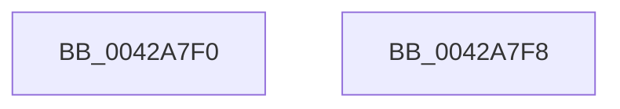

# CmpInitializeDelayDerefContext

- RVA: `0x0042A7F0`–`0x0042A7F9` (길이 `9` bytes)
- VA: `0x000000014042A7F0`
- 실행 섹션: `.text`
- PDB 이름 있음: `예`; PDB Function 태그: `아니요`
- unwind 정보 RVA: `0x000DB714`
- 디코드: `4`개 명령, `9/9` bytes 표시
- 미해석 바이트: `0` (있으면 어셈블리에 `.byte`로 보존)

> 이 문서는 커널 이미지의 기계어와 PDB 기호를 분석해 생성했습니다. 4번과 5번은 함수 원형과 자료형을 바이너리 사용 방식에서 추정한 C 해석이며 원본 소스 복구 결과는 아닙니다.

## 1. Dependencies

- 직접 호출 지점: **0**; 고유 호출 대상: **0**
- 직접 호출자로 확인된 함수: **26**
- RIP 상대 이미지 참조: **0**

### Outgoing calls
- 직접 디코드된 call 명령이 없습니다.

### Direct callers
- [CmpSaveBootControlSet](../../page/7D/CmpSaveBootControlSet_function_007DC744.md) at `0x007DC7E2`
- [CmRestoreKey](../../page/7D/CmRestoreKey_function_007DCF04.md) at `0x007DCFBB`
- [CmRestoreKey](../../page/7D/CmRestoreKey_function_007DCF04.md) at `0x007DD51E`
- [CmpRefreshHive](../../page/7D/CmpRefreshHive_function_007DEAD0.md) at `0x007DEB2B`
- [CmpCloneHwProfile](../../page/7E/CmpCloneHwProfile_function_007E303C.md) at `0x007E30EA`
- [CmRenameKey](../../page/7E/CmRenameKey_function_007E8F48.md) at `0x007E9072`
- [CmpUnfreezeHive](../../page/7E/CmpUnfreezeHive_function_007EA778.md) at `0x007EA78E`
- [CmpPrepareDiscardAndReplaceKcbAndUnbackedHigherLayers](../../page/7F/CmpPrepareDiscardAndReplaceKcbAndUnbackedHigherLayers_function_007F1610.md) at `0x007F1631`
- [CmpPrepareToInvalidateAllHigherLayerKcbs](../../page/7F/CmpPrepareToInvalidateAllHigherLayerKcbs_function_007F174C.md) at `0x007F1774`
- [CmKeyBodyReplicateToVirtual](../../page/84/CmKeyBodyReplicateToVirtual_function_00843FE4.md) at `0x008440D2`
- [CmSetValueKey](../../page/84/CmSetValueKey_function_008457C0.md) at `0x0084588E`
- [CmDeleteValueKey](../../page/84/CmDeleteValueKey_function_008476E8.md) at `0x008477BF`
- [CmDeleteKey](../../page/84/CmDeleteKey_function_00848E5C.md) at `0x00848F5A`
- [sub_0084E4B5](../../page/84/Unknown_function_0084E4B5.md) at `0x0084E528`
- [CmpPerformCompleteKcbCacheLookup](../../page/84/CmpPerformCompleteKcbCacheLookup_function_0084FD20.md) at `0x008502D6`
- [CmpPerformCompleteKcbCacheLookup](../../page/84/CmpPerformCompleteKcbCacheLookup_function_0084FD20.md) at `0x00850D40`
- [CmpDereferenceKeyControlBlock](../../page/85/CmpDereferenceKeyControlBlock_function_00851310.md) at `0x0085133C`
- [CmQueryKey](../../page/85/CmQueryKey_function_00858240.md) at `0x008582E7`
- [CmpDoParseKey](../../page/85/CmpDoParseKey_function_0085F750.md) at `0x0085F843`
- [CmpDeleteKeyObject](../../page/86/CmpDeleteKeyObject_function_00865590.md) at `0x008655F1`
- [CmpTransMgrFreeVolatileData](../../page/87/CmpTransMgrFreeVolatileData_function_00874BDC.md) at `0x00874C0A`
- [CmpLinkHiveToMaster](../../page/87/CmpLinkHiveToMaster_function_00877D6C.md) at `0x00877E2E`
- [CmpEnumerateLayeredKey](../../page/94/CmpEnumerateLayeredKey_function_00945E58.md) at `0x00945F25`
- [CmpPerformUnloadKey](../../page/9A/CmpPerformUnloadKey_function_009AFA28.md) at `0x009AFAA1`
- [CmpCleanUpKCBCacheTable](../../page/9B/CmpCleanUpKCBCacheTable_function_009B0478.md) at `0x009B04CC`
- [CmpCommitLightWeightTransaction](../../page/9B/CmpCommitLightWeightTransaction_function_009B0868.md) at `0x009B088C`
- [CmpCompleteUnloadKey](../../page/9B/CmpCompleteUnloadKey_function_009B32FC.md) at `0x009B3329`
- [CmpDelayCloseWorker](../../page/9D/CmpDelayCloseWorker_function_009DB8E0.md) at `0x009DB953`

### Static image references
- 디코드된 RIP-relative 메모리 참조가 없습니다.

## 2. Other-region calls and transfers

- 다른 실행 섹션으로 향하는 call: **0**
- 별도 외부 분기/꼬리 이동을 확인하지 못했습니다.

## 3. Assembly (complete function range)

```asm
0042A7F0  48 89 49 08                     mov qword ptr [rcx + 8], rcx
0042A7F4  48 89 09                        mov qword ptr [rcx], rcx
0042A7F7  C3                              ret
0042A7F8  CC                              int3
```

## 4. C-style interpretation (structured pseudocode)

```c
void __fastcall CmpInitializeDelayDerefContext(__int64 a1)
{
    *(unsigned __int64 *)(a1 + 8) = a1;
    *(unsigned __int64 *)(a1) = a1;
    return;
}
```

## 5. (Beta) C Style

```c
void CmpInitializeDelayDerefContext(void *Arg1)
{
    uint8_t *arg1 = (uint8_t *)Arg1;

    *(void **)(arg1 + 0x8) = Arg1;
    *(void **)(arg1) = Arg1;
    return;
}
```

### 관측된 메모리 오프셋

구조체 형식이 확인되지 않은 접근은 인자 기준의 오프셋으로만 기록했습니다.

| 기준 인자 | 오프셋 표현 | 폭 (bit) | 접근 |
|---|---:|---:|---|
| `Arg1` | `+ 0x0` | `64` | `W` |
| `Arg1` | `+ 0x8` | `64` | `W` |

## 6. Execution-region graph

[열기: 2D/3D 그래프와 함수 탐색 컨트롤 패널](../../../control-panel.html?section=text&rva=0x0042A7F0&view=graph)

- 2D 그래프는 위에서 아래로 흐르고, 3D 그래프는 빈 공간을 드래그해 회전합니다. Shift+드래그는 이동, 휠은 확대·축소, 함수 노드 선택은 대상 보고서 이동입니다.

### Static fallback


