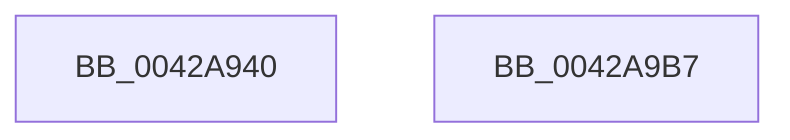

# EtwTraceLongDpcDetectionEvent

- RVA: `0x0042A940`–`0x0042A9B8` (길이 `120` bytes)
- VA: `0x000000014042A940`
- 실행 섹션: `.text`
- PDB 이름 있음: `예`; PDB Function 태그: `아니요`
- unwind 정보 RVA: `0x00079788`
- 디코드: `27`개 명령, `120/120` bytes 표시
- 미해석 바이트: `0` (있으면 어셈블리에 `.byte`로 보존)

> 이 문서는 커널 이미지의 기계어와 PDB 기호를 분석해 생성했습니다. 4번과 5번은 함수 원형과 자료형을 바이너리 사용 방식에서 추정한 C 해석이며 원본 소스 복구 결과는 아닙니다.

## 1. Dependencies

- 직접 호출 지점: **2**; 고유 호출 대상: **2**
- 직접 호출자로 확인된 함수: **1**
- RIP 상대 이미지 참조: **1**

### Outgoing calls
- `0x0042A9A0` → [EtwTraceKernelEvent](../23/EtwTraceKernelEvent_function_00235350.md) (function, `0x00235350`)
- `0x0042A9AD` → [_security_check_cookie](../6A/_security_check_cookie_function_006AC640.md) (function, `0x006AC640`)

### Direct callers
- [KiExecuteAllDpcs](../25/KiExecuteAllDpcs_function_0025B740.md) at `0x0025C7DE`

### Static image references
- `0x0042A947` → RVA `0x00E0A740` (`.data`; read)

## 2. Other-region calls and transfers

- 다른 실행 섹션으로 향하는 call: **0**
- 별도 외부 분기/꼬리 이동을 확인하지 못했습니다.

## 3. Assembly (complete function range)

```asm
0042A940  4C 8B DC                        mov r11, rsp
0042A943  48 83 EC 58                     sub rsp, 0x58
0042A947  48 8B 05 F2 FD 9D 00            mov rax, qword ptr [rip + 0x9dfdf2]
0042A94E  48 33 C4                        xor rax, rsp
0042A951  48 89 44 24 48                  mov qword ptr [rsp + 0x48], rax
0042A956  49 83 63 D8 00                  and qword ptr [r11 - 0x28], 0
0042A95B  33 C0                           xor eax, eax
0042A95D  66 89 44 24 35                  mov word ptr [rsp + 0x35], ax
0042A962  41 B9 76 0F 00 00               mov r9d, 0xf76
0042A968  88 44 24 37                     mov byte ptr [rsp + 0x37], al
0042A96C  41 B8 00 00 04 20               mov r8d, 0x20040000
0042A972  49 8D 43 D8                     lea rax, [r11 - 0x28]
0042A976  89 4C 24 30                     mov dword ptr [rsp + 0x30], ecx
0042A97A  49 89 43 E0                     mov qword ptr [r11 - 0x20], rax
0042A97E  49 8D 4B E0                     lea rcx, [r11 - 0x20]
0042A982  83 64 24 44 00                  and dword ptr [rsp + 0x44], 0
0042A987  88 54 24 34                     mov byte ptr [rsp + 0x34], dl
0042A98B  BA 01 00 00 00                  mov edx, 1
0042A990  C7 44 24 40 08 00 00 00         mov dword ptr [rsp + 0x40], 8
0042A998  C7 44 24 20 02 0A 50 00         mov dword ptr [rsp + 0x20], 0x500a02
0042A9A0  E8 AB A9 E0 FF                  call 0x140235350
0042A9A5  48 8B 4C 24 48                  mov rcx, qword ptr [rsp + 0x48]
0042A9AA  48 33 CC                        xor rcx, rsp
0042A9AD  E8 8E 1C 28 00                  call 0x1406ac640
0042A9B2  48 83 C4 58                     add rsp, 0x58
0042A9B6  C3                              ret
0042A9B7  CC                              int3
```

## 4. C-style interpretation (structured pseudocode)

```c
__int64 __fastcall EtwTraceLongDpcDetectionEvent(int a1, unsigned __int8 a2)
{
    __int64 result;
    __int64 v_rsp;
    unsigned __int64 v_stack_m10;
    unsigned int v_stack_m14;
    unsigned int v_stack_m18;
    unsigned __int8 v_stack_m21;
    unsigned __int16 v_stack_m23;
    unsigned __int8 v_stack_m24;
    unsigned int v_stack_m28;
    unsigned int v_stack_m38;

    v_rsp = (v_rsp) - (88);
    result = (*(unsigned __int64 *)(v_rip + 10354162)) ^ (v_rsp);
    v_stack_m10 = result;
    result = 0;
    v_stack_m23 = 0;
    v_stack_m21 = 0;
    v_stack_m28 = a1;
    *(unsigned __int64 *)(v_rsp - 32) = v_rsp - 40;
    v_stack_m24 = a2;
    v_stack_m18 = 8;
    v_stack_m38 = 0x500A02ULL;
    result = EtwTraceKernelEvent(v_rsp - 32, 1, (unsigned int)(0x20040000ULL), (unsigned int)(0xF76ULL));
    a1 = (v_stack_m10) ^ (v_rsp);
    result = _security_check_cookie(a1, 1, (unsigned int)(0x20040000ULL), (unsigned int)(0xF76ULL));
    v_rsp = (v_rsp) + (88);
    return result;
}
```

## 5. (Beta) C Style

```c
int64_t EtwTraceLongDpcDetectionEvent(int32_t Arg1, uint8_t Arg2)
{
    int64_t result;
    int64_t local_rsp;
    uint64_t v_stack_m10;
    uint32_t v_stack_m14;
    uint32_t v_stack_m18;
    uint8_t v_stack_m21;
    uint16_t v_stack_m23;
    uint8_t v_stack_m24;
    uint32_t v_stack_m28;
    uint32_t v_stack_m38;

    local_rsp = (local_rsp) - (88);
    result = (*(uint64_t *)(v_rip + 0x9DFDF2)) ^ (local_rsp);
    v_stack_m10 = result;
    result = 0;
    v_stack_m23 = 0;
    v_stack_m21 = 0;
    v_stack_m28 = Arg1;
    *(uint64_t *)(local_rsp - 0x20) = local_rsp - 40;
    v_stack_m24 = Arg2;
    v_stack_m18 = 8;
    v_stack_m38 = 0x500A02ULL;
    result = EtwTraceKernelEvent(local_rsp - 32, 1, (uint32_t)(0x20040000ULL), (uint32_t)(0xF76ULL));
    Arg1 = (v_stack_m10) ^ (local_rsp);
    result = _security_check_cookie(Arg1, 1, (uint32_t)(0x20040000ULL), (uint32_t)(0xF76ULL));
    local_rsp = (local_rsp) + (88);
    return result;
}
```

## 6. Execution-region graph

[열기: 2D/3D 그래프와 함수 탐색 컨트롤 패널](../../../control-panel.html?section=text&rva=0x0042A940&view=graph)

- 2D 그래프는 위에서 아래로 흐르고, 3D 그래프는 빈 공간을 드래그해 회전합니다. Shift+드래그는 이동, 휠은 확대·축소, 함수 노드 선택은 대상 보고서 이동입니다.

### Static fallback


