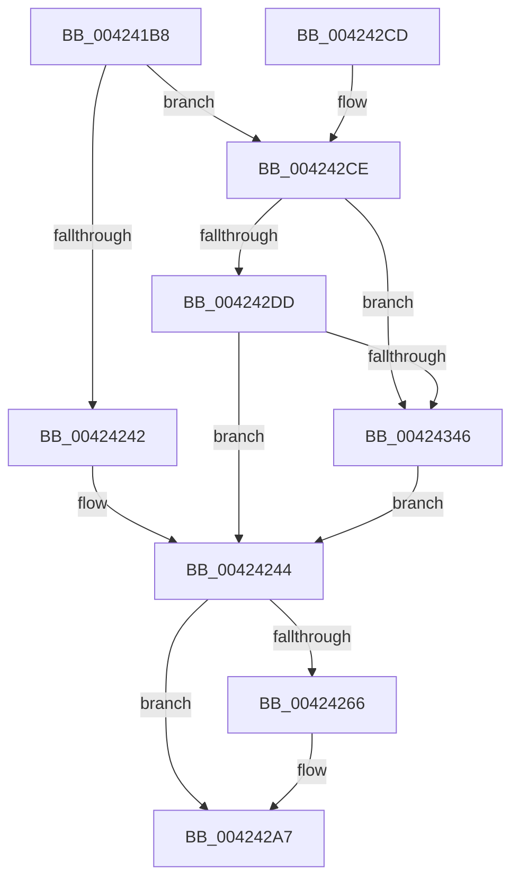

# EtwpFileModeCompress

- RVA: `0x004241B8`–`0x00424350` (길이 `408` bytes)
- VA: `0x00000001404241B8`
- 실행 섹션: `.text`
- PDB 이름 있음: `예`; PDB Function 태그: `아니요`
- unwind 정보 RVA: `0x000A0394`
- 디코드: `100`개 명령, `408/408` bytes 표시
- 미해석 바이트: `0` (있으면 어셈블리에 `.byte`로 보존)

> 이 문서는 커널 이미지의 기계어와 PDB 기호를 분석해 생성했습니다. 4번과 5번은 함수 원형과 자료형을 바이너리 사용 방식에서 추정한 C 해석이며 원본 소스 복구 결과는 아닙니다.

## 1. Dependencies

- 직접 호출 지점: **6**; 고유 호출 대상: **5**
- 직접 호출자로 확인된 함수: **1**
- RIP 상대 이미지 참조: **3**

### Outgoing calls
- `0x004241F5` → [KeQueryPerformanceCounter](../37/KeQueryPerformanceCounter_function_0037E7E0.md) (function, `0x0037E7E0`)
- `0x00424235` → [RtlCompressBuffer](../26/RtlCompressBuffer_function_0026A220.md) (function, `0x0026A220`)
- `0x00424248` → [KeQueryPerformanceCounter](../37/KeQueryPerformanceCounter_function_0037E7E0.md) (function, `0x0037E7E0`)
- `0x004242A2` → [tlgWriteTransfer_EtwWriteTransfer](tlgWriteTransfer_EtwWriteTransfer_function_004260E0.md) (function, `0x004260E0`)
- `0x004242B0` → [_security_check_cookie](../6A/_security_check_cookie_function_006AC640.md) (function, `0x006AC640`)
- `0x00424339` → [EtwpPrepareHeader](../../page/9B/EtwpPrepareHeader_function_009BDD20.md) (function, `0x009BDD20`)

### Direct callers
- [EtwpFlushBuffer](../../page/9B/EtwpFlushBuffer_function_009BF570.md) at `0x009BF6CD`

### Static image references
- `0x004241D2` → RVA `0x00E0A740` (`.data`; read)
- `0x0042425D` → RVA `0x00E09168` (`.data`; read)
- `0x0042426A` → RVA `0x00055463` (`.rdata`; read)

## 2. Other-region calls and transfers

- 다른 실행 섹션으로 향하는 call: **1**
  - `0x00424339` → [EtwpPrepareHeader](../../page/9B/EtwpPrepareHeader_function_009BDD20.md) (`.text` → `PAGE`)
- 별도 외부 분기/꼬리 이동을 확인하지 못했습니다.

## 3. Assembly (complete function range)

```asm
004241B8  48 89 5C 24 18                  mov qword ptr [rsp + 0x18], rbx
004241BD  48 89 74 24 20                  mov qword ptr [rsp + 0x20], rsi
004241C2  55                              push rbp
004241C3  57                              push rdi
004241C4  41 56                           push r14
004241C6  48 8D 6C 24 B9                  lea rbp, [rsp - 0x47]
004241CB  48 81 EC 90 00 00 00            sub rsp, 0x90
004241D2  48 8B 05 67 65 9E 00            mov rax, qword ptr [rip + 0x9e6567]
004241D9  48 33 C4                        xor rax, rsp
004241DC  48 89 45 37                     mov qword ptr [rbp + 0x37], rax
004241E0  48 83 65 FF 00                  and qword ptr [rbp - 1], 0
004241E5  48 8B F1                        mov rsi, rcx
004241E8  83 65 F7 00                     and dword ptr [rbp - 9], 0
004241EC  48 8D 4D FF                     lea rcx, [rbp - 1]
004241F0  4C 8B F2                        mov r14, rdx
004241F3  33 FF                           xor edi, edi
004241F5  E8 E6 A5 F5 FF                  call 0x14037e7e0
004241FA  44 8B 46 04                     mov r8d, dword ptr [rsi + 4]
004241FE  49 8D 56 48                     lea rdx, [r14 + 0x48]
00424202  4C 8B 8E 88 05 00 00            mov r9, qword ptr [rsi + 0x588]
00424209  8D 4F 03                        lea ecx, [rdi + 3]
0042420C  48 8B D8                        mov rbx, rax
0042420F  41 83 C0 B8                     add r8d, -0x48
00424213  48 8B 86 90 05 00 00            mov rax, qword ptr [rsi + 0x590]
0042421A  49 83 C1 48                     add r9, 0x48
0042421E  48 89 44 24 38                  mov qword ptr [rsp + 0x38], rax
00424223  48 8D 45 F7                     lea rax, [rbp - 9]
00424227  48 89 44 24 30                  mov qword ptr [rsp + 0x30], rax
0042422C  21 7C 24 28                     and dword ptr [rsp + 0x28], edi
00424230  44 89 44 24 20                  mov dword ptr [rsp + 0x20], r8d
00424235  E8 E6 5F E4 FF                  call 0x14026a220
0042423A  85 C0                           test eax, eax
0042423C  0F 89 8C 00 00 00               jns 0x1404242ce
00424242  8B F8                           mov edi, eax
00424244  48 8D 4D FF                     lea rcx, [rbp - 1]
00424248  E8 93 A5 F5 FF                  call 0x14037e7e0
0042424D  48 2B C3                        sub rax, rbx
00424250  48 69 C0 00 E1 F5 05            imul rax, rax, 0x5f5e100
00424257  48 99                           cqo
00424259  48 F7 7D FF                     idiv qword ptr [rbp - 1]
0042425D  83 3D 04 4F 9E 00 05            cmp dword ptr [rip + 0x9e4f04], 5
00424264  76 41                           jbe 0x1404242a7
00424266  83 65 33 00                     and dword ptr [rbp + 0x33], 0
0042426A  48 8D 15 F2 11 C3 FF            lea rdx, [rip - 0x3cee0e]
00424271  48 89 45 FF                     mov qword ptr [rbp - 1], rax
00424275  48 8D 0D EC 4E 9E 00            lea rcx, [rip + 0x9e4eec]
0042427C  48 8D 45 FF                     lea rax, [rbp - 1]
00424280  C7 45 2F 08 00 00 00            mov dword ptr [rbp + 0x2f], 8
00424287  48 89 45 27                     mov qword ptr [rbp + 0x27], rax
0042428B  45 33 C9                        xor r9d, r9d
0042428E  48 8D 45 07                     lea rax, [rbp + 7]
00424292  45 33 C0                        xor r8d, r8d
00424295  48 89 44 24 28                  mov qword ptr [rsp + 0x28], rax
0042429A  C7 44 24 20 03 00 00 00         mov dword ptr [rsp + 0x20], 3
004242A2  E8 39 1E 00 00                  call 0x1404260e0
004242A7  8B C7                           mov eax, edi
004242A9  48 8B 4D 37                     mov rcx, qword ptr [rbp + 0x37]
004242AD  48 33 CC                        xor rcx, rsp
004242B0  E8 8B 83 28 00                  call 0x1406ac640
004242B5  4C 8D 9C 24 90 00 00 00         lea r11, [rsp + 0x90]
004242BD  49 8B 5B 30                     mov rbx, qword ptr [r11 + 0x30]
004242C1  49 8B 73 38                     mov rsi, qword ptr [r11 + 0x38]
004242C5  49 8B E3                        mov rsp, r11
004242C8  41 5E                           pop r14
004242CA  5F                              pop rdi
004242CB  5D                              pop rbp
004242CC  C3                              ret
004242CD  CC                              int3
004242CE  8B 4E 04                        mov ecx, dword ptr [rsi + 4]
004242D1  8B 45 F7                        mov eax, dword ptr [rbp - 9]
004242D4  48 83 E9 48                     sub rcx, 0x48
004242D8  48 3B C1                        cmp rax, rcx
004242DB  73 69                           jae 0x140424346
004242DD  48 8B 96 88 05 00 00            mov rdx, qword ptr [rsi + 0x588]
004242E4  48 8B CE                        mov rcx, rsi
004242E7  41 0F 10 06                     movups xmm0, xmmword ptr [r14]
004242EB  0F 11 02                        movups xmmword ptr [rdx], xmm0
004242EE  41 0F 10 4E 10                  movups xmm1, xmmword ptr [r14 + 0x10]
004242F3  0F 11 4A 10                     movups xmmword ptr [rdx + 0x10], xmm1
004242F7  41 0F 10 46 20                  movups xmm0, xmmword ptr [r14 + 0x20]
004242FC  0F 11 42 20                     movups xmmword ptr [rdx + 0x20], xmm0
00424300  41 0F 10 4E 30                  movups xmm1, xmmword ptr [r14 + 0x30]
00424305  0F 11 4A 30                     movups xmmword ptr [rdx + 0x30], xmm1
00424309  F2 41 0F 10 46 40               movsd xmm0, qword ptr [r14 + 0x40]
0042430F  F2 0F 11 42 40                  movsd qword ptr [rdx + 0x40], xmm0
00424314  8B 45 F7                        mov eax, dword ptr [rbp - 9]
00424317  66 83 4A 34 40                  or word ptr [rdx + 0x34], 0x40
0042431C  83 C0 48                        add eax, 0x48
0042431F  44 0F B7 42 34                  movzx r8d, word ptr [rdx + 0x34]
00424324  89 02                           mov dword ptr [rdx], eax
00424326  C7 42 2C 03 00 00 00            mov dword ptr [rdx + 0x2c], 3
0042432D  8B 46 04                        mov eax, dword ptr [rsi + 4]
00424330  89 42 08                        mov dword ptr [rdx + 8], eax
00424333  8B 46 04                        mov eax, dword ptr [rsi + 4]
00424336  89 42 04                        mov dword ptr [rdx + 4], eax
00424339  E8 E2 99 59 00                  call 0x1409bdd20
0042433E  85 C0                           test eax, eax
00424340  0F 84 FE FE FF FF               je 0x140424244
00424346  BF 0D 00 00 C0                  mov edi, 0xc000000d
0042434B  E9 F4 FE FF FF                  jmp 0x140424244
```

## 4. C-style interpretation (structured pseudocode)

```c
__int64 __fastcall EtwpFileModeCompress(__int64 a1, __int64 a2)
{
    __int64 result;
    __int64 v_rdi;
    __int64 v_rsp;
    unsigned __int64 v_stack_m18;
    unsigned __int64 v_stack_m28;
    unsigned int v_stack_m2C;
    unsigned int v_stack_m30;
    unsigned __int64 v_stack_m38;
    unsigned __int64 v_stack_m58;
    unsigned __int64 v_stack_m5F;
    unsigned __int64 v_stack_m60;
    unsigned int v_stack_m68;
    unsigned __int64 v_stack_m70;
    unsigned __int64 v_stack_m78;
    unsigned int v_stack_m80;
    unsigned int v_stack_m88;
    unsigned __int64 v_stack_p18;
    unsigned __int64 v_stack_p20;

    v_stack_p18 = v_rbx;
    v_stack_p20 = v_rsi;
    v_rsp = (v_rsp) - (144);
    result = (*(unsigned __int64 *)(v_rip + 10380647)) ^ (v_rsp);
    v_stack_m28 = result;
    v_rdi = 0;
    result = KeQueryPerformanceCounter(v_stack_m60, a2, a3, a4);
    a3 = (unsigned int)(((unsigned int)(*(unsigned int *)(a1 + 4))) + (-72));
    a4 = (*(unsigned __int64 *)(a1 + 1416)) + (72);
    v_stack_m70 = *(unsigned __int64 *)(a1 + 1424);
    v_stack_m78 = v_stack_m68;
    v_stack_m88 = (unsigned int)(a3);
    result = RtlCompressBuffer(v_rdi + 3, a2 + 72, a3, a4);
    if (!sign_flag) goto loc_004242CE;
loc_00424244:
    result = KeQueryPerformanceCounter(v_stack_m60, a2 + 72, a3, a4);
    result = (result) - (result);
    result = (result) * (result);
    if ((*(unsigned int *)(v_rip + 10374916)) >= = 5) {
        a2 = v_rip - 3993102;
        v_stack_m60 = result;
        a1 = v_rip + 10374892;
        result = v_stack_m60;
        v_stack_m30 = 8;
        v_stack_m38 = result;
        a4 = 0;
        result = v_stack_m58;
        a3 = 0;
        v_stack_m80 = result;
        v_stack_m88 = 3;
        result = tlgWriteTransfer_EtwWriteTransfer(a1, a2, a3, a4);
    }
    a1 = (v_stack_m28) ^ (v_rsp);
    result = _security_check_cookie(a1, a2, a3, a4);
    return result;
loc_004242CE:
    a1 = ((unsigned int)(*(unsigned int *)(*(unsigned __int64 *)(v_stack_m18 + 56) + 4))) - (72);
    if (((unsigned int)(v_stack_m68)) >= a1) goto loc_00424346;
    *(unsigned __int64 *)(*(unsigned __int64 *)(*(unsigned __int64 *)(v_stack_m18 + 56) + 1416)) = v_xmm0;
    *(unsigned __int64 *)(*(unsigned __int64 *)(*(unsigned __int64 *)(v_stack_m18 + 56) + 1416) + 16) = v_xmm1;
    *(unsigned __int64 *)(*(unsigned __int64 *)(*(unsigned __int64 *)(v_stack_m18 + 56) + 1416) + 32) = v_xmm0;
    *(unsigned __int64 *)(*(unsigned __int64 *)(*(unsigned __int64 *)(v_stack_m18 + 56) + 1416) + 48) = v_xmm1;
    *(unsigned __int64 *)(*(unsigned __int64 *)(*(unsigned __int64 *)(v_stack_m18 + 56) + 1416) + 64) = v_xmm0;
    result = (unsigned int)(((unsigned int)(v_stack_m68)) + (72));
    *(unsigned int *)(*(unsigned __int64 *)(*(unsigned __int64 *)(v_stack_m18 + 56) + 1416)) = (unsigned int)(result);
    *(unsigned int *)(*(unsigned __int64 *)(*(unsigned __int64 *)(v_stack_m18 + 56) + 1416) + 44) = 3;
    *(unsigned int *)(*(unsigned __int64 *)(*(unsigned __int64 *)(v_stack_m18 + 56) + 1416) + 8) = (unsigned int)((unsigned int)(*(unsigned int *)(*(unsigned __int64 *)(v_stack_m18 + 56) + 4)));
    *(unsigned int *)(*(unsigned __int64 *)(*(unsigned __int64 *)(v_stack_m18 + 56) + 1416) + 4) = (unsigned int)((unsigned int)(*(unsigned int *)(*(unsigned __int64 *)(v_stack_m18 + 56) + 4)));
    result = EtwpPrepareHeader(*(unsigned __int64 *)(v_stack_m18 + 56), *(unsigned __int64 *)(*(unsigned __int64 *)(v_stack_m18 + 56) + 1416), *(unsigned __int16 *)(*(unsigned __int64 *)(*(unsigned __int64 *)(v_stack_m18 + 56) + 1416) + 52), a4);
    if ((unsigned int)(result) == 0) goto loc_00424244;
loc_00424346:
    goto loc_00424244;
}
```

## 5. (Beta) C Style

```c
int64_t EtwpFileModeCompress(void *Arg1, void *Arg2)
{
    uint8_t *arg1 = (uint8_t *)Arg1;
    uint8_t *arg2 = (uint8_t *)Arg2;

    int64_t result;
    int64_t local_rdi;
    int64_t local_rsp;
    uint64_t v_stack_m18;
    uint64_t v_stack_m28;
    uint32_t v_stack_m2C;
    uint32_t v_stack_m30;
    uint64_t v_stack_m38;
    uint64_t v_stack_m58;
    uint64_t v_stack_m5F;
    uint64_t v_stack_m60;
    uint32_t v_stack_m68;
    uint64_t v_stack_m70;
    uint64_t v_stack_m78;
    uint32_t v_stack_m80;
    uint32_t v_stack_m88;
    uint64_t v_stack_p18;
    uint64_t v_stack_p20;

    v_stack_p18 = local_rbx;
    v_stack_p20 = local_rsi;
    local_rsp = (local_rsp) - (144);
    result = (*(uint64_t *)(v_rip + 0x9E6567)) ^ (local_rsp);
    v_stack_m28 = result;
    local_rdi = 0;
    result = KeQueryPerformanceCounter(v_stack_m60, Arg2, a3, a4);
    a3 = (uint32_t)(((uint32_t)(*(uint32_t *)(arg1 + 0x4))) + (-72));
    a4 = (*(uint64_t *)(arg1 + 0x588)) + (72);
    v_stack_m70 = *(uint64_t *)(arg1 + 0x590);
    v_stack_m78 = v_stack_m68;
    v_stack_m88 = (uint32_t)(a3);
    result = RtlCompressBuffer(local_rdi + 3, Arg2 + 72, a3, a4);
    if (!sign_flag) goto loc_004242CE;
loc_00424244:
    result = KeQueryPerformanceCounter(v_stack_m60, Arg2 + 72, a3, a4);
    result = (result) - (result);
    result = (result) * (result);
    if ((*(uint32_t *)(v_rip + 0x9E4F04)) >= = 5) {
        Arg2 = v_rip - 3993102;
        v_stack_m60 = result;
        Arg1 = v_rip + 10374892;
        result = v_stack_m60;
        v_stack_m30 = 8;
        v_stack_m38 = result;
        a4 = 0;
        result = v_stack_m58;
        a3 = 0;
        v_stack_m80 = result;
        v_stack_m88 = 3;
        result = tlgWriteTransfer_EtwWriteTransfer(Arg1, Arg2, a3, a4);
    }
    Arg1 = (v_stack_m28) ^ (local_rsp);
    result = _security_check_cookie(Arg1, Arg2, a3, a4);
    return result;
loc_004242CE:
    Arg1 = ((uint32_t)(*(uint32_t *)(*(uint64_t *)(v_stack_m18 + 0x38) + 0x4))) - (72);
    if (((uint32_t)(v_stack_m68)) >= Arg1) goto loc_00424346;
    *(uint64_t *)(*(uint64_t *)(*(uint64_t *)(v_stack_m18 + 0x38) + 0x588)) = v_xmm0;
    *(uint64_t *)(*(uint64_t *)(*(uint64_t *)(v_stack_m18 + 0x38) + 0x588) + 0x10) = v_xmm1;
    *(uint64_t *)(*(uint64_t *)(*(uint64_t *)(v_stack_m18 + 0x38) + 0x588) + 0x20) = v_xmm0;
    *(uint64_t *)(*(uint64_t *)(*(uint64_t *)(v_stack_m18 + 0x38) + 0x588) + 0x30) = v_xmm1;
    *(uint64_t *)(*(uint64_t *)(*(uint64_t *)(v_stack_m18 + 0x38) + 0x588) + 0x40) = v_xmm0;
    result = (uint32_t)(((uint32_t)(v_stack_m68)) + (72));
    *(uint32_t *)(*(uint64_t *)(*(uint64_t *)(v_stack_m18 + 0x38) + 0x588)) = (uint32_t)(result);
    *(uint32_t *)(*(uint64_t *)(*(uint64_t *)(v_stack_m18 + 0x38) + 0x588) + 0x2C) = 3;
    *(uint32_t *)(*(uint64_t *)(*(uint64_t *)(v_stack_m18 + 0x38) + 0x588) + 0x8) = (uint32_t)((uint32_t)(*(uint32_t *)(*(uint64_t *)(v_stack_m18 + 0x38) + 0x4)));
    *(uint32_t *)(*(uint64_t *)(*(uint64_t *)(v_stack_m18 + 0x38) + 0x588) + 0x4) = (uint32_t)((uint32_t)(*(uint32_t *)(*(uint64_t *)(v_stack_m18 + 0x38) + 0x4)));
    result = EtwpPrepareHeader(*(uint64_t *)(v_stack_m18 + 0x38), *(uint64_t *)(*(uint64_t *)(v_stack_m18 + 0x38) + 0x588), *(uint16_t *)(*(uint64_t *)(*(uint64_t *)(v_stack_m18 + 0x38) + 0x588) + 0x34), a4);
    if ((uint32_t)(result) == 0) goto loc_00424244;
loc_00424346:
    goto loc_00424244;
}
```

### 관측된 메모리 오프셋

구조체 형식이 확인되지 않은 접근은 인자 기준의 오프셋으로만 기록했습니다.

| 기준 인자 | 오프셋 표현 | 폭 (bit) | 접근 |
|---|---:|---:|---|
| `Arg1` | `+ 0x4` | `32` | `R` |
| `Arg1` | `+ 0x588` | `64` | `R` |
| `Arg1` | `+ 0x590` | `64` | `R` |
| `Arg2` | `+ 0x0` | `128` | `R` |
| `Arg2` | `+ 0x10` | `128` | `R` |
| `Arg2` | `+ 0x20` | `128` | `R` |
| `Arg2` | `+ 0x30` | `128` | `R` |
| `Arg2` | `+ 0x40` | `64` | `R` |
| `Arg2` | `+ 0x48` | `64` | `R` |

## 6. Execution-region graph

[열기: 2D/3D 그래프와 함수 탐색 컨트롤 패널](../../../control-panel.html?section=text&rva=0x004241B8&view=graph)

- 2D 그래프는 위에서 아래로 흐르고, 3D 그래프는 빈 공간을 드래그해 회전합니다. Shift+드래그는 이동, 휠은 확대·축소, 함수 노드 선택은 대상 보고서 이동입니다.

### Static fallback


