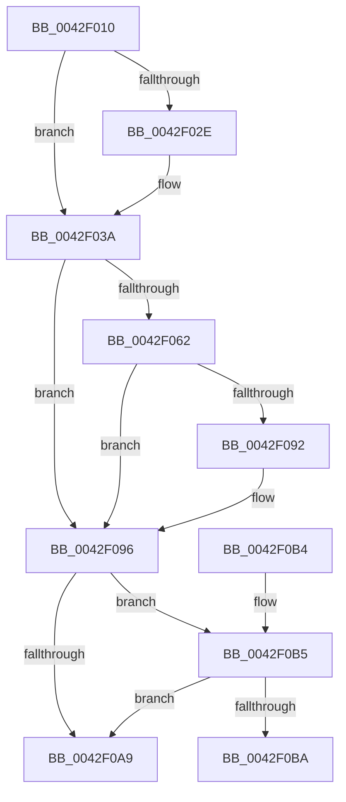

# ExAllocatePool

- RVA: `0x0042F010`–`0x0042F0D6` (길이 `198` bytes)
- VA: `0x000000014042F010`
- 실행 섹션: `.text`
- PDB 이름 있음: `예`; PDB Function 태그: `아니요`
- unwind 정보 RVA: `0x0007BD98`
- 디코드: `58`개 명령, `198/198` bytes 표시
- 미해석 바이트: `0` (있으면 어셈블리에 `.byte`로 보존)

> 이 문서는 커널 이미지의 기계어와 PDB 기호를 분석해 생성했습니다. 4번과 5번은 함수 원형과 자료형을 바이너리 사용 방식에서 추정한 C 해석이며 원본 소스 복구 결과는 아닙니다.

## 1. Dependencies

- 직접 호출 지점: **2**; 고유 호출 대상: **2**
- 직접 호출자로 확인된 함수: **1**
- RIP 상대 이미지 참조: **0**

### Outgoing calls
- `0x0042F09F` → [ExAllocatePool2](../../poolcode/B8/ExAllocatePool2_function_00B820F0.md) (function, `0x00B820F0`)
- `0x0042F0D0` → [KeBugCheckEx](../4F/KeBugCheckEx_function_004FD660.md) (function, `0x004FD660`)

### Direct callers
- [VerifierExAllocatePool](../../pagevrfy/BA/VerifierExAllocatePool_function_00BA1060.md) at `0x00BA114E`

### Static image references
- 디코드된 RIP-relative 메모리 참조가 없습니다.

## 2. Other-region calls and transfers

- 다른 실행 섹션으로 향하는 call: **1**
  - `0x0042F09F` → [ExAllocatePool2](../../poolcode/B8/ExAllocatePool2_function_00B820F0.md) (`.text` → `POOLCODE`)
- 별도 외부 분기/꼬리 이동을 확인하지 못했습니다.

## 3. Assembly (complete function range)

```asm
0042F010  48 89 5C 24 08                  mov qword ptr [rsp + 8], rbx
0042F015  57                              push rdi
0042F016  48 83 EC 30                     sub rsp, 0x30
0042F01A  8B D9                           mov ebx, ecx
0042F01C  48 8B FA                        mov rdi, rdx
0042F01F  B9 00 01 00 00                  mov ecx, 0x100
0042F024  B8 40 00 00 00                  mov eax, 0x40
0042F029  F6 C3 01                        test bl, 1
0042F02C  75 0C                           jne 0x14042f03a
0042F02E  0F BA E3 09                     bt ebx, 9
0042F032  B9 80 00 00 00                  mov ecx, 0x80
0042F037  0F 42 C8                        cmovb ecx, eax
0042F03A  85 DB                           test ebx, ebx
0042F03C  48 0F 48 C8                     cmovs rcx, rax
0042F040  48 8B D1                        mov rdx, rcx
0042F043  48 83 CA 04                     or rdx, 4
0042F047  F6 C3 20                        test bl, 0x20
0042F04A  48 0F 44 D1                     cmove rdx, rcx
0042F04E  48 8B CA                        mov rcx, rdx
0042F051  48 83 C9 02                     or rcx, 2
0042F055  0F BA E3 0A                     bt ebx, 0xa
0042F059  48 0F 42 CA                     cmovb rcx, rdx
0042F05D  F6 C3 DE                        test bl, 0xde
0042F060  74 34                           je 0x14042f096
0042F062  48 8B D1                        mov rdx, rcx
0042F065  48 83 CA 08                     or rdx, 8
0042F069  F6 C3 04                        test bl, 4
0042F06C  48 0F 44 D1                     cmove rdx, rcx
0042F070  4C 8B C2                        mov r8, rdx
0042F073  49 0F BA E8 09                  bts r8, 9
0042F078  F6 C3 80                        test bl, 0x80
0042F07B  4C 0F 44 C2                     cmove r8, rdx
0042F07F  49 8B C8                        mov rcx, r8
0042F082  48 0F BA E9 0A                  bts rcx, 0xa
0042F087  84 D8                           test al, bl
0042F089  49 0F 44 C8                     cmove rcx, r8
0042F08D  F6 C3 10                        test bl, 0x10
0042F090  74 04                           je 0x14042f096
0042F092  48 83 C9 20                     or rcx, 0x20
0042F096  41 B8 4E 6F 6E 65               mov r8d, 0x656e6f4e
0042F09C  48 8B D7                        mov rdx, rdi
0042F09F  E8 4C 30 75 00                  call 0x140b820f0
0042F0A4  48 85 C0                        test rax, rax
0042F0A7  74 0C                           je 0x14042f0b5
0042F0A9  48 8B 5C 24 40                  mov rbx, qword ptr [rsp + 0x40]
0042F0AE  48 83 C4 30                     add rsp, 0x30
0042F0B2  5F                              pop rdi
0042F0B3  C3                              ret
0042F0B4  CC                              int3
0042F0B5  F6 C3 02                        test bl, 2
0042F0B8  74 EF                           je 0x14042f0a9
0042F0BA  45 33 C9                        xor r9d, r9d
0042F0BD  48 C7 44 24 20 00 00 00 00      mov qword ptr [rsp + 0x20], 0
0042F0C6  45 33 C0                        xor r8d, r8d
0042F0C9  48 8B D7                        mov rdx, rdi
0042F0CC  41 8D 49 41                     lea ecx, [r9 + 0x41]
0042F0D0  E8 8B E5 0C 00                  call 0x1404fd660
0042F0D5  CC                              int3
```

## 4. C-style interpretation (structured pseudocode)

```c
__int64 __fastcall ExAllocatePool(int a1, __int64 a2, __int64 a3, int a4)
{
    __int64 result;
    __int64 v_rsp;
    unsigned __int64 v_stack_p20;
    unsigned __int64 v_stack_p8;

    v_stack_p8 = v_rbx;
    v_rsp = (v_rsp) - (48);
    if ((((unsigned __int8)((unsigned int)(a1))) & (1)) == 0) {
        a1 = 128;
        if (condition_is_below) { a1 = 64; }
    }
    if (sign_flag) { a1 = 64; }
    a2 = (a1) | (4);
    if ((((unsigned __int8)((unsigned int)(a1))) & (32)) == 0) { a2 = a1; }
    a1 = (a2) | (2);
    if (condition_is_below) { a1 = a2; }
    if ((((unsigned __int8)((unsigned int)(a1))) & (222)) == 0) goto loc_0042F096;
    a2 = (a1) | (8);
    if ((((unsigned __int8)((unsigned int)(a1))) & (4)) == 0) { a2 = a1; }
    if ((((unsigned __int8)((unsigned int)(a1))) & (128)) == 0) { a2 = a2; }
    if (((64) & ((unsigned __int8)((unsigned int)(a1)))) == 0) { a2 = a2; }
    if ((((unsigned __int8)((unsigned int)(a1))) & (16)) != 0) {
        a1 = (a2) | (32);
    }
    result = ExAllocatePool2(a1, a2, (unsigned int)(0x656E6F4EULL), a4);
    if (result == 0) goto loc_0042F0B5;
loc_0042F0A9:
    v_rsp = (v_rsp) + (48);
    return result;
loc_0042F0B5:
    if ((((unsigned __int8)(v_stack_p8)) & (2)) == 0) goto loc_0042F0A9;
    a4 = 0;
    v_stack_p20 = 0;
    a3 = 0;
    result = KeBugCheckEx(a4 + 65, a2, a3, a4);
    return result;
}
```

## 5. (Beta) C Style

```c
int64_t ExAllocatePool(int32_t Arg1, int64_t Arg2, int64_t Arg3, int32_t Arg4)
{
    int64_t result;
    int64_t local_rsp;
    uint64_t v_stack_p20;
    uint64_t v_stack_p8;

    v_stack_p8 = local_rbx;
    local_rsp = (local_rsp) - (48);
    if ((((uint8_t)((uint32_t)(Arg1))) & (1)) == 0) {
        Arg1 = 128;
        if (condition_is_below) { Arg1 = 64; }
    }
    if (sign_flag) { Arg1 = 64; }
    Arg2 = (Arg1) | (4);
    if ((((uint8_t)((uint32_t)(Arg1))) & (32)) == 0) { Arg2 = Arg1; }
    Arg1 = (Arg2) | (2);
    if (condition_is_below) { Arg1 = Arg2; }
    if ((((uint8_t)((uint32_t)(Arg1))) & (222)) == 0) goto loc_0042F096;
    Arg2 = (Arg1) | (8);
    if ((((uint8_t)((uint32_t)(Arg1))) & (4)) == 0) { Arg2 = Arg1; }
    if ((((uint8_t)((uint32_t)(Arg1))) & (128)) == 0) { Arg2 = Arg2; }
    if (((64) & ((uint8_t)((uint32_t)(Arg1)))) == 0) { Arg2 = Arg2; }
    if ((((uint8_t)((uint32_t)(Arg1))) & (16)) != 0) {
        Arg1 = (Arg2) | (32);
    }
    result = ExAllocatePool2(Arg1, Arg2, (uint32_t)(0x656E6F4EULL), Arg4);
    if (result == 0) goto loc_0042F0B5;
loc_0042F0A9:
    local_rsp = (local_rsp) + (48);
    return result;
loc_0042F0B5:
    if ((((uint8_t)(v_stack_p8)) & (2)) == 0) goto loc_0042F0A9;
    Arg4 = 0;
    v_stack_p20 = 0;
    Arg3 = 0;
    result = KeBugCheckEx(Arg4 + 65, Arg2, Arg3, Arg4);
    return result;
}
```

## 6. Execution-region graph

[열기: 2D/3D 그래프와 함수 탐색 컨트롤 패널](../../../control-panel.html?section=text&rva=0x0042F010&view=graph)

- 2D 그래프는 위에서 아래로 흐르고, 3D 그래프는 빈 공간을 드래그해 회전합니다. Shift+드래그는 이동, 휠은 확대·축소, 함수 노드 선택은 대상 보고서 이동입니다.

### Static fallback


