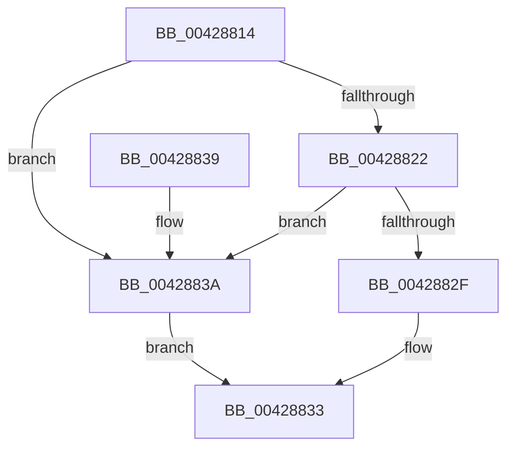

# ExGetExtensionTable

- RVA: `0x00428814`–`0x0042883E` (길이 `42` bytes)
- VA: `0x0000000140428814`
- 실행 섹션: `.text`
- PDB 이름 있음: `예`; PDB Function 태그: `아니요`
- unwind 정보 RVA: `0x00065BAC`
- 디코드: `16`개 명령, `42/42` bytes 표시
- 미해석 바이트: `0` (있으면 어셈블리에 `.byte`로 보존)

> 이 문서는 커널 이미지의 기계어와 PDB 기호를 분석해 생성했습니다. 4번과 5번은 함수 원형과 자료형을 바이너리 사용 방식에서 추정한 C 해석이며 원본 소스 복구 결과는 아닙니다.

## 1. Dependencies

- 직접 호출 지점: **1**; 고유 호출 대상: **1**
- 직접 호출자로 확인된 함수: **59**
- RIP 상대 이미지 참조: **0**

### Outgoing calls
- `0x00428826` → [ExAcquireRundownProtection](../21/ExAcquireRundownProtection_function_00216620.md) (function, `0x00216620`)

### Direct callers
- [IoStopIoRateControl](IoStopIoRateControl_function_0042867C.md) at `0x0042868C`
- [IopIoRateStartRateControl](IopIoRateStartRateControl_function_004286C0.md) at `0x00428721`
- [VmpPrefetchVirtualAddresses](VmpPrefetchVirtualAddresses_function_00428844.md) at `0x0042887F`
- [IoCaptureLiveDump](../4E/IoCaptureLiveDump_function_004E085C.md) at `0x004E09AB`
- [BCryptEncrypt](../4F/BCryptEncrypt_function_004F9D54.md) at `0x004F9D85`
- [PsQueryActivityModerationUserSettings](../5E/PsQueryActivityModerationUserSettings_function_005E2D84.md) at `0x005E2D9E`
- [PsSetExeModerationState](../5E/PsSetExeModerationState_function_005E2DF0.md) at `0x005E2E0E`
- [PspChangeProcessExecutionStateLegacy](../5E/PspChangeProcessExecutionStateLegacy_function_005E4098.md) at `0x005E427E`
- [BCryptCloseAlgorithmProvider](../60/BCryptCloseAlgorithmProvider_function_006064D8.md) at `0x006064F1`
- [BCryptDestroyKey](../60/BCryptDestroyKey_function_00606530.md) at `0x00606549`
- [BCryptGenRandom](../60/BCryptGenRandom_function_00606588.md) at `0x006065A9`
- [ExpGetExtensionHostForCrossVmObject](../../page/70/ExpGetExtensionHostForCrossVmObject_function_007020E0.md) at `0x007020F0`
- [ExpGetExtensionHostForCrossVmObject](../../page/70/ExpGetExtensionHostForCrossVmObject_function_007020E0.md) at `0x0070210D`
- [SepLogonSystemManagedAdmin](../../page/70/SepLogonSystemManagedAdmin_function_00704DA4.md) at `0x00704DCE`
- [PspProcessQosChangeNotificationWorker](../../page/78/PspProcessQosChangeNotificationWorker_function_00781740.md) at `0x007817C9`
- [PspNetRateControlDispatch](../../page/78/PspNetRateControlDispatch_function_007850C4.md) at `0x007850D4`
- [BCryptGenerateSymmetricKey](../../page/79/BCryptGenerateSymmetricKey_function_0079C828.md) at `0x0079C859`
- [BCryptImportKeyPair](../../page/79/BCryptImportKeyPair_function_0079C8C8.md) at `0x0079C8E9`
- [BCryptSetProperty](../../page/79/BCryptSetProperty_function_0079C950.md) at `0x0079C981`
- [LsaCallAuthenticationPackage](../../page/79/LsaCallAuthenticationPackage_function_0079C9E0.md) at `0x0079CA10`
- [LsaDeregisterLogonProcess](../../page/79/LsaDeregisterLogonProcess_function_0079CA90.md) at `0x0079CAA9`
- [LsaLogonUser](../../page/79/LsaLogonUser_function_0079CAF0.md) at `0x0079CB24`
- [LsaLookupAuthenticationPackage](../../page/79/LsaLookupAuthenticationPackage_function_0079CC00.md) at `0x0079CC29`
- [LsaRegisterLogonProcess](../../page/79/LsaRegisterLogonProcess_function_0079CC80.md) at `0x0079CCA9`
- [VmCleanProcessAddressSpace](../../page/7A/VmCleanProcessAddressSpace_function_007ACD38.md) at `0x007ACD77`
- [EtwpConstructIptData](../../page/7C/EtwpConstructIptData_function_007C1048.md) at `0x007C10A4`
- [ExpCreateCrossVmEvent](../../page/7D/ExpCreateCrossVmEvent_function_007D530C.md) at `0x007D5352`
- [ExpCreateCrossVmMutant](../../page/7D/ExpCreateCrossVmMutant_function_007D53D0.md) at `0x007D5416`
- [ExpCrossVmIntHostCallback](../../page/7D/ExpCrossVmIntHostCallback_function_007D54A0.md) at `0x007D54B9`
- [ExpCrossVmWnfPull](../../page/7D/ExpCrossVmWnfPull_function_007D55BC.md) at `0x007D55DB`
- [DbgkForwardException](../../page/8A/DbgkForwardException_function_008A2D60.md) at `0x008A2E63`
- [BCryptFinishHash](../../page/8D/BCryptFinishHash_function_008D1BB8.md) at `0x008D1BE1`
- [BCryptHashData](../../page/8D/BCryptHashData_function_008D1CB4.md) at `0x008D1CDD`
- [BCryptDestroyHash](../../page/8D/BCryptDestroyHash_function_008D1D2C.md) at `0x008D1D45`
- [BCryptCreateHash](../../page/8D/BCryptCreateHash_function_008D1D80.md) at `0x008D1DB1`
- [sub_008D1E14](../../page/8D/Unknown_function_008D1E14.md) at `0x008D1E88`
- [PspCallProcessNotifyRoutines](../../page/90/PspCallProcessNotifyRoutines_function_00904928.md) at `0x00904968`
- [PspCallProcessNotifyRoutines](../../page/90/PspCallProcessNotifyRoutines_function_00904928.md) at `0x0090497B`
- [ExpNtUpdateWnfStateData](../../page/90/ExpNtUpdateWnfStateData_function_0090A7A0.md) at `0x0090ADB3`
- [ExpNtUpdateWnfStateData](../../page/90/ExpNtUpdateWnfStateData_function_0090A7A0.md) at `0x0090B1FB`
- [ExProcessCounterSetCallback](../../page/91/ExProcessCounterSetCallback_function_0091CDF0.md) at `0x0091D1AE`
- [ExpSetCrossVmEvent](../../page/99/ExpSetCrossVmEvent_function_0099C730.md) at `0x0099C74C`
- [ExpSetCrossVmEvent](../../page/99/ExpSetCrossVmEvent_function_0099C730.md) at `0x0099C766`
- [NtQueryInformationProcess](../../page/9A/NtQueryInformationProcess_function_009AA250.md) at `0x009AB420`
- [ExProcessorCounterSetCallback](../../page/9E/ExProcessorCounterSetCallback_function_009E4880.md) at `0x009E4A12`
- [ExProcessorCounterSetCallback](../../page/9E/ExProcessorCounterSetCallback_function_009E4880.md) at `0x009E4BE4`
- [ExProcessorCounterSetCallback](../../page/9E/ExProcessorCounterSetCallback_function_009E4880.md) at `0x009E507C`
- [ExProcessorCounterSetCallback](../../page/9E/ExProcessorCounterSetCallback_function_009E4880.md) at `0x009E520E`
- [EtwpEventTracingCounterSetCallback](../../page/A0/EtwpEventTracingCounterSetCallback_function_00A0E0C0.md) at `0x00A0E1B3`
- [PcwAddInstance](../../page/A0/PcwAddInstance_function_00A0E530.md) at `0x00A0E557`
- [BCryptGetProperty](../../page/A5/BCryptGetProperty_function_00A56158.md) at `0x00A56181`
- [KiSynchCounterSetCallback](../../page/A5/KiSynchCounterSetCallback_function_00A5F5B0.md) at `0x00A5F662`
- [PcwCreateInstance](../../page/A6/PcwCreateInstance_function_00A610F0.md) at `0x00A61117`
- [PcwRegister](../../page/A6/PcwRegister_function_00A61180.md) at `0x00A61197`
- [FsRtlAddDiskIOCounterInstance](../../page/A6/FsRtlAddDiskIOCounterInstance_function_00A615C0.md) at `0x00A61654`
- [PcwCloseInstance](../../page/A7/PcwCloseInstance_function_00A705A0.md) at `0x00A705B0`
- [PsSetProcessFaultInformation](../../page/A7/PsSetProcessFaultInformation_function_00A75400.md) at `0x00A7546C`
- [KiSynchNumaCounterSetCallback](../../page/A7/KiSynchNumaCounterSetCallback_function_00A77BE0.md) at `0x00A77D70`
- [KiSynchNumaCounterSetCallback](../../page/A7/KiSynchNumaCounterSetCallback_function_00A77BE0.md) at `0x00A780FF`
- [ExpCrossVmWnfPush](../../page/A8/ExpCrossVmWnfPush_function_00A85A14.md) at `0x00A85A44`
- [PsSetProcessesWindowState](../../page/A9/PsSetProcessesWindowState_function_00A97C80.md) at `0x00A97C9B`
- [BCryptOpenAlgorithmProvider](../../page/AB/BCryptOpenAlgorithmProvider_function_00ABF200.md) at `0x00ABF231`
- [LsaFreeReturnBuffer](../../page/AC/LsaFreeReturnBuffer_function_00AC3C60.md) at `0x00AC3C79`
- [PcwUnregister](../../page/AC/PcwUnregister_function_00AC41A0.md) at `0x00AC41B0`
- [ExpQueryCrossVmEvent](../../page/AD/ExpQueryCrossVmEvent_function_00AD4B08.md) at `0x00AD4B2C`
- [ExpQueryCrossVmEvent](../../page/AD/ExpQueryCrossVmEvent_function_00AD4B08.md) at `0x00AD4B46`
- [NtSetInformationProcess](../../page/AE/NtSetInformationProcess_function_00AE5370.md) at `0x00AE92AA`
- [PspChangeProcessExecutionState](../../page/AE/PspChangeProcessExecutionState_function_00AEC594.md) at `0x00AEC794`

### Static image references
- 디코드된 RIP-relative 메모리 참조가 없습니다.

## 2. Other-region calls and transfers

- 다른 실행 섹션으로 향하는 call: **0**
- 별도 외부 분기/꼬리 이동을 확인하지 못했습니다.

## 3. Assembly (complete function range)

```asm
00428814  40 53                           push rbx
00428816  48 83 EC 20                     sub rsp, 0x20
0042881A  48 8B D9                        mov rbx, rcx
0042881D  48 85 C9                        test rcx, rcx
00428820  74 18                           je 0x14042883a
00428822  48 83 C1 58                     add rcx, 0x58
00428826  E8 F5 DD DE FF                  call 0x140216620
0042882B  84 C0                           test al, al
0042882D  74 0B                           je 0x14042883a
0042882F  48 8B 43 60                     mov rax, qword ptr [rbx + 0x60]
00428833  48 83 C4 20                     add rsp, 0x20
00428837  5B                              pop rbx
00428838  C3                              ret
00428839  CC                              int3
0042883A  33 C0                           xor eax, eax
0042883C  EB F5                           jmp 0x140428833
```

## 4. C-style interpretation (structured pseudocode)

```c
__int64 __fastcall ExGetExtensionTable(__int64 a1)
{
    __int64 result;
    __int64 v_rsp;

    v_rsp = (v_rsp) - (32);
    if (a1 == 0) goto loc_0042883A;
    a1 = (a1) + (88);
    result = ExAcquireRundownProtection(a1, a2, a3, a4);
    if ((unsigned __int8)(result) == 0) goto loc_0042883A;
loc_00428833:
    v_rsp = (v_rsp) + (32);
    return *(unsigned __int64 *)(a1 + 96);
loc_0042883A:
    result = 0;
    goto loc_00428833;
}
```

## 5. (Beta) C Style

```c
int64_t ExGetExtensionTable(void *Arg1)
{
    uint8_t *arg1 = (uint8_t *)Arg1;

    int64_t result;
    int64_t local_rsp;

    local_rsp = (local_rsp) - (32);
    if (Arg1 == NULL) goto loc_0042883A;
    Arg1 = (Arg1) + (88);
    result = ExAcquireRundownProtection(Arg1, a2, a3, a4);
    if ((uint8_t)(result) == 0) goto loc_0042883A;
loc_00428833:
    local_rsp = (local_rsp) + (32);
    return *(uint64_t *)(arg1 + 0x60);
loc_0042883A:
    result = 0;
    goto loc_00428833;
}
```

### 관측된 메모리 오프셋

구조체 형식이 확인되지 않은 접근은 인자 기준의 오프셋으로만 기록했습니다.

| 기준 인자 | 오프셋 표현 | 폭 (bit) | 접근 |
|---|---:|---:|---|
| `Arg1` | `+ 0x60` | `64` | `R` |

## 6. Execution-region graph

[열기: 2D/3D 그래프와 함수 탐색 컨트롤 패널](../../../control-panel.html?section=text&rva=0x00428814&view=graph)

- 2D 그래프는 위에서 아래로 흐르고, 3D 그래프는 빈 공간을 드래그해 회전합니다. Shift+드래그는 이동, 휠은 확대·축소, 함수 노드 선택은 대상 보고서 이동입니다.

### Static fallback


