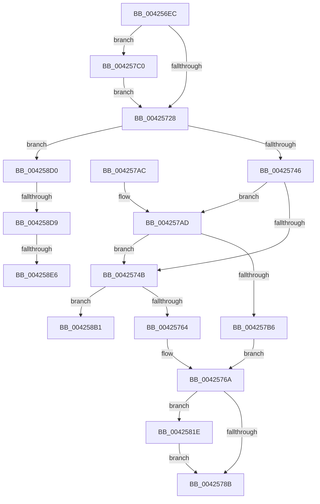

# FsRtlpComputeShareableOplockState

- RVA: `0x004256EC`–`0x004258F3` (길이 `519` bytes)
- VA: `0x00000001404256EC`
- 실행 섹션: `.text`
- PDB 이름 있음: `예`; PDB Function 태그: `예`
- unwind 정보 RVA: `0x000A04CC`
- 디코드: `118`개 명령, `519/519` bytes 표시
- 미해석 바이트: `0` (있으면 어셈블리에 `.byte`로 보존)

> 이 문서는 커널 이미지의 기계어와 PDB 기호를 분석해 생성했습니다. 4번과 5번은 함수 원형과 자료형을 바이너리 사용 방식에서 추정한 C 해석이며 원본 소스 복구 결과는 아닙니다.

## 1. Dependencies

- 직접 호출 지점: **3**; 고유 호출 대상: **2**
- 직접 호출자로 확인된 함수: **10**
- RIP 상대 이미지 참조: **4**

### Outgoing calls
- `0x00425792` → [_security_check_cookie](../6A/_security_check_cookie_function_006AC640.md) (function, `0x006AC640`)
- `0x00425814` → [tlgWriteTransfer_EtwWriteTransfer](tlgWriteTransfer_EtwWriteTransfer_function_004260E0.md) (function, `0x004260E0`)
- `0x004258A7` → [tlgWriteTransfer_EtwWriteTransfer](tlgWriteTransfer_EtwWriteTransfer_function_004260E0.md) (function, `0x004260E0`)

### Direct callers
- [FsRtlpAcknowledgeOplockBreakByCacheFlags](../3F/FsRtlpAcknowledgeOplockBreakByCacheFlags_function_003F1988.md) at `0x003F2036`
- [FsRtlCheckOplockEx2](../3F/FsRtlCheckOplockEx2_function_003F2BC0.md) at `0x003F2D94`
- [FsRtlpRequestExclusiveOplock](../3F/FsRtlpRequestExclusiveOplock_function_003F3800.md) at `0x003F393C`
- [FsRtlpRequestExclusiveOplock](../3F/FsRtlpRequestExclusiveOplock_function_003F3800.md) at `0x003F39F4`
- [FsRtlpOplockCleanup](FsRtlpOplockCleanup_function_00425030.md) at `0x0042513F`
- [FsRtlpOplockCleanup](FsRtlpOplockCleanup_function_00425030.md) at `0x004254CD`
- [FsRtlpCancelOplockRHIrp](../4A/FsRtlpCancelOplockRHIrp_function_004A55F0.md) at `0x004A5787`
- [FsRtlpOplockBreakByCacheFlags](../4E/FsRtlpOplockBreakByCacheFlags_function_004E4990.md) at `0x004E512B`
- [FsRtlpOplockBreakByCacheFlags](../4E/FsRtlpOplockBreakByCacheFlags_function_004E4990.md) at `0x004E61E3`
- [FsRtlpOplockBreakByCacheFlags](../4E/FsRtlpOplockBreakByCacheFlags_function_004E4990.md) at `0x004E61F5`
- [FsRtlpRequestShareableOplock](../4E/FsRtlpRequestShareableOplock_function_004E6EC8.md) at `0x004E701E`
- [FsRtlpRequestShareableOplock](../4E/FsRtlpRequestShareableOplock_function_004E6EC8.md) at `0x004E70CA`
- [FsRtlpRequestShareableOplock](../4E/FsRtlpRequestShareableOplock_function_004E6EC8.md) at `0x004E7673`
- [FsRtlpRequestShareableOplock](../4E/FsRtlpRequestShareableOplock_function_004E6EC8.md) at `0x004E78CA`
- [FsRtlpCancelReadOnlyOplockIrp](../58/FsRtlpCancelReadOnlyOplockIrp_function_00582380.md) at `0x00582409`
- [FsRtlCheckUpperOplock](../../page/71/FsRtlCheckUpperOplock_function_007145F0.md) at `0x0071471B`
- [sub_00B3115E](../../page/B3/Unknown_function_00B3115E.md) at `0x00B312C8`

### Static image references
- `0x00425703` → RVA `0x00E0A740` (`.data`; read)
- `0x00425711` → RVA `0x00E06C50` (`.data`; read)
- `0x004257CC` → RVA `0x0005ACED` (`.rdata`; read)
- `0x0042582A` → RVA `0x0005AD3E` (`.rdata`; read)

## 2. Other-region calls and transfers

- 다른 실행 섹션으로 향하는 call: **0**
- call이 아닌 외부 분기/꼬리 이동: **4**
  - `0x004258CB` → [sub_006EDB84](../6E/Unknown_function_006EDB84.md) (`tail-transfer`)
  - `0x004258D3` → [sub_006EDB84 + 0x91](../6E/Unknown_function_006EDB84.md) (`tail-transfer`)
  - `0x004258E0` → [sub_006EDB84 + 0x91](../6E/Unknown_function_006EDB84.md) (`tail-transfer`)
  - `0x004258EE` → [sub_006EDB84 + 0x33](../6E/Unknown_function_006EDB84.md) (`tail-transfer`)

## 3. Assembly (complete function range)

```asm
004256EC  48 89 5C 24 10                  mov qword ptr [rsp + 0x10], rbx
004256F1  48 89 7C 24 18                  mov qword ptr [rsp + 0x18], rdi
004256F6  55                              push rbp
004256F7  48 8D 6C 24 A9                  lea rbp, [rsp - 0x57]
004256FC  48 81 EC C0 00 00 00            sub rsp, 0xc0
00425703  48 8B 05 36 50 9E 00            mov rax, qword ptr [rip + 0x9e5036]
0042570A  48 33 C4                        xor rax, rsp
0042570D  48 89 45 47                     mov qword ptr [rbp + 0x47], rax
00425711  83 3D 38 15 9E 00 05            cmp dword ptr [rip + 0x9e1538], 5
00425718  48 8D B9 90 00 00 00            lea rdi, [rcx + 0x90]
0042571F  48 8B D9                        mov rbx, rcx
00425722  0F 87 98 00 00 00               ja 0x1404257c0
00425728  44 8B 17                        mov r10d, dword ptr [rdi]
0042572B  48 8D 43 28                     lea rax, [rbx + 0x28]
0042572F  4C 8B 00                        mov r8, qword ptr [rax]
00425732  41 81 E2 00 00 01 01            and r10d, 0x1010000
00425739  4C 3B C0                        cmp r8, rax
0042573C  48 8D 43 38                     lea rax, [rbx + 0x38]
00425740  0F 85 8A 01 00 00               jne 0x1404258d0
00425746  48 39 00                        cmp qword ptr [rax], rax
00425749  74 62                           je 0x1404257ad
0042574B  48 8D 43 38                     lea rax, [rbx + 0x38]
0042574F  41 B9 00 30 00 00               mov r9d, 0x3000
00425755  48 39 00                        cmp qword ptr [rax], rax
00425758  8B 83 90 00 00 00               mov eax, dword ptr [rbx + 0x90]
0042575E  0F 84 4D 01 00 00               je 0x1404258b1
00425764  83 E0 20                        and eax, 0x20
00425767  41 0B C1                        or eax, r9d
0042576A  89 83 90 00 00 00               mov dword ptr [rbx + 0x90], eax
00425770  44 0B 93 90 00 00 00            or r10d, dword ptr [rbx + 0x90]
00425777  44 89 93 90 00 00 00            mov dword ptr [rbx + 0x90], r10d
0042577E  83 3D CB 14 9E 00 05            cmp dword ptr [rip + 0x9e14cb], 5
00425785  0F 87 93 00 00 00               ja 0x14042581e
0042578B  48 8B 4D 47                     mov rcx, qword ptr [rbp + 0x47]
0042578F  48 33 CC                        xor rcx, rsp
00425792  E8 A9 6E 28 00                  call 0x1406ac640
00425797  4C 8D 9C 24 C0 00 00 00         lea r11, [rsp + 0xc0]
0042579F  49 8B 5B 18                     mov rbx, qword ptr [r11 + 0x18]
004257A3  49 8B 7B 20                     mov rdi, qword ptr [r11 + 0x20]
004257A7  49 8B E3                        mov rsp, r11
004257AA  5D                              pop rbp
004257AB  C3                              ret
004257AC  CC                              int3
004257AD  48 8D 43 48                     lea rax, [rbx + 0x48]
004257B1  48 39 00                        cmp qword ptr [rax], rax
004257B4  75 95                           jne 0x14042574b
004257B6  8B 07                           mov eax, dword ptr [rdi]
004257B8  83 E0 20                        and eax, 0x20
004257BB  83 C8 01                        or eax, 1
004257BE  EB AA                           jmp 0x14042576a
004257C0  83 65 13 00                     and dword ptr [rbp + 0x13], 0
004257C4  48 8D 45 CF                     lea rax, [rbp - 0x31]
004257C8  83 65 23 00                     and dword ptr [rbp + 0x23], 0
004257CC  48 8D 15 1A 55 C3 FF            lea rdx, [rip - 0x3caae6]
004257D3  48 89 45 07                     mov qword ptr [rbp + 7], rax
004257D7  48 8D 0D 72 14 9E 00            lea rcx, [rip + 0x9e1472]
004257DE  8B 07                           mov eax, dword ptr [rdi]
004257E0  45 33 C9                        xor r9d, r9d
004257E3  89 45 CB                        mov dword ptr [rbp - 0x35], eax
004257E6  45 33 C0                        xor r8d, r8d
004257E9  48 8D 45 CB                     lea rax, [rbp - 0x35]
004257ED  48 89 5D CF                     mov qword ptr [rbp - 0x31], rbx
004257F1  48 89 45 17                     mov qword ptr [rbp + 0x17], rax
004257F5  48 8D 45 E7                     lea rax, [rbp - 0x19]
004257F9  48 89 44 24 28                  mov qword ptr [rsp + 0x28], rax
004257FE  C7 44 24 20 04 00 00 00         mov dword ptr [rsp + 0x20], 4
00425806  C7 45 0F 08 00 00 00            mov dword ptr [rbp + 0xf], 8
0042580D  C7 45 1F 04 00 00 00            mov dword ptr [rbp + 0x1f], 4
00425814  E8 C7 08 00 00                  call 0x1404260e0
00425819  E9 0A FF FF FF                  jmp 0x140425728
0042581E  83 65 13 00                     and dword ptr [rbp + 0x13], 0
00425822  48 8D 45 CF                     lea rax, [rbp - 0x31]
00425826  83 65 23 00                     and dword ptr [rbp + 0x23], 0
0042582A  48 8D 15 0D 55 C3 FF            lea rdx, [rip - 0x3caaf3]
00425831  83 65 33 00                     and dword ptr [rbp + 0x33], 0
00425835  48 8D 0D 14 14 9E 00            lea rcx, [rip + 0x9e1414]
0042583C  83 65 43 00                     and dword ptr [rbp + 0x43], 0
00425840  45 33 C9                        xor r9d, r9d
00425843  48 89 45 07                     mov qword ptr [rbp + 7], rax
00425847  45 33 C0                        xor r8d, r8d
0042584A  48 8D 45 CB                     lea rax, [rbp - 0x35]
0042584E  48 89 5D CF                     mov qword ptr [rbp - 0x31], rbx
00425852  48 89 45 17                     mov qword ptr [rbp + 0x17], rax
00425856  48 8B 43 58                     mov rax, qword ptr [rbx + 0x58]
0042585A  48 89 45 D7                     mov qword ptr [rbp - 0x29], rax
0042585E  48 8D 45 D7                     lea rax, [rbp - 0x29]
00425862  48 89 45 27                     mov qword ptr [rbp + 0x27], rax
00425866  48 8B 43 60                     mov rax, qword ptr [rbx + 0x60]
0042586A  48 89 45 DF                     mov qword ptr [rbp - 0x21], rax
0042586E  48 8D 45 DF                     lea rax, [rbp - 0x21]
00425872  48 89 45 37                     mov qword ptr [rbp + 0x37], rax
00425876  48 8D 45 E7                     lea rax, [rbp - 0x19]
0042587A  48 89 44 24 28                  mov qword ptr [rsp + 0x28], rax
0042587F  C7 44 24 20 06 00 00 00         mov dword ptr [rsp + 0x20], 6
00425887  C7 45 0F 08 00 00 00            mov dword ptr [rbp + 0xf], 8
0042588E  44 89 55 CB                     mov dword ptr [rbp - 0x35], r10d
00425892  C7 45 1F 04 00 00 00            mov dword ptr [rbp + 0x1f], 4
00425899  C7 45 2F 08 00 00 00            mov dword ptr [rbp + 0x2f], 8
004258A0  C7 45 3F 08 00 00 00            mov dword ptr [rbp + 0x3f], 8
004258A7  E8 34 08 00 00                  call 0x1404260e0
004258AC  E9 DA FE FF FF                  jmp 0x14042578b
004258B1  33 C9                           xor ecx, ecx
004258B3  4C 8D 5B 48                     lea r11, [rbx + 0x48]
004258B7  83 E0 20                        and eax, 0x20
004258BA  BF 00 00 F0 00                  mov edi, 0xf00000
004258BF  41 0B C1                        or eax, r9d
004258C2  89 83 90 00 00 00               mov dword ptr [rbx + 0x90], eax
004258C8  4D 8B 03                        mov r8, qword ptr [r11]
004258CB  E9 B4 82 2C 00                  jmp 0x1406edb84
004258D0  48 39 00                        cmp qword ptr [rax], rax
004258D3  0F 85 3C 83 2C 00               jne 0x1406edc15
004258D9  48 8D 43 48                     lea rax, [rbx + 0x48]
004258DD  48 39 00                        cmp qword ptr [rax], rax
004258E0  0F 85 2F 83 2C 00               jne 0x1406edc15
004258E6  32 D2                           xor dl, dl
004258E8  4C 8D 4B 28                     lea r9, [rbx + 0x28]
004258EC  32 C9                           xor cl, cl
004258EE  E9 C4 82 2C 00                  jmp 0x1406edbb7
```

## 4. C-style interpretation (structured pseudocode)

```c
__int64 __fastcall FsRtlpComputeShareableOplockState(__int64 a1)
{
    __int64 result;
    __int64 v_r10;
    __int64 v_rsp;
    unsigned __int64 v_stack_m18;
    unsigned int v_stack_m1C;
    unsigned int v_stack_m20;
    unsigned __int64 v_stack_m28;
    unsigned int v_stack_m2C;
    unsigned int v_stack_m30;
    unsigned __int64 v_stack_m38;
    unsigned int v_stack_m3C;
    unsigned int v_stack_m40;
    unsigned __int64 v_stack_m48;
    unsigned int v_stack_m4C;
    unsigned int v_stack_m50;
    unsigned __int64 v_stack_m58;
    unsigned __int64 v_stack_m5F;
    unsigned __int64 v_stack_m78;
    unsigned __int64 v_stack_m8;
    unsigned __int64 v_stack_m80;
    unsigned __int64 v_stack_m88;
    unsigned __int64 v_stack_m90;
    unsigned int v_stack_m94;
    unsigned __int64 v_stack_m98;
    unsigned int v_stack_mA0;
    unsigned __int64 v_stack_p10;
    unsigned __int64 v_stack_p18;

    v_stack_p10 = v_rbx;
    v_stack_p18 = v_rdi;
    v_rsp = (v_rsp) - (192);
    result = (*(unsigned __int64 *)(v_rip + 10375222)) ^ (v_rsp);
    v_stack_m18 = result;
    if ((*(unsigned int *)(v_rip + 10360120)) > 5) goto loc_004257C0;
loc_00425728:
    v_r10 = (unsigned int)(((unsigned int)(*(unsigned int *)(a1 + 144))) & (0x1010000ULL));
    if ((*(unsigned __int64 *)(a1 + 40)) != (a1 + 40)) goto loc_004258D0;
    if ((*(unsigned __int64 *)(a1 + 56)) == (a1 + 56)) goto loc_004257AD;
loc_0042574B:
    if ((*(unsigned __int64 *)(a1 + 56)) == (a1 + 56)) goto loc_004258B1;
    result = (unsigned int)(((unsigned int)(*(unsigned int *)(a1 + 144))) & (32));
    result = (unsigned int)((result) | ((unsigned int)((unsigned int)(0x3000ULL))));
loc_0042576A:
    *(unsigned int *)(a1 + 144) = (unsigned int)(result);
    v_r10 = (unsigned int)((v_r10) | (*(unsigned int *)(a1 + 144)));
    *(unsigned int *)(a1 + 144) = (unsigned int)(v_r10);
    if ((*(unsigned int *)(v_rip + 10360011)) > 5) goto loc_0042581E;
loc_0042578B:
    a1 = (v_stack_m18) ^ (v_rsp);
    result = _security_check_cookie(a1, a2, *(unsigned __int64 *)(a1 + 40), (unsigned int)(0x3000ULL));
    return result;
loc_004257AD:
    if ((*(unsigned __int64 *)(*(unsigned __int64 *)(v_stack_m8 + 24) + 72)) != (*(unsigned __int64 *)(v_stack_m8 + 24) + 72)) goto loc_0042574B;
    result = (unsigned int)(((unsigned int)(*(unsigned int *)(*(unsigned __int64 *)(v_stack_m8 + 32)))) & (32));
    result = (unsigned int)((result) | (1));
    goto loc_0042576A;
loc_004257C0:
    v_stack_m58 = v_stack_m90;
    a4 = 0;
    v_stack_m94 = (unsigned int)((unsigned int)(*(unsigned int *)(*(unsigned __int64 *)(v_stack_m8 + 32))));
    a3 = 0;
    v_stack_m90 = *(unsigned __int64 *)(v_stack_m8 + 24);
    v_stack_m48 = v_stack_m94;
    v_stack_m98 = v_stack_m78;
    v_stack_mA0 = 4;
    v_stack_m50 = 8;
    v_stack_m40 = 4;
    result = tlgWriteTransfer_EtwWriteTransfer(v_rip + 10359922, v_rip - 3975910, a3, a4);
    goto loc_00425728;
loc_0042581E:
    a4 = 0;
    v_stack_m58 = v_stack_m90;
    a3 = 0;
    v_stack_m90 = *(unsigned __int64 *)(v_stack_m8 + 24);
    v_stack_m48 = v_stack_m94;
    v_stack_m88 = *(unsigned __int64 *)(*(unsigned __int64 *)(v_stack_m8 + 24) + 88);
    v_stack_m38 = v_stack_m88;
    v_stack_m80 = *(unsigned __int64 *)(*(unsigned __int64 *)(v_stack_m8 + 24) + 96);
    v_stack_m28 = v_stack_m80;
    v_stack_m98 = v_stack_m78;
    v_stack_mA0 = 6;
    v_stack_m50 = 8;
    v_stack_m94 = (unsigned int)(v_r10);
    v_stack_m40 = 4;
    v_stack_m30 = 8;
    v_stack_m20 = 8;
    result = tlgWriteTransfer_EtwWriteTransfer(v_rip + 10359828, v_rip - 3975923, a3, a4);
    goto loc_0042578B;
loc_004258B1:
    a1 = 0;
    result = (unsigned int)((result) & (32));
    result = (unsigned int)((result) | (0));
    *(unsigned int *)(*(unsigned __int64 *)(v_stack_m8 + 24) + 144) = (unsigned int)(result);
loc_004258D0:
    a2 = 0;
    a1 = 0;
}
```

## 5. (Beta) C Style

```c
int64_t FsRtlpComputeShareableOplockState(void *Arg1)
{
    uint8_t *arg1 = (uint8_t *)Arg1;

    int64_t result;
    int64_t local_r10;
    int64_t local_rsp;
    uint64_t v_stack_m18;
    uint32_t v_stack_m1C;
    uint32_t v_stack_m20;
    uint64_t v_stack_m28;
    uint32_t v_stack_m2C;
    uint32_t v_stack_m30;
    uint64_t v_stack_m38;
    uint32_t v_stack_m3C;
    uint32_t v_stack_m40;
    uint64_t v_stack_m48;
    uint32_t v_stack_m4C;
    uint32_t v_stack_m50;
    uint64_t v_stack_m58;
    uint64_t v_stack_m5F;
    uint64_t v_stack_m78;
    uint64_t v_stack_m8;
    uint64_t v_stack_m80;
    uint64_t v_stack_m88;
    uint64_t v_stack_m90;
    uint32_t v_stack_m94;
    uint64_t v_stack_m98;
    uint32_t v_stack_mA0;
    uint64_t v_stack_p10;
    uint64_t v_stack_p18;

    v_stack_p10 = local_rbx;
    v_stack_p18 = local_rdi;
    local_rsp = (local_rsp) - (192);
    result = (*(uint64_t *)(v_rip + 0x9E5036)) ^ (local_rsp);
    v_stack_m18 = result;
    if ((*(uint32_t *)(v_rip + 0x9E1538)) > 5) goto loc_004257C0;
loc_00425728:
    local_r10 = (uint32_t)(((uint32_t)(*(uint32_t *)(arg1 + 0x90))) & (0x1010000ULL));
    if ((*(uint64_t *)(arg1 + 0x28)) != (Arg1 + 40)) goto loc_004258D0;
    if ((*(uint64_t *)(arg1 + 0x38)) == (Arg1 + 56)) goto loc_004257AD;
loc_0042574B:
    if ((*(uint64_t *)(arg1 + 0x38)) == (Arg1 + 56)) goto loc_004258B1;
    result = (uint32_t)(((uint32_t)(*(uint32_t *)(arg1 + 0x90))) & (32));
    result = (uint32_t)((result) | ((uint32_t)((uint32_t)(0x3000ULL))));
loc_0042576A:
    *(uint32_t *)(arg1 + 0x90) = (uint32_t)(result);
    local_r10 = (uint32_t)((local_r10) | (*(uint32_t *)(arg1 + 0x90)));
    *(uint32_t *)(arg1 + 0x90) = (uint32_t)(local_r10);
    if ((*(uint32_t *)(v_rip + 0x9E14CB)) > 5) goto loc_0042581E;
loc_0042578B:
    Arg1 = (v_stack_m18) ^ (local_rsp);
    result = _security_check_cookie(Arg1, a2, *(uint64_t *)(arg1 + 0x28), (uint32_t)(0x3000ULL));
    return result;
loc_004257AD:
    if ((*(uint64_t *)(*(uint64_t *)(v_stack_m8 + 0x18) + 0x48)) != (*(uint64_t *)(v_stack_m8 + 0x18) + 72)) goto loc_0042574B;
    result = (uint32_t)(((uint32_t)(*(uint32_t *)(*(uint64_t *)(v_stack_m8 + 0x20)))) & (32));
    result = (uint32_t)((result) | (1));
    goto loc_0042576A;
loc_004257C0:
    v_stack_m58 = v_stack_m90;
    a4 = 0;
    v_stack_m94 = (uint32_t)((uint32_t)(*(uint32_t *)(*(uint64_t *)(v_stack_m8 + 0x20))));
    a3 = 0;
    v_stack_m90 = *(uint64_t *)(v_stack_m8 + 0x18);
    v_stack_m48 = v_stack_m94;
    v_stack_m98 = v_stack_m78;
    v_stack_mA0 = 4;
    v_stack_m50 = 8;
    v_stack_m40 = 4;
    result = tlgWriteTransfer_EtwWriteTransfer(v_rip + 10359922, v_rip - 3975910, a3, a4);
    goto loc_00425728;
loc_0042581E:
    a4 = 0;
    v_stack_m58 = v_stack_m90;
    a3 = 0;
    v_stack_m90 = *(uint64_t *)(v_stack_m8 + 0x18);
    v_stack_m48 = v_stack_m94;
    v_stack_m88 = *(uint64_t *)(*(uint64_t *)(v_stack_m8 + 0x18) + 0x58);
    v_stack_m38 = v_stack_m88;
    v_stack_m80 = *(uint64_t *)(*(uint64_t *)(v_stack_m8 + 0x18) + 0x60);
    v_stack_m28 = v_stack_m80;
    v_stack_m98 = v_stack_m78;
    v_stack_mA0 = 6;
    v_stack_m50 = 8;
    v_stack_m94 = (uint32_t)(local_r10);
    v_stack_m40 = 4;
    v_stack_m30 = 8;
    v_stack_m20 = 8;
    result = tlgWriteTransfer_EtwWriteTransfer(v_rip + 10359828, v_rip - 3975923, a3, a4);
    goto loc_0042578B;
loc_004258B1:
    Arg1 = 0;
    result = (uint32_t)((result) & (32));
    result = (uint32_t)((result) | (0));
    *(uint32_t *)(*(uint64_t *)(v_stack_m8 + 0x18) + 0x90) = (uint32_t)(result);
loc_004258D0:
    a2 = 0;
    Arg1 = 0;
}
```

### 관측된 메모리 오프셋

구조체 형식이 확인되지 않은 접근은 인자 기준의 오프셋으로만 기록했습니다.

| 기준 인자 | 오프셋 표현 | 폭 (bit) | 접근 |
|---|---:|---:|---|
| `Arg1` | `+ 0x0` | `32` | `R` |
| `Arg1` | `+ 0x0` | `64` | `R` |
| `Arg1` | `+ 0x28` | `64` | `R` |
| `Arg1` | `+ 0x38` | `64` | `R` |
| `Arg1` | `+ 0x48` | `64` | `R` |
| `Arg1` | `+ 0x58` | `64` | `R` |
| `Arg1` | `+ 0x60` | `64` | `R` |
| `Arg1` | `+ 0x90` | `32` | `R` |
| `Arg1` | `+ 0x90` | `32` | `W` |
| `Arg1` | `+ 0x90` | `64` | `R` |

## 6. Execution-region graph

[열기: 2D/3D 그래프와 함수 탐색 컨트롤 패널](../../../control-panel.html?section=text&rva=0x004256EC&view=graph)

- 2D 그래프는 위에서 아래로 흐르고, 3D 그래프는 빈 공간을 드래그해 회전합니다. Shift+드래그는 이동, 휠은 확대·축소, 함수 노드 선택은 대상 보고서 이동입니다.

### Static fallback


