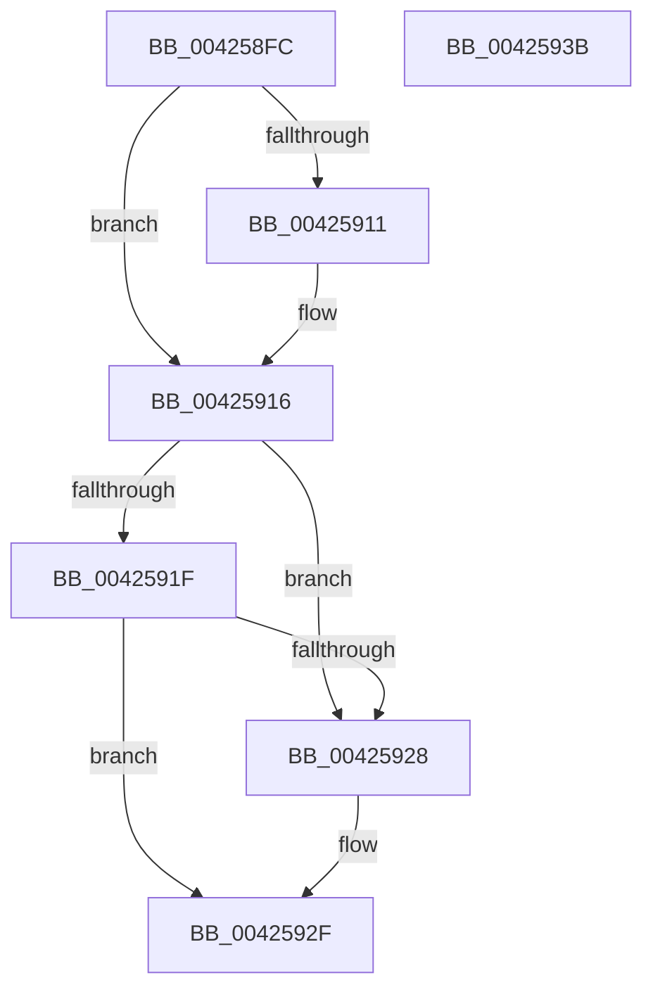

# FsRtlpOplockDequeueRH

- RVA: `0x004258FC`–`0x0042593C` (길이 `64` bytes)
- VA: `0x00000001404258FC`
- 실행 섹션: `.text`
- PDB 이름 있음: `예`; PDB Function 태그: `아니요`
- unwind 정보 RVA: `0x0005C788`
- 디코드: `20`개 명령, `64/64` bytes 표시
- 미해석 바이트: `0` (있으면 어셈블리에 `.byte`로 보존)

> 이 문서는 커널 이미지의 기계어와 PDB 기호를 분석해 생성했습니다. 4번과 5번은 함수 원형과 자료형을 바이너리 사용 방식에서 추정한 C 해석이며 원본 소스 복구 결과는 아닙니다.

## 1. Dependencies

- 직접 호출 지점: **1**; 고유 호출 대상: **1**
- 직접 호출자로 확인된 함수: **9**
- RIP 상대 이미지 참조: **0**

### Outgoing calls
- `0x00425907` → [IoGetOplockFullFoExt](IoGetOplockFullFoExt_function_00425944.md) (function, `0x00425944`)

### Direct callers
- [FsRtlpOplockEnqueueRH](../38/FsRtlpOplockEnqueueRH_function_0038F534.md) at `0x0038F594`
- [FsRtlpAcknowledgeOplockBreakByCacheFlags](../3F/FsRtlpAcknowledgeOplockBreakByCacheFlags_function_003F1988.md) at `0x003F1F04`
- [FsRtlCheckOplockEx2](../3F/FsRtlCheckOplockEx2_function_003F2BC0.md) at `0x003F2D34`
- [FsRtlCheckOplockEx2](../3F/FsRtlCheckOplockEx2_function_003F2BC0.md) at `0x003F2E33`
- [FsRtlpRequestExclusiveOplock](../3F/FsRtlpRequestExclusiveOplock_function_003F3800.md) at `0x003F38DC`
- [FsRtlpRequestExclusiveOplock](../3F/FsRtlpRequestExclusiveOplock_function_003F3800.md) at `0x003F398E`
- [FsRtlpOplockCleanup](FsRtlpOplockCleanup_function_00425030.md) at `0x0042531B`
- [FsRtlpOplockCleanup](FsRtlpOplockCleanup_function_00425030.md) at `0x00425505`
- [FsRtlpRemoveAndCompleteRHIrp](FsRtlpRemoveAndCompleteRHIrp_function_00425964.md) at `0x004259E5`
- [FsRtlUninitializeOplock](../4E/FsRtlUninitializeOplock_function_004E42C0.md) at `0x004E449A`
- [FsRtlUninitializeOplock](../4E/FsRtlUninitializeOplock_function_004E42C0.md) at `0x004E44F7`
- [FsRtlpRequestShareableOplock](../4E/FsRtlpRequestShareableOplock_function_004E6EC8.md) at `0x004E6FC3`
- [FsRtlpRequestShareableOplock](../4E/FsRtlpRequestShareableOplock_function_004E6EC8.md) at `0x004E7067`
- [sub_00B3115E](../../page/B3/Unknown_function_00B3115E.md) at `0x00B31275`

### Static image references
- 디코드된 RIP-relative 메모리 참조가 없습니다.

## 2. Other-region calls and transfers

- 다른 실행 섹션으로 향하는 call: **0**
- 별도 외부 분기/꼬리 이동을 확인하지 못했습니다.

## 3. Assembly (complete function range)

```asm
004258FC  48 83 EC 28                     sub rsp, 0x28
00425900  4C 8B C1                        mov r8, rcx
00425903  48 8B 49 18                     mov rcx, qword ptr [rcx + 0x18]
00425907  E8 38 00 00 00                  call 0x140425944
0042590C  48 85 C0                        test rax, rax
0042590F  74 05                           je 0x140425916
00425911  48 83 60 28 00                  and qword ptr [rax + 0x28], 0
00425916  49 8B 08                        mov rcx, qword ptr [r8]
00425919  4C 39 41 08                     cmp qword ptr [rcx + 8], r8
0042591D  75 09                           jne 0x140425928
0042591F  49 8B 40 08                     mov rax, qword ptr [r8 + 8]
00425923  4C 39 00                        cmp qword ptr [rax], r8
00425926  74 07                           je 0x14042592f
00425928  B9 03 00 00 00                  mov ecx, 3
0042592D  CD 29                           int 0x29
0042592F  48 89 08                        mov qword ptr [rax], rcx
00425932  48 89 41 08                     mov qword ptr [rcx + 8], rax
00425936  48 83 C4 28                     add rsp, 0x28
0042593A  C3                              ret
0042593B  CC                              int3
```

## 4. C-style interpretation (structured pseudocode)

```c
__int64 __fastcall FsRtlpOplockDequeueRH(__int64 a1)
{
    __int64 result;
    __int64 v_rsp;

    v_rsp = (v_rsp) - (40);
    result = IoGetOplockFullFoExt(*(unsigned __int64 *)(a1 + 24), a2, a1, a4);
    if (result != 0) {
    }
    if ((*(unsigned __int64 *)(*(unsigned __int64 *)(a1) + 8)) != a1) goto loc_00425928;
    if ((*(unsigned __int64 *)(*(unsigned __int64 *)(a1 + 8))) != a1) {
        a1 = 3;
    }
    *(unsigned __int64 *)(*(unsigned __int64 *)(a1 + 8)) = a1;
    *(unsigned __int64 *)(a1 + 8) = *(unsigned __int64 *)(a1 + 8);
    v_rsp = (v_rsp) + (40);
    return *(unsigned __int64 *)(a1 + 8);
}
```

## 5. (Beta) C Style

```c
int64_t FsRtlpOplockDequeueRH(void *Arg1)
{
    uint8_t *arg1 = (uint8_t *)Arg1;

    int64_t result;
    int64_t local_rsp;

    local_rsp = (local_rsp) - (40);
    result = IoGetOplockFullFoExt(*(uint64_t *)(arg1 + 0x18), a2, Arg1, a4);
    if (result != 0) {
    }
    if ((*(uint64_t *)(*(uint64_t *)(arg1) + 0x8)) != Arg1) goto loc_00425928;
    if ((*(uint64_t *)(*(uint64_t *)(arg1 + 0x8))) != Arg1) {
        Arg1 = 3;
    }
    *(void **)(*(uint64_t *)(arg1 + 0x8)) = Arg1;
    *(uint64_t *)(arg1 + 0x8) = *(uint64_t *)(arg1 + 0x8);
    local_rsp = (local_rsp) + (40);
    return *(uint64_t *)(arg1 + 0x8);
}
```

### 관측된 메모리 오프셋

구조체 형식이 확인되지 않은 접근은 인자 기준의 오프셋으로만 기록했습니다.

| 기준 인자 | 오프셋 표현 | 폭 (bit) | 접근 |
|---|---:|---:|---|
| `Arg1` | `+ 0x18` | `64` | `R` |

## 6. Execution-region graph

[열기: 2D/3D 그래프와 함수 탐색 컨트롤 패널](../../../control-panel.html?section=text&rva=0x004258FC&view=graph)

- 2D 그래프는 위에서 아래로 흐르고, 3D 그래프는 빈 공간을 드래그해 회전합니다. Shift+드래그는 이동, 휠은 확대·축소, 함수 노드 선택은 대상 보고서 이동입니다.

### Static fallback


