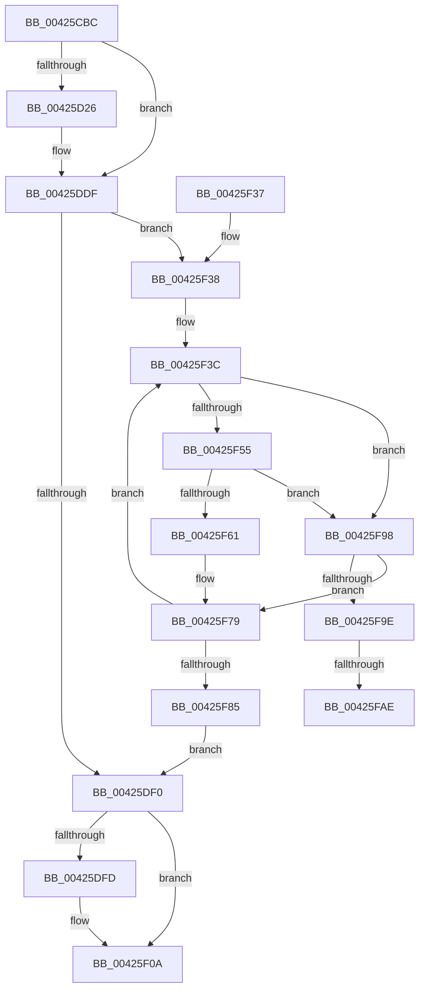

# FsRtlpReleaseIrpsWaitingForRH

- RVA: `0x00425CBC`–`0x00425FBA` (길이 `766` bytes)
- VA: `0x0000000140425CBC`
- 실행 섹션: `.text`
- PDB 이름 있음: `예`; PDB Function 태그: `예`
- unwind 정보 RVA: `0x000A0534`
- 디코드: `167`개 명령, `766/766` bytes 표시
- 미해석 바이트: `0` (있으면 어셈블리에 `.byte`로 보존)

> 이 문서는 커널 이미지의 기계어와 PDB 기호를 분석해 생성했습니다. 4번과 5번은 함수 원형과 자료형을 바이너리 사용 방식에서 추정한 C 해석이며 원본 소스 복구 결과는 아닙니다.

## 1. Dependencies

- 직접 호출 지점: **4**; 고유 호출 대상: **3**
- 직접 호출자로 확인된 함수: **6**
- RIP 상대 이미지 참조: **10**

### Outgoing calls
- `0x00425DCE` → [EtwWriteEx](../25/EtwWriteEx_function_0025F0D0.md) (function, `0x0025F0D0`)
- `0x00425F05` → [EtwWriteEx](../25/EtwWriteEx_function_0025F0D0.md) (function, `0x0025F0D0`)
- `0x00425F11` → [_security_check_cookie](../6A/_security_check_cookie_function_006AC640.md) (function, `0x006AC640`)
- `0x00425F65` → [FsRtlpRemoveAndCompleteWaitingIrp](FsRtlpRemoveAndCompleteWaitingIrp_function_00425FC0.md) (function, `0x00425FC0`)

### Direct callers
- [FsRtlpAcknowledgeOplockBreakByCacheFlags](../3F/FsRtlpAcknowledgeOplockBreakByCacheFlags_function_003F1988.md) at `0x003F22AF`
- [FsRtlCheckOplockEx2](../3F/FsRtlCheckOplockEx2_function_003F2BC0.md) at `0x003F2D9C`
- [FsRtlpOplockCleanup](FsRtlpOplockCleanup_function_00425030.md) at `0x00425301`
- [FsRtlpCancelOplockRHIrp](../4A/FsRtlpCancelOplockRHIrp_function_004A55F0.md) at `0x004A577A`
- [FsRtlpOplockBreakByCacheFlags](../4E/FsRtlpOplockBreakByCacheFlags_function_004E4990.md) at `0x004E6176`
- [sub_00B3115E](../../page/B3/Unknown_function_00B3115E.md) at `0x00B312D0`

### Static image references
- `0x00425CDF` → RVA `0x00E0A740` (`.data`; read)
- `0x00425CF0` → RVA `0x0005BCFD` (`.rdata`; read)
- `0x00425CF7` → RVA `0x00E06C50` (`.data`; read)
- `0x00425CFE` → RVA `0x00043590` (`.rdata`; read)
- `0x00425D4C` → RVA `0x000445EF` (`.rdata`; read)
- `0x00425D57` → RVA `0x00E06C58` (`.data`; read)
- `0x00425D81` → RVA `0x000445F9` (`.rdata`; read)
- `0x00425DAF` → RVA `0x00E06C70` (`.data`; read)
- `0x00425E5A` → RVA `0x00044551` (`.rdata`; read)
- `0x00425EB8` → RVA `0x0004455B` (`.rdata`; read)

## 2. Other-region calls and transfers

- 다른 실행 섹션으로 향하는 call: **0**
- call이 아닌 외부 분기/꼬리 이동: **2**
  - `0x00425FA8` → [sub_006EDC30](../6E/Unknown_function_006EDC30.md) (`tail-transfer`)
  - `0x00425FB5` → [sub_006EDC30 + 0x3](../6E/Unknown_function_006EDC30.md) (`tail-transfer`)

## 3. Assembly (complete function range)

```asm
00425CBC  48 8B C4                        mov rax, rsp
00425CBF  48 89 58 10                     mov qword ptr [rax + 0x10], rbx
00425CC3  48 89 70 18                     mov qword ptr [rax + 0x18], rsi
00425CC7  48 89 78 20                     mov qword ptr [rax + 0x20], rdi
00425CCB  55                              push rbp
00425CCC  41 54                           push r12
00425CCE  41 55                           push r13
00425CD0  41 56                           push r14
00425CD2  41 57                           push r15
00425CD4  48 8D 68 C8                     lea rbp, [rax - 0x38]
00425CD8  48 81 EC 10 01 00 00            sub rsp, 0x110
00425CDF  48 8B 05 5A 4A 9E 00            mov rax, qword ptr [rip + 0x9e4a5a]
00425CE6  48 33 C4                        xor rax, rsp
00425CE9  48 89 45 00                     mov qword ptr [rbp], rax
00425CED  45 33 C9                        xor r9d, r9d
00425CF0  48 8D 35 06 60 C3 FF            lea rsi, [rip - 0x3c9ffa]
00425CF7  83 3D 52 0F 9E 00 05            cmp dword ptr [rip + 0x9e0f52], 5
00425CFE  4C 8D 2D 8B D8 C1 FF            lea r13, [rip - 0x3e2775]
00425D05  41 8B C1                        mov eax, r9d
00425D08  41 8B D1                        mov edx, r9d
00425D0B  48 8B F9                        mov rdi, rcx
00425D0E  89 44 24 40                     mov dword ptr [rsp + 0x40], eax
00425D12  45 8D 71 04                     lea r14d, [r9 + 4]
00425D16  89 54 24 44                     mov dword ptr [rsp + 0x44], edx
00425D1A  45 8B C1                        mov r8d, r9d
00425D1D  45 8B F9                        mov r15d, r9d
00425D20  0F 86 B9 00 00 00               jbe 0x140425ddf
00425D26  48 89 4C 24 58                  mov qword ptr [rsp + 0x58], rcx
00425D2B  48 8D 44 24 58                  lea rax, [rsp + 0x58]
00425D30  48 89 45 A0                     mov qword ptr [rbp - 0x60], rax
00425D34  48 8D 54 24 60                  lea rdx, [rsp + 0x60]
00425D39  8B 81 90 00 00 00               mov eax, dword ptr [rcx + 0x90]
00425D3F  89 44 24 4C                     mov dword ptr [rsp + 0x4c], eax
00425D43  48 8D 44 24 4C                  lea rax, [rsp + 0x4c]
00425D48  48 89 45 B0                     mov qword ptr [rbp - 0x50], rax
00425D4C  0F B7 05 9C E8 C1 FF            movzx eax, word ptr [rip - 0x3e1764]
00425D53  89 44 24 64                     mov dword ptr [rsp + 0x64], eax
00425D57  48 8B 05 FA 0E 9E 00            mov rax, qword ptr [rip + 0x9e0efa]
00425D5E  48 89 45 80                     mov qword ptr [rbp - 0x80], rax
00425D62  48 C7 45 A8 08 00 00 00         mov qword ptr [rbp - 0x58], 8
00425D6A  4C 89 75 B8                     mov qword ptr [rbp - 0x48], r14
00425D6E  C7 44 24 60 00 00 00 0B         mov dword ptr [rsp + 0x60], 0xb000000
00425D76  4C 89 4C 24 68                  mov qword ptr [rsp + 0x68], r9
00425D7B  0F B7 00                        movzx eax, word ptr [rax]
00425D7E  89 45 88                        mov dword ptr [rbp - 0x78], eax
00425D81  48 8D 05 71 E8 C1 FF            lea rax, [rip - 0x3e178f]
00425D88  48 89 45 90                     mov qword ptr [rbp - 0x70], rax
00425D8C  48 8B C6                        mov rax, rsi
00425D8F  41 2B C5                        sub eax, r13d
00425D92  C7 45 8C 02 00 00 00            mov dword ptr [rbp - 0x74], 2
00425D99  C7 45 98 41 00 00 00            mov dword ptr [rbp - 0x68], 0x41
00425DA0  C7 45 9C 01 00 00 00            mov dword ptr [rbp - 0x64], 1
00425DA7  89 44 24 50                     mov dword ptr [rsp + 0x50], eax
00425DAB  8B 44 24 50                     mov eax, dword ptr [rsp + 0x50]
00425DAF  48 8B 0D BA 0E 9E 00            mov rcx, qword ptr [rip + 0x9e0eba]
00425DB6  48 8D 45 80                     lea rax, [rbp - 0x80]
00425DBA  48 89 44 24 38                  mov qword ptr [rsp + 0x38], rax
00425DBF  44 89 74 24 30                  mov dword ptr [rsp + 0x30], r14d
00425DC4  4C 89 4C 24 28                  mov qword ptr [rsp + 0x28], r9
00425DC9  4C 89 4C 24 20                  mov qword ptr [rsp + 0x20], r9
00425DCE  E8 FD 92 E3 FF                  call 0x14025f0d0
00425DD3  41 8B C7                        mov eax, r15d
00425DD6  41 8B D7                        mov edx, r15d
00425DD9  45 8B C7                        mov r8d, r15d
00425DDC  45 33 C9                        xor r9d, r9d
00425DDF  4C 8D 67 58                     lea r12, [rdi + 0x58]
00425DE3  49 8B 1C 24                     mov rbx, qword ptr [r12]
00425DE7  49 3B DC                        cmp rbx, r12
00425DEA  0F 85 48 01 00 00               jne 0x140425f38
00425DF0  83 3D 59 0E 9E 00 05            cmp dword ptr [rip + 0x9e0e59], 5
00425DF7  0F 86 0D 01 00 00               jbe 0x140425f0a
00425DFD  89 44 24 4C                     mov dword ptr [rsp + 0x4c], eax
00425E01  48 8D 4C 24 50                  lea rcx, [rsp + 0x50]
00425E06  44 89 44 24 50                  mov dword ptr [rsp + 0x50], r8d
00425E0B  48 8D 44 24 4C                  lea rax, [rsp + 0x4c]
00425E10  48 89 45 B0                     mov qword ptr [rbp - 0x50], rax
00425E14  41 2B F5                        sub esi, r13d
00425E17  48 89 4D A0                     mov qword ptr [rbp - 0x60], rcx
00425E1B  48 8D 44 24 48                  lea rax, [rsp + 0x48]
00425E20  48 89 45 C0                     mov qword ptr [rbp - 0x40], rax
00425E24  45 33 C0                        xor r8d, r8d
00425E27  89 54 24 44                     mov dword ptr [rsp + 0x44], edx
00425E2B  48 8D 44 24 44                  lea rax, [rsp + 0x44]
00425E30  48 89 45 D0                     mov qword ptr [rbp - 0x30], rax
00425E34  48 8D 54 24 70                  lea rdx, [rsp + 0x70]
00425E39  4C 89 4C 24 78                  mov qword ptr [rsp + 0x78], r9
00425E3E  48 8D 44 24 60                  lea rax, [rsp + 0x60]
00425E43  48 89 45 E0                     mov qword ptr [rbp - 0x20], rax
00425E47  8B 87 90 00 00 00               mov eax, dword ptr [rdi + 0x90]
00425E4D  89 44 24 40                     mov dword ptr [rsp + 0x40], eax
00425E51  48 8D 44 24 40                  lea rax, [rsp + 0x40]
00425E56  48 89 45 F0                     mov qword ptr [rbp - 0x10], rax
00425E5A  0F B7 05 F0 E6 C1 FF            movzx eax, word ptr [rip - 0x3e1910]
00425E61  89 44 24 74                     mov dword ptr [rsp + 0x74], eax
00425E65  48 8B 05 EC 0D 9E 00            mov rax, qword ptr [rip + 0x9e0dec]
00425E6C  48 89 45 80                     mov qword ptr [rbp - 0x80], rax
00425E70  48 C7 45 A8 04 00 00 00         mov qword ptr [rbp - 0x58], 4
00425E78  48 C7 45 B8 04 00 00 00         mov qword ptr [rbp - 0x48], 4
00425E80  44 89 7C 24 48                  mov dword ptr [rsp + 0x48], r15d
00425E85  48 C7 45 C8 04 00 00 00         mov qword ptr [rbp - 0x38], 4
00425E8D  48 C7 45 D8 04 00 00 00         mov qword ptr [rbp - 0x28], 4
00425E95  48 89 7C 24 60                  mov qword ptr [rsp + 0x60], rdi
00425E9A  48 C7 45 E8 08 00 00 00         mov qword ptr [rbp - 0x18], 8
00425EA2  48 C7 45 F8 04 00 00 00         mov qword ptr [rbp - 8], 4
00425EAA  C7 44 24 70 00 00 00 0B         mov dword ptr [rsp + 0x70], 0xb000000
00425EB2  0F B7 00                        movzx eax, word ptr [rax]
00425EB5  89 45 88                        mov dword ptr [rbp - 0x78], eax
00425EB8  48 8D 05 9C E6 C1 FF            lea rax, [rip - 0x3e1964]
00425EBF  48 89 45 90                     mov qword ptr [rbp - 0x70], rax
00425EC3  C7 45 8C 02 00 00 00            mov dword ptr [rbp - 0x74], 2
00425ECA  C7 45 98 92 00 00 00            mov dword ptr [rbp - 0x68], 0x92
00425ED1  C7 45 9C 01 00 00 00            mov dword ptr [rbp - 0x64], 1
00425ED8  89 74 24 58                     mov dword ptr [rsp + 0x58], esi
00425EDC  8B 44 24 58                     mov eax, dword ptr [rsp + 0x58]
00425EE0  48 8B 0D 89 0D 9E 00            mov rcx, qword ptr [rip + 0x9e0d89]
00425EE7  48 8D 45 80                     lea rax, [rbp - 0x80]
00425EEB  48 89 44 24 38                  mov qword ptr [rsp + 0x38], rax
00425EF0  C7 44 24 30 08 00 00 00         mov dword ptr [rsp + 0x30], 8
00425EF8  4C 89 4C 24 28                  mov qword ptr [rsp + 0x28], r9
00425EFD  4C 89 4C 24 20                  mov qword ptr [rsp + 0x20], r9
00425F02  45 33 C9                        xor r9d, r9d
00425F05  E8 C6 91 E3 FF                  call 0x14025f0d0
00425F0A  48 8B 4D 00                     mov rcx, qword ptr [rbp]
00425F0E  48 33 CC                        xor rcx, rsp
00425F11  E8 2A 67 28 00                  call 0x1406ac640
00425F16  4C 8D 9C 24 10 01 00 00         lea r11, [rsp + 0x110]
00425F1E  49 8B 5B 38                     mov rbx, qword ptr [r11 + 0x38]
00425F22  49 8B 73 40                     mov rsi, qword ptr [r11 + 0x40]
00425F26  49 8B 7B 48                     mov rdi, qword ptr [r11 + 0x48]
00425F2A  49 8B E3                        mov rsp, r11
00425F2D  41 5F                           pop r15
00425F2F  41 5E                           pop r14
00425F31  41 5D                           pop r13
00425F33  41 5C                           pop r12
00425F35  5D                              pop rbp
00425F36  C3                              ret
00425F37  CC                              int3
00425F38  4C 8D 6F 48                     lea r13, [rdi + 0x48]
00425F3C  49 8B 75 00                     mov rsi, qword ptr [r13]
00425F40  41 FF C0                        inc r8d
00425F43  48 89 5C 24 50                  mov qword ptr [rsp + 0x50], rbx
00425F48  48 8B CB                        mov rcx, rbx
00425F4B  44 89 44 24 48                  mov dword ptr [rsp + 0x48], r8d
00425F50  49 3B F5                        cmp rsi, r13
00425F53  75 43                           jne 0x140425f98
00425F55  F7 87 90 00 00 00 00 00 01 00   test dword ptr [rdi + 0x90], 0x10000
00425F5F  75 37                           jne 0x140425f98
00425F61  48 8B 5B 08                     mov rbx, qword ptr [rbx + 8]
00425F65  E8 56 00 00 00                  call 0x140425fc0
00425F6A  44 8B 44 24 48                  mov r8d, dword ptr [rsp + 0x48]
00425F6F  41 FF C7                        inc r15d
00425F72  8B 54 24 44                     mov edx, dword ptr [rsp + 0x44]
00425F76  45 33 C9                        xor r9d, r9d
00425F79  8B 44 24 40                     mov eax, dword ptr [rsp + 0x40]
00425F7D  48 8B 1B                        mov rbx, qword ptr [rbx]
00425F80  49 3B DC                        cmp rbx, r12
00425F83  75 B7                           jne 0x140425f3c
00425F85  48 8D 35 71 5D C3 FF            lea rsi, [rip - 0x3ca28f]
00425F8C  4C 8D 2D FD D5 C1 FF            lea r13, [rip - 0x3e2a03]
00425F93  E9 58 FE FF FF                  jmp 0x140425df0
00425F98  44 38 4B 34                     cmp byte ptr [rbx + 0x34], r9b
00425F9C  75 DB                           jne 0x140425f79
00425F9E  F7 87 90 00 00 00 00 00 01 00   test dword ptr [rdi + 0x90], 0x10000
00425FA8  0F 84 82 7C 2C 00               je 0x1406edc30
00425FAE  4C 8D 77 78                     lea r14, [rdi + 0x78]
00425FB2  49 8B 36                        mov rsi, qword ptr [r14]
00425FB5  E9 79 7C 2C 00                  jmp 0x1406edc33
```

## 4. C-style interpretation (structured pseudocode)

```c
__int64 __fastcall FsRtlpReleaseIrpsWaitingForRH(__int64 a1, __int64 a2, __int64 a3, int a4)
{
    __int64 result;
    __int64 v_r15;
    __int64 v_rsi;
    __int64 v_rsp;
    unsigned __int64 v_stack_m100;
    unsigned int v_stack_m108;
    unsigned __int64 v_stack_m110;
    unsigned __int64 v_stack_m118;
    unsigned __int64 v_stack_m28;
    unsigned __int64 v_stack_mC0;
    unsigned int v_stack_mC4;
    unsigned __int64 v_stack_mC8;
    unsigned int v_stack_mCC;
    unsigned __int64 v_stack_mD0;
    unsigned int v_stack_mD4;
    unsigned __int64 v_stack_mD8;
    unsigned __int64 v_stack_mE0;
    unsigned int v_stack_mE8;
    unsigned int v_stack_mEC;
    unsigned __int64 v_stack_mF0;
    unsigned int v_stack_mF4;
    unsigned int v_stack_mF8;

    *(unsigned __int64 *)(v_rsp + 16) = v_rbx;
    *(unsigned __int64 *)(v_rsp + 24) = v_rsi;
    *(unsigned __int64 *)(v_rsp + 32) = v_rdi;
    v_rsp = (v_rsp) - (272);
    result = (*(unsigned __int64 *)(v_rip + 10373722)) ^ (v_rsp);
    *(unsigned __int64 *)(v_rsp - 56) = result;
    a4 = 0;
    v_stack_mF8 = 0;
    v_stack_mF4 = 0;
    result = 0;
    if ((*(unsigned int *)(v_rip + 10358610)) >= = 5) {
        v_stack_mE0 = a1;
        result = v_stack_mE0;
        *(unsigned __int64 *)(v_rsp - 56 - 96) = result;
        a2 = v_stack_mD8;
        result = *(unsigned int *)(a1 + 144);
        v_stack_mEC = (unsigned int)(result);
        result = v_stack_mEC;
        *(unsigned __int64 *)(v_rsp - 56 - 80) = result;
        result = *(unsigned __int16 *)(v_rip - 4069220);
        v_stack_mD4 = (unsigned int)(result);
        result = *(unsigned __int64 *)(v_rip + 10358522);
        *(unsigned __int64 *)(v_rsp - 56 - 128) = result;
        *(unsigned __int64 *)(v_rsp - 56 - 88) = 8;
        *(unsigned __int64 *)(v_rsp - 56 - 72) = a4 + 4;
        v_stack_mD8 = 0xB000000ULL;
        v_stack_mD0 = 0;
        result = *(unsigned __int16 *)(result);
        *(unsigned int *)(v_rsp - 56 - 120) = (unsigned int)(result);
        result = v_rip - 4069263;
        *(unsigned __int64 *)(v_rsp - 56 - 112) = result;
        result = v_rip - 3973114;
        result = (unsigned int)((result) - ((unsigned int)(v_rip - 4073333)));
        *(unsigned int *)(v_rsp - 56 - 116) = 2;
        *(unsigned int *)(v_rsp - 56 - 104) = 65;
        *(unsigned int *)(v_rsp - 56 - 100) = 1;
        v_stack_mE8 = (unsigned int)(result);
        result = v_stack_mE8;
        a1 = *(unsigned __int64 *)(v_rip + 10358458);
        result = v_rsp - 56 - 128;
        v_stack_m100 = result;
        v_stack_m108 = (unsigned int)(a4 + 4);
        v_stack_m110 = 0;
        v_stack_m118 = 0;
        result = EtwWriteEx(a1, a2, 0, a4);
        result = 0;
        a2 = 0;
        a3 = 0;
        a4 = 0;
    }
    if ((*(unsigned __int64 *)(a1 + 88)) != (a1 + 88)) goto loc_00425F38;
loc_00425DF0:
    v_rsi = v_rip - 3973114;
    if ((*(unsigned int *)(v_rip + 10358361)) >= = 5) {
        v_stack_mEC = (unsigned int)(result);
        a1 = v_stack_mE8;
        v_stack_mE8 = (unsigned int)(a3);
        result = v_stack_mEC;
        *(unsigned __int64 *)(v_rsp - 56 - 80) = result;
        v_rsi = (unsigned int)((v_rip - 3973114) - ((unsigned int)(v_rip - 4073333)));
        *(unsigned __int64 *)(v_rsp - 56 - 96) = a1;
        result = v_stack_mF0;
        *(unsigned __int64 *)(v_rsp - 56 - 64) = result;
        a3 = 0;
        v_stack_mF4 = (unsigned int)(a2);
        result = v_stack_mF4;
        *(unsigned __int64 *)(v_rsp - 56 - 48) = result;
        a2 = v_stack_mC8;
        v_stack_mC0 = 0;
        result = v_stack_mD8;
        *(unsigned __int64 *)(v_rsp - 56 - 32) = result;
        result = *(unsigned int *)(a1 + 144);
        v_stack_mF8 = (unsigned int)(result);
        result = v_stack_mF8;
        *(unsigned __int64 *)(v_rsp - 56 - 16) = result;
        result = *(unsigned __int16 *)(v_rip - 4069648);
        v_stack_mC4 = (unsigned int)(result);
        result = *(unsigned __int64 *)(v_rip + 10358252);
        *(unsigned __int64 *)(v_rsp - 56 - 128) = result;
        *(unsigned __int64 *)(v_rsp - 56 - 88) = 4;
        *(unsigned __int64 *)(v_rsp - 56 - 72) = 4;
        v_stack_mF0 = 0;
        *(unsigned __int64 *)(v_rsp - 56 - 56) = 4;
        *(unsigned __int64 *)(v_rsp - 56 - 40) = 4;
        v_stack_mD8 = a1;
        *(unsigned __int64 *)(v_rsp - 56 - 24) = 8;
        *(unsigned __int64 *)(v_rsp - 56 - 8) = 4;
        v_stack_mC8 = 0xB000000ULL;
        result = *(unsigned __int16 *)(result);
        *(unsigned int *)(v_rsp - 56 - 120) = (unsigned int)(result);
        result = v_rip - 4069732;
        *(unsigned __int64 *)(v_rsp - 56 - 112) = result;
        *(unsigned int *)(v_rsp - 56 - 116) = 2;
        *(unsigned int *)(v_rsp - 56 - 104) = 146;
        *(unsigned int *)(v_rsp - 56 - 100) = 1;
        v_stack_mE0 = (unsigned int)(v_rsi);
        result = v_stack_mE0;
        a1 = *(unsigned __int64 *)(v_rip + 10358153);
        result = v_rsp - 56 - 128;
        v_stack_m100 = result;
        v_stack_m108 = 8;
        v_stack_m110 = 0;
        v_stack_m118 = 0;
        a4 = 0;
        result = EtwWriteEx(a1, a2, a3, a4);
    }
    a1 = (*(unsigned __int64 *)(v_rsp - 56)) ^ (v_rsp);
    result = _security_check_cookie(a1, a2, a3, a4);
    return result;
loc_00425F38:
loc_00425F3C:
    a3 = (unsigned int)((a3) + 1);
    v_stack_mC0 = *(unsigned __int64 *)(v_stack_m28 + 56);
    v_stack_mC8 = (unsigned int)(a3);
    if ((*(unsigned __int64 *)(*(unsigned __int64 *)(v_stack_m28 + 72) + 72)) != (*(unsigned __int64 *)(v_stack_m28 + 72) + 72)) goto loc_00425F98;
    if (((*(unsigned int *)(*(unsigned __int64 *)(v_stack_m28 + 72) + 144)) & (0x10000ULL)) != 0) goto loc_00425F98;
    result = FsRtlpRemoveAndCompleteWaitingIrp(*(unsigned __int64 *)(v_stack_m28 + 56), a2, a3, a4);
    v_r15 = (unsigned int)((0) + 1);
    a4 = 0;
loc_00425F79:
    if ((*(unsigned __int64 *)(*(unsigned __int64 *)(*(unsigned __int64 *)(v_stack_m28 + 56) + 8))) != (a1 + 88)) goto loc_00425F3C;
    goto loc_00425DF0;
loc_00425F98:
    if ((*(unsigned __int8 *)(*(unsigned __int64 *)(*(unsigned __int64 *)(*(unsigned __int64 *)(v_stack_m28 + 56) + 8)) + 52)) != 0) goto loc_00425F79;
}
```

## 5. (Beta) C Style

```c
int64_t FsRtlpReleaseIrpsWaitingForRH(void *Arg1, int64_t Arg2, int64_t Arg3, int32_t Arg4)
{
    uint8_t *arg1 = (uint8_t *)Arg1;

    int64_t result;
    int64_t local_r15;
    int64_t local_rsi;
    int64_t local_rsp;
    uint64_t v_stack_m100;
    uint32_t v_stack_m108;
    uint64_t v_stack_m110;
    uint64_t v_stack_m118;
    uint64_t v_stack_m28;
    uint64_t v_stack_mC0;
    uint32_t v_stack_mC4;
    uint64_t v_stack_mC8;
    uint32_t v_stack_mCC;
    uint64_t v_stack_mD0;
    uint32_t v_stack_mD4;
    uint64_t v_stack_mD8;
    uint64_t v_stack_mE0;
    uint32_t v_stack_mE8;
    uint32_t v_stack_mEC;
    uint64_t v_stack_mF0;
    uint32_t v_stack_mF4;
    uint32_t v_stack_mF8;

    *(uint64_t *)(local_rsp + 0x10) = local_rbx;
    *(uint64_t *)(local_rsp + 0x18) = local_rsi;
    *(uint64_t *)(local_rsp + 0x20) = local_rdi;
    local_rsp = (local_rsp) - (272);
    result = (*(uint64_t *)(v_rip + 0x9E4A5A)) ^ (local_rsp);
    *(uint64_t *)(local_rsp - 0x38) = result;
    Arg4 = 0;
    v_stack_mF8 = 0;
    v_stack_mF4 = 0;
    result = 0;
    if ((*(uint32_t *)(v_rip + 0x9E0F52)) >= = 5) {
        v_stack_mE0 = Arg1;
        result = v_stack_mE0;
        *(uint64_t *)(local_rsp - 0x38 - 0x60) = result;
        Arg2 = v_stack_mD8;
        result = *(uint32_t *)(arg1 + 0x90);
        v_stack_mEC = (uint32_t)(result);
        result = v_stack_mEC;
        *(uint64_t *)(local_rsp - 0x38 - 0x50) = result;
        result = *(uint16_t *)(v_rip - 0x3E1764);
        v_stack_mD4 = (uint32_t)(result);
        result = *(uint64_t *)(v_rip + 0x9E0EFA);
        *(uint64_t *)(local_rsp - 0x38 - 0x80) = result;
        *(uint64_t *)(local_rsp - 0x38 - 0x58) = 8;
        *(uint64_t *)(local_rsp - 0x38 - 0x48) = Arg4 + 4;
        v_stack_mD8 = 0xB000000ULL;
        v_stack_mD0 = 0;
        result = *(uint16_t *)(result);
        *(uint32_t *)(local_rsp - 0x38 - 0x78) = (uint32_t)(result);
        result = v_rip - 4069263;
        *(uint64_t *)(local_rsp - 0x38 - 0x70) = result;
        result = v_rip - 3973114;
        result = (uint32_t)((result) - ((uint32_t)(v_rip - 4073333)));
        *(uint32_t *)(local_rsp - 0x38 - 0x74) = 2;
        *(uint32_t *)(local_rsp - 0x38 - 0x68) = 65;
        *(uint32_t *)(local_rsp - 0x38 - 0x64) = 1;
        v_stack_mE8 = (uint32_t)(result);
        result = v_stack_mE8;
        Arg1 = *(uint64_t *)(v_rip + 0x9E0EBA);
        result = local_rsp - 56 - 128;
        v_stack_m100 = result;
        v_stack_m108 = (uint32_t)(Arg4 + 4);
        v_stack_m110 = 0;
        v_stack_m118 = 0;
        result = EtwWriteEx(Arg1, Arg2, 0, Arg4);
        result = 0;
        Arg2 = 0;
        Arg3 = 0;
        Arg4 = 0;
    }
    if ((*(uint64_t *)(arg1 + 0x58)) != (Arg1 + 88)) goto loc_00425F38;
loc_00425DF0:
    local_rsi = v_rip - 3973114;
    if ((*(uint32_t *)(v_rip + 0x9E0E59)) >= = 5) {
        v_stack_mEC = (uint32_t)(result);
        Arg1 = v_stack_mE8;
        v_stack_mE8 = (uint32_t)(Arg3);
        result = v_stack_mEC;
        *(uint64_t *)(local_rsp - 0x38 - 0x50) = result;
        local_rsi = (uint32_t)((v_rip - 3973114) - ((uint32_t)(v_rip - 4073333)));
        *(void **)(local_rsp - 0x38 - 0x60) = Arg1;
        result = v_stack_mF0;
        *(uint64_t *)(local_rsp - 0x38 - 0x40) = result;
        Arg3 = 0;
        v_stack_mF4 = (uint32_t)(Arg2);
        result = v_stack_mF4;
        *(uint64_t *)(local_rsp - 0x38 - 0x30) = result;
        Arg2 = v_stack_mC8;
        v_stack_mC0 = 0;
        result = v_stack_mD8;
        *(uint64_t *)(local_rsp - 0x38 - 0x20) = result;
        result = *(uint32_t *)(arg1 + 0x90);
        v_stack_mF8 = (uint32_t)(result);
        result = v_stack_mF8;
        *(uint64_t *)(local_rsp - 0x38 - 0x10) = result;
        result = *(uint16_t *)(v_rip - 0x3E1910);
        v_stack_mC4 = (uint32_t)(result);
        result = *(uint64_t *)(v_rip + 0x9E0DEC);
        *(uint64_t *)(local_rsp - 0x38 - 0x80) = result;
        *(uint64_t *)(local_rsp - 0x38 - 0x58) = 4;
        *(uint64_t *)(local_rsp - 0x38 - 0x48) = 4;
        v_stack_mF0 = 0;
        *(uint64_t *)(local_rsp - 0x38 - 0x38) = 4;
        *(uint64_t *)(local_rsp - 0x38 - 0x28) = 4;
        v_stack_mD8 = Arg1;
        *(uint64_t *)(local_rsp - 0x38 - 0x18) = 8;
        *(uint64_t *)(local_rsp - 0x38 - 0x8) = 4;
        v_stack_mC8 = 0xB000000ULL;
        result = *(uint16_t *)(result);
        *(uint32_t *)(local_rsp - 0x38 - 0x78) = (uint32_t)(result);
        result = v_rip - 4069732;
        *(uint64_t *)(local_rsp - 0x38 - 0x70) = result;
        *(uint32_t *)(local_rsp - 0x38 - 0x74) = 2;
        *(uint32_t *)(local_rsp - 0x38 - 0x68) = 146;
        *(uint32_t *)(local_rsp - 0x38 - 0x64) = 1;
        v_stack_mE0 = (uint32_t)(local_rsi);
        result = v_stack_mE0;
        Arg1 = *(uint64_t *)(v_rip + 0x9E0D89);
        result = local_rsp - 56 - 128;
        v_stack_m100 = result;
        v_stack_m108 = 8;
        v_stack_m110 = 0;
        v_stack_m118 = 0;
        Arg4 = 0;
        result = EtwWriteEx(Arg1, Arg2, Arg3, Arg4);
    }
    Arg1 = (*(uint64_t *)(local_rsp - 0x38)) ^ (local_rsp);
    result = _security_check_cookie(Arg1, Arg2, Arg3, Arg4);
    return result;
loc_00425F38:
loc_00425F3C:
    Arg3 = (uint32_t)((Arg3) + 1);
    v_stack_mC0 = *(uint64_t *)(v_stack_m28 + 0x38);
    v_stack_mC8 = (uint32_t)(Arg3);
    if ((*(uint64_t *)(*(uint64_t *)(v_stack_m28 + 0x48) + 0x48)) != (*(uint64_t *)(v_stack_m28 + 0x48) + 72)) goto loc_00425F98;
    if (((*(uint32_t *)(*(uint64_t *)(v_stack_m28 + 0x48) + 0x90)) & (0x10000ULL)) != 0) goto loc_00425F98;
    result = FsRtlpRemoveAndCompleteWaitingIrp(*(uint64_t *)(v_stack_m28 + 0x38), Arg2, Arg3, Arg4);
    local_r15 = (uint32_t)((0) + 1);
    Arg4 = 0;
loc_00425F79:
    if ((*(uint64_t *)(*(uint64_t *)(*(uint64_t *)(v_stack_m28 + 0x38) + 0x8))) != (Arg1 + 88)) goto loc_00425F3C;
    goto loc_00425DF0;
loc_00425F98:
    if ((*(uint8_t *)(*(uint64_t *)(*(uint64_t *)(*(uint64_t *)(v_stack_m28 + 0x38) + 0x8)) + 0x34)) != 0) goto loc_00425F79;
}
```

### 관측된 메모리 오프셋

구조체 형식이 확인되지 않은 접근은 인자 기준의 오프셋으로만 기록했습니다.

| 기준 인자 | 오프셋 표현 | 폭 (bit) | 접근 |
|---|---:|---:|---|
| `Arg1` | `+ 0x0` | `64` | `R` |
| `Arg1` | `+ 0x48` | `64` | `R` |
| `Arg1` | `+ 0x58` | `64` | `R` |
| `Arg1` | `+ 0x78` | `64` | `R` |
| `Arg1` | `+ 0x90` | `32` | `R` |

## 6. Execution-region graph

[열기: 2D/3D 그래프와 함수 탐색 컨트롤 패널](../../../control-panel.html?section=text&rva=0x00425CBC&view=graph)

- 2D 그래프는 위에서 아래로 흐르고, 3D 그래프는 빈 공간을 드래그해 회전합니다. Shift+드래그는 이동, 휠은 확대·축소, 함수 노드 선택은 대상 보고서 이동입니다.

### Static fallback


