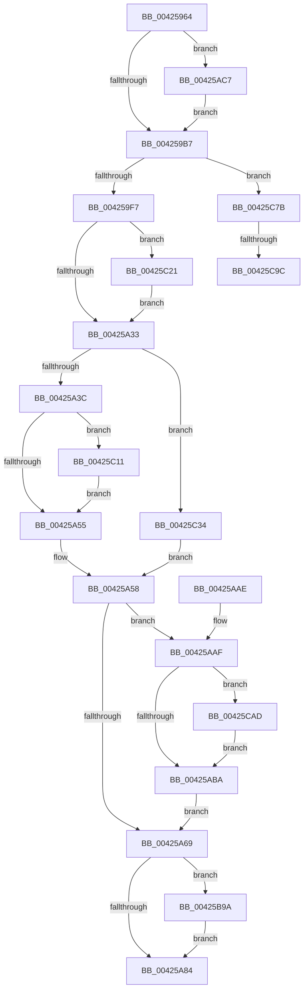

# FsRtlpRemoveAndCompleteRHIrp

- RVA: `0x00425964`–`0x00425CB6` (길이 `850` bytes)
- VA: `0x0000000140425964`
- 실행 섹션: `.text`
- PDB 이름 있음: `예`; PDB Function 태그: `예`
- unwind 정보 RVA: `0x000A04FC`
- 디코드: `198`개 명령, `850/850` bytes 표시
- 미해석 바이트: `0` (있으면 어셈블리에 `.byte`로 보존)

> 이 문서는 커널 이미지의 기계어와 PDB 기호를 분석해 생성했습니다. 4번과 5번은 함수 원형과 자료형을 바이너리 사용 방식에서 추정한 C 해석이며 원본 소스 복구 결과는 아닙니다.

## 1. Dependencies

- 직접 호출 지점: **15**; 고유 호출 대상: **12**
- 직접 호출자로 확인된 함수: **6**
- RIP 상대 이미지 참조: **4**

### Outgoing calls
- `0x004259C8` → [KeAcquireQueuedSpinLock](../27/KeAcquireQueuedSpinLock_function_00273D80.md) (function, `0x00273D80`)
- `0x004259DD` → [KeReleaseQueuedSpinLock](../27/KeReleaseQueuedSpinLock_function_00272540.md) (function, `0x00272540`)
- `0x004259E5` → [FsRtlpOplockDequeueRH](FsRtlpOplockDequeueRH_function_004258FC.md) (function, `0x004258FC`)
- `0x00425A45` → [ObfDereferenceObjectWithTag](../2F/ObfDereferenceObjectWithTag_function_002F78E0.md) (function, `0x002F78E0`)
- `0x00425A72` → [IofCompleteRequest](../29/IofCompleteRequest_function_0029B5C0.md) (function, `0x0029B5C0`)
- `0x00425A8E` → [_security_check_cookie](../6A/_security_check_cookie_function_006AC640.md) (function, `0x006AC640`)
- `0x00425AC0` → [FsRtlpFreeRHOpContext](../4F/FsRtlpFreeRHOpContext_function_004F2394.md) (function, `0x004F2394`)
- `0x00425B90` → [tlgWriteTransfer_EtwWriteTransfer](tlgWriteTransfer_EtwWriteTransfer_function_004260E0.md) (function, `0x004260E0`)
- `0x00425C07` → [tlgWriteTransfer_EtwWriteTransfer](tlgWriteTransfer_EtwWriteTransfer_function_004260E0.md) (function, `0x004260E0`)
- `0x00425C17` → [FsRtlpClearOwner](../26/FsRtlpClearOwner_function_00265BE8.md) (function, `0x00265BE8`)
- `0x00425C58` → [FsRtlpOplockEnqueueRH](../38/FsRtlpOplockEnqueueRH_function_0038F534.md) (function, `0x0038F534`)
- `0x00425C66` → [FsRtlpModifyThreadPriorities](../48/FsRtlpModifyThreadPriorities_function_0048B098.md) (function, `0x0048B098`)
- `0x00425C71` → [FsRtlpOplockSendModernAppTermination](../49/FsRtlpOplockSendModernAppTermination_function_0049F22C.md) (function, `0x0049F22C`)
- `0x00425C8D` → [ObfDereferenceObjectWithTag](../2F/ObfDereferenceObjectWithTag_function_002F78E0.md) (function, `0x002F78E0`)
- `0x00425CA2` → [FsRtlpClearOwner](../26/FsRtlpClearOwner_function_00265BE8.md) (function, `0x00265BE8`)

### Direct callers
- [FsRtlpRequestExclusiveOplock](../3F/FsRtlpRequestExclusiveOplock_function_003F3800.md) at `0x003F3E4F`
- [FsRtlpOplockCleanup](FsRtlpOplockCleanup_function_00425030.md) at `0x00425137`
- [FsRtlpCancelOplockRHIrp](../4A/FsRtlpCancelOplockRHIrp_function_004A55F0.md) at `0x004A575B`
- [FsRtlUninitializeOplock](../4E/FsRtlUninitializeOplock_function_004E42C0.md) at `0x004E456E`
- [FsRtlpOplockBreakByCacheFlags](../4E/FsRtlpOplockBreakByCacheFlags_function_004E4990.md) at `0x004E5D1B`
- [FsRtlpOplockBreakByCacheFlags](../4E/FsRtlpOplockBreakByCacheFlags_function_004E4990.md) at `0x004E6047`
- [FsRtlpRequestShareableOplock](../4E/FsRtlpRequestShareableOplock_function_004E6EC8.md) at `0x004E73BA`

### Static image references
- `0x00425980` → RVA `0x00E0A740` (`.data`; read)
- `0x00425995` → RVA `0x00E06C50` (`.data`; read)
- `0x00425B28` → RVA `0x000449FD` (`.rdata`; read)
- `0x00425BA8` → RVA `0x000449A2` (`.rdata`; read)

## 2. Other-region calls and transfers

- 다른 실행 섹션으로 향하는 call: **0**
- call이 아닌 외부 분기/꼬리 이동: **2**
  - `0x00425C96` → [sub_006EDC28](../6E/Unknown_function_006EDC28.md) (`tail-transfer`)
  - `0x00425CA8` → [sub_006EDC28](../6E/Unknown_function_006EDC28.md) (`tail-transfer`)

## 3. Assembly (complete function range)

```asm
00425964  48 89 5C 24 18                  mov qword ptr [rsp + 0x18], rbx
00425969  55                              push rbp
0042596A  56                              push rsi
0042596B  57                              push rdi
0042596C  41 54                           push r12
0042596E  41 55                           push r13
00425970  41 56                           push r14
00425972  41 57                           push r15
00425974  48 8D 6C 24 F9                  lea rbp, [rsp - 7]
00425979  48 81 EC 00 01 00 00            sub rsp, 0x100
00425980  48 8B 05 B9 4D 9E 00            mov rax, qword ptr [rip + 0x9e4db9]
00425987  48 33 C4                        xor rax, rsp
0042598A  48 89 45 F7                     mov qword ptr [rbp - 9], rax
0042598E  44 8B 7D 67                     mov r15d, dword ptr [rbp + 0x67]
00425992  45 33 ED                        xor r13d, r13d
00425995  83 3D B4 12 9E 00 05            cmp dword ptr [rip + 0x9e12b4], 5
0042599C  41 8B C1                        mov eax, r9d
0042599F  89 44 24 38                     mov dword ptr [rsp + 0x38], eax
004259A3  45 8B E0                        mov r12d, r8d
004259A6  48 8B FA                        mov rdi, rdx
004259A9  C6 44 24 30 01                  mov byte ptr [rsp + 0x30], 1
004259AE  48 8B D9                        mov rbx, rcx
004259B1  0F 87 10 01 00 00               ja 0x140425ac7
004259B7  48 8B 73 10                     mov rsi, qword ptr [rbx + 0x10]
004259BB  41 BE 07 00 00 00               mov r14d, 7
004259C1  41 8B CE                        mov ecx, r14d
004259C4  4C 89 6B 10                     mov qword ptr [rbx + 0x10], r13
004259C8  E8 B3 E3 E4 FF                  call 0x140273d80
004259CD  88 46 45                        mov byte ptr [rsi + 0x45], al
004259D0  41 8B CE                        mov ecx, r14d
004259D3  49 8B C5                        mov rax, r13
004259D6  48 87 46 68                     xchg qword ptr [rsi + 0x68], rax
004259DA  8A 56 45                        mov dl, byte ptr [rsi + 0x45]
004259DD  E8 5E CB E4 FF                  call 0x140272540
004259E2  48 8B CB                        mov rcx, rbx
004259E5  E8 12 FF FF FF                  call 0x1404258fc
004259EA  45 8A F5                        mov r14b, r13b
004259ED  44 38 6E 44                     cmp byte ptr [rsi + 0x44], r13b
004259F1  0F 85 84 02 00 00               jne 0x140425c7b
004259F7  48 8B 4E 18                     mov rcx, qword ptr [rsi + 0x18]
004259FB  41 B8 01 00 00 00               mov r8d, 1
00425A01  4C 89 69 10                     mov qword ptr [rcx + 0x10], r13
00425A05  45 8D 68 17                     lea r13d, [r8 + 0x17]
00425A09  8B 54 24 38                     mov edx, dword ptr [rsp + 0x38]
00425A0D  8B C2                           mov eax, edx
00425A0F  C1 E8 0C                        shr eax, 0xc
00425A12  83 E0 07                        and eax, 7
00425A15  C7 01 01 00 18 00               mov dword ptr [rcx], 0x180001
00425A1B  C7 41 04 03 00 00 00            mov dword ptr [rcx + 4], 3
00425A22  89 41 08                        mov dword ptr [rcx + 8], eax
00425A25  44 89 79 0C                     mov dword ptr [rcx + 0xc], r15d
00425A29  41 F6 C7 02                     test r15b, 2
00425A2D  0F 85 EE 01 00 00               jne 0x140425c21
00425A33  45 84 F8                        test r8b, r15b
00425A36  0F 85 F8 01 00 00               jne 0x140425c34
00425A3C  48 8B 4B 18                     mov rcx, qword ptr [rbx + 0x18]
00425A40  BA 44 66 6C 74                  mov edx, 0x746c6644
00425A45  E8 96 1E ED FF                  call 0x1402f78e0
00425A4A  48 83 7B 28 00                  cmp qword ptr [rbx + 0x28], 0
00425A4F  0F 85 BC 01 00 00               jne 0x140425c11
00425A55  41 B6 01                        mov r14b, 1
00425A58  44 8A 7C 24 30                  mov r15b, byte ptr [rsp + 0x30]
00425A5D  4C 89 6E 38                     mov qword ptr [rsi + 0x38], r13
00425A61  45 33 ED                        xor r13d, r13d
00425A64  45 84 F6                        test r14b, r14b
00425A67  75 46                           jne 0x140425aaf
00425A69  B2 01                           mov dl, 1
00425A6B  44 89 66 30                     mov dword ptr [rsi + 0x30], r12d
00425A6F  48 8B CE                        mov rcx, rsi
00425A72  E8 49 5B E7 FF                  call 0x14029b5c0
00425A77  83 3D D2 11 9E 00 05            cmp dword ptr [rip + 0x9e11d2], 5
00425A7E  0F 87 16 01 00 00               ja 0x140425b9a
00425A84  41 8A C7                        mov al, r15b
00425A87  48 8B 4D F7                     mov rcx, qword ptr [rbp - 9]
00425A8B  48 33 CC                        xor rcx, rsp
00425A8E  E8 AD 6B 28 00                  call 0x1406ac640
00425A93  48 8B 9C 24 50 01 00 00         mov rbx, qword ptr [rsp + 0x150]
00425A9B  48 81 C4 00 01 00 00            add rsp, 0x100
00425AA2  41 5F                           pop r15
00425AA4  41 5E                           pop r14
00425AA6  41 5D                           pop r13
00425AA8  41 5C                           pop r12
00425AAA  5F                              pop rdi
00425AAB  5E                              pop rsi
00425AAC  5D                              pop rbp
00425AAD  C3                              ret
00425AAE  CC                              int3
00425AAF  8A 45 7F                        mov al, byte ptr [rbp + 0x7f]
00425AB2  84 C0                           test al, al
00425AB4  0F 85 F3 01 00 00               jne 0x140425cad
00425ABA  0F 94 C2                        sete dl
00425ABD  48 8B CB                        mov rcx, rbx
00425AC0  E8 CF C8 0C 00                  call 0x1404f2394
00425AC5  EB A2                           jmp 0x140425a69
00425AC7  89 44 24 40                     mov dword ptr [rsp + 0x40], eax
00425ACB  48 8D 4C 24 3C                  lea rcx, [rsp + 0x3c]
00425AD0  48 8D 44 24 40                  lea rax, [rsp + 0x40]
00425AD5  44 89 44 24 3C                  mov dword ptr [rsp + 0x3c], r8d
00425ADA  48 89 45 97                     mov qword ptr [rbp - 0x69], rax
00425ADE  45 33 C9                        xor r9d, r9d
00425AE1  48 8D 44 24 44                  lea rax, [rsp + 0x44]
00425AE6  48 89 4D 87                     mov qword ptr [rbp - 0x79], rcx
00425AEA  48 89 45 A7                     mov qword ptr [rbp - 0x59], rax
00425AEE  48 8D 0D 5B 11 9E 00            lea rcx, [rip + 0x9e115b]
00425AF5  8B 45 6F                        mov eax, dword ptr [rbp + 0x6f]
00425AF8  45 33 C0                        xor r8d, r8d
00425AFB  89 44 24 48                     mov dword ptr [rsp + 0x48], eax
00425AFF  48 8D 44 24 48                  lea rax, [rsp + 0x48]
00425B04  48 89 45 B7                     mov qword ptr [rbp - 0x49], rax
00425B08  0F B7 45 77                     movzx eax, word ptr [rbp + 0x77]
00425B0C  89 44 24 4C                     mov dword ptr [rsp + 0x4c], eax
00425B10  48 8D 44 24 4C                  lea rax, [rsp + 0x4c]
00425B15  48 89 45 C7                     mov qword ptr [rbp - 0x39], rax
00425B19  48 8D 44 24 50                  lea rax, [rsp + 0x50]
00425B1E  48 89 45 D7                     mov qword ptr [rbp - 0x29], rax
00425B22  8B 82 90 00 00 00               mov eax, dword ptr [rdx + 0x90]
00425B28  48 8D 15 CE EE C1 FF            lea rdx, [rip - 0x3e1132]
00425B2F  89 44 24 34                     mov dword ptr [rsp + 0x34], eax
00425B33  48 8D 44 24 34                  lea rax, [rsp + 0x34]
00425B38  48 89 45 E7                     mov qword ptr [rbp - 0x19], rax
00425B3C  48 8D 44 24 60                  lea rax, [rsp + 0x60]
00425B41  48 89 44 24 28                  mov qword ptr [rsp + 0x28], rax
00425B46  C7 44 24 20 09 00 00 00         mov dword ptr [rsp + 0x20], 9
00425B4E  48 C7 45 8F 04 00 00 00         mov qword ptr [rbp - 0x71], 4
00425B56  48 C7 45 9F 04 00 00 00         mov qword ptr [rbp - 0x61], 4
00425B5E  44 89 7C 24 44                  mov dword ptr [rsp + 0x44], r15d
00425B63  48 C7 45 AF 04 00 00 00         mov qword ptr [rbp - 0x51], 4
00425B6B  48 C7 45 BF 04 00 00 00         mov qword ptr [rbp - 0x41], 4
00425B73  48 C7 45 CF 04 00 00 00         mov qword ptr [rbp - 0x31], 4
00425B7B  48 89 7C 24 50                  mov qword ptr [rsp + 0x50], rdi
00425B80  48 C7 45 DF 08 00 00 00         mov qword ptr [rbp - 0x21], 8
00425B88  48 C7 45 EF 04 00 00 00         mov qword ptr [rbp - 0x11], 4
00425B90  E8 4B 05 00 00                  call 0x1404260e0
00425B95  E9 1D FE FF FF                  jmp 0x1404259b7
00425B9A  48 8D 44 24 38                  lea rax, [rsp + 0x38]
00425B9F  44 89 64 24 38                  mov dword ptr [rsp + 0x38], r12d
00425BA4  48 89 45 87                     mov qword ptr [rbp - 0x79], rax
00425BA8  48 8D 15 F3 ED C1 FF            lea rdx, [rip - 0x3e120d]
00425BAF  48 8D 44 24 50                  lea rax, [rsp + 0x50]
00425BB4  48 C7 45 8F 04 00 00 00         mov qword ptr [rbp - 0x71], 4
00425BBC  48 89 45 97                     mov qword ptr [rbp - 0x69], rax
00425BC0  48 8D 0D 89 10 9E 00            lea rcx, [rip + 0x9e1089]
00425BC7  8B 87 90 00 00 00               mov eax, dword ptr [rdi + 0x90]
00425BCD  45 33 C9                        xor r9d, r9d
00425BD0  89 44 24 34                     mov dword ptr [rsp + 0x34], eax
00425BD4  45 33 C0                        xor r8d, r8d
00425BD7  48 8D 44 24 34                  lea rax, [rsp + 0x34]
00425BDC  48 89 7C 24 50                  mov qword ptr [rsp + 0x50], rdi
00425BE1  48 89 45 A7                     mov qword ptr [rbp - 0x59], rax
00425BE5  48 8D 44 24 60                  lea rax, [rsp + 0x60]
00425BEA  48 89 44 24 28                  mov qword ptr [rsp + 0x28], rax
00425BEF  C7 44 24 20 05 00 00 00         mov dword ptr [rsp + 0x20], 5
00425BF7  48 C7 45 9F 08 00 00 00         mov qword ptr [rbp - 0x61], 8
00425BFF  48 C7 45 AF 04 00 00 00         mov qword ptr [rbp - 0x51], 4
00425C07  E8 D4 04 00 00                  call 0x1404260e0
00425C0C  E9 73 FE FF FF                  jmp 0x140425a84
00425C11  48 8B D3                        mov rdx, rbx
00425C14  48 8B CF                        mov rcx, rdi
00425C17  E8 CC FF E3 FF                  call 0x140265be8
00425C1C  E9 34 FE FF FF                  jmp 0x140425a55
00425C21  8B 45 6F                        mov eax, dword ptr [rbp + 0x6f]
00425C24  89 41 10                        mov dword ptr [rcx + 0x10], eax
00425C27  0F B7 45 77                     movzx eax, word ptr [rbp + 0x77]
00425C2B  66 89 41 14                     mov word ptr [rcx + 0x14], ax
00425C2F  E9 FF FD FF FF                  jmp 0x140425a33
00425C34  8B 43 30                        mov eax, dword ptr [rbx + 0x30]
00425C37  F7 DA                           neg edx
00425C39  48 8B D3                        mov rdx, rbx
00425C3C  1B C9                           sbb ecx, ecx
00425C3E  25 FF FF 0F FF                  and eax, 0xff0fffff
00425C43  81 E1 00 00 90 FF               and ecx, 0xff900000
00425C49  81 C1 00 00 80 00               add ecx, 0x800000
00425C4F  0B C8                           or ecx, eax
00425C51  89 4B 30                        mov dword ptr [rbx + 0x30], ecx
00425C54  48 8D 4F 48                     lea rcx, [rdi + 0x48]
00425C58  E8 D7 98 F6 FF                  call 0x14038f534
00425C5D  41 B0 01                        mov r8b, 1
00425C60  48 8B D3                        mov rdx, rbx
00425C63  48 8B CF                        mov rcx, rdi
00425C66  E8 2D 54 06 00                  call 0x14048b098
00425C6B  48 8B D3                        mov rdx, rbx
00425C6E  48 8B CF                        mov rcx, rdi
00425C71  E8 B6 95 07 00                  call 0x14049f22c
00425C76  E9 DD FD FF FF                  jmp 0x140425a58
00425C7B  48 8B 4B 18                     mov rcx, qword ptr [rbx + 0x18]
00425C7F  BA 44 66 6C 74                  mov edx, 0x746c6644
00425C84  41 BC 20 01 00 C0               mov r12d, 0xc0000120
00425C8A  45 8A FD                        mov r15b, r13b
00425C8D  E8 4E 1C ED FF                  call 0x1402f78e0
00425C92  4C 39 6B 28                     cmp qword ptr [rbx + 0x28], r13
00425C96  0F 84 8C 7F 2C 00               je 0x1406edc28
00425C9C  48 8B D3                        mov rdx, rbx
00425C9F  48 8B CF                        mov rcx, rdi
00425CA2  E8 41 FF E3 FF                  call 0x140265be8
00425CA7  90                              nop
00425CA8  E9 7B 7F 2C 00                  jmp 0x1406edc28
00425CAD  4C 89 6B 58                     mov qword ptr [rbx + 0x58], r13
00425CB1  E9 04 FE FF FF                  jmp 0x140425aba
```

## 4. C-style interpretation (structured pseudocode)

```c
__int64 __fastcall FsRtlpRemoveAndCompleteRHIrp(__int64 a1, __int64 a2, int a3, int a4, unsigned int a5, unsigned int a6, unsigned __int16 a7, unsigned __int8 a8)
{
    __int64 result;
    __int64 v_r13;
    __int64 v_rsp;
    unsigned int v_stack_m100;
    unsigned __int8 v_stack_m108;
    unsigned __int64 v_stack_m3F;
    unsigned __int64 v_stack_m48;
    unsigned __int64 v_stack_m50;
    unsigned __int64 v_stack_m58;
    unsigned __int64 v_stack_m60;
    unsigned __int64 v_stack_m68;
    unsigned __int64 v_stack_m70;
    unsigned __int64 v_stack_m78;
    unsigned __int64 v_stack_m80;
    unsigned __int64 v_stack_m88;
    unsigned __int64 v_stack_m90;
    unsigned __int64 v_stack_m98;
    unsigned __int64 v_stack_mA0;
    unsigned __int64 v_stack_mA8;
    unsigned __int64 v_stack_mB0;
    unsigned __int64 v_stack_mB8;
    unsigned __int64 v_stack_p18;
    unsigned int v_stack_p20;
    unsigned __int64 v_stack_p28;
    unsigned int v_stack_p34;
    unsigned __int64 v_stack_p38;
    unsigned __int64 v_stack_p3C;
    unsigned int v_stack_p40;
    unsigned __int64 v_stack_p44;
    unsigned int v_stack_p48;
    unsigned int v_stack_p4C;
    unsigned __int64 v_stack_p50;
    unsigned __int64 v_stack_p60;

    v_stack_p18 = v_rbx;
    v_rsp = (v_rsp) - (256);
    result = (*(unsigned __int64 *)(v_rip + 10374585)) ^ (v_rsp);
    v_stack_m48 = result;
    v_r13 = 0;
    v_stack_m100 = (unsigned int)((unsigned int)(a4));
    v_stack_m108 = 1;
    if ((*(unsigned int *)(v_rip + 10359476)) > 5) goto loc_00425AC7;
loc_004259B7:
    *(unsigned __int64 *)(a1 + 16) = 0;
    result = KeAcquireQueuedSpinLock(7, a2, a3, a4);
    *(unsigned __int8 *)(*(unsigned __int64 *)(a1 + 16) + 69) = (unsigned __int8)(result);
    result = KeReleaseQueuedSpinLock(7, *(unsigned __int8 *)(*(unsigned __int64 *)(a1 + 16) + 69), a3, a4);
    result = FsRtlpOplockDequeueRH(a1, *(unsigned __int8 *)(*(unsigned __int64 *)(a1 + 16) + 69), a3, a4);
    if ((*(unsigned __int8 *)(*(unsigned __int64 *)(a1 + 16) + 68)) != 0) goto loc_00425C7B;
    *(unsigned __int64 *)(*(unsigned __int64 *)(*(unsigned __int64 *)(a1 + 16) + 24) + 16) = 0;
    result = (unsigned int)(((unsigned int)((unsigned int)((unsigned int)(v_stack_m100)))) >> (12));
    result = (unsigned int)((result) & (7));
    *(unsigned int *)(*(unsigned __int64 *)(*(unsigned __int64 *)(a1 + 16) + 24)) = 0x180001ULL;
    *(unsigned int *)(*(unsigned __int64 *)(*(unsigned __int64 *)(a1 + 16) + 24) + 4) = 3;
    *(unsigned int *)(*(unsigned __int64 *)(*(unsigned __int64 *)(a1 + 16) + 24) + 8) = (unsigned int)(result);
    *(unsigned int *)(*(unsigned __int64 *)(*(unsigned __int64 *)(a1 + 16) + 24) + 12) = (unsigned int)((unsigned int)(a5));
    if ((((unsigned __int8)((unsigned int)(a5))) & (2)) != 0) goto loc_00425C21;
loc_00425A33:
    if (((1) & ((unsigned __int8)((unsigned int)(a5)))) != 0) goto loc_00425C34;
    result = ObfDereferenceObjectWithTag(*(unsigned __int64 *)(a1 + 24), (unsigned int)(0x746C6644ULL), 1, a4);
    if ((*(unsigned __int64 *)(a1 + 40)) != 0) goto loc_00425C11;
loc_00425A55:
loc_00425A58:
    *(unsigned __int64 *)(*(unsigned __int64 *)(a1 + 16) + 56) = 1 + 23;
    v_r13 = 0;
    if (1 != 0) goto loc_00425AAF;
loc_00425A69:
    *(unsigned int *)(*(unsigned __int64 *)(a1 + 16) + 48) = (unsigned int)((unsigned int)(a3));
    result = IofCompleteRequest(*(unsigned __int64 *)(a1 + 16), 1, 1, a4);
    if ((*(unsigned int *)(v_rip + 10359250)) > 5) goto loc_00425B9A;
loc_00425A84:
    a1 = (v_stack_m48) ^ (v_rsp);
    result = _security_check_cookie(a1, 1, 1, a4);
    v_rsp = (v_rsp) + (256);
    return result;
loc_00425AAF:
    if (a8 != 0) goto loc_00425CAD;
loc_00425ABA:
    a2 = (a8 == 0) ? 1 : 0;
    result = FsRtlpFreeRHOpContext(v_stack_p18, a2, 1, a4);
    goto loc_00425A69;
loc_00425AC7:
    v_stack_p40 = (unsigned int)(result);
    v_stack_p3C = 1;
    v_stack_mA8 = v_stack_p40;
    a4 = 0;
    v_stack_mB8 = v_stack_p3C;
    v_stack_m98 = v_stack_p44;
    a3 = 0;
    v_stack_p48 = (unsigned int)((unsigned int)(a6));
    v_stack_m88 = v_stack_p48;
    v_stack_p4C = a7;
    v_stack_m78 = v_stack_p4C;
    v_stack_m68 = v_stack_p50;
    v_stack_p34 = (unsigned int)((unsigned int)(*(unsigned int *)(a2 + 144)));
    v_stack_m58 = v_stack_p34;
    v_stack_p28 = v_stack_p60;
    v_stack_p20 = 9;
    v_stack_mB0 = 4;
    v_stack_mA0 = 4;
    v_stack_p44 = (unsigned int)(v_stack_m108);
    v_stack_m90 = 4;
    v_stack_m80 = 4;
    v_stack_m70 = 4;
    v_stack_p50 = a2;
    v_stack_m60 = 8;
    v_stack_m50 = 4;
    result = tlgWriteTransfer_EtwWriteTransfer(v_rip + 10359131, v_rip - 4067634, a3, a4);
    goto loc_004259B7;
loc_00425B9A:
    v_stack_p38 = (unsigned int)((unsigned int)(a3));
    v_stack_mB8 = v_stack_p38;
    v_stack_mB0 = 4;
    v_stack_mA8 = v_stack_p50;
    a4 = 0;
    v_stack_p34 = (unsigned int)((unsigned int)(*(unsigned int *)(a2 + 144)));
    a3 = 0;
    v_stack_p50 = a2;
    v_stack_m98 = v_stack_p34;
    v_stack_p28 = v_stack_p60;
    v_stack_p20 = 5;
    v_stack_mA0 = 8;
    v_stack_m90 = 4;
    result = tlgWriteTransfer_EtwWriteTransfer(v_rip + 10358921, v_rip - 4067853, a3, a4);
    goto loc_00425A84;
loc_00425C11:
    result = FsRtlpClearOwner(a2, v_stack_p18, a3, a4);
    goto loc_00425A55;
loc_00425C21:
    *(unsigned int *)(a2 + 16) = (unsigned int)((unsigned int)(a6));
    *(unsigned __int16 *)(a2 + 20) = a7;
    goto loc_00425A33;
loc_00425C34:
    a2 = (unsigned int)(-(v_stack_p18));
    result = (unsigned int)(((unsigned int)(*(unsigned int *)(v_stack_p18 + 48))) & (0xFF0FFFFFULL));
    a1 = (unsigned int)((a2) & (0xFF900000ULL));
    a1 = (unsigned int)((a1) + (0x800000ULL));
    a1 = (unsigned int)((a1) | ((unsigned int)(result)));
    *(unsigned int *)(v_stack_p18 + 48) = (unsigned int)(a1);
    result = FsRtlpOplockEnqueueRH(a2 + 72, v_stack_p18, a3, a4);
    result = FsRtlpModifyThreadPriorities(a2, v_stack_p18, 1, a4);
    result = FsRtlpOplockSendModernAppTermination(a2, v_stack_p18, 1, a4);
    goto loc_00425A58;
loc_00425C7B:
    result = ObfDereferenceObjectWithTag(*(unsigned __int64 *)(v_stack_p18 + 24), (unsigned int)(0x746C6644ULL), 1, a4);
    result = FsRtlpClearOwner(a2, v_stack_p18, 1, a4);
loc_00425CAD:
    *(unsigned __int64 *)(v_stack_p18 + 88) = 0;
    goto loc_00425ABA;
}
```

## 5. (Beta) C Style

```c
int64_t FsRtlpRemoveAndCompleteRHIrp(void *Arg1, void *Arg2, int32_t Arg3, int32_t Arg4, uint32_t Arg5, uint32_t Arg6, uint16_t Arg7, uint8_t Arg8)
{
    uint8_t *arg1 = (uint8_t *)Arg1;
    uint8_t *arg2 = (uint8_t *)Arg2;

    int64_t result;
    int64_t local_r13;
    int64_t local_rsp;
    uint32_t v_stack_m100;
    uint8_t v_stack_m108;
    uint64_t v_stack_m3F;
    uint64_t v_stack_m48;
    uint64_t v_stack_m50;
    uint64_t v_stack_m58;
    uint64_t v_stack_m60;
    uint64_t v_stack_m68;
    uint64_t v_stack_m70;
    uint64_t v_stack_m78;
    uint64_t v_stack_m80;
    uint64_t v_stack_m88;
    uint64_t v_stack_m90;
    uint64_t v_stack_m98;
    uint64_t v_stack_mA0;
    uint64_t v_stack_mA8;
    uint64_t v_stack_mB0;
    uint64_t v_stack_mB8;
    uint64_t v_stack_p18;
    uint32_t v_stack_p20;
    uint64_t v_stack_p28;
    uint32_t v_stack_p34;
    uint64_t v_stack_p38;
    uint64_t v_stack_p3C;
    uint32_t v_stack_p40;
    uint64_t v_stack_p44;
    uint32_t v_stack_p48;
    uint32_t v_stack_p4C;
    uint64_t v_stack_p50;
    uint64_t v_stack_p60;

    v_stack_p18 = local_rbx;
    local_rsp = (local_rsp) - (256);
    result = (*(uint64_t *)(v_rip + 0x9E4DB9)) ^ (local_rsp);
    v_stack_m48 = result;
    local_r13 = 0;
    v_stack_m100 = (uint32_t)((uint32_t)(Arg4));
    v_stack_m108 = 1;
    if ((*(uint32_t *)(v_rip + 0x9E12B4)) > 5) goto loc_00425AC7;
loc_004259B7:
    *(uint64_t *)(arg1 + 0x10) = 0;
    result = KeAcquireQueuedSpinLock(7, Arg2, Arg3, Arg4);
    *(uint8_t *)(*(uint64_t *)(arg1 + 0x10) + 0x45) = (uint8_t)(result);
    result = KeReleaseQueuedSpinLock(7, *(uint8_t *)(*(uint64_t *)(arg1 + 0x10) + 0x45), Arg3, Arg4);
    result = FsRtlpOplockDequeueRH(Arg1, *(uint8_t *)(*(uint64_t *)(arg1 + 0x10) + 0x45), Arg3, Arg4);
    if ((*(uint8_t *)(*(uint64_t *)(arg1 + 0x10) + 0x44)) != 0) goto loc_00425C7B;
    *(uint64_t *)(*(uint64_t *)(*(uint64_t *)(arg1 + 0x10) + 0x18) + 0x10) = 0;
    result = (uint32_t)(((uint32_t)((uint32_t)((uint32_t)(v_stack_m100)))) >> (12));
    result = (uint32_t)((result) & (7));
    *(uint32_t *)(*(uint64_t *)(*(uint64_t *)(arg1 + 0x10) + 0x18)) = 0x180001ULL;
    *(uint32_t *)(*(uint64_t *)(*(uint64_t *)(arg1 + 0x10) + 0x18) + 0x4) = 3;
    *(uint32_t *)(*(uint64_t *)(*(uint64_t *)(arg1 + 0x10) + 0x18) + 0x8) = (uint32_t)(result);
    *(uint32_t *)(*(uint64_t *)(*(uint64_t *)(arg1 + 0x10) + 0x18) + 0xC) = (uint32_t)((uint32_t)(Arg5));
    if ((((uint8_t)((uint32_t)(Arg5))) & (2)) != 0) goto loc_00425C21;
loc_00425A33:
    if (((1) & ((uint8_t)((uint32_t)(Arg5)))) != 0) goto loc_00425C34;
    result = ObfDereferenceObjectWithTag(*(uint64_t *)(arg1 + 0x18), (uint32_t)(0x746C6644ULL), 1, Arg4);
    if ((*(uint64_t *)(arg1 + 0x28)) != 0) goto loc_00425C11;
loc_00425A55:
loc_00425A58:
    *(uint64_t *)(*(uint64_t *)(arg1 + 0x10) + 0x38) = 1 + 23;
    local_r13 = 0;
    if (1 != 0) goto loc_00425AAF;
loc_00425A69:
    *(uint32_t *)(*(uint64_t *)(arg1 + 0x10) + 0x30) = (uint32_t)((uint32_t)(Arg3));
    result = IofCompleteRequest(*(uint64_t *)(arg1 + 0x10), 1, 1, Arg4);
    if ((*(uint32_t *)(v_rip + 0x9E11D2)) > 5) goto loc_00425B9A;
loc_00425A84:
    Arg1 = (v_stack_m48) ^ (local_rsp);
    result = _security_check_cookie(Arg1, 1, 1, Arg4);
    local_rsp = (local_rsp) + (256);
    return result;
loc_00425AAF:
    if (Arg8 != 0) goto loc_00425CAD;
loc_00425ABA:
    Arg2 = (Arg8 == 0) ? 1 : 0;
    result = FsRtlpFreeRHOpContext(v_stack_p18, Arg2, 1, Arg4);
    goto loc_00425A69;
loc_00425AC7:
    v_stack_p40 = (uint32_t)(result);
    v_stack_p3C = 1;
    v_stack_mA8 = v_stack_p40;
    Arg4 = 0;
    v_stack_mB8 = v_stack_p3C;
    v_stack_m98 = v_stack_p44;
    Arg3 = 0;
    v_stack_p48 = (uint32_t)((uint32_t)(Arg6));
    v_stack_m88 = v_stack_p48;
    v_stack_p4C = Arg7;
    v_stack_m78 = v_stack_p4C;
    v_stack_m68 = v_stack_p50;
    v_stack_p34 = (uint32_t)((uint32_t)(*(uint32_t *)(arg2 + 0x90)));
    v_stack_m58 = v_stack_p34;
    v_stack_p28 = v_stack_p60;
    v_stack_p20 = 9;
    v_stack_mB0 = 4;
    v_stack_mA0 = 4;
    v_stack_p44 = (uint32_t)(v_stack_m108);
    v_stack_m90 = 4;
    v_stack_m80 = 4;
    v_stack_m70 = 4;
    v_stack_p50 = Arg2;
    v_stack_m60 = 8;
    v_stack_m50 = 4;
    result = tlgWriteTransfer_EtwWriteTransfer(v_rip + 10359131, v_rip - 4067634, Arg3, Arg4);
    goto loc_004259B7;
loc_00425B9A:
    v_stack_p38 = (uint32_t)((uint32_t)(Arg3));
    v_stack_mB8 = v_stack_p38;
    v_stack_mB0 = 4;
    v_stack_mA8 = v_stack_p50;
    Arg4 = 0;
    v_stack_p34 = (uint32_t)((uint32_t)(*(uint32_t *)(arg2 + 0x90)));
    Arg3 = 0;
    v_stack_p50 = Arg2;
    v_stack_m98 = v_stack_p34;
    v_stack_p28 = v_stack_p60;
    v_stack_p20 = 5;
    v_stack_mA0 = 8;
    v_stack_m90 = 4;
    result = tlgWriteTransfer_EtwWriteTransfer(v_rip + 10358921, v_rip - 4067853, Arg3, Arg4);
    goto loc_00425A84;
loc_00425C11:
    result = FsRtlpClearOwner(Arg2, v_stack_p18, Arg3, Arg4);
    goto loc_00425A55;
loc_00425C21:
    *(uint32_t *)(arg2 + 0x10) = (uint32_t)((uint32_t)(Arg6));
    *(uint16_t *)(arg2 + 0x14) = Arg7;
    goto loc_00425A33;
loc_00425C34:
    Arg2 = (uint32_t)(-(v_stack_p18));
    result = (uint32_t)(((uint32_t)(*(uint32_t *)(v_stack_p18 + 0x30))) & (0xFF0FFFFFULL));
    Arg1 = (uint32_t)((Arg2) & (0xFF900000ULL));
    Arg1 = (uint32_t)((Arg1) + (0x800000ULL));
    Arg1 = (uint32_t)((Arg1) | ((uint32_t)(result)));
    *(uint32_t *)(v_stack_p18 + 0x30) = (uint32_t)(Arg1);
    result = FsRtlpOplockEnqueueRH(Arg2 + 72, v_stack_p18, Arg3, Arg4);
    result = FsRtlpModifyThreadPriorities(Arg2, v_stack_p18, 1, Arg4);
    result = FsRtlpOplockSendModernAppTermination(Arg2, v_stack_p18, 1, Arg4);
    goto loc_00425A58;
loc_00425C7B:
    result = ObfDereferenceObjectWithTag(*(uint64_t *)(v_stack_p18 + 0x18), (uint32_t)(0x746C6644ULL), 1, Arg4);
    result = FsRtlpClearOwner(Arg2, v_stack_p18, 1, Arg4);
loc_00425CAD:
    *(uint64_t *)(v_stack_p18 + 0x58) = 0;
    goto loc_00425ABA;
}
```

### 관측된 메모리 오프셋

구조체 형식이 확인되지 않은 접근은 인자 기준의 오프셋으로만 기록했습니다.

| 기준 인자 | 오프셋 표현 | 폭 (bit) | 접근 |
|---|---:|---:|---|
| `Arg1` | `+ 0x10` | `64` | `R` |
| `Arg1` | `+ 0x10` | `64` | `W` |
| `Arg1` | `+ 0x18` | `64` | `R` |
| `Arg1` | `+ 0x28` | `64` | `R` |
| `Arg1` | `+ 0x30` | `32` | `R` |
| `Arg1` | `+ 0x30` | `32` | `W` |
| `Arg1` | `+ 0x58` | `64` | `W` |
| `Arg2` | `+ 0x48` | `64` | `R` |
| `Arg2` | `+ 0x90` | `32` | `R` |

## 6. Execution-region graph

[열기: 2D/3D 그래프와 함수 탐색 컨트롤 패널](../../../control-panel.html?section=text&rva=0x00425964&view=graph)

- 2D 그래프는 위에서 아래로 흐르고, 3D 그래프는 빈 공간을 드래그해 회전합니다. Shift+드래그는 이동, 휠은 확대·축소, 함수 노드 선택은 대상 보고서 이동입니다.

### Static fallback


