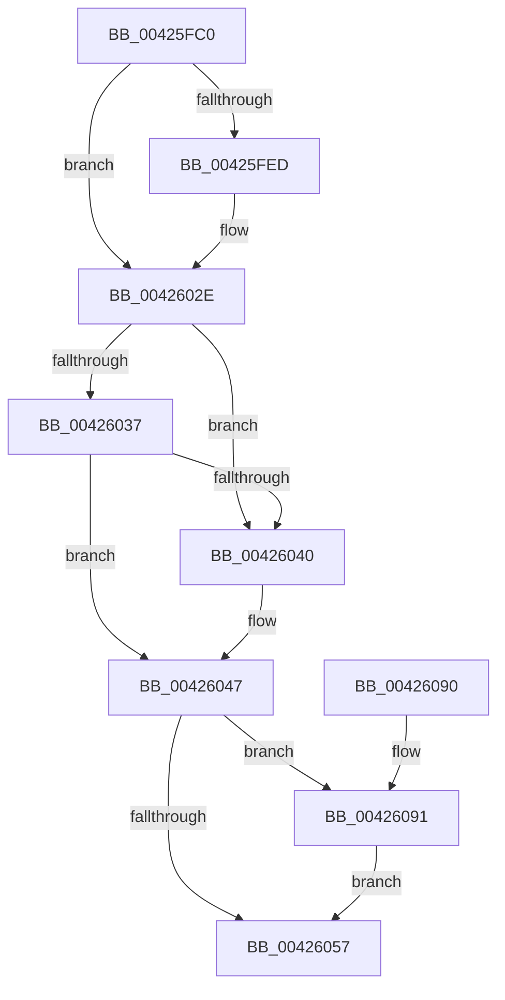

# FsRtlpRemoveAndCompleteWaitingIrp

- RVA: `0x00425FC0`–`0x004260CB` (길이 `267` bytes)
- VA: `0x0000000140425FC0`
- 실행 섹션: `.text`
- PDB 이름 있음: `예`; PDB Function 태그: `아니요`
- unwind 정보 RVA: `0x000A0570`
- 디코드: `70`개 명령, `267/267` bytes 표시
- 미해석 바이트: `0` (있으면 어셈블리에 `.byte`로 보존)

> 이 문서는 커널 이미지의 기계어와 PDB 기호를 분석해 생성했습니다. 4번과 5번은 함수 원형과 자료형을 바이너리 사용 방식에서 추정한 C 해석이며 원본 소스 복구 결과는 아닙니다.

## 1. Dependencies

- 직접 호출 지점: **6**; 고유 호출 대상: **6**
- 직접 호출자로 확인된 함수: **14**
- RIP 상대 이미지 참조: **3**

### Outgoing calls
- `0x00426029` → [tlgWriteTransfer_EtwWriteTransfer](tlgWriteTransfer_EtwWriteTransfer_function_004260E0.md) (function, `0x004260E0`)
- `0x00426062` → [guard_dispatch_icall](../6B/guard_dispatch_icall_function_006BAAD0.md) (function, `0x006BAAD0`)
- `0x0042606C` → [ExFreePoolWithTag](../../poolcode/B8/ExFreePoolWithTag_function_00B82870.md) (function, `0x00B82870`)
- `0x00426079` → [_security_check_cookie](../6A/_security_check_cookie_function_006AC640.md) (function, `0x006AC640`)
- `0x00426096` → [KeAcquireQueuedSpinLock](../27/KeAcquireQueuedSpinLock_function_00273D80.md) (function, `0x00273D80`)
- `0x004260AA` → [KeReleaseQueuedSpinLock](../27/KeReleaseQueuedSpinLock_function_00272540.md) (function, `0x00272540`)

### Direct callers
- [FsRtlpAcknowledgeOplockBreakByCacheFlags](../3F/FsRtlpAcknowledgeOplockBreakByCacheFlags_function_003F1988.md) at `0x003F2581`
- [FsRtlCheckOplockEx2](../3F/FsRtlCheckOplockEx2_function_003F2BC0.md) at `0x003F2DEE`
- [FsRtlpRequestExclusiveOplock](../3F/FsRtlpRequestExclusiveOplock_function_003F3800.md) at `0x003F397A`
- [FsRtlpOplockCleanup](FsRtlpOplockCleanup_function_00425030.md) at `0x004254B8`
- [FsRtlpOplockCleanup](FsRtlpOplockCleanup_function_00425030.md) at `0x0042569F`
- [FsRtlpReleaseIrpsWaitingForRH](FsRtlpReleaseIrpsWaitingForRH_function_00425CBC.md) at `0x00425F65`
- [FsRtlpOplockBreakToII](../4B/FsRtlpOplockBreakToII_function_004BB824.md) at `0x004BB965`
- [FsRtlpCancelWaitingIrp](../4E/FsRtlpCancelWaitingIrp_function_004E4698.md) at `0x004E48A7`
- [FsRtlpOplockBreakByCacheFlags](../4E/FsRtlpOplockBreakByCacheFlags_function_004E4990.md) at `0x004E576F`
- [FsRtlpRequestShareableOplock](../4E/FsRtlpRequestShareableOplock_function_004E6EC8.md) at `0x004E7052`
- [FsRtlpWaitOnIrp](../4E/FsRtlpWaitOnIrp_function_004E7998.md) at `0x004E7D9B`
- [FsRtlpOplockBreakToNone](../4F/FsRtlpOplockBreakToNone_function_004F8354.md) at `0x004F847A`
- [FsRtlpCancelExclusiveIrp](../4F/FsRtlpCancelExclusiveIrp_function_004F96CC.md) at `0x004F97B8`
- [FsRtlpAcknowledgeOplockBreak](../58/FsRtlpAcknowledgeOplockBreak_function_00582144.md) at `0x00582348`
- [FsRtlpOpBatchBreakClosePending](../../page/71/FsRtlpOpBatchBreakClosePending_function_00714CDC.md) at `0x00714DC6`

### Static image references
- `0x00425FD0` → RVA `0x00E0A740` (`.data`; read)
- `0x00425FE4` → RVA `0x00E06C50` (`.data`; read)
- `0x00425FF1` → RVA `0x000444A3` (`.rdata`; read)

## 2. Other-region calls and transfers

- 다른 실행 섹션으로 향하는 call: **1**
  - `0x0042606C` → [ExFreePoolWithTag](../../poolcode/B8/ExFreePoolWithTag_function_00B82870.md) (`.text` → `POOLCODE`)
- 별도 외부 분기/꼬리 이동을 확인하지 못했습니다.

## 3. Assembly (complete function range)

```asm
00425FC0  4C 8B DC                        mov r11, rsp
00425FC3  49 89 5B 10                     mov qword ptr [r11 + 0x10], rbx
00425FC7  49 89 73 18                     mov qword ptr [r11 + 0x18], rsi
00425FCB  57                              push rdi
00425FCC  48 83 EC 70                     sub rsp, 0x70
00425FD0  48 8B 05 69 47 9E 00            mov rax, qword ptr [rip + 0x9e4769]
00425FD7  48 33 C4                        xor rax, rsp
00425FDA  48 89 44 24 68                  mov qword ptr [rsp + 0x68], rax
00425FDF  33 F6                           xor esi, esi
00425FE1  48 8B D9                        mov rbx, rcx
00425FE4  83 3D 65 0C 9E 00 05            cmp dword ptr [rip + 0x9e0c65], 5
00425FEB  76 41                           jbe 0x14042602e
00425FED  48 8B 41 10                     mov rax, qword ptr [rcx + 0x10]
00425FF1  48 8D 15 AB E4 C1 FF            lea rdx, [rip - 0x3e1b55]
00425FF8  49 89 43 B8                     mov qword ptr [r11 - 0x48], rax
00425FFC  48 8D 0D 4D 0C 9E 00            lea rcx, [rip + 0x9e0c4d]
00426003  49 8D 43 B8                     lea rax, [r11 - 0x48]
00426007  49 C7 43 E8 08 00 00 00         mov qword ptr [r11 - 0x18], 8
0042600F  49 89 43 E0                     mov qword ptr [r11 - 0x20], rax
00426013  45 33 C9                        xor r9d, r9d
00426016  49 8D 43 C0                     lea rax, [r11 - 0x40]
0042601A  45 33 C0                        xor r8d, r8d
0042601D  49 89 43 B0                     mov qword ptr [r11 - 0x50], rax
00426021  C7 44 24 20 03 00 00 00         mov dword ptr [rsp + 0x20], 3
00426029  E8 B2 00 00 00                  call 0x1404260e0
0042602E  48 8B 0B                        mov rcx, qword ptr [rbx]
00426031  48 39 59 08                     cmp qword ptr [rcx + 8], rbx
00426035  75 09                           jne 0x140426040
00426037  48 8B 43 08                     mov rax, qword ptr [rbx + 8]
0042603B  48 39 18                        cmp qword ptr [rax], rbx
0042603E  74 07                           je 0x140426047
00426040  B9 03 00 00 00                  mov ecx, 3
00426045  CD 29                           int 0x29
00426047  48 89 08                        mov qword ptr [rax], rcx
0042604A  48 89 41 08                     mov qword ptr [rcx + 8], rax
0042604E  48 8B 7B 10                     mov rdi, qword ptr [rbx + 0x10]
00426052  48 85 FF                        test rdi, rdi
00426055  75 3A                           jne 0x140426091
00426057  48 8B 43 18                     mov rax, qword ptr [rbx + 0x18]
0042605B  48 8B D7                        mov rdx, rdi
0042605E  48 8B 4B 20                     mov rcx, qword ptr [rbx + 0x20]
00426062  E8 69 4A 29 00                  call 0x1406baad0
00426067  33 D2                           xor edx, edx
00426069  48 8B CB                        mov rcx, rbx
0042606C  E8 FF C7 75 00                  call 0x140b82870
00426071  48 8B 4C 24 68                  mov rcx, qword ptr [rsp + 0x68]
00426076  48 33 CC                        xor rcx, rsp
00426079  E8 C2 65 28 00                  call 0x1406ac640
0042607E  4C 8D 5C 24 70                  lea r11, [rsp + 0x70]
00426083  49 8B 5B 18                     mov rbx, qword ptr [r11 + 0x18]
00426087  49 8B 73 20                     mov rsi, qword ptr [r11 + 0x20]
0042608B  49 8B E3                        mov rsp, r11
0042608E  5F                              pop rdi
0042608F  C3                              ret
00426090  CC                              int3
00426091  B9 07 00 00 00                  mov ecx, 7
00426096  E8 E5 DC E4 FF                  call 0x140273d80
0042609B  88 47 45                        mov byte ptr [rdi + 0x45], al
0042609E  B9 07 00 00 00                  mov ecx, 7
004260A3  48 87 77 68                     xchg qword ptr [rdi + 0x68], rsi
004260A7  8A 57 45                        mov dl, byte ptr [rdi + 0x45]
004260AA  E8 91 C4 E4 FF                  call 0x140272540
004260AF  8B 43 30                        mov eax, dword ptr [rbx + 0x30]
004260B2  48 89 47 38                     mov qword ptr [rdi + 0x38], rax
004260B6  8A 47 44                        mov al, byte ptr [rdi + 0x44]
004260B9  F6 D8                           neg al
004260BB  45 1B C0                        sbb r8d, r8d
004260BE  41 81 E0 20 01 00 C0            and r8d, 0xc0000120
004260C5  44 89 47 30                     mov dword ptr [rdi + 0x30], r8d
004260C9  EB 8C                           jmp 0x140426057
```

## 4. C-style interpretation (structured pseudocode)

```c
__int64 __fastcall FsRtlpRemoveAndCompleteWaitingIrp(__int64 a1, __int64 a2, int a3, int a4)
{
    __int64 result;
    __int64 v_rsi;
    __int64 v_rsp;
    unsigned __int64 v_stack_m10;
    unsigned int v_stack_m58;
    unsigned __int64 v_stack_m8;

    *(unsigned __int64 *)(v_rsp + 16) = v_rbx;
    *(unsigned __int64 *)(v_rsp + 24) = v_rsi;
    v_rsp = (v_rsp) - (112);
    result = (*(unsigned __int64 *)(v_rip + 10372969)) ^ (v_rsp);
    v_stack_m10 = result;
    v_rsi = 0;
    if ((*(unsigned int *)(v_rip + 10357861)) >= = 5) {
        result = *(unsigned __int64 *)(a1 + 16);
        a2 = v_rip - 4070229;
        *(unsigned __int64 *)(v_rsp - 72) = result;
        a1 = v_rip + 10357837;
        result = v_rsp - 72;
        *(unsigned __int64 *)(v_rsp - 24) = 8;
        *(unsigned __int64 *)(v_rsp - 32) = result;
        a4 = 0;
        result = v_rsp - 64;
        a3 = 0;
        *(unsigned __int64 *)(v_rsp - 80) = result;
        v_stack_m58 = 3;
        result = tlgWriteTransfer_EtwWriteTransfer(a1, a2, a3, a4);
    }
    if ((*(unsigned __int64 *)(*(unsigned __int64 *)(a1) + 8)) != a1) goto loc_00426040;
    if ((*(unsigned __int64 *)(*(unsigned __int64 *)(a1 + 8))) != a1) {
        a1 = 3;
    }
    *(unsigned __int64 *)(*(unsigned __int64 *)(a1 + 8)) = a1;
    *(unsigned __int64 *)(a1 + 8) = *(unsigned __int64 *)(a1 + 8);
    if (*(unsigned __int64 *)(a1 + 16) != 0) goto loc_00426091;
loc_00426057:
    result = guard_dispatch_icall(*(unsigned __int64 *)(a1 + 32), *(unsigned __int64 *)(a1 + 16), a3, a4);
    a2 = 0;
    result = ExFreePoolWithTag(a1, a2, a3, a4);
    a1 = (v_stack_m10) ^ (v_rsp);
    result = _security_check_cookie(a1, a2, a3, a4);
    return result;
loc_00426091:
    result = KeAcquireQueuedSpinLock(7, a2, a3, a4);
    *(unsigned __int8 *)(*(unsigned __int64 *)(a1 + 16) + 69) = (unsigned __int8)(result);
    result = KeReleaseQueuedSpinLock(7, *(unsigned __int8 *)(*(unsigned __int64 *)(a1 + 16) + 69), a3, a4);
    *(unsigned __int64 *)(*(unsigned __int64 *)(a1 + 16) + 56) = (unsigned int)(*(unsigned int *)(*(unsigned __int64 *)(v_stack_m8 + 24) + 48));
    result = (unsigned __int8)(-(*(unsigned __int8 *)(*(unsigned __int64 *)(a1 + 16) + 68)));
    a3 = (unsigned int)((a3) & (0xC0000120ULL));
    *(unsigned int *)(*(unsigned __int64 *)(a1 + 16) + 48) = a3;
    goto loc_00426057;
}
```

## 5. (Beta) C Style

```c
int64_t FsRtlpRemoveAndCompleteWaitingIrp(void *Arg1, int64_t Arg2, int32_t Arg3, int32_t Arg4)
{
    uint8_t *arg1 = (uint8_t *)Arg1;

    int64_t result;
    int64_t local_rsi;
    int64_t local_rsp;
    uint64_t v_stack_m10;
    uint32_t v_stack_m58;
    uint64_t v_stack_m8;

    *(uint64_t *)(local_rsp + 0x10) = local_rbx;
    *(uint64_t *)(local_rsp + 0x18) = local_rsi;
    local_rsp = (local_rsp) - (112);
    result = (*(uint64_t *)(v_rip + 0x9E4769)) ^ (local_rsp);
    v_stack_m10 = result;
    local_rsi = 0;
    if ((*(uint32_t *)(v_rip + 0x9E0C65)) >= = 5) {
        result = *(uint64_t *)(arg1 + 0x10);
        Arg2 = v_rip - 4070229;
        *(uint64_t *)(local_rsp - 0x48) = result;
        Arg1 = v_rip + 10357837;
        result = local_rsp - 72;
        *(uint64_t *)(local_rsp - 0x18) = 8;
        *(uint64_t *)(local_rsp - 0x20) = result;
        Arg4 = 0;
        result = local_rsp - 64;
        Arg3 = 0;
        *(uint64_t *)(local_rsp - 0x50) = result;
        v_stack_m58 = 3;
        result = tlgWriteTransfer_EtwWriteTransfer(Arg1, Arg2, Arg3, Arg4);
    }
    if ((*(uint64_t *)(*(uint64_t *)(arg1) + 0x8)) != Arg1) goto loc_00426040;
    if ((*(uint64_t *)(*(uint64_t *)(arg1 + 0x8))) != Arg1) {
        Arg1 = 3;
    }
    *(void **)(*(uint64_t *)(arg1 + 0x8)) = Arg1;
    *(uint64_t *)(arg1 + 0x8) = *(uint64_t *)(arg1 + 0x8);
    if (*(uint64_t *)(arg1 + 0x10) != 0) goto loc_00426091;
loc_00426057:
    result = guard_dispatch_icall(*(uint64_t *)(arg1 + 0x20), *(uint64_t *)(arg1 + 0x10), Arg3, Arg4);
    Arg2 = 0;
    result = ExFreePoolWithTag(Arg1, Arg2, Arg3, Arg4);
    Arg1 = (v_stack_m10) ^ (local_rsp);
    result = _security_check_cookie(Arg1, Arg2, Arg3, Arg4);
    return result;
loc_00426091:
    result = KeAcquireQueuedSpinLock(7, Arg2, Arg3, Arg4);
    *(uint8_t *)(*(uint64_t *)(arg1 + 0x10) + 0x45) = (uint8_t)(result);
    result = KeReleaseQueuedSpinLock(7, *(uint8_t *)(*(uint64_t *)(arg1 + 0x10) + 0x45), Arg3, Arg4);
    *(uint64_t *)(*(uint64_t *)(arg1 + 0x10) + 0x38) = (uint32_t)(*(uint32_t *)(*(uint64_t *)(v_stack_m8 + 0x18) + 0x30));
    result = (uint8_t)(-(*(uint8_t *)(*(uint64_t *)(arg1 + 0x10) + 0x44)));
    Arg3 = (uint32_t)((Arg3) & (0xC0000120ULL));
    *(uint32_t *)(*(uint64_t *)(arg1 + 0x10) + 0x30) = Arg3;
    goto loc_00426057;
}
```

### 관측된 메모리 오프셋

구조체 형식이 확인되지 않은 접근은 인자 기준의 오프셋으로만 기록했습니다.

| 기준 인자 | 오프셋 표현 | 폭 (bit) | 접근 |
|---|---:|---:|---|
| `Arg1` | `+ 0x0` | `64` | `R` |
| `Arg1` | `+ 0x8` | `64` | `R` |
| `Arg1` | `+ 0x10` | `64` | `R` |
| `Arg1` | `+ 0x18` | `64` | `R` |
| `Arg1` | `+ 0x20` | `64` | `R` |
| `Arg1` | `+ 0x30` | `32` | `R` |

## 6. Execution-region graph

[열기: 2D/3D 그래프와 함수 탐색 컨트롤 패널](../../../control-panel.html?section=text&rva=0x00425FC0&view=graph)

- 2D 그래프는 위에서 아래로 흐르고, 3D 그래프는 빈 공간을 드래그해 회전합니다. Shift+드래그는 이동, 휠은 확대·축소, 함수 노드 선택은 대상 보고서 이동입니다.

### Static fallback


