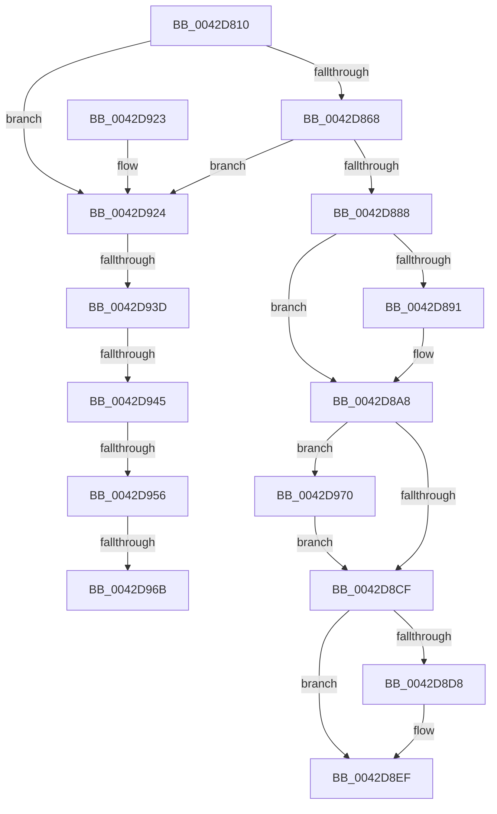

# HalQueryRealTimeClock

- RVA: `0x0042D810`–`0x0042D985` (길이 `373` bytes)
- VA: `0x000000014042D810`
- 실행 섹션: `.text`
- PDB 이름 있음: `예`; PDB Function 태그: `예`
- unwind 정보 RVA: `0x000A1A8C`
- 디코드: `88`개 명령, `373/373` bytes 표시
- 미해석 바이트: `0` (있으면 어셈블리에 `.byte`로 보존)

> 이 문서는 커널 이미지의 기계어와 PDB 기호를 분석해 생성했습니다. 4번과 5번은 함수 원형과 자료형을 바이너리 사용 방식에서 추정한 C 해석이며 원본 소스 복구 결과는 아닙니다.

## 1. Dependencies

- 직접 호출 지점: **9**; 고유 호출 대상: **8**
- 직접 호출자로 확인된 함수: **6**
- RIP 상대 이미지 참조: **5**

### Outgoing calls
- `0x0042D855` → [HalpSetVirtualRtc](HalpSetVirtualRtc_function_0042DF30.md) (function, `0x0042DF30`)
- `0x0042D86C` → [HalpReadCmosTime](HalpReadCmosTime_function_0042DC74.md) (function, `0x0042DC74`)
- `0x0042D87B` → [RtlpTimeFieldsToTime](RtlpTimeFieldsToTime_function_0042E6C8.md) (function, `0x0042E6C8`)
- `0x0042D891` → [PsGetCurrentServerSiloGlobals](../2F/PsGetCurrentServerSiloGlobals_function_002FE1F0.md) (function, `0x002FE1F0`)
- `0x0042D8D8` → [PsGetCurrentServerSiloGlobals](../2F/PsGetCurrentServerSiloGlobals_function_002FE1F0.md) (function, `0x002FE1F0`)
- `0x0042D8F6` → [RtlpTimeToTimeFields](RtlpTimeToTimeFields_function_0042E110.md) (function, `0x0042E110`)
- `0x0042D904` → [_security_check_cookie](../6A/_security_check_cookie_function_006AC640.md) (function, `0x006AC640`)
- `0x0042D949` → [HalpQueryAcpiRealTimeClock](../../page/A9/HalpQueryAcpiRealTimeClock_function_00A98230.md) (function, `0x00A98230`)
- `0x0042D95E` → [HalpAcpiRealTimeToUtcTime](../../page/70/HalpAcpiRealTimeToUtcTime_function_007065D8.md) (function, `0x007065D8`)

### Direct callers
- [HalpCheckWakeupTimeAndAdjust](../55/HalpCheckWakeupTimeAndAdjust_function_0055BB14.md) at `0x0055BB4D`
- [ExpRefreshSystemTime](../../page/7C/ExpRefreshSystemTime_function_007C6264.md) at `0x007C62A5`
- [NtSetSystemTime](../../page/7C/NtSetSystemTime_function_007C65F0.md) at `0x007C67AB`
- [ExUpdateSystemTimeFromCmos](../../pagelk/B7/ExUpdateSystemTimeFromCmos_function_00B7BD98.md) at `0x00B7BDE2`
- [HaliSetWakeAlarm](../../pagelk/B7/HaliSetWakeAlarm_function_00B7D300.md) at `0x00B7D38F`
- [GetBootSystemTime](../../init/C1/GetBootSystemTime_function_00C1AFCC.md) at `0x00C1B100`

### Static image references
- `0x0042D82B` → RVA `0x00E0A740` (`.data`; read)
- `0x0042D85A` → RVA `0x00E0A808` (`.data`; read)
- `0x0042D888` → RVA `0x00E68570` (`.data`; read)
- `0x0042D924` → RVA `0x00FC1A98` (`.data`; read)
- `0x0042D974` → RVA `0x00FC3F90` (`.data`; read/write)

## 2. Other-region calls and transfers

- 다른 실행 섹션으로 향하는 call: **2**
  - `0x0042D949` → [HalpQueryAcpiRealTimeClock](../../page/A9/HalpQueryAcpiRealTimeClock_function_00A98230.md) (`.text` → `PAGE`)
  - `0x0042D95E` → [HalpAcpiRealTimeToUtcTime](../../page/70/HalpAcpiRealTimeToUtcTime_function_007065D8.md) (`.text` → `PAGE`)
- call이 아닌 외부 분기/꼬리 이동: **5**
  - `0x0042D937` → [sub_006EE4C2 + 0x22](../6E/Unknown_function_006EE4C2.md) (`tail-transfer`)
  - `0x0042D93F` → [sub_006EE4C2 + 0x22](../6E/Unknown_function_006EE4C2.md) (`tail-transfer`)
  - `0x0042D950` → [sub_006EE4C2 + 0x7](../6E/Unknown_function_006EE4C2.md) (`tail-transfer`)
  - `0x0042D965` → [sub_006EE4C2](../6E/Unknown_function_006EE4C2.md) (`tail-transfer`)
  - `0x0042D96B` → [sub_006EE4C2 + 0x22](../6E/Unknown_function_006EE4C2.md) (`tail-transfer`)

## 3. Assembly (complete function range)

```asm
0042D810  48 89 5C 24 10                  mov qword ptr [rsp + 0x10], rbx
0042D815  48 89 74 24 18                  mov qword ptr [rsp + 0x18], rsi
0042D81A  48 89 7C 24 20                  mov qword ptr [rsp + 0x20], rdi
0042D81F  55                              push rbp
0042D820  41 54                           push r12
0042D822  41 56                           push r14
0042D824  48 8B EC                        mov rbp, rsp
0042D827  48 83 EC 60                     sub rsp, 0x60
0042D82B  48 8B 05 0E CF 9D 00            mov rax, qword ptr [rip + 0x9dcf0e]
0042D832  48 33 C4                        xor rax, rsp
0042D835  48 89 45 F0                     mov qword ptr [rbp - 0x10], rax
0042D839  48 83 65 C8 00                  and qword ptr [rbp - 0x38], 0
0042D83E  0F 57 C0                        xorps xmm0, xmm0
0042D841  4C 8B F1                        mov r14, rcx
0042D844  C6 45 C0 00                     mov byte ptr [rbp - 0x40], 0
0042D848  33 C9                           xor ecx, ecx
0042D84A  40 32 F6                        xor sil, sil
0042D84D  0F 11 45 E0                     movups xmmword ptr [rbp - 0x20], xmm0
0042D851  0F 11 45 D0                     movups xmmword ptr [rbp - 0x30], xmm0
0042D855  E8 D6 06 00 00                  call 0x14042df30
0042D85A  8B 05 A8 CF 9D 00               mov eax, dword ptr [rip + 0x9dcfa8]
0042D860  A8 04                           test al, 4
0042D862  0F 84 BC 00 00 00               je 0x14042d924
0042D868  48 8D 4D D0                     lea rcx, [rbp - 0x30]
0042D86C  E8 03 04 00 00                  call 0x14042dc74
0042D871  48 8D 55 C8                     lea rdx, [rbp - 0x38]
0042D875  B3 01                           mov bl, 1
0042D877  48 8D 4D D0                     lea rcx, [rbp - 0x30]
0042D87B  E8 48 0E 00 00                  call 0x14042e6c8
0042D880  84 C0                           test al, al
0042D882  0F 84 9C 00 00 00               je 0x14042d924
0042D888  83 3D E1 AC A3 00 00            cmp dword ptr [rip + 0xa3ace1], 0
0042D88F  75 17                           jne 0x14042d8a8
0042D891  E8 5A 09 ED FF                  call 0x1402fe1f0
0042D896  48 8B 88 C8 04 00 00            mov rcx, qword ptr [rax + 0x4c8]
0042D89D  48 8B 81 B8 01 00 00            mov rax, qword ptr [rcx + 0x1b8]
0042D8A4  48 01 45 C8                     add qword ptr [rbp - 0x38], rax
0042D8A8  48 B9 14 00 00 00 80 F7 FF FF   movabs rcx, 0xfffff78000000014
0042D8B2  49 B8 00 C0 69 2A C9 00 00 00   movabs r8, 0xc92a69c000
0042D8BC  48 8B 09                        mov rcx, qword ptr [rcx]
0042D8BF  48 8B 55 C8                     mov rdx, qword ptr [rbp - 0x38]
0042D8C3  4C 03 C2                        add r8, rdx
0042D8C6  49 3B C8                        cmp rcx, r8
0042D8C9  0F 8F A1 00 00 00               jg 0x14042d970
0042D8CF  83 3D 9A AC A3 00 00            cmp dword ptr [rip + 0xa3ac9a], 0
0042D8D6  75 17                           jne 0x14042d8ef
0042D8D8  E8 13 09 ED FF                  call 0x1402fe1f0
0042D8DD  48 8B 88 C8 04 00 00            mov rcx, qword ptr [rax + 0x4c8]
0042D8E4  48 2B 91 B8 01 00 00            sub rdx, qword ptr [rcx + 0x1b8]
0042D8EB  48 89 55 C8                     mov qword ptr [rbp - 0x38], rdx
0042D8EF  49 8B D6                        mov rdx, r14
0042D8F2  48 8D 4D C8                     lea rcx, [rbp - 0x38]
0042D8F6  E8 15 08 00 00                  call 0x14042e110
0042D8FB  8A C3                           mov al, bl
0042D8FD  48 8B 4D F0                     mov rcx, qword ptr [rbp - 0x10]
0042D901  48 33 CC                        xor rcx, rsp
0042D904  E8 37 ED 27 00                  call 0x1406ac640
0042D909  4C 8D 5C 24 60                  lea r11, [rsp + 0x60]
0042D90E  49 8B 5B 28                     mov rbx, qword ptr [r11 + 0x28]
0042D912  49 8B 73 30                     mov rsi, qword ptr [r11 + 0x30]
0042D916  49 8B 7B 38                     mov rdi, qword ptr [r11 + 0x38]
0042D91A  49 8B E3                        mov rsp, r11
0042D91D  41 5E                           pop r14
0042D91F  41 5C                           pop r12
0042D921  5D                              pop rbp
0042D922  C3                              ret
0042D923  CC                              int3
0042D924  8B 1D 6E 41 B9 00               mov ebx, dword ptr [rip + 0xb9416e]
0042D92A  44 0F 20 C0                     mov rax, cr8
0042D92E  41 BC 02 00 00 00               mov r12d, 2
0042D934  41 3A C4                        cmp al, r12b
0042D937  0F 83 A7 0B 2C 00               jae 0x1406ee4e4
0042D93D  85 DB                           test ebx, ebx
0042D93F  0F 85 9F 0B 2C 00               jne 0x1406ee4e4
0042D945  48 8D 4D E0                     lea rcx, [rbp - 0x20]
0042D949  E8 E2 A8 66 00                  call 0x140a98230
0042D94E  85 C0                           test eax, eax
0042D950  0F 88 73 0B 2C 00               js 0x1406ee4c9
0042D956  48 8D 55 C8                     lea rdx, [rbp - 0x38]
0042D95A  48 8D 4D E0                     lea rcx, [rbp - 0x20]
0042D95E  E8 75 8C 2D 00                  call 0x1407065d8
0042D963  85 C0                           test eax, eax
0042D965  0F 89 57 0B 2C 00               jns 0x1406ee4c2
0042D96B  E9 74 0B 2C 00                  jmp 0x1406ee4e4
0042D970  48 89 4D C8                     mov qword ptr [rbp - 0x38], rcx
0042D974  F0 83 0D 14 66 B9 00 01         lock or dword ptr [rip + 0xb96614], 1
0042D97C  48 8B 55 C8                     mov rdx, qword ptr [rbp - 0x38]
0042D980  E9 4A FF FF FF                  jmp 0x14042d8cf
```

## 4. C-style interpretation (structured pseudocode)

```c
__int64 __fastcall HalQueryRealTimeClock(__int64 a1)
{
    __int64 result;
    __int64 v_rsi;
    __int64 v_rsp;
    unsigned __int64 v_stack_m18;
    unsigned __int64 v_stack_m28;
    unsigned __int64 v_stack_m38;
    unsigned __int64 v_stack_m48;
    unsigned __int64 v_stack_m50;
    unsigned __int8 v_stack_m58;
    unsigned __int64 v_stack_p10;
    unsigned __int64 v_stack_p18;
    unsigned __int64 v_stack_p20;

    v_stack_p10 = v_rbx;
    v_stack_p18 = v_rsi;
    v_stack_p20 = v_rdi;
    v_rsp = (v_rsp) - (96);
    result = (*(unsigned __int64 *)(v_rip + 10342158)) ^ (v_rsp);
    v_stack_m28 = result;
    v_stack_m58 = 0;
    a1 = 0;
    v_rsi = 0;
    v_stack_m38 = v_xmm0;
    v_stack_m48 = v_xmm0;
    result = HalpSetVirtualRtc(a1, a2, a3, a4);
    if ((((unsigned __int8)((unsigned int)(*(unsigned int *)(v_rip + 10342312)))) & (4)) == 0) goto loc_0042D924;
    result = HalpReadCmosTime(v_stack_m48, a2, a3, a4);
    result = RtlpTimeFieldsToTime(v_stack_m48, v_stack_m50, a3, a4);
    if ((unsigned __int8)(result) == 0) goto loc_0042D924;
    if ((*(unsigned int *)(v_rip + 10726625)) == 0) {
        result = PsGetCurrentServerSiloGlobals(v_stack_m48, v_stack_m50, a3, a4);
        a1 = *(unsigned __int64 *)(result + 1224);
        result = *(unsigned __int64 *)(a1 + 440);
    }
    a3 = (a3) + (v_stack_m50);
    if ((*(unsigned __int64 *)(a1)) > a3) goto loc_0042D970;
loc_0042D8CF:
    if ((*(unsigned int *)(v_rip + 10726554)) == 0) {
        result = PsGetCurrentServerSiloGlobals(*(unsigned __int64 *)(a1), v_stack_m50, a3, a4);
        a1 = *(unsigned __int64 *)(result + 1224);
        a2 = (v_stack_m50) - (*(unsigned __int64 *)(a1 + 440));
        v_stack_m50 = a2;
    }
    result = RtlpTimeToTimeFields(v_stack_m50, a1, a3, a4);
    a1 = (v_stack_m28) ^ (v_rsp);
    result = _security_check_cookie(a1, a1, a3, a4);
    return result;
loc_0042D924:
    result = HalpQueryAcpiRealTimeClock(v_stack_m38, a1, a3, a4);
    result = HalpAcpiRealTimeToUtcTime(v_stack_m38, v_stack_m50, a3, a4);
loc_0042D970:
    v_stack_m50 = v_stack_m38;
    goto loc_0042D8CF;
}
```

## 5. (Beta) C Style

```c
int64_t HalQueryRealTimeClock(int64_t Arg1)
{
    int64_t result;
    int64_t local_rsi;
    int64_t local_rsp;
    uint64_t v_stack_m18;
    uint64_t v_stack_m28;
    uint64_t v_stack_m38;
    uint64_t v_stack_m48;
    uint64_t v_stack_m50;
    uint8_t v_stack_m58;
    uint64_t v_stack_p10;
    uint64_t v_stack_p18;
    uint64_t v_stack_p20;

    v_stack_p10 = local_rbx;
    v_stack_p18 = local_rsi;
    v_stack_p20 = local_rdi;
    local_rsp = (local_rsp) - (96);
    result = (*(uint64_t *)(v_rip + 0x9DCF0E)) ^ (local_rsp);
    v_stack_m28 = result;
    v_stack_m58 = 0;
    Arg1 = 0;
    local_rsi = 0;
    v_stack_m38 = v_xmm0;
    v_stack_m48 = v_xmm0;
    result = HalpSetVirtualRtc(Arg1, a2, a3, a4);
    if ((((uint8_t)((uint32_t)(*(uint32_t *)(v_rip + 0x9DCFA8)))) & (4)) == 0) goto loc_0042D924;
    result = HalpReadCmosTime(v_stack_m48, a2, a3, a4);
    result = RtlpTimeFieldsToTime(v_stack_m48, v_stack_m50, a3, a4);
    if ((uint8_t)(result) == 0) goto loc_0042D924;
    if ((*(uint32_t *)(v_rip + 0xA3ACE1)) == 0) {
        result = PsGetCurrentServerSiloGlobals(v_stack_m48, v_stack_m50, a3, a4);
        Arg1 = *(uint64_t *)(result + 0x4C8);
        result = *(uint64_t *)(Arg1 + 0x1B8);
    }
    a3 = (a3) + (v_stack_m50);
    if ((*(uint64_t *)(Arg1)) > a3) goto loc_0042D970;
loc_0042D8CF:
    if ((*(uint32_t *)(v_rip + 0xA3AC9A)) == 0) {
        result = PsGetCurrentServerSiloGlobals(*(uint64_t *)(Arg1), v_stack_m50, a3, a4);
        Arg1 = *(uint64_t *)(result + 0x4C8);
        a2 = (v_stack_m50) - (*(uint64_t *)(Arg1 + 0x1B8));
        v_stack_m50 = a2;
    }
    result = RtlpTimeToTimeFields(v_stack_m50, Arg1, a3, a4);
    Arg1 = (v_stack_m28) ^ (local_rsp);
    result = _security_check_cookie(Arg1, Arg1, a3, a4);
    return result;
loc_0042D924:
    result = HalpQueryAcpiRealTimeClock(v_stack_m38, Arg1, a3, a4);
    result = HalpAcpiRealTimeToUtcTime(v_stack_m38, v_stack_m50, a3, a4);
loc_0042D970:
    v_stack_m50 = v_stack_m38;
    goto loc_0042D8CF;
}
```

## 6. Execution-region graph

[열기: 2D/3D 그래프와 함수 탐색 컨트롤 패널](../../../control-panel.html?section=text&rva=0x0042D810&view=graph)

- 2D 그래프는 위에서 아래로 흐르고, 3D 그래프는 빈 공간을 드래그해 회전합니다. Shift+드래그는 이동, 휠은 확대·축소, 함수 노드 선택은 대상 보고서 이동입니다.

### Static fallback


