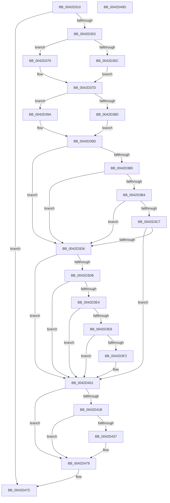

# HalSetRealTimeClock

- RVA: `0x0042D310`–`0x0042D49E` (길이 `398` bytes)
- VA: `0x000000014042D310`
- 실행 섹션: `.text`
- PDB 이름 있음: `예`; PDB Function 태그: `아니요`
- unwind 정보 RVA: `0x000A1A5C`
- 디코드: `107`개 명령, `398/398` bytes 표시
- 미해석 바이트: `0` (있으면 어셈블리에 `.byte`로 보존)

> 이 문서는 커널 이미지의 기계어와 PDB 기호를 분석해 생성했습니다. 4번과 5번은 함수 원형과 자료형을 바이너리 사용 방식에서 추정한 C 해석이며 원본 소스 복구 결과는 아닙니다.

## 1. Dependencies

- 직접 호출 지점: **9**; 고유 호출 대상: **9**
- 직접 호출자로 확인된 함수: **4**
- RIP 상대 이미지 참조: **12**

### Outgoing calls
- `0x0042D346` → [RtlpTimeFieldsToTime](RtlpTimeFieldsToTime_function_0042E6C8.md) (function, `0x0042E6C8`)
- `0x0042D35C` → [PsGetCurrentServerSiloGlobals](../2F/PsGetCurrentServerSiloGlobals_function_002FE1F0.md) (function, `0x002FE1F0`)
- `0x0042D390` → [HalpWriteCmosTime](HalpWriteCmosTime_function_0042D598.md) (function, `0x0042D598`)
- `0x0042D3BC` → [HalpUtcTimeToAcpiRealTime](../../page/A9/HalpUtcTimeToAcpiRealTime_function_00A980E8.md) (function, `0x00A980E8`)
- `0x0042D3CB` → [HalpSetAcpiRealTimeClock](../../page/70/HalpSetAcpiRealTimeClock_function_00705BFC.md) (function, `0x00705BFC`)
- `0x0042D3F6` → [HalEfiSetTime](../54/HalEfiSetTime_function_0054DE84.md) (function, `0x0054DE84`)
- `0x0042D427` → [RtlpTimeToTimeFields](RtlpTimeToTimeFields_function_0042E110.md) (function, `0x0042E110`)
- `0x0042D439` → [KeQueryPerformanceCounter](../37/KeQueryPerformanceCounter_function_0037E7E0.md) (function, `0x0037E7E0`)
- `0x0042D483` → [_security_check_cookie](../6A/_security_check_cookie_function_006AC640.md) (function, `0x006AC640`)

### Direct callers
- [ExpRefreshSystemTime](../../page/7C/ExpRefreshSystemTime_function_007C6264.md) at `0x007C631D`
- [NtSetSystemTime](../../page/7C/NtSetSystemTime_function_007C65F0.md) at `0x007C6821`
- [ExpSetSystemTime](../../pagelk/B7/ExpSetSystemTime_function_00B7C838.md) at `0x00B7C8EA`
- [GetBootSystemTime](../../init/C1/GetBootSystemTime_function_00C1AFCC.md) at `0x00C1B0E4`

### Static image references
- `0x0042D325` → RVA `0x00E0A740` (`.data`; read)
- `0x0042D353` → RVA `0x00E68570` (`.data`; read)
- `0x0042D37D` → RVA `0x00E0A808` (`.data`; read)
- `0x0042D39D` → RVA `0x00FC1A98` (`.data`; read)
- `0x0042D3DB` → RVA `0x00FC1A28` (`.data`; read)
- `0x0042D44B` → RVA `0x00FC21C0` (`.data`; write)
- `0x0042D451` → RVA `0x00FC21B8` (`.data`; write)
- `0x0042D458` → RVA `0x00FC21B4` (`.data`; write)
- `0x0042D45E` → RVA `0x00FC21AC` (`.data`; write)
- `0x0042D465` → RVA `0x00FC21A8` (`.data`; write)
- `0x0042D46B` → RVA `0x00FC21A0` (`.data`; write)
- `0x0042D472` → RVA `0x00FC21C4` (`.data`; write)

## 2. Other-region calls and transfers

- 다른 실행 섹션으로 향하는 call: **2**
  - `0x0042D3BC` → [HalpUtcTimeToAcpiRealTime](../../page/A9/HalpUtcTimeToAcpiRealTime_function_00A980E8.md) (`.text` → `PAGE`)
  - `0x0042D3CB` → [HalpSetAcpiRealTimeClock](../../page/70/HalpSetAcpiRealTimeClock_function_00705BFC.md) (`.text` → `PAGE`)
- 별도 외부 분기/꼬리 이동을 확인하지 못했습니다.

## 3. Assembly (complete function range)

```asm
0042D310  48 89 5C 24 10                  mov qword ptr [rsp + 0x10], rbx
0042D315  48 89 74 24 18                  mov qword ptr [rsp + 0x18], rsi
0042D31A  55                              push rbp
0042D31B  57                              push rdi
0042D31C  41 57                           push r15
0042D31E  48 8B EC                        mov rbp, rsp
0042D321  48 83 EC 60                     sub rsp, 0x60
0042D325  48 8B 05 14 D4 9D 00            mov rax, qword ptr [rip + 0x9dd414]
0042D32C  48 33 C4                        xor rax, rsp
0042D32F  48 89 45 F0                     mov qword ptr [rbp - 0x10], rax
0042D333  48 83 65 C0 00                  and qword ptr [rbp - 0x40], 0
0042D338  48 8D 55 C0                     lea rdx, [rbp - 0x40]
0042D33C  0F 57 C0                        xorps xmm0, xmm0
0042D33F  48 8B F9                        mov rdi, rcx
0042D342  0F 11 45 E0                     movups xmmword ptr [rbp - 0x20], xmm0
0042D346  E8 7D 13 00 00                  call 0x14042e6c8
0042D34B  84 C0                           test al, al
0042D34D  0F 84 29 01 00 00               je 0x14042d47c
0042D353  83 3D 16 B2 A3 00 00            cmp dword ptr [rip + 0xa3b216], 0
0042D35A  75 1D                           jne 0x14042d379
0042D35C  E8 8F 0E ED FF                  call 0x1402fe1f0
0042D361  48 8B 5D C0                     mov rbx, qword ptr [rbp - 0x40]
0042D365  48 8B 88 C8 04 00 00            mov rcx, qword ptr [rax + 0x4c8]
0042D36C  48 03 99 B8 01 00 00            add rbx, qword ptr [rcx + 0x1b8]
0042D373  48 89 5D C0                     mov qword ptr [rbp - 0x40], rbx
0042D377  EB 04                           jmp 0x14042d37d
0042D379  48 8B 5D C0                     mov rbx, qword ptr [rbp - 0x40]
0042D37D  8B 05 85 D4 9D 00               mov eax, dword ptr [rip + 0x9dd485]
0042D383  41 BF 01 00 00 00               mov r15d, 1
0042D389  A8 04                           test al, 4
0042D38B  74 0D                           je 0x14042d39a
0042D38D  48 8B CF                        mov rcx, rdi
0042D390  E8 03 02 00 00                  call 0x14042d598
0042D395  41 8A FF                        mov dil, r15b
0042D398  EB 03                           jmp 0x14042d39d
0042D39A  40 32 FF                        xor dil, dil
0042D39D  8B 35 F5 46 B9 00               mov esi, dword ptr [rip + 0xb946f5]
0042D3A3  B9 01 00 00 C0                  mov ecx, 0xc0000001
0042D3A8  44 0F 20 C0                     mov rax, cr8
0042D3AC  3C 02                           cmp al, 2
0042D3AE  73 26                           jae 0x14042d3d6
0042D3B0  85 F6                           test esi, esi
0042D3B2  75 22                           jne 0x14042d3d6
0042D3B4  48 8D 55 E0                     lea rdx, [rbp - 0x20]
0042D3B8  48 8D 4D C0                     lea rcx, [rbp - 0x40]
0042D3BC  E8 27 AD 66 00                  call 0x140a980e8
0042D3C1  8B C8                           mov ecx, eax
0042D3C3  85 C0                           test eax, eax
0042D3C5  78 0F                           js 0x14042d3d6
0042D3C7  48 8D 4D E0                     lea rcx, [rbp - 0x20]
0042D3CB  E8 2C 88 2D 00                  call 0x140705bfc
0042D3D0  8B C8                           mov ecx, eax
0042D3D2  85 C0                           test eax, eax
0042D3D4  79 2B                           jns 0x14042d401
0042D3D6  41 3A FF                        cmp dil, r15b
0042D3D9  74 26                           je 0x14042d401
0042D3DB  80 3D 46 46 B9 00 00            cmp byte ptr [rip + 0xb94646], 0
0042D3E2  74 1D                           je 0x14042d401
0042D3E4  85 F6                           test esi, esi
0042D3E6  74 19                           je 0x14042d401
0042D3E8  8B 05 1A D4 9D 00               mov eax, dword ptr [rip + 0x9dd41a]
0042D3EE  A8 08                           test al, 8
0042D3F0  75 0F                           jne 0x14042d401
0042D3F2  48 8D 4D C0                     lea rcx, [rbp - 0x40]
0042D3F6  E8 89 0A 12 00                  call 0x14054de84
0042D3FB  48 8B 5D C0                     mov rbx, qword ptr [rbp - 0x40]
0042D3FF  8B C8                           mov ecx, eax
0042D401  85 C9                           test ecx, ecx
0042D403  40 0F B6 FF                     movzx edi, dil
0042D407  0F 57 C0                        xorps xmm0, xmm0
0042D40A  41 0F 49 FF                     cmovns edi, r15d
0042D40E  83 3D 83 46 B9 00 02            cmp dword ptr [rip + 0xb94683], 2
0042D415  0F 11 45 D0                     movups xmmword ptr [rbp - 0x30], xmm0
0042D419  74 5E                           je 0x14042d479
0042D41B  48 8D 55 D0                     lea rdx, [rbp - 0x30]
0042D41F  48 89 5D C8                     mov qword ptr [rbp - 0x38], rbx
0042D423  48 8D 4D C8                     lea rcx, [rbp - 0x38]
0042D427  E8 E4 0C 00 00                  call 0x14042e110
0042D42C  B8 41 06 00 00                  mov eax, 0x641
0042D431  66 39 45 D0                     cmp word ptr [rbp - 0x30], ax
0042D435  7E 42                           jle 0x14042d479
0042D437  33 C9                           xor ecx, ecx
0042D439  E8 A2 13 F5 FF                  call 0x14037e7e0
0042D43E  8B 4D C4                        mov ecx, dword ptr [rbp - 0x3c]
0042D441  48 8B D0                        mov rdx, rax
0042D444  48 C1 EA 20                     shr rdx, 0x20
0042D448  41 8A FF                        mov dil, r15b
0042D44B  89 15 6F 4D B9 00               mov dword ptr [rip + 0xb94d6f], edx
0042D451  48 89 05 60 4D B9 00            mov qword ptr [rip + 0xb94d60], rax
0042D458  89 0D 56 4D B9 00               mov dword ptr [rip + 0xb94d56], ecx
0042D45E  48 89 1D 47 4D B9 00            mov qword ptr [rip + 0xb94d47], rbx
0042D465  89 15 3D 4D B9 00               mov dword ptr [rip + 0xb94d3d], edx
0042D46B  48 89 05 2E 4D B9 00            mov qword ptr [rip + 0xb94d2e], rax
0042D472  C6 05 4B 4D B9 00 00            mov byte ptr [rip + 0xb94d4b], 0
0042D479  40 8A C7                        mov al, dil
0042D47C  48 8B 4D F0                     mov rcx, qword ptr [rbp - 0x10]
0042D480  48 33 CC                        xor rcx, rsp
0042D483  E8 B8 F1 27 00                  call 0x1406ac640
0042D488  4C 8D 5C 24 60                  lea r11, [rsp + 0x60]
0042D48D  49 8B 5B 28                     mov rbx, qword ptr [r11 + 0x28]
0042D491  49 8B 73 30                     mov rsi, qword ptr [r11 + 0x30]
0042D495  49 8B E3                        mov rsp, r11
0042D498  41 5F                           pop r15
0042D49A  5F                              pop rdi
0042D49B  5D                              pop rbp
0042D49C  C3                              ret
0042D49D  CC                              int3
```

## 4. C-style interpretation (structured pseudocode)

```c
__int64 __fastcall HalSetRealTimeClock(__int64 a1)
{
    __int64 result;
    __int64 v_rbx;
    __int64 v_rdi;
    __int64 v_rsp;
    unsigned __int64 v_stack_m18;
    unsigned __int64 v_stack_m28;
    unsigned __int64 v_stack_m38;
    unsigned __int64 v_stack_m48;
    unsigned __int64 v_stack_m50;
    unsigned int v_stack_m54;
    unsigned __int64 v_stack_m58;
    unsigned __int64 v_stack_p10;
    unsigned __int64 v_stack_p18;

    v_stack_p10 = v_rbx;
    v_stack_p18 = v_rsi;
    v_rsp = (v_rsp) - (96);
    result = (*(unsigned __int64 *)(v_rip + 10343444)) ^ (v_rsp);
    v_stack_m28 = result;
    v_stack_m38 = v_xmm0;
    result = RtlpTimeFieldsToTime(a1, v_stack_m58, a3, a4);
    if ((unsigned __int8)(result) == 0) goto loc_0042D47C;
    if ((*(unsigned int *)(v_rip + 10727958)) != 0) goto loc_0042D379;
    result = PsGetCurrentServerSiloGlobals(a1, v_stack_m58, a3, a4);
    v_rbx = (v_stack_m58) + (*(unsigned __int64 *)(*(unsigned __int64 *)(result + 1224) + 440));
    v_stack_m58 = v_rbx;
    goto loc_0042D37D;
loc_0042D379:
loc_0042D37D:
    if ((((unsigned __int8)((unsigned int)(*(unsigned int *)(v_rip + 10343557)))) & (4)) == 0) goto loc_0042D39A;
    result = HalpWriteCmosTime(a1, v_stack_m58, a3, a4);
    goto loc_0042D39D;
loc_0042D39A:
    v_rdi = 0;
loc_0042D39D:
    if (((unsigned __int8)(v_cr8)) >= 2) goto loc_0042D3D6;
    if ((unsigned int)((unsigned int)(*(unsigned int *)(v_rip + 12142325))) != 0) goto loc_0042D3D6;
    result = HalpUtcTimeToAcpiRealTime(v_stack_m58, v_stack_m38, a3, a4);
    if (sign_flag) goto loc_0042D3D6;
    result = HalpSetAcpiRealTimeClock(v_stack_m38, v_stack_m38, a3, a4);
    if (!sign_flag) goto loc_0042D401;
loc_0042D3D6:
    if (0 == 1) goto loc_0042D401;
    if ((*(unsigned __int8 *)(v_rip + 12142150)) == 0) goto loc_0042D401;
    if ((unsigned int)((unsigned int)(*(unsigned int *)(v_rip + 12142325))) == 0) goto loc_0042D401;
    result = (unsigned int)(*(unsigned int *)(v_rip + 10343450));
    v_rbx = v_stack_m58;
    if ((((unsigned __int8)((unsigned int)(*(unsigned int *)(v_rip + 10343450)))) & (8)) == 0) {
        a1 = v_stack_m58;
        result = HalEfiSetTime(a1, v_stack_m38, a3, a4);
        v_rbx = v_stack_m58;
        a1 = (unsigned int)(result);
    }
    v_rdi = 0;
    if (!sign_flag) { v_rdi = 1; }
    v_stack_m48 = v_xmm0;
    if ((*(unsigned int *)(v_rip + 12142211)) == 2) goto loc_0042D479;
    v_stack_m50 = v_rbx;
    result = RtlpTimeToTimeFields(v_stack_m50, v_stack_m48, a3, a4);
    result = (unsigned int)(0x641ULL);
    if (v_stack_m48 >= = ((unsigned __int16)((unsigned int)(0x641ULL)))) {
        a1 = 0;
        result = KeQueryPerformanceCounter(a1, v_stack_m48, a3, a4);
        a1 = v_stack_m54;
        a2 = result;
        a2 = (a2) >> (32);
        v_rdi = 1;
        *(unsigned int *)(v_rip + 12143983) = (unsigned int)(a2);
        *(unsigned __int64 *)(v_rip + 12143968) = result;
        *(unsigned int *)(v_rip + 12143958) = (unsigned int)(a1);
        *(unsigned __int64 *)(v_rip + 12143943) = v_rbx;
        *(unsigned int *)(v_rip + 12143933) = (unsigned int)(a2);
        *(unsigned __int64 *)(v_rip + 12143918) = result;
        *(unsigned __int8 *)(v_rip + 12143947) = 0;
    }
loc_0042D47C:
    a1 = (v_stack_m28) ^ (v_rsp);
    result = _security_check_cookie(a1, a2, a3, a4);
    return result;
}
```

## 5. (Beta) C Style

```c
int64_t HalSetRealTimeClock(int64_t Arg1)
{
    int64_t result;
    int64_t local_rbx;
    int64_t local_rdi;
    int64_t local_rsp;
    uint64_t v_stack_m18;
    uint64_t v_stack_m28;
    uint64_t v_stack_m38;
    uint64_t v_stack_m48;
    uint64_t v_stack_m50;
    uint32_t v_stack_m54;
    uint64_t v_stack_m58;
    uint64_t v_stack_p10;
    uint64_t v_stack_p18;

    v_stack_p10 = local_rbx;
    v_stack_p18 = local_rsi;
    local_rsp = (local_rsp) - (96);
    result = (*(uint64_t *)(v_rip + 0x9DD414)) ^ (local_rsp);
    v_stack_m28 = result;
    v_stack_m38 = v_xmm0;
    result = RtlpTimeFieldsToTime(Arg1, v_stack_m58, a3, a4);
    if ((uint8_t)(result) == 0) goto loc_0042D47C;
    if ((*(uint32_t *)(v_rip + 0xA3B216)) != 0) goto loc_0042D379;
    result = PsGetCurrentServerSiloGlobals(Arg1, v_stack_m58, a3, a4);
    local_rbx = (v_stack_m58) + (*(uint64_t *)(*(uint64_t *)(result + 0x4C8) + 0x1B8));
    v_stack_m58 = local_rbx;
    goto loc_0042D37D;
loc_0042D379:
loc_0042D37D:
    if ((((uint8_t)((uint32_t)(*(uint32_t *)(v_rip + 0x9DD485)))) & (4)) == 0) goto loc_0042D39A;
    result = HalpWriteCmosTime(Arg1, v_stack_m58, a3, a4);
    goto loc_0042D39D;
loc_0042D39A:
    local_rdi = 0;
loc_0042D39D:
    if (((uint8_t)(v_cr8)) >= 2) goto loc_0042D3D6;
    if ((uint32_t)((uint32_t)(*(uint32_t *)(v_rip + 0xB946F5))) != 0) goto loc_0042D3D6;
    result = HalpUtcTimeToAcpiRealTime(v_stack_m58, v_stack_m38, a3, a4);
    if (sign_flag) goto loc_0042D3D6;
    result = HalpSetAcpiRealTimeClock(v_stack_m38, v_stack_m38, a3, a4);
    if (!sign_flag) goto loc_0042D401;
loc_0042D3D6:
    if (0 == 1) goto loc_0042D401;
    if ((*(uint8_t *)(v_rip + 0xB94646)) == 0) goto loc_0042D401;
    if ((uint32_t)((uint32_t)(*(uint32_t *)(v_rip + 0xB946F5))) == 0) goto loc_0042D401;
    result = (uint32_t)(*(uint32_t *)(v_rip + 0x9DD41A));
    local_rbx = v_stack_m58;
    if ((((uint8_t)((uint32_t)(*(uint32_t *)(v_rip + 0x9DD41A)))) & (8)) == 0) {
        Arg1 = v_stack_m58;
        result = HalEfiSetTime(Arg1, v_stack_m38, a3, a4);
        local_rbx = v_stack_m58;
        Arg1 = (uint32_t)(result);
    }
    local_rdi = 0;
    if (!sign_flag) { local_rdi = 1; }
    v_stack_m48 = v_xmm0;
    if ((*(uint32_t *)(v_rip + 0xB94683)) == 2) goto loc_0042D479;
    v_stack_m50 = local_rbx;
    result = RtlpTimeToTimeFields(v_stack_m50, v_stack_m48, a3, a4);
    result = (uint32_t)(0x641ULL);
    if (v_stack_m48 >= = ((uint16_t)((uint32_t)(0x641ULL)))) {
        Arg1 = 0;
        result = KeQueryPerformanceCounter(Arg1, v_stack_m48, a3, a4);
        Arg1 = v_stack_m54;
        a2 = result;
        a2 = (a2) >> (32);
        local_rdi = 1;
        *(uint32_t *)(v_rip + 0xB94D6F) = (uint32_t)(a2);
        *(uint64_t *)(v_rip + 0xB94D60) = result;
        *(uint32_t *)(v_rip + 0xB94D56) = (uint32_t)(Arg1);
        *(uint64_t *)(v_rip + 0xB94D47) = local_rbx;
        *(uint32_t *)(v_rip + 0xB94D3D) = (uint32_t)(a2);
        *(uint64_t *)(v_rip + 0xB94D2E) = result;
        *(uint8_t *)(v_rip + 0xB94D4B) = 0;
    }
loc_0042D47C:
    Arg1 = (v_stack_m28) ^ (local_rsp);
    result = _security_check_cookie(Arg1, a2, a3, a4);
    return result;
}
```

## 6. Execution-region graph

[열기: 2D/3D 그래프와 함수 탐색 컨트롤 패널](../../../control-panel.html?section=text&rva=0x0042D310&view=graph)

- 2D 그래프는 위에서 아래로 흐르고, 3D 그래프는 빈 공간을 드래그해 회전합니다. Shift+드래그는 이동, 휠은 확대·축소, 함수 노드 선택은 대상 보고서 이동입니다.

### Static fallback


