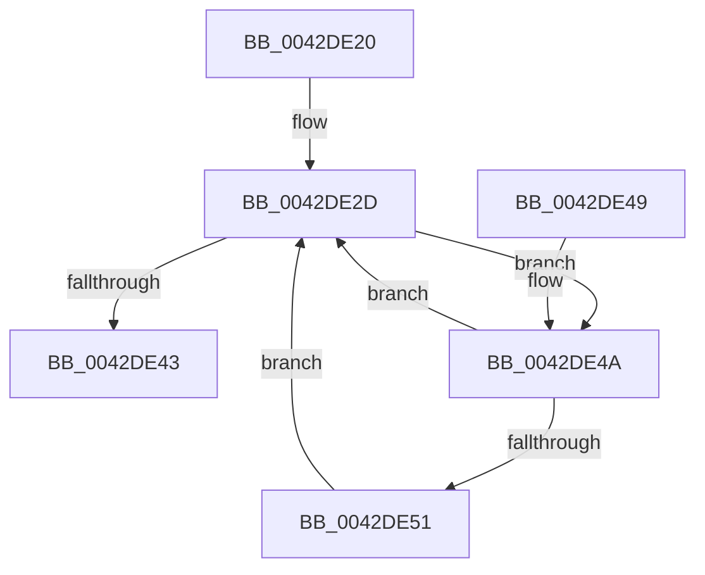

# HalpAcquireCmosSpinLockAndWait

- RVA: `0x0042DE20`–`0x0042DE5F` (길이 `63` bytes)
- VA: `0x000000014042DE20`
- 실행 섹션: `.text`
- PDB 이름 있음: `예`; PDB Function 태그: `아니요`
- unwind 정보 RVA: `0x0008C670`
- 디코드: `26`개 명령, `63/63` bytes 표시
- 미해석 바이트: `0` (있으면 어셈블리에 `.byte`로 보존)

> 이 문서는 커널 이미지의 기계어와 PDB 기호를 분석해 생성했습니다. 4번과 5번은 함수 원형과 자료형을 바이너리 사용 방식에서 추정한 C 해석이며 원본 소스 복구 결과는 아닙니다.

## 1. Dependencies

- 직접 호출 지점: **3**; 고유 호출 대상: **2**
- 직접 호출자로 확인된 함수: **3**
- RIP 상대 이미지 참조: **0**

### Outgoing calls
- `0x0042DE26` → [HalpAcquireCmosSpinLock](HalpAcquireCmosSpinLock_function_0042DEE8.md) (function, `0x0042DEE8`)
- `0x0042DE53` → [HalpReleaseCmosSpinLock](HalpReleaseCmosSpinLock_function_0042DE04.md) (function, `0x0042DE04`)
- `0x0042DE58` → [HalpAcquireCmosSpinLock](HalpAcquireCmosSpinLock_function_0042DEE8.md) (function, `0x0042DEE8`)

### Direct callers
- [HalpWriteCmosTime](HalpWriteCmosTime_function_0042D598.md) at `0x0042D5AF`
- [HalpSetWakeAlarm](HalpSetWakeAlarm_function_0042DAC8.md) at `0x0042DAD1`
- [HalpReadCmosTime](HalpReadCmosTime_function_0042DC74.md) at `0x0042DC86`

### Static image references
- 디코드된 RIP-relative 메모리 참조가 없습니다.

## 2. Other-region calls and transfers

- 다른 실행 섹션으로 향하는 call: **0**
- 별도 외부 분기/꼬리 이동을 확인하지 못했습니다.

## 3. Assembly (complete function range)

```asm
0042DE20  40 53                           push rbx
0042DE22  48 83 EC 20                     sub rsp, 0x20
0042DE26  E8 BD 00 00 00                  call 0x14042dee8
0042DE2B  33 DB                           xor ebx, ebx
0042DE2D  90                              nop
0042DE2E  B0 0A                           mov al, 0xa
0042DE30  BA 70 00 00 00                  mov edx, 0x70
0042DE35  EE                              out dx, al
0042DE36  90                              nop
0042DE37  BA 71 00 00 00                  mov edx, 0x71
0042DE3C  90                              nop
0042DE3D  EC                              in al, dx
0042DE3E  90                              nop
0042DE3F  84 C0                           test al, al
0042DE41  78 07                           js 0x14042de4a
0042DE43  48 83 C4 20                     add rsp, 0x20
0042DE47  5B                              pop rbx
0042DE48  C3                              ret
0042DE49  CC                              int3
0042DE4A  FF C3                           inc ebx
0042DE4C  83 FB 64                        cmp ebx, 0x64
0042DE4F  75 DC                           jne 0x14042de2d
0042DE51  33 DB                           xor ebx, ebx
0042DE53  E8 AC FF FF FF                  call 0x14042de04
0042DE58  E8 8B 00 00 00                  call 0x14042dee8
0042DE5D  EB CE                           jmp 0x14042de2d
```

## 4. C-style interpretation (structured pseudocode)

```c
__int64 __fastcall HalpAcquireCmosSpinLockAndWait(void)
{
    __int64 result;
    __int64 v_rbx;
    __int64 v_rsp;

    v_rsp = (v_rsp) - (32);
    result = HalpAcquireCmosSpinLock(a1, a2, a3, a4);
    v_rbx = 0;
loc_0042DE2D:
    if (sign_flag) goto loc_0042DE4A;
    v_rsp = (v_rsp) + (32);
    return 10;
loc_0042DE4A:
    v_rbx = (unsigned int)((v_rbx) + 1);
    if (((unsigned int)(v_rbx)) != 100) goto loc_0042DE2D;
    v_rbx = 0;
    result = HalpReleaseCmosSpinLock(a1, 113, a3, a4);
    result = HalpAcquireCmosSpinLock(a1, 113, a3, a4);
    goto loc_0042DE2D;
}
```

## 5. (Beta) C Style

```c
void HalpAcquireCmosSpinLockAndWait(void)
{
    int64_t result;
    int64_t local_rbx;
    int64_t local_rsp;

    local_rsp = (local_rsp) - (32);
    result = HalpAcquireCmosSpinLock(a1, a2, a3, a4);
    local_rbx = 0;
loc_0042DE2D:
    if (sign_flag) goto loc_0042DE4A;
    local_rsp = (local_rsp) + (32);
    return 10;
loc_0042DE4A:
    local_rbx = (uint32_t)((local_rbx) + 1);
    if (((uint32_t)(local_rbx)) != 100) goto loc_0042DE2D;
    local_rbx = 0;
    result = HalpReleaseCmosSpinLock(a1, 113, a3, a4);
    result = HalpAcquireCmosSpinLock(a1, 113, a3, a4);
    goto loc_0042DE2D;
}
```

## 6. Execution-region graph

[열기: 2D/3D 그래프와 함수 탐색 컨트롤 패널](../../../control-panel.html?section=text&rva=0x0042DE20&view=graph)

- 2D 그래프는 위에서 아래로 흐르고, 3D 그래프는 빈 공간을 드래그해 회전합니다. Shift+드래그는 이동, 휠은 확대·축소, 함수 노드 선택은 대상 보고서 이동입니다.

### Static fallback


