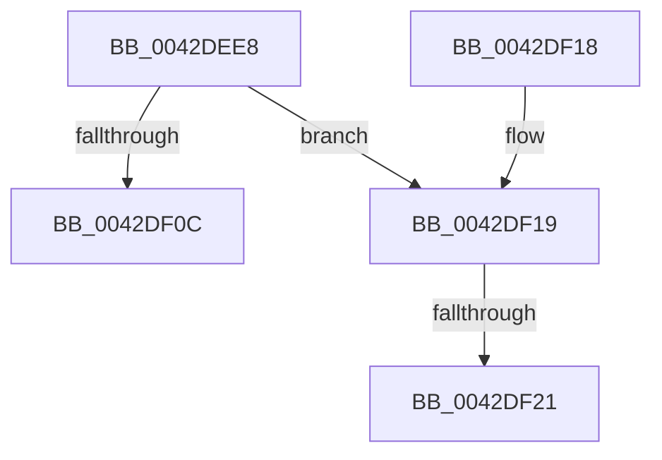

# HalpAcquireCmosSpinLock

- RVA: `0x0042DEE8`–`0x0042DF27` (길이 `63` bytes)
- VA: `0x000000014042DEE8`
- 실행 섹션: `.text`
- PDB 이름 있음: `예`; PDB Function 태그: `예`
- unwind 정보 RVA: `0x000704F4`
- 디코드: `18`개 명령, `63/63` bytes 표시
- 미해석 바이트: `0` (있으면 어셈블리에 `.byte`로 보존)

> 이 문서는 커널 이미지의 기계어와 PDB 기호를 분석해 생성했습니다. 4번과 5번은 함수 원형과 자료형을 바이너리 사용 방식에서 추정한 C 해석이며 원본 소스 복구 결과는 아닙니다.

## 1. Dependencies

- 직접 호출 지점: **1**; 고유 호출 대상: **1**
- 직접 호출자로 확인된 함수: **16**
- RIP 상대 이미지 참조: **2**

### Outgoing calls
- `0x0042DEF0` → [HalpDisableInterrupts](../25/HalpDisableInterrupts_function_002521A0.md) (function, `0x002521A0`)

### Direct callers
- [HalpWriteCmosDataByPort](HalpWriteCmosDataByPort_function_0042D230.md) at `0x0042D24C`
- [HalpSetCmosData](HalpSetCmosData_function_0042D294.md) at `0x0042D2C0`
- [HalpSetClockAfterSleep](HalpSetClockAfterSleep_function_0042D4A4.md) at `0x0042D4A8`
- [HalpSetClockBeforeSleep](HalpSetClockBeforeSleep_function_0042D518.md) at `0x0042D51C`
- [HalpGetSetCmosData](HalpGetSetCmosData_function_0042D794.md) at `0x0042D7C0`
- [HalpWriteRtcStdPCAT](HalpWriteRtcStdPCAT_function_0042D990.md) at `0x0042D9A8`
- [HalpReadRtcStdPCAT](HalpReadRtcStdPCAT_function_0042DA50.md) at `0x0042DA68`
- [HalpReadCmosDataByPort](HalpReadCmosDataByPort_function_0042DC10.md) at `0x0042DC2C`
- [HalpAcquireCmosSpinLockAndWait](HalpAcquireCmosSpinLockAndWait_function_0042DE20.md) at `0x0042DE26`
- [HalpAcquireCmosSpinLockAndWait](HalpAcquireCmosSpinLockAndWait_function_0042DE20.md) at `0x0042DE58`
- [HalSetBusDataByOffset](../46/HalSetBusDataByOffset_function_004614A0.md) at `0x0046159A`
- [HalGetEnvironmentVariable](../54/HalGetEnvironmentVariable_function_005430E0.md) at `0x00543117`
- [HalSetEnvironmentVariable](../54/HalSetEnvironmentVariable_function_00543170.md) at `0x005431B3`
- [HalSetEnvironmentVariable](../54/HalSetEnvironmentVariable_function_00543170.md) at `0x005431E9`
- [HalMakeBeep](../54/HalMakeBeep_function_00545B80.md) at `0x00545BA1`
- [HalpReboot](../54/HalpReboot_function_00546870.md) at `0x005468CE`
- [x86BiosReadCmosPortByte](../54/x86BiosReadCmosPortByte_function_00547DE4.md) at `0x00547DED`
- [x86BiosWriteCmosPortByte](../54/x86BiosWriteCmosPortByte_function_00547F60.md) at `0x00547F6D`

### Static image references
- `0x0042DF02` → RVA `0x00E0A804` (`.data`; read)
- `0x0042DF0C` → RVA `0x00FC1C40` (`.data`; write)

## 2. Other-region calls and transfers

- 다른 실행 섹션으로 향하는 call: **0**
- call이 아닌 외부 분기/꼬리 이동: **2**
  - `0x0042DF1B` → [sub_006EE630 + 0x32](../6E/Unknown_function_006EE630.md) (`tail-transfer`)
  - `0x0042DF22` → [sub_006EE630 + 0x32](../6E/Unknown_function_006EE630.md) (`tail-transfer`)

## 3. Assembly (complete function range)

```asm
0042DEE8  40 53                           push rbx
0042DEEA  48 83 EC 20                     sub rsp, 0x20
0042DEEE  33 DB                           xor ebx, ebx
0042DEF0  E8 AB 42 E2 FF                  call 0x1402521a0
0042DEF5  65 8B 0C 25 A4 01 00 00         mov ecx, dword ptr gs:[0x1a4]
0042DEFD  8A D0                           mov dl, al
0042DEFF  83 C8 FF                        or eax, 0xffffffff
0042DF02  F0 0F B1 0D FA C8 9D 00         lock cmpxchg dword ptr [rip + 0x9dc8fa], ecx
0042DF0A  75 0D                           jne 0x14042df19
0042DF0C  88 15 2E 3D B9 00               mov byte ptr [rip + 0xb93d2e], dl
0042DF12  48 83 C4 20                     add rsp, 0x20
0042DF16  5B                              pop rbx
0042DF17  C3                              ret
0042DF18  CC                              int3
0042DF19  84 D2                           test dl, dl
0042DF1B  0F 84 41 07 2C 00               je 0x1406ee662
0042DF21  FB                              sti
0042DF22  E9 3B 07 2C 00                  jmp 0x1406ee662
```

## 4. C-style interpretation (structured pseudocode)

```c
__int64 __fastcall HalpAcquireCmosSpinLock(void)
{
    __int64 result;
    __int64 v_rbx;
    __int64 v_rsp;

    v_rsp = (v_rsp) - (32);
    v_rbx = 0;
    result = HalpDisableInterrupts(a1, a2, a3, a4);
    result = (unsigned int)((result) | (0xFFFFFFFFULL));
    if (condition_is_not_equal) goto loc_0042DF19;
    *(unsigned __int8 *)(v_rip + 12139822) = (unsigned __int8)((unsigned __int8)(result));
    v_rsp = (v_rsp) + (32);
    return result;
loc_0042DF19:
}
```

## 5. (Beta) C Style

```c
void HalpAcquireCmosSpinLock(void)
{
    int64_t result;
    int64_t local_rbx;
    int64_t local_rsp;

    local_rsp = (local_rsp) - (32);
    local_rbx = 0;
    result = HalpDisableInterrupts(a1, a2, a3, a4);
    result = (uint32_t)((result) | (0xFFFFFFFFULL));
    if (condition_is_not_equal) goto loc_0042DF19;
    *(uint8_t *)(v_rip + 0xB93D2E) = (uint8_t)((uint8_t)(result));
    local_rsp = (local_rsp) + (32);
    return result;
loc_0042DF19:
}
```

## 6. Execution-region graph

[열기: 2D/3D 그래프와 함수 탐색 컨트롤 패널](../../../control-panel.html?section=text&rva=0x0042DEE8&view=graph)

- 2D 그래프는 위에서 아래로 흐르고, 3D 그래프는 빈 공간을 드래그해 회전합니다. Shift+드래그는 이동, 휠은 확대·축소, 함수 노드 선택은 대상 보고서 이동입니다.

### Static fallback


