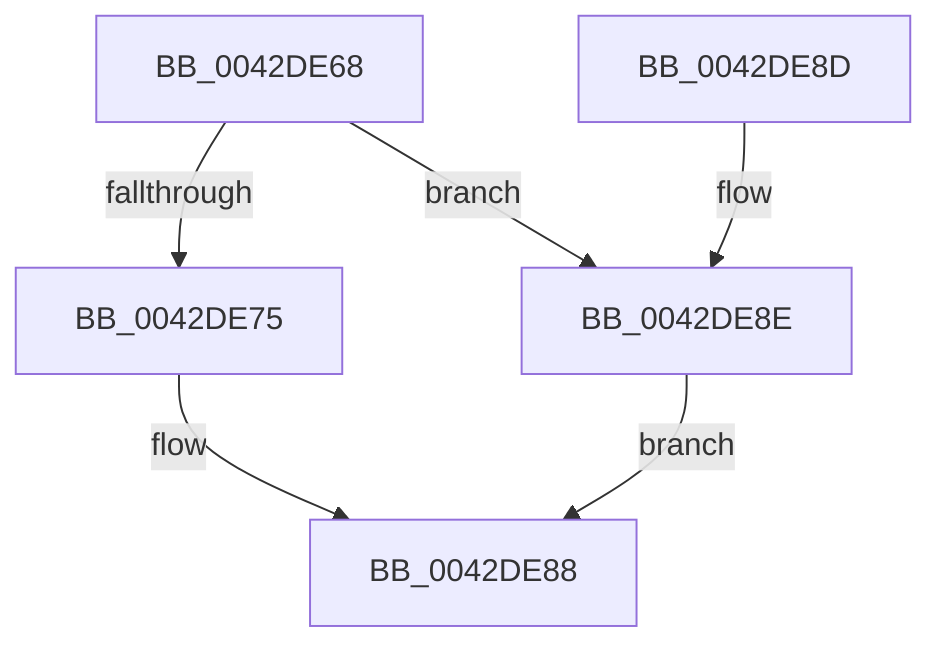

# HalpGetCmosCenturyByte

- RVA: `0x0042DE68`–`0x0042DEDF` (길이 `119` bytes)
- VA: `0x000000014042DE68`
- 실행 섹션: `.text`
- PDB 이름 있음: `예`; PDB Function 태그: `아니요`
- unwind 정보 RVA: `0x000DB714`
- 디코드: `58`개 명령, `119/119` bytes 표시
- 미해석 바이트: `0` (있으면 어셈블리에 `.byte`로 보존)

> 이 문서는 커널 이미지의 기계어와 PDB 기호를 분석해 생성했습니다. 4번과 5번은 함수 원형과 자료형을 바이너리 사용 방식에서 추정한 C 해석이며 원본 소스 복구 결과는 아닙니다.

## 1. Dependencies

- 직접 호출 지점: **0**; 고유 호출 대상: **0**
- 직접 호출자로 확인된 함수: **1**
- RIP 상대 이미지 참조: **1**

### Outgoing calls
- 직접 디코드된 call 명령이 없습니다.

### Direct callers
- [HalpReadCmosTime](HalpReadCmosTime_function_0042DC74.md) at `0x0042DD7E`

### Static image references
- `0x0042DE68` → RVA `0x00FC1700` (`.data`; read)

## 2. Other-region calls and transfers

- 다른 실행 섹션으로 향하는 call: **0**
- 별도 외부 분기/꼬리 이동을 확인하지 못했습니다.

## 3. Assembly (complete function range)

```asm
0042DE68  8B 0D 92 38 B9 00               mov ecx, dword ptr [rip + 0xb93892]
0042DE6E  90                              nop
0042DE6F  0F BA E1 08                     bt ecx, 8
0042DE73  72 19                           jb 0x14042de8e
0042DE75  BA 70 00 00 00                  mov edx, 0x70
0042DE7A  8A C1                           mov al, cl
0042DE7C  EE                              out dx, al
0042DE7D  90                              nop
0042DE7E  BA 71 00 00 00                  mov edx, 0x71
0042DE83  90                              nop
0042DE84  EC                              in al, dx
0042DE85  44 8A D0                        mov r10b, al
0042DE88  90                              nop
0042DE89  41 8A C2                        mov al, r10b
0042DE8C  C3                              ret
0042DE8D  CC                              int3
0042DE8E  41 B8 70 00 00 00               mov r8d, 0x70
0042DE94  B0 0A                           mov al, 0xa
0042DE96  41 8B D0                        mov edx, r8d
0042DE99  EE                              out dx, al
0042DE9A  90                              nop
0042DE9B  90                              nop
0042DE9C  45 8D 48 01                     lea r9d, [r8 + 1]
0042DEA0  41 8B D1                        mov edx, r9d
0042DEA3  EC                              in al, dx
0042DEA4  90                              nop
0042DEA5  8A C8                           mov cl, al
0042DEA7  90                              nop
0042DEA8  B0 0A                           mov al, 0xa
0042DEAA  41 8B D0                        mov edx, r8d
0042DEAD  EE                              out dx, al
0042DEAE  90                              nop
0042DEAF  41 8B D1                        mov edx, r9d
0042DEB2  90                              nop
0042DEB3  8A C1                           mov al, cl
0042DEB5  0C 10                           or al, 0x10
0042DEB7  EE                              out dx, al
0042DEB8  90                              nop
0042DEB9  41 8B D0                        mov edx, r8d
0042DEBC  8A 05 3E 38 B9 00               mov al, byte ptr [rip + 0xb9383e]
0042DEC2  90                              nop
0042DEC3  EE                              out dx, al
0042DEC4  90                              nop
0042DEC5  41 8B D1                        mov edx, r9d
0042DEC8  90                              nop
0042DEC9  EC                              in al, dx
0042DECA  90                              nop
0042DECB  44 8A D0                        mov r10b, al
0042DECE  90                              nop
0042DECF  B0 0A                           mov al, 0xa
0042DED1  41 8B D0                        mov edx, r8d
0042DED4  EE                              out dx, al
0042DED5  90                              nop
0042DED6  41 8B D1                        mov edx, r9d
0042DED9  8A C1                           mov al, cl
0042DEDB  90                              nop
0042DEDC  EE                              out dx, al
0042DEDD  EB A9                           jmp 0x14042de88
```

## 4. C-style interpretation (structured pseudocode)

```c
__int64 __fastcall HalpGetCmosCenturyByte(void)
{
    __int64 result;

    if (condition_is_below) goto loc_0042DE8E;
loc_0042DE88:
    return (unsigned __int8)((unsigned __int8)((unsigned __int8)((unsigned int)(*(unsigned int *)(v_rip + 12138642)))));
loc_0042DE8E:
    result = (unsigned __int8)((10) | (16));
    goto loc_0042DE88;
}
```

## 5. (Beta) C Style

```c
void HalpGetCmosCenturyByte(void)
{
    int64_t result;

    if (condition_is_below) goto loc_0042DE8E;
loc_0042DE88:
    return (uint8_t)((uint8_t)((uint8_t)((uint32_t)(*(uint32_t *)(v_rip + 0xB93892)))));
loc_0042DE8E:
    result = (uint8_t)((10) | (16));
    goto loc_0042DE88;
}
```

## 6. Execution-region graph

[열기: 2D/3D 그래프와 함수 탐색 컨트롤 패널](../../../control-panel.html?section=text&rva=0x0042DE68&view=graph)

- 2D 그래프는 위에서 아래로 흐르고, 3D 그래프는 빈 공간을 드래그해 회전합니다. Shift+드래그는 이동, 휠은 확대·축소, 함수 노드 선택은 대상 보고서 이동입니다.

### Static fallback


