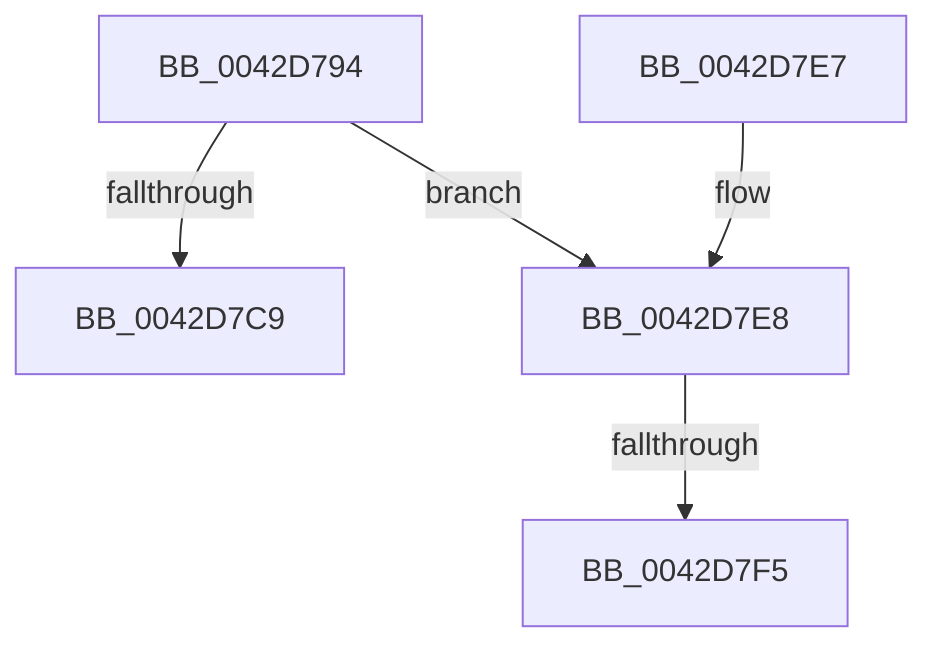

# HalpGetSetCmosData

- RVA: `0x0042D794`–`0x0042D808` (길이 `116` bytes)
- VA: `0x000000014042D794`
- 실행 섹션: `.text`
- PDB 이름 있음: `예`; PDB Function 태그: `예`
- unwind 정보 RVA: `0x0007836C`
- 디코드: `33`개 명령, `116/116` bytes 표시
- 미해석 바이트: `0` (있으면 어셈블리에 `.byte`로 보존)

> 이 문서는 커널 이미지의 기계어와 PDB 기호를 분석해 생성했습니다. 4번과 5번은 함수 원형과 자료형을 바이너리 사용 방식에서 추정한 C 해석이며 원본 소스 복구 결과는 아닙니다.

## 1. Dependencies

- 직접 호출 지점: **3**; 고유 호출 대상: **3**
- 직접 호출자로 확인된 함수: **2**
- RIP 상대 이미지 참조: **2**

### Outgoing calls
- `0x0042D7C0` → [HalpAcquireCmosSpinLock](HalpAcquireCmosSpinLock_function_0042DEE8.md) (function, `0x0042DEE8`)
- `0x0042D7C9` → [HalpReleaseCmosSpinLock](HalpReleaseCmosSpinLock_function_0042DE04.md) (function, `0x0042DE04`)
- `0x0042D7FC` → [guard_dispatch_icall](../6B/guard_dispatch_icall_function_006BAAD0.md) (function, `0x006BAAD0`)

### Direct callers
- [HalGetBusDataByOffset](../46/HalGetBusDataByOffset_function_00461730.md) at `0x0046184B`
- [HalpGetCmosData](../55/HalpGetCmosData_function_00553C4C.md) at `0x00553C55`

### Static image references
- `0x0042D7A8` → RVA `0x00E003D0` (`.data`; read)
- `0x0042D7F5` → RVA `0x00E003D8` (`.data`; read)

## 2. Other-region calls and transfers

- 다른 실행 섹션으로 향하는 call: **0**
- call이 아닌 외부 분기/꼬리 이동: **2**
  - `0x0042D7EF` → [sub_006EE4A2](../6E/Unknown_function_006EE4A2.md) (`tail-transfer`)
  - `0x0042D803` → [sub_006EE4A2 + 0xE](../6E/Unknown_function_006EE4A2.md) (`tail-transfer`)

## 3. Assembly (complete function range)

```asm
0042D794  48 89 5C 24 08                  mov qword ptr [rsp + 8], rbx
0042D799  48 89 6C 24 10                  mov qword ptr [rsp + 0x10], rbp
0042D79E  48 89 74 24 18                  mov qword ptr [rsp + 0x18], rsi
0042D7A3  57                              push rdi
0042D7A4  48 83 EC 20                     sub rsp, 0x20
0042D7A8  8B 35 22 2C 9D 00               mov esi, dword ptr [rip + 0x9d2c22]
0042D7AE  41 8D 41 FF                     lea eax, [r9 - 1]
0042D7B2  03 C2                           add eax, edx
0042D7B4  49 8B F8                        mov rdi, r8
0042D7B7  3B C6                           cmp eax, esi
0042D7B9  8B EA                           mov ebp, edx
0042D7BB  8B DA                           mov ebx, edx
0042D7BD  0F 46 F0                        cmovbe esi, eax
0042D7C0  E8 23 07 00 00                  call 0x14042dee8
0042D7C5  3B DE                           cmp ebx, esi
0042D7C7  76 1F                           jbe 0x14042d7e8
0042D7C9  E8 36 06 00 00                  call 0x14042de04
0042D7CE  48 8B 74 24 40                  mov rsi, qword ptr [rsp + 0x40]
0042D7D3  2B DD                           sub ebx, ebp
0042D7D5  48 8B 6C 24 38                  mov rbp, qword ptr [rsp + 0x38]
0042D7DA  8B C3                           mov eax, ebx
0042D7DC  48 8B 5C 24 30                  mov rbx, qword ptr [rsp + 0x30]
0042D7E1  48 83 C4 20                     add rsp, 0x20
0042D7E5  5F                              pop rdi
0042D7E6  C3                              ret
0042D7E7  CC                              int3
0042D7E8  80 7C 24 50 00                  cmp byte ptr [rsp + 0x50], 0
0042D7ED  8B CB                           mov ecx, ebx
0042D7EF  0F 85 AD 0C 2C 00               jne 0x1406ee4a2
0042D7F5  48 8B 05 DC 2B 9D 00            mov rax, qword ptr [rip + 0x9d2bdc]
0042D7FC  E8 CF D2 28 00                  call 0x1406baad0
0042D801  88 07                           mov byte ptr [rdi], al
0042D803  E9 A8 0C 2C 00                  jmp 0x1406ee4b0
```

## 4. C-style interpretation (structured pseudocode)

```c
__int64 __fastcall HalpGetSetCmosData(__int64 a1, int a2, __int64 a3, __int64 a4, unsigned __int8 a5)
{
    __int64 result;
    __int64 v_rbx;
    __int64 v_rsi;
    __int64 v_rsp;
    unsigned __int64 v_stack_p10;
    unsigned __int64 v_stack_p18;
    unsigned __int64 v_stack_p8;

    v_stack_p8 = v_rbx;
    v_stack_p10 = v_rbp;
    v_stack_p18 = v_rsi;
    v_rsp = (v_rsp) - (32);
    result = (unsigned int)((a4 - 1) + (a2));
    v_rsi = (unsigned int)(*(unsigned int *)(v_rip + 10300450));
    if (((unsigned int)(result)) <= ((unsigned int)((unsigned int)(*(unsigned int *)(v_rip + 10300450))))) { v_rsi = (unsigned int)(result); }
    result = HalpAcquireCmosSpinLock(a1, a2, a3, a4);
    if (((unsigned int)((unsigned int)(a2))) <= ((unsigned int)(v_rsi))) goto loc_0042D7E8;
    result = HalpReleaseCmosSpinLock(a1, a2, a3, a4);
    v_rbx = (unsigned int)(((unsigned int)(a2)) - ((unsigned int)((unsigned int)(a2))));
    v_rsp = (v_rsp) + (32);
    return (unsigned int)((unsigned int)(v_rbx));
loc_0042D7E8:
    result = guard_dispatch_icall((unsigned int)((unsigned int)(v_stack_p8)), a2, a3, a4);
    *(unsigned __int8 *)(a3) = (unsigned __int8)(result);
}
```

## 5. (Beta) C Style

```c
int64_t HalpGetSetCmosData(int64_t Arg1, int32_t Arg2, void *Arg3, void *Arg4, uint8_t Arg5)
{
    uint8_t *arg3 = (uint8_t *)Arg3;
    uint8_t *arg4 = (uint8_t *)Arg4;

    int64_t result;
    int64_t local_rbx;
    int64_t local_rsi;
    int64_t local_rsp;
    uint64_t v_stack_p10;
    uint64_t v_stack_p18;
    uint64_t v_stack_p8;

    v_stack_p8 = local_rbx;
    v_stack_p10 = local_rbp;
    v_stack_p18 = local_rsi;
    local_rsp = (local_rsp) - (32);
    result = (uint32_t)((Arg4 - 1) + (Arg2));
    local_rsi = (uint32_t)(*(uint32_t *)(v_rip + 0x9D2C22));
    if (((uint32_t)(result)) <= ((uint32_t)((uint32_t)(*(uint32_t *)(v_rip + 0x9D2C22))))) { local_rsi = (uint32_t)(result); }
    result = HalpAcquireCmosSpinLock(Arg1, Arg2, Arg3, Arg4);
    if (((uint32_t)((uint32_t)(Arg2))) <= ((uint32_t)(local_rsi))) goto loc_0042D7E8;
    result = HalpReleaseCmosSpinLock(Arg1, Arg2, Arg3, Arg4);
    local_rbx = (uint32_t)(((uint32_t)(Arg2)) - ((uint32_t)((uint32_t)(Arg2))));
    local_rsp = (local_rsp) + (32);
    return (uint32_t)((uint32_t)(local_rbx));
loc_0042D7E8:
    result = guard_dispatch_icall((uint32_t)((uint32_t)(v_stack_p8)), Arg2, Arg3, Arg4);
    *(uint8_t *)(arg3) = (uint8_t)(result);
}
```

### 관측된 메모리 오프셋

구조체 형식이 확인되지 않은 접근은 인자 기준의 오프셋으로만 기록했습니다.

| 기준 인자 | 오프셋 표현 | 폭 (bit) | 접근 |
|---|---:|---:|---|
| `Arg3` | `+ 0x0` | `8` | `W` |
| `Arg4` | `- 0x1` | `32` | `R` |

## 6. Execution-region graph

[열기: 2D/3D 그래프와 함수 탐색 컨트롤 패널](../../../control-panel.html?section=text&rva=0x0042D794&view=graph)

- 2D 그래프는 위에서 아래로 흐르고, 3D 그래프는 빈 공간을 드래그해 회전합니다. Shift+드래그는 이동, 휠은 확대·축소, 함수 노드 선택은 대상 보고서 이동입니다.

### Static fallback


