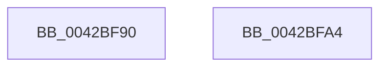

# HalpHvWatchdogArm

- RVA: `0x0042BF90`–`0x0042BFA5` (길이 `21` bytes)
- VA: `0x000000014042BF90`
- 실행 섹션: `.text`
- PDB 이름 있음: `예`; PDB Function 태그: `아니요`
- unwind 정보 RVA: `0x000DB714`
- 디코드: `8`개 명령, `21/21` bytes 표시
- 미해석 바이트: `0` (있으면 어셈블리에 `.byte`로 보존)

> 이 문서는 커널 이미지의 기계어와 PDB 기호를 분석해 생성했습니다. 4번과 5번은 함수 원형과 자료형을 바이너리 사용 방식에서 추정한 C 해석이며 원본 소스 복구 결과는 아닙니다.

## 1. Dependencies

- 직접 호출 지점: **0**; 고유 호출 대상: **0**
- 직접 호출자로 확인된 함수: **3**
- RIP 상대 이미지 참조: **0**

### Outgoing calls
- 직접 디코드된 call 명령이 없습니다.

### Direct callers
- [sub_0042B9E0](Unknown_function_0042B9E0.md) at `0x0042BAA5`
- [sub_0042BAC2](Unknown_function_0042BAC2.md) at `0x0042BB5C`
- [HalpSetTimer](HalpSetTimer_function_0042BD30.md) at `0x0042BE39`

### Static image references
- 디코드된 RIP-relative 메모리 참조가 없습니다.

## 2. Other-region calls and transfers

- 다른 실행 섹션으로 향하는 call: **0**
- 별도 외부 분기/꼬리 이동을 확인하지 못했습니다.

## 3. Assembly (complete function range)

```asm
0042BF90  49 8B D0                        mov rdx, r8
0042BF93  49 8B C0                        mov rax, r8
0042BF96  48 C1 EA 20                     shr rdx, 0x20
0042BF9A  B9 11 01 00 40                  mov ecx, 0x40000111
0042BF9F  0F 30                           wrmsr
0042BFA1  33 C0                           xor eax, eax
0042BFA3  C3                              ret
0042BFA4  CC                              int3
```

## 4. C-style interpretation (structured pseudocode)

```c
__int64 __fastcall HalpHvWatchdogArm(__int64 a1, __int64 a2, __int64 a3)
{
    __int64 result;

    a2 = (a3) >> (32);
    result = 0;
    return result;
}
```

## 5. (Beta) C Style

```c
int64_t HalpHvWatchdogArm(int64_t Arg1, int64_t Arg2, int64_t Arg3)
{
    int64_t result;

    Arg2 = (Arg3) >> (32);
    result = 0;
    return result;
}
```

## 6. Execution-region graph

[열기: 2D/3D 그래프와 함수 탐색 컨트롤 패널](../../../control-panel.html?section=text&rva=0x0042BF90&view=graph)

- 2D 그래프는 위에서 아래로 흐르고, 3D 그래프는 빈 공간을 드래그해 회전합니다. Shift+드래그는 이동, 휠은 확대·축소, 함수 노드 선택은 대상 보고서 이동입니다.

### Static fallback


