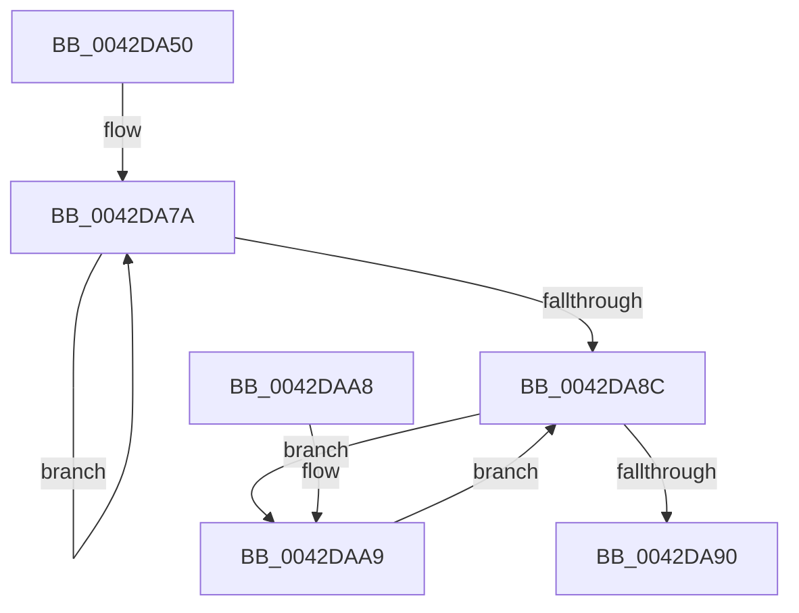

# HalpReadRtcStdPCAT

- RVA: `0x0042DA50`–`0x0042DAC2` (길이 `114` bytes)
- VA: `0x000000014042DA50`
- 실행 섹션: `.text`
- PDB 이름 있음: `예`; PDB Function 태그: `아니요`
- unwind 정보 RVA: `0x000A1AC0`
- 디코드: `45`개 명령, `114/114` bytes 표시
- 미해석 바이트: `0` (있으면 어셈블리에 `.byte`로 보존)

> 이 문서는 커널 이미지의 기계어와 PDB 기호를 분석해 생성했습니다. 4번과 5번은 함수 원형과 자료형을 바이너리 사용 방식에서 추정한 C 해석이며 원본 소스 복구 결과는 아닙니다.

## 1. Dependencies

- 직접 호출 지점: **2**; 고유 호출 대상: **2**
- 직접 호출자로 확인된 함수: **0**
- RIP 상대 이미지 참조: **0**

### Outgoing calls
- `0x0042DA68` → [HalpAcquireCmosSpinLock](HalpAcquireCmosSpinLock_function_0042DEE8.md) (function, `0x0042DEE8`)
- `0x0042DA90` → [HalpReleaseCmosSpinLock](HalpReleaseCmosSpinLock_function_0042DE04.md) (function, `0x0042DE04`)

### Direct callers
- 이 함수 시작 RVA로 연결되는 직접 call은 확인되지 않았습니다. 간접 호출은 완전히 역산할 수 없습니다.

### Static image references
- 디코드된 RIP-relative 메모리 참조가 없습니다.

## 2. Other-region calls and transfers

- 다른 실행 섹션으로 향하는 call: **0**
- 별도 외부 분기/꼬리 이동을 확인하지 못했습니다.

## 3. Assembly (complete function range)

```asm
0042DA50  48 89 5C 24 08                  mov qword ptr [rsp + 8], rbx
0042DA55  48 89 74 24 10                  mov qword ptr [rsp + 0x10], rsi
0042DA5A  57                              push rdi
0042DA5B  48 83 EC 20                     sub rsp, 0x20
0042DA5F  48 8B F2                        mov rsi, rdx
0042DA62  42 8D 3C 01                     lea edi, [rcx + r8]
0042DA66  8B D9                           mov ebx, ecx
0042DA68  E8 7B 04 00 00                  call 0x14042dee8
0042DA6D  41 B9 70 00 00 00               mov r9d, 0x70
0042DA73  45 33 C0                        xor r8d, r8d
0042DA76  45 8D 51 01                     lea r10d, [r9 + 1]
0042DA7A  90                              nop
0042DA7B  41 8B D1                        mov edx, r9d
0042DA7E  B0 0A                           mov al, 0xa
0042DA80  EE                              out dx, al
0042DA81  90                              nop
0042DA82  41 8B D2                        mov edx, r10d
0042DA85  90                              nop
0042DA86  EC                              in al, dx
0042DA87  90                              nop
0042DA88  84 C0                           test al, al
0042DA8A  78 EE                           js 0x14042da7a
0042DA8C  3B DF                           cmp ebx, edi
0042DA8E  72 19                           jb 0x14042daa9
0042DA90  E8 6F 03 00 00                  call 0x14042de04
0042DA95  48 8B 5C 24 30                  mov rbx, qword ptr [rsp + 0x30]
0042DA9A  41 8B C0                        mov eax, r8d
0042DA9D  48 8B 74 24 38                  mov rsi, qword ptr [rsp + 0x38]
0042DAA2  48 83 C4 20                     add rsp, 0x20
0042DAA6  5F                              pop rdi
0042DAA7  C3                              ret
0042DAA8  CC                              int3
0042DAA9  90                              nop
0042DAAA  8A C3                           mov al, bl
0042DAAC  41 8B D1                        mov edx, r9d
0042DAAF  FF C3                           inc ebx
0042DAB1  EE                              out dx, al
0042DAB2  90                              nop
0042DAB3  41 8B D2                        mov edx, r10d
0042DAB6  90                              nop
0042DAB7  EC                              in al, dx
0042DAB8  90                              nop
0042DAB9  41 88 04 30                     mov byte ptr [r8 + rsi], al
0042DABD  41 FF C0                        inc r8d
0042DAC0  EB CA                           jmp 0x14042da8c
```

## 4. C-style interpretation (structured pseudocode)

```c
__int64 __fastcall HalpReadRtcStdPCAT(__int64 a1, __int64 a2, __int64 a3)
{
    __int64 result;
    __int64 v_rbx;
    __int64 v_rsp;
    unsigned __int64 v_stack_p10;
    unsigned __int64 v_stack_p8;

    v_stack_p8 = v_rbx;
    v_stack_p10 = v_rsi;
    v_rsp = (v_rsp) - (32);
    result = HalpAcquireCmosSpinLock(a1, a2, a3, a4);
    a3 = 0;
loc_0042DA7A:
    if (sign_flag) goto loc_0042DA7A;
loc_0042DA8C:
    if (((unsigned int)((unsigned int)((unsigned int)(a1)))) < ((unsigned int)(a1 + a3 * 1))) goto loc_0042DAA9;
    result = HalpReleaseCmosSpinLock(a1, (unsigned int)((unsigned int)(112 + 1)), a3, 112);
    v_rsp = (v_rsp) + (32);
    return 0;
loc_0042DAA9:
    v_rbx = (unsigned int)((v_stack_p8) + 1);
    *(unsigned __int8 *)(a3 + v_stack_p10 * 1) = (unsigned __int8)((unsigned __int8)(v_stack_p8));
    a3 = (unsigned int)((a3) + 1);
    goto loc_0042DA8C;
}
```

## 5. (Beta) C Style

```c
int64_t HalpReadRtcStdPCAT(void *Arg1, int64_t Arg2, int64_t Arg3)
{
    uint8_t *arg1 = (uint8_t *)Arg1;

    int64_t result;
    int64_t local_rbx;
    int64_t local_rsp;
    uint64_t v_stack_p10;
    uint64_t v_stack_p8;

    v_stack_p8 = local_rbx;
    v_stack_p10 = local_rsi;
    local_rsp = (local_rsp) - (32);
    result = HalpAcquireCmosSpinLock(Arg1, Arg2, Arg3, a4);
    Arg3 = 0;
loc_0042DA7A:
    if (sign_flag) goto loc_0042DA7A;
loc_0042DA8C:
    if (((uint32_t)((uint32_t)((uint32_t)(Arg1)))) < ((uint32_t)(Arg1 + Arg3 * 1))) goto loc_0042DAA9;
    result = HalpReleaseCmosSpinLock(Arg1, (uint32_t)((uint32_t)(112 + 1)), Arg3, 112);
    local_rsp = (local_rsp) + (32);
    return 0;
loc_0042DAA9:
    local_rbx = (uint32_t)((v_stack_p8) + 1);
    *(uint8_t *)(Arg3 + v_stack_p10 * 1) = (uint8_t)((uint8_t)(v_stack_p8));
    Arg3 = (uint32_t)((Arg3) + 1);
    goto loc_0042DA8C;
}
```

### 관측된 메모리 오프셋

구조체 형식이 확인되지 않은 접근은 인자 기준의 오프셋으로만 기록했습니다.

| 기준 인자 | 오프셋 표현 | 폭 (bit) | 접근 |
|---|---:|---:|---|
| `Arg1` | `+ 0x0 + r8*1` | `32` | `R` |

## 6. Execution-region graph

[열기: 2D/3D 그래프와 함수 탐색 컨트롤 패널](../../../control-panel.html?section=text&rva=0x0042DA50&view=graph)

- 2D 그래프는 위에서 아래로 흐르고, 3D 그래프는 빈 공간을 드래그해 회전합니다. Shift+드래그는 이동, 휠은 확대·축소, 함수 노드 선택은 대상 보고서 이동입니다.

### Static fallback


