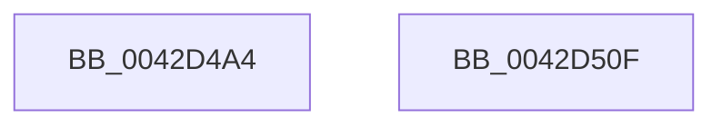

# HalpSetClockAfterSleep

- RVA: `0x0042D4A4`–`0x0042D510` (길이 `108` bytes)
- VA: `0x000000014042D4A4`
- 실행 섹션: `.text`
- PDB 이름 있음: `예`; PDB Function 태그: `아니요`
- unwind 정보 RVA: `0x0005C788`
- 디코드: `50`개 명령, `108/108` bytes 표시
- 미해석 바이트: `0` (있으면 어셈블리에 `.byte`로 보존)

> 이 문서는 커널 이미지의 기계어와 PDB 기호를 분석해 생성했습니다. 4번과 5번은 함수 원형과 자료형을 바이너리 사용 방식에서 추정한 C 해석이며 원본 소스 복구 결과는 아닙니다.

## 1. Dependencies

- 직접 호출 지점: **2**; 고유 호출 대상: **2**
- 직접 호출자로 확인된 함수: **2**
- RIP 상대 이미지 참조: **2**

### Outgoing calls
- `0x0042D4A8` → [HalpAcquireCmosSpinLock](HalpAcquireCmosSpinLock_function_0042DEE8.md) (function, `0x0042DEE8`)
- `0x0042D505` → [HalpReleaseCmosSpinLock](HalpReleaseCmosSpinLock_function_0042DE04.md) (function, `0x0042DE04`)

### Direct callers
- [HalpDpPostReplace](../../pagelk/B5/HalpDpPostReplace_function_00B5FCD0.md) at `0x00B5FCF8`
- [HalpAcpiPostSleep](../../pagelk/B7/HalpAcpiPostSleep_function_00B79990.md) at `0x00B79B6E`

### Static image references
- `0x0042D4AD` → RVA `0x00FC1ADC` (`.data`; read)
- `0x0042D4CF` → RVA `0x00FC1ADD` (`.data`; read)

## 2. Other-region calls and transfers

- 다른 실행 섹션으로 향하는 call: **0**
- 별도 외부 분기/꼬리 이동을 확인하지 못했습니다.

## 3. Assembly (complete function range)

```asm
0042D4A4  48 83 EC 28                     sub rsp, 0x28
0042D4A8  E8 3B 0A 00 00                  call 0x14042dee8
0042D4AD  8A 0D 29 46 B9 00               mov cl, byte ptr [rip + 0xb94629]
0042D4B3  41 B9 70 00 00 00               mov r9d, 0x70
0042D4B9  90                              nop
0042D4BA  B0 0A                           mov al, 0xa
0042D4BC  41 8B D1                        mov edx, r9d
0042D4BF  EE                              out dx, al
0042D4C0  90                              nop
0042D4C1  45 8D 41 01                     lea r8d, [r9 + 1]
0042D4C5  90                              nop
0042D4C6  8A C1                           mov al, cl
0042D4C8  41 8B D0                        mov edx, r8d
0042D4CB  EE                              out dx, al
0042D4CC  90                              nop
0042D4CD  B0 0B                           mov al, 0xb
0042D4CF  8A 0D 08 46 B9 00               mov cl, byte ptr [rip + 0xb94608]
0042D4D5  41 8B D1                        mov edx, r9d
0042D4D8  90                              nop
0042D4D9  80 E1 DF                        and cl, 0xdf
0042D4DC  EE                              out dx, al
0042D4DD  90                              nop
0042D4DE  80 C9 02                        or cl, 2
0042D4E1  90                              nop
0042D4E2  8A C1                           mov al, cl
0042D4E4  41 8B D0                        mov edx, r8d
0042D4E7  EE                              out dx, al
0042D4E8  90                              nop
0042D4E9  B0 0C                           mov al, 0xc
0042D4EB  90                              nop
0042D4EC  41 8B D1                        mov edx, r9d
0042D4EF  EE                              out dx, al
0042D4F0  90                              nop
0042D4F1  41 8B D0                        mov edx, r8d
0042D4F4  90                              nop
0042D4F5  EC                              in al, dx
0042D4F6  90                              nop
0042D4F7  B0 0D                           mov al, 0xd
0042D4F9  90                              nop
0042D4FA  41 8B D1                        mov edx, r9d
0042D4FD  EE                              out dx, al
0042D4FE  90                              nop
0042D4FF  41 8B D0                        mov edx, r8d
0042D502  90                              nop
0042D503  EC                              in al, dx
0042D504  90                              nop
0042D505  E8 FA 08 00 00                  call 0x14042de04
0042D50A  48 83 C4 28                     add rsp, 0x28
0042D50E  C3                              ret
0042D50F  CC                              int3
```

## 4. C-style interpretation (structured pseudocode)

```c
__int64 __fastcall HalpSetClockAfterSleep(void)
{
    __int64 result;
    __int64 v_rsp;

    v_rsp = (v_rsp) - (40);
    result = HalpAcquireCmosSpinLock(a1, a2, a3, a4);
    a1 = (unsigned __int8)((*(unsigned __int8 *)(v_rip + 12142088)) & (223));
    a1 = (unsigned __int8)((a1) | (2));
    result = HalpReleaseCmosSpinLock(a1, (unsigned int)((unsigned int)(112 + 1)), 112 + 1, 112);
    v_rsp = (v_rsp) + (40);
    return result;
}
```

## 5. (Beta) C Style

```c
void HalpSetClockAfterSleep(void)
{
    int64_t result;
    int64_t local_rsp;

    local_rsp = (local_rsp) - (40);
    result = HalpAcquireCmosSpinLock(a1, a2, a3, a4);
    a1 = (uint8_t)((*(uint8_t *)(v_rip + 0xB94608)) & (223));
    a1 = (uint8_t)((a1) | (2));
    result = HalpReleaseCmosSpinLock(a1, (uint32_t)((uint32_t)(112 + 1)), 112 + 1, 112);
    local_rsp = (local_rsp) + (40);
    return result;
}
```

## 6. Execution-region graph

[열기: 2D/3D 그래프와 함수 탐색 컨트롤 패널](../../../control-panel.html?section=text&rva=0x0042D4A4&view=graph)

- 2D 그래프는 위에서 아래로 흐르고, 3D 그래프는 빈 공간을 드래그해 회전합니다. Shift+드래그는 이동, 휠은 확대·축소, 함수 노드 선택은 대상 보고서 이동입니다.

### Static fallback


