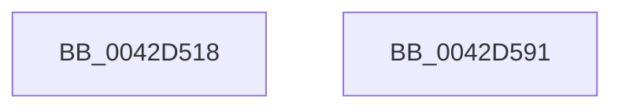

# HalpSetClockBeforeSleep

- RVA: `0x0042D518`–`0x0042D592` (길이 `122` bytes)
- VA: `0x000000014042D518`
- 실행 섹션: `.text`
- PDB 이름 있음: `예`; PDB Function 태그: `아니요`
- unwind 정보 RVA: `0x0005C788`
- 디코드: `59`개 명령, `122/122` bytes 표시
- 미해석 바이트: `0` (있으면 어셈블리에 `.byte`로 보존)

> 이 문서는 커널 이미지의 기계어와 PDB 기호를 분석해 생성했습니다. 4번과 5번은 함수 원형과 자료형을 바이너리 사용 방식에서 추정한 C 해석이며 원본 소스 복구 결과는 아닙니다.

## 1. Dependencies

- 직접 호출 지점: **2**; 고유 호출 대상: **2**
- 직접 호출자로 확인된 함수: **2**
- RIP 상대 이미지 참조: **2**

### Outgoing calls
- `0x0042D51C` → [HalpAcquireCmosSpinLock](HalpAcquireCmosSpinLock_function_0042DEE8.md) (function, `0x0042DEE8`)
- `0x0042D587` → [HalpReleaseCmosSpinLock](HalpReleaseCmosSpinLock_function_0042DE04.md) (function, `0x0042DE04`)

### Direct callers
- [HalpDpPreReplace](../../pagelk/B5/HalpDpPreReplace_function_00B5FF8C.md) at `0x00B6008D`
- [HalpAcpiPreSleep](../../pagelk/B7/HalpAcpiPreSleep_function_00B7BFD4.md) at `0x00B7C084`

### Static image references
- `0x0042D53C` → RVA `0x00FC1ADC` (`.data`; write)
- `0x0042D54F` → RVA `0x00FC1ADD` (`.data`; write)

## 2. Other-region calls and transfers

- 다른 실행 섹션으로 향하는 call: **0**
- 별도 외부 분기/꼬리 이동을 확인하지 못했습니다.

## 3. Assembly (complete function range)

```asm
0042D518  48 83 EC 28                     sub rsp, 0x28
0042D51C  E8 C7 09 00 00                  call 0x14042dee8
0042D521  90                              nop
0042D522  41 B9 70 00 00 00               mov r9d, 0x70
0042D528  B0 0A                           mov al, 0xa
0042D52A  41 8B D1                        mov edx, r9d
0042D52D  EE                              out dx, al
0042D52E  90                              nop
0042D52F  90                              nop
0042D530  45 8D 41 01                     lea r8d, [r9 + 1]
0042D534  41 8B D0                        mov edx, r8d
0042D537  EC                              in al, dx
0042D538  90                              nop
0042D539  41 8B D1                        mov edx, r9d
0042D53C  88 05 9A 45 B9 00               mov byte ptr [rip + 0xb9459a], al
0042D542  90                              nop
0042D543  B0 0B                           mov al, 0xb
0042D545  EE                              out dx, al
0042D546  90                              nop
0042D547  41 8B D0                        mov edx, r8d
0042D54A  90                              nop
0042D54B  EC                              in al, dx
0042D54C  90                              nop
0042D54D  8A C8                           mov cl, al
0042D54F  88 05 88 45 B9 00               mov byte ptr [rip + 0xb94588], al
0042D555  80 E1 BF                        and cl, 0xbf
0042D558  90                              nop
0042D559  B0 0B                           mov al, 0xb
0042D55B  41 8B D1                        mov edx, r9d
0042D55E  80 C9 02                        or cl, 2
0042D561  EE                              out dx, al
0042D562  90                              nop
0042D563  8A C1                           mov al, cl
0042D565  90                              nop
0042D566  41 8B D0                        mov edx, r8d
0042D569  EE                              out dx, al
0042D56A  90                              nop
0042D56B  B0 0C                           mov al, 0xc
0042D56D  90                              nop
0042D56E  41 8B D1                        mov edx, r9d
0042D571  EE                              out dx, al
0042D572  90                              nop
0042D573  41 8B D0                        mov edx, r8d
0042D576  90                              nop
0042D577  EC                              in al, dx
0042D578  90                              nop
0042D579  B0 0D                           mov al, 0xd
0042D57B  90                              nop
0042D57C  41 8B D1                        mov edx, r9d
0042D57F  EE                              out dx, al
0042D580  90                              nop
0042D581  41 8B D0                        mov edx, r8d
0042D584  90                              nop
0042D585  EC                              in al, dx
0042D586  90                              nop
0042D587  E8 78 08 00 00                  call 0x14042de04
0042D58C  48 83 C4 28                     add rsp, 0x28
0042D590  C3                              ret
0042D591  CC                              int3
```

## 4. C-style interpretation (structured pseudocode)

```c
__int64 __fastcall HalpSetClockBeforeSleep(void)
{
    __int64 result;
    __int64 v_rsp;

    v_rsp = (v_rsp) - (40);
    result = HalpAcquireCmosSpinLock(a1, a2, a3, a4);
    *(unsigned __int8 *)(v_rip + 12141978) = 10;
    *(unsigned __int8 *)(v_rip + 12141960) = 11;
    a1 = (unsigned __int8)((11) & (191));
    a1 = (unsigned __int8)((a1) | (2));
    result = HalpReleaseCmosSpinLock(a1, (unsigned int)((unsigned int)(112 + 1)), 112 + 1, 112);
    v_rsp = (v_rsp) + (40);
    return result;
}
```

## 5. (Beta) C Style

```c
void HalpSetClockBeforeSleep(void)
{
    int64_t result;
    int64_t local_rsp;

    local_rsp = (local_rsp) - (40);
    result = HalpAcquireCmosSpinLock(a1, a2, a3, a4);
    *(uint8_t *)(v_rip + 0xB9459A) = 10;
    *(uint8_t *)(v_rip + 0xB94588) = 11;
    a1 = (uint8_t)((11) & (191));
    a1 = (uint8_t)((a1) | (2));
    result = HalpReleaseCmosSpinLock(a1, (uint32_t)((uint32_t)(112 + 1)), 112 + 1, 112);
    local_rsp = (local_rsp) + (40);
    return result;
}
```

## 6. Execution-region graph

[열기: 2D/3D 그래프와 함수 탐색 컨트롤 패널](../../../control-panel.html?section=text&rva=0x0042D518&view=graph)

- 2D 그래프는 위에서 아래로 흐르고, 3D 그래프는 빈 공간을 드래그해 회전합니다. Shift+드래그는 이동, 휠은 확대·축소, 함수 노드 선택은 대상 보고서 이동입니다.

### Static fallback


