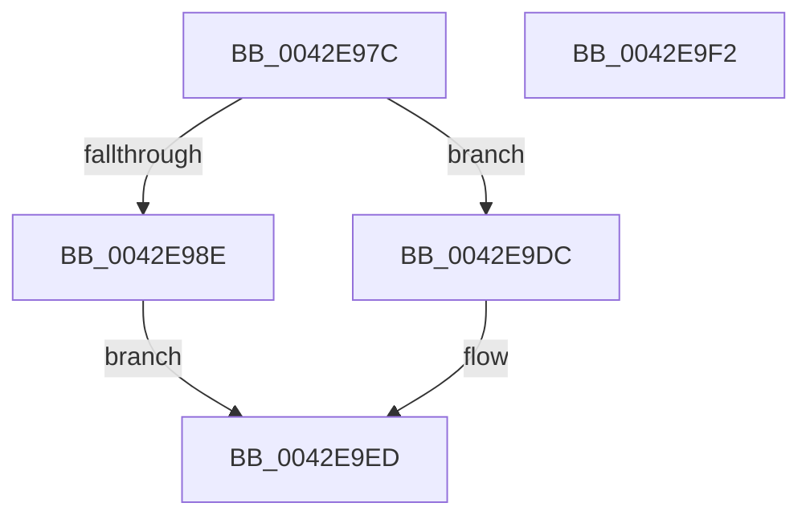

# HalpSetCmosCenturyByte

- RVA: `0x0042E97C`–`0x0042E9F3` (길이 `119` bytes)
- VA: `0x000000014042E97C`
- 실행 섹션: `.text`
- PDB 이름 있음: `예`; PDB Function 태그: `아니요`
- unwind 정보 RVA: `0x000DB714`
- 디코드: `55`개 명령, `119/119` bytes 표시
- 미해석 바이트: `0` (있으면 어셈블리에 `.byte`로 보존)

> 이 문서는 커널 이미지의 기계어와 PDB 기호를 분석해 생성했습니다. 4번과 5번은 함수 원형과 자료형을 바이너리 사용 방식에서 추정한 C 해석이며 원본 소스 복구 결과는 아닙니다.

## 1. Dependencies

- 직접 호출 지점: **0**; 고유 호출 대상: **0**
- 직접 호출자로 확인된 함수: **1**
- RIP 상대 이미지 참조: **1**

### Outgoing calls
- 직접 디코드된 call 명령이 없습니다.

### Direct callers
- [HalpWriteCmosTime](HalpWriteCmosTime_function_0042D598.md) at `0x0042D735`

### Static image references
- `0x0042E97C` → RVA `0x00FC1700` (`.data`; read)

## 2. Other-region calls and transfers

- 다른 실행 섹션으로 향하는 call: **0**
- 별도 외부 분기/꼬리 이동을 확인하지 못했습니다.

## 3. Assembly (complete function range)

```asm
0042E97C  44 8B 05 7D 2D B9 00            mov r8d, dword ptr [rip + 0xb92d7d]
0042E983  44 8A D1                        mov r10b, cl
0042E986  90                              nop
0042E987  41 0F BA E0 08                  bt r8d, 8
0042E98C  73 4E                           jae 0x14042e9dc
0042E98E  41 B9 70 00 00 00               mov r9d, 0x70
0042E994  B0 0A                           mov al, 0xa
0042E996  41 8B D1                        mov edx, r9d
0042E999  EE                              out dx, al
0042E99A  90                              nop
0042E99B  90                              nop
0042E99C  45 8D 41 01                     lea r8d, [r9 + 1]
0042E9A0  41 8B D0                        mov edx, r8d
0042E9A3  EC                              in al, dx
0042E9A4  90                              nop
0042E9A5  8A C8                           mov cl, al
0042E9A7  90                              nop
0042E9A8  B0 0A                           mov al, 0xa
0042E9AA  41 8B D1                        mov edx, r9d
0042E9AD  EE                              out dx, al
0042E9AE  90                              nop
0042E9AF  41 8B D0                        mov edx, r8d
0042E9B2  90                              nop
0042E9B3  8A C1                           mov al, cl
0042E9B5  0C 10                           or al, 0x10
0042E9B7  EE                              out dx, al
0042E9B8  90                              nop
0042E9B9  41 8B D1                        mov edx, r9d
0042E9BC  8A 05 3E 2D B9 00               mov al, byte ptr [rip + 0xb92d3e]
0042E9C2  90                              nop
0042E9C3  EE                              out dx, al
0042E9C4  90                              nop
0042E9C5  41 8B D0                        mov edx, r8d
0042E9C8  90                              nop
0042E9C9  41 8A C2                        mov al, r10b
0042E9CC  EE                              out dx, al
0042E9CD  90                              nop
0042E9CE  41 8B D1                        mov edx, r9d
0042E9D1  B0 0A                           mov al, 0xa
0042E9D3  90                              nop
0042E9D4  EE                              out dx, al
0042E9D5  41 8B D0                        mov edx, r8d
0042E9D8  8A C1                           mov al, cl
0042E9DA  EB 11                           jmp 0x14042e9ed
0042E9DC  BA 70 00 00 00                  mov edx, 0x70
0042E9E1  41 8A C0                        mov al, r8b
0042E9E4  EE                              out dx, al
0042E9E5  BA 71 00 00 00                  mov edx, 0x71
0042E9EA  41 8A C2                        mov al, r10b
0042E9ED  90                              nop
0042E9EE  90                              nop
0042E9EF  EE                              out dx, al
0042E9F0  90                              nop
0042E9F1  C3                              ret
0042E9F2  CC                              int3
```

## 4. C-style interpretation (structured pseudocode)

```c
__int64 __fastcall HalpSetCmosCenturyByte(unsigned __int8 a1)
{
    __int64 result;

    if (condition_is_above_or_equal) goto loc_0042E9DC;
    result = (unsigned __int8)((10) | (16));
    goto loc_0042E9ED;
loc_0042E9DC:
loc_0042E9ED:
    return a1;
}
```

## 5. (Beta) C Style

```c
int64_t HalpSetCmosCenturyByte(uint8_t Arg1)
{
    int64_t result;

    if (condition_is_above_or_equal) goto loc_0042E9DC;
    result = (uint8_t)((10) | (16));
    goto loc_0042E9ED;
loc_0042E9DC:
loc_0042E9ED:
    return Arg1;
}
```

## 6. Execution-region graph

[열기: 2D/3D 그래프와 함수 탐색 컨트롤 패널](../../../control-panel.html?section=text&rva=0x0042E97C&view=graph)

- 2D 그래프는 위에서 아래로 흐르고, 3D 그래프는 빈 공간을 드래그해 회전합니다. Shift+드래그는 이동, 휠은 확대·축소, 함수 노드 선택은 대상 보고서 이동입니다.

### Static fallback


